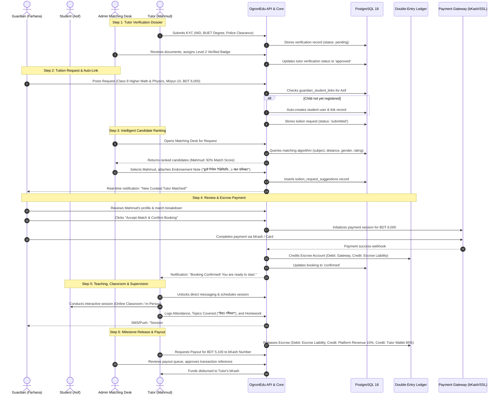

# OgroniEdu — Master 4-User Journeys & End-to-End System Flow Architecture

**Document Version:** 2.0.0  
**Last Updated:** October 2026  
**Status:** Approved & Implemented  
**Architecture Model:** Curated Request-First, Admin-Assisted Matching & Escrow-Protected Educational Platform  
**Target Region:** Bangladesh (All 8 Divisions, 64 Districts, 495+ Thanas)  
**Strict Domain Constraints:** 
- Gender options: Strictly `male` and `female` system-wide.
- Dynamic Academic Taxonomy: National Curriculum (Bangla & English Version), English Medium (Cambridge & Edexcel), Madrasah, University Admission, Technical & Skill Development.

---

## 1. Executive Architecture & Strategic Overview

### 1.1 The Strategic Shift: Why Curated Matching Replaced the Open Directory

In legacy tuition marketplaces, platforms operated as passive open directories where unvetted guardians contacted unvetted tutors directly. This resulted in four fatal platform failures:
1. **Platform Disintermediation (Leakage):** Users exchanged phone numbers and arranged off-platform offline deals, depriving the platform of revenue.
2. **Safety & Credential Fraud:** Unverified tutors used fake university credentials, posing severe safety risks to minor students.
3. **Severe Search Fatigue:** Guardians spent hours filtering through thousands of inactive profiles without knowing who was actually available or suitable.
4. **Payment Insecurity & Salary Defaults:** Tutors faced rampant non-payment after teaching for months, while guardians had no recourse if a tutor stopped showing up midway.

### 1.2 The OgroniEdu Curated Matching Paradigm

OgroniEdu operates as a **full-lifecycle, managed educational ecosystem**:

```
+---------------------------------------------------------------------------------------------------+
|                                  OGRONIEDU MANAGED PLATFORM                                       |
|                                                                                                   |
|  [GUARDIAN / STUDENT]                   [ADMIN MATCHING DESK]                    [VERIFIED TUTOR]  |
|  Posts Tuition Request ───────────────> Evaluates Requirements  <─────────────── Multi-Step KYC   |
|  Selects/Links Child                    Smart Algorithm Scoring                  Verified Dossier |
|                                         Curates Top Candidates                   Sets Availability|
|                                         Attaches Endorsements                                     |
|                                                    │                                              |
|                                                    ▼                                              |
|  Reviews Candidate Matches <──────────── Suggestion Pushed ────────────────────> Receives Invite  |
|  Inspects Score Breakdown                                                        Reviews Request  |
|                                                    │                                              |
|                                                    ▼                                              |
|  Accepts Candidate ───────────────────> Booking Confirmed <────────────────────> Accepts Match    |
|  Deposits Escrow Payment               (Held in Trust)                                            |
|                                                    │                                              |
|                                                    ▼                                              |
|  Monitors Attendance <──────────────── Classroom / In-Person ──────────────────> Conducts Class   |
|  Tracks Homework & Progress            Curriculum Milestones                     Marks Attendance |
|                                                    │                                              |
|                                                    ▼                                              |
|  Rate & Review Tutor ─────────────────> Milestone Settlement ──────────────────> Earnings Credited|
|  (30-Day Replacement Guarantee)         Platform Commission (15%)                Withdraws Payout |
+---------------------------------------------------------------------------------------------------+
```

---

## 2. Global System Lifecycle Flowcharts

### 2.1 Complete End-to-End Lifecycle (`flowchart TD`)

```mermaid
flowchart TD
    %% Roles Styling
    classDef guardian fill:#e0f2fe,stroke:#0284c7,stroke-width:2px,color:#0369a1;
    classDef student fill:#f3e8ff,stroke:#9333ea,stroke-width:2px,color:#6b21a8;
    classDef tutor fill:#fef3c7,stroke:#d97706,stroke-width:2px,color:#92400e;
    classDef admin fill:#dcfce7,stroke:#16a34a,stroke-width:2px,color:#15803d;
    classDef system fill:#f1f5f9,stroke:#64748b,stroke-width:2px,color:#334155;

    %% STAGE 1: ONBOARDING & VERIFICATION
    subgraph S1["1. Onboarding & Identity Verification"]
        G_Reg["Guardian Signs Up<br/>(Phone/Email + OTP)"]:::guardian
        T_Onb["Tutor Multi-Step Onboarding<br/>(Academics, KYC, NID, Student ID)"]:::tutor
        A_Ver["Admin Verification Desk<br/>(Inspects Dossier & Issues Badges)"]:::admin
        G_Child["Guardian Links/Creates Child<br/>(Asif Iqbal - Class 9)"]:::guardian

        T_Onb --> A_Ver
        G_Reg --> G_Child
    end

    %% STAGE 2: REQUEST & MATCHING
    subgraph S2["2. Tuition Request & Curated Matching"]
        G_Req["Post Tuition Request Wizard<br/>(Subject, Grade, Mode, Salary, Location)"]:::guardian
        Auto_Link{"Child Already Linked?"}:::system
        Auto_Create["System Auto-Provisions Child<br/>& Links to Guardian"]:::system
        Req_Queue["Tuition Request Active in Queue"]:::system
        Adm_Desk["Admin Matching Desk (Bento Grid)<br/>Algorithm ranks top tutors (90%+ Match)"]:::admin
        Adm_Sugg["Admin Sends Curated Suggestion<br/>+ Custom Endorsement Note"]:::admin

        G_Child --> G_Req
        G_Req --> Auto_Link
        Auto_Link -- No --> Auto_Create --> Req_Queue
        Auto_Link -- Yes --> Req_Queue
        Req_Queue --> Adm_Desk
        A_Ver -- Verified Active --> Adm_Desk
        Adm_Desk --> Adm_Sugg
    end

    %% STAGE 3: TRIAGE & BOOKING
    subgraph S3["3. Candidate Review & Escrow Booking"]
        G_Rev["Guardian Reviews Suggestion<br/>(Score Breakdown, Dossier, Note)"]:::guardian
        G_Acc{"Accept Match?"}:::guardian
        G_Decline["Guardian Requests Re-Match<br/>(Admin Triage)"]:::guardian
        Book_Init["Booking Created (Pending Payment)"]:::system
        Escrow_Pay["Guardian Deposits Escrow<br/>(bKash / Nagad / Card / SSLCommerz)"]:::guardian
        Ledger_Hold["Double-Entry Ledger:<br/>Funds Locked in Platform Escrow"]:::system

        Adm_Sugg --> G_Rev
        G_Rev --> G_Acc
        G_Acc -- No --> G_Decline --> Adm_Desk
        G_Acc -- Yes --> Book_Init
        Book_Init --> Escrow_Pay --> Ledger_Hold
    end

    %% STAGE 4: COLLABORATION & CLASSROOM
    subgraph S4["4. Interactive Learning & Supervision"]
        Chat_Unlock["Secure Messages Unlocked<br/>(Automated PII Filter Activated)"]:::system
        Class_Live["Classroom Session / In-Person Class<br/>(Whiteboard, Materials, Syllabus)"]:::student
        T_Attend["Tutor Marks Attendance<br/>& Submits Session Notes"]:::tutor
        G_Audit["Guardian Real-Time Oversight<br/>(Attendance, Pace, Homework)"]:::guardian

        Ledger_Hold --> Chat_Unlock
        Chat_Unlock --> Class_Live
        Class_Live --> T_Attend
        T_Attend --> G_Audit
    end

    %% STAGE 5: SETTLEMENT, REPLACEMENT & PAYOUT
    subgraph S5["5. Settlement, Trust & Payouts"]
        Satisfied{"Guardian Satisfied with Session/Month?"}:::guardian
        Replace_Claim["Claim 30-Day Replacement Guarantee<br/>or Open Dispute"]:::guardian
        Arb_Desk["Admin Dispute & Replacement Desk"]:::admin
        Auto_Settle["Milestone Completed:<br/>Escrow Release Triggered"]:::system
        Comm_Deduct["Platform Commission Deducted (15%)<br/>Net Credited to Tutor Wallet"]:::system
        T_Payout["Tutor Requests Payout<br/>(bKash / Nagad / Bank Transfer)"]:::tutor
        Fin_Approve["Finance Admin Approves & Dispatches Funds"]:::admin

        G_Audit --> Satisfied
        Satisfied -- Yes --> Auto_Settle
        Satisfied -- No --> Replace_Claim --> Arb_Desk
        Arb_Desk -- Re-Match --> Adm_Desk
        Auto_Settle --> Comm_Deduct --> T_Payout --> Fin_Approve
    end
```



---

### 2.2 Complete System Interaction (`sequenceDiagram`)



---

## 3. Comprehensive Role Journeys

---

### Journey 1: The Guardian Journey (A to Z)

**Target Persona:** Farhana Chowdhury, parent of Class 9 student Asif Iqbal in Mirpur, Dhaka.  
**Primary Goal:** Find a verified, high-scoring math & physics tutor, guarantee safe study conditions, and pay securely via platform escrow.

#### Canonical Route Map for Guardian
| Page / Route | Component / View | Purpose |
| :--- | :--- | :--- |
| `/[locale]/login` | `AuthModal` / `LoginPage` | Phone/Email + OTP Authentication |
| `/[locale]/dashboard/guardian` | `GuardianDashboardPage` | Overview: children, active tuitions, pending matches, billing |
| `/[locale]/dashboard/guardian/children` | `GuardianChildrenPage` | Manage linked children, academic details, institution |
| `/[locale]/request-tutor` | `RequestTutorWizard` | Dynamic Tuition Request Wizard (Child, Subject, Budget, Area) |
| `/[locale]/dashboard/guardian/requests` | `GuardianRequestsPage` | View active requests, inspect suggested tutors, accept/decline |
| `/[locale]/dashboard/guardian/requests/[id]` | `GuardianRequestDetailPage`| Deep-dive into single request, review tutor match scores & endorsements |
| `/[locale]/dashboard/guardian/sessions` | `GuardianSessionsPage` | Calendar schedule of upcoming and past tuition sessions |
| `/[locale]/dashboard/guardian/learning` | `GuardianLearningPage` | Progress tracking, homework audit, syllabus completion |
| `/[locale]/dashboard/guardian/messages` | `MessagingView` | In-app secure chat with tutors (anti-bypass protected) |
| `/[locale]/dashboard/guardian/payments` | `GuardianBillingPage` | Escrow transaction history, receipts, payment status |
| `/[locale]/dashboard/guardian/replacements` | `GuardianReplacementsPage` | 30-Day Tutor Replacement Guarantee request & status |
| `/[locale]/dashboard/guardian/safety-reports`| `SafetyReportModal` | Child safety SOS, emergency alerts, incident logging |

#### Detailed Stage-by-Stage Flow

```
[Register/Login] ──> [Add/Select Child] ──> [Post Request Wizard] ──> [Admin Suggests Tutor]
        │                                                                     │
[30-Day Guarantee] <── [Monitor Classes] <── [Escrow Payment] <── [Review & Accept]
```

1. **Registration & Profile Setup:**
   - Farhana registers using her mobile number (+88017XXXXXXXX).
   - Enters emergency contact, address (Dhaka -> Mirpur -> Mirpur-10), and sets preferred communication language (`bn` or `en`).
2. **Child Linking & Academic Profile:**
   - Navigates to `/dashboard/guardian/children`.
   - Adds Asif Iqbal (Class 9, Bangla Medium - National Curriculum, Mirpur Cantonment Public School).
   - *Note:* If she proceeds directly to `/request-tutor` without creating a child first, the wizard auto-provisions Asif and establishes the database relationship transparently.
3. **Submitting the Dynamic Tuition Request:**
   - Launches `/request-tutor`.
   - **Step 1:** Selects Asif Iqbal.
   - **Step 2:** Selects Curriculum: National Curriculum (Bangla Medium) -> Class 9 -> Subjects: Higher Mathematics, Physics.
   - **Step 3:** Specifies mode: `Offline (Home Tutoring)` at home in Mirpur-10; 3 days/week (Sun/Tue/Thu); 5:00 PM.
   - **Step 4:** Budget: BDT 6,000/month; Preferred Tutor Gender: `male` (or `female`); requirements: "BUET or DU student preferred".
   - Submits request. System sets status to `submitted`.
4. **Receiving & Reviewing Curated Matches:**
   - Farhana receives an instant SMS and notification: "OgroniEdu matching team suggested a top tutor for Asif!"
   - Opens `/dashboard/guardian/requests`.
   - Views Candidate Mahmudul Hasan:
     - **Match Score:** 92% (Location: 100%, Subject: 100%, Rating: 5.0, Education: 95%).
     - **Verification Badges:** NID Verified, BUET Student ID Verified.
     - **Admin Endorsement Note:** "মাহমুদ বুয়েট সিভিল ইঞ্জিনিয়ারিং ৩য় বর্ষের শিক্ষার্থী এবং গত ২ বছর ধরে নবম-দশম শ্রেণির গণিত পড়াচ্ছেন।"
5. **Acceptance & Escrow Funding:**
   - Farhana clicks **"Accept & Confirm Booking"**.
   - Redirection to checkout powered by SSLCommerz / bKash.
   - Farhana deposits 1 month's tuition fee (BDT 6,000). Funds are held in OgroniEdu platform escrow. No money is paid to the tutor upfront.
6. **Classroom Coordination & Supervision:**
   - In-app messaging unlocks. Farhana coordinates exact flat address and confirms start date.
   - Farhana tracks each session via `/dashboard/guardian/sessions`.
   - After each class, tutor marks attendance and logs homework. Farhana receives instant notification.
7. **Post-Tuition Rating & 30-Day Replacement Guarantee:**
   - After the first week or month, Farhana rates Mahmud (5 stars).
   - **Replacement Safety Net:** If within the first 30 days Farhana feels the tutor is unsuitable, she clicks **"Request Replacement"** (`/dashboard/guardian/replacements`). The admin matching desk immediately assigns a new tutor without any additional matching fee, transferring the escrow balance seamlessly.

---

### Journey 2: The Student Journey (A to Z)

**Target Persona:** Asif Iqbal, Class 9 student preparing for SSC examinations.  
**Primary Goal:** Attend scheduled lessons, access study resources, submit homework, and receive structured academic guidance.

#### Canonical Route Map for Student
| Page / Route | Component / View | Purpose |
| :--- | :--- | :--- |
| `/[locale]/dashboard/student` | `StudentDashboardPage` | Overview: upcoming classes, pending assignments, progress |
| `/[locale]/dashboard/student/learning` | `StudentStudyRoomPage` | Enrolled subjects, syllabus checklist, teacher notes, resources |
| `/[locale]/classroom/[bookingId]` | `ClassroomView` | Interactive WebRTC Live Classroom (Whiteboard, Screen Share, Chat) |
| `/[locale]/dashboard/student/sessions` | `StudentSessionsPage` | Class schedule, attendance log, session timings |
| `/[locale]/dashboard/student/messages` | `MessagingView` | Direct messaging with assigned tutor (monitored for safety) |
| `/[locale]/request-tutor` | `RequestTutorWizard` | Self-service tuition request (for independent college/university students) |
| `/[locale]/dashboard/student/requests` | `StudentRequestsPage` | Status of student-initiated tuition requests |

#### Detailed Stage-by-Stage Flow

```
[Guardian Linkage / Login] ──> [Study Room] ──> [Live Classroom / In-Person]
                                     │                         │
[Incident SOS Report] <──────── [Assignments] <───────── [Attendance Confirmed]
```

1. **Student Account Activation:**
   - Asif logs in using the credentials provisioned by his guardian (or pairing code).
   - His profile shows the minor safeguarding indicator, linking his activity to Farhana.
2. **Accessing the Study Room (`/dashboard/student/learning`):**
   - Asif sees his active tuition: "Class 9 Higher Mathematics & Physics with Tutor Mahmud".
   - Views syllabus outline, chapter milestones, and shared formula sheets/PDFs.
3. **Attending Live Sessions:**
   - For online tuitions: Asif clicks **"Enter Classroom"** (`/classroom/[bookingId]`).
   - WebRTC session starts with video/audio, teaching whiteboard, and code/math formula support.
   - For offline home tuitions: Mahmud arrives at home; Asif receives confirmation when Mahmud checks in.
4. **Homework & Assignment Workflow:**
   - Mahmud assigns 5 problems on Quadratic Equations.
   - Asif takes photos of his handwritten notebook and uploads them directly via the mobile web portal.
   - Mahmud grades the submission, leaving line-by-line feedback and tips for improvement.
5. **Safeguarding & Student Voice:**
   - Asif has access to a dedicated **Safety Report / SOS button** on every screen.
   - If any inappropriate behavior occurs, Asif can trigger an immediate alert that notifies both the guardian and the OgroniEdu Trust & Safety team.

---

### Journey 3: The Tutor Journey (A to Z)

**Target Persona:** Mahmudul Hasan, 3rd-year Civil Engineering student at BUET.  
**Primary Goal:** Find high-paying tuition jobs matching his schedule and commute, teach professionally, and receive guaranteed monthly payments without default.

#### Canonical Route Map for Tutor
| Page / Route | Component / View | Purpose |
| :--- | :--- | :--- |
| `/[locale]/tutor/onboarding` | `TutorOnboardingWizard` | 5-step registration: Academics, Verification Dossier, Subjects, Rates |
| `/[locale]/dashboard/tutor` | `TutorDashboardPage` | Overview: income, active tuitions, incoming invitations, schedule |
| `/[locale]/dashboard/tutor/verification` | `TutorVerificationStatus` | Track NID, Student ID, and background verification status |
| `/[locale]/tuitions` | `TuitionJobBoardPage` | Public & verified Job Board: browse tuition requests across Bangladesh |
| `/[locale]/dashboard/tutor/requests` | `TutorJobInvitationsPage` | Direct nominations from Admin Matching Desk; Accept / Decline |
| `/[locale]/dashboard/tutor/sessions` | `TutorSchedulePage` | Calendar timetable, upcoming sessions, reschedule tool |
| `/[locale]/dashboard/tutor/learning` | `TutorLearningManagement` | Upload syllabus, assign homework, record session topics |
| `/[locale]/classroom/[bookingId]` | `TutorClassroomView` | Host live interactive WebRTC classes with canvas whiteboard |
| `/[locale]/dashboard/tutor/payments` | `TutorEarningsPage` | Wallet balance, escrow release timeline, payout requests (bKash/Nagad) |
| `/[locale]/dashboard/tutor/profile` | `TutorProfileSettingsPage` | Edit headline, bio, subjects taught, preferred tuition districts/thanas |

#### Detailed Stage-by-Stage Flow

```
[5-Step Onboarding] ──> [Upload Dossier] ──> [Admin KYC Approval]
                                                    │
[Withdraw Payout] <── [Teach & Log Attendance] <── [Accept Matching Invite]
```

1. **Multi-Step Onboarding & Dossier Submission:**
   - Mahmud signs up at `/[locale]/tutor/onboarding`.
   - **Step 1 (Personal Info):** Name, phone, gender (`male`), current residence (Dhaka, Lalbagh / Palashi).
   - **Step 2 (Academic Credentials):** Institution: BUET, Department: Civil Engineering, Degree: B.Sc. Engineering, Passing Year: 2027, HSC: Notre Dame College (GPA 5.00).
   - **Step 3 (Teaching Expertise):** Subjects: Physics, Higher Math, General Math; Classes: Class 8, Class 9, Class 10; Curricula: Bangla Medium, English Version.
   - **Step 4 (Verification Uploads):** Uploads national NID card (front/back), BUET Student ID card, and latest semester grade sheet.
   - **Step 5 (Preferences & Rates):** Hourly Rate: BDT 500/hr, Monthly Expected: BDT 6,000–8,000; Preferred Areas: Mirpur, Dhanmondi, Azimpur.
2. **Admin Verification & Badge Issuance:**
   - Admin verifies documents against national databases.
   - Mahmud is awarded **Level 2 Verified Tutor** shield on his profile.
3. **Receiving Matching Nominations & Applying:**
   - **Channel A (Curated Admin Suggestion):** Admin matches Mahmud to Farhana's request for Asif. Mahmud receives an alert: "You have been nominated for a Class 9 Higher Math tuition in Mirpur-10 (BDT 6,000/mo)".
   - Mahmud clicks **"Accept Nomination"**.
   - **Channel B (Tuition Job Board - `/tuitions`):** Mahmud can also browse verified public requests, filter by Dhaka -> Mirpur, and submit a proposal pitch with his expected salary.
4. **Booking Confirmation & Class Routine:**
   - Farhana accepts and funds the escrow. Mahmud's dashboard updates to **Booking Active**.
   - Schedule locked: Sun / Tue / Thu at 5:00 PM.
5. **Class Delivery & Attendance Logging:**
   - Mahmud travels to Farhana's residence in Mirpur (or starts WebRTC classroom).
   - Conducts the 90-minute session.
   - Opens `/dashboard/tutor/sessions` on his phone, marks Asif **Present**, and enters session notes: "Covered Higher Math Chapter 3.1; assigned 5 homework problems".
6. **Automated Escrow Settlement & Payout:**
   - At the completion of the 1-month tuition cycle (12 sessions), the escrow releases automatically.
   - From BDT 6,000, platform fee (15% = BDT 900) is deducted; BDT 5,100 is credited to Mahmud's available wallet balance.
   - Mahmud requests payout to his personal bKash number (`017XXXXXXXX`).
   - Finance admin approves, and BDT 5,100 arrives directly in Mahmud's mobile wallet.

---

### Journey 4: The Administrator & Matching Desk Journey (A to Z)

**Target Persona:** OgroniEdu Operations Manager & Matching Specialist.  
**Primary Goal:** Maintain 100% verified tutor quality, rapidly match incoming guardian requests with optimal tutors, monitor financial escrow integrity, and arbitrate disputes.

#### Canonical Route Map for Admin
| Page / Route | Component / View | Purpose |
| :--- | :--- | :--- |
| `/[locale]/dashboard/admin` | `AdminDashboardPage` | Executive KPIs: GMV, Escrow Held, Active Tuitions, Open Requests |
| `/[locale]/dashboard/admin/tuition-requests` | `AdminTuitionRequestsPage` | Tuition Request Queue with filters (unassigned, suggested, booked) |
| `/[locale]/dashboard/admin/tuition-requests/[id]` | `AdminTuitionDetailPage` | **The Bento-Grid Matching Desk:** candidate matching algorithm, 1-click endorsements |
| `/[locale]/dashboard/admin/verification` | `AdminVerificationsPage` | Tutor KYC Audit: inspect NID, student ID, issue verification badges |
| `/[locale]/dashboard/admin/taxonomy` | `AdminTaxonomyPage` | Manage dynamic curriculum, grade levels, subjects, and topics |
| `/[locale]/dashboard/admin/finance` | `AdminFinancePage` | Real-time Double-Entry Ledger, platform revenue, escrow liabilities |
| `/[locale]/dashboard/admin/finance/payouts`| `AdminPayoutsPage` | Review and approve tutor withdrawal requests (bKash/Nagad/Bank) |
| `/[locale]/dashboard/admin/disputes` | `AdminDisputesPage` | Dispute mediation desk, refunds, partial settlements |
| `/[locale]/dashboard/admin/replacements` | `AdminReplacementsPage` | 30-Day Tutor Replacement Guarantee triage & re-assignment |
| `/[locale]/dashboard/admin/audit-logs` | `AdminAuditLogsPage` | Immutable audit log of all system changes, logins, and overrides |

#### Detailed Stage-by-Stage Flow

```
[KYC Verification Desk] ──> [Review Requests Queue] ──> [Bento-Grid Matching Desk]
                                                                  │
[Finance Payouts Desk] <── [Disputes & Replacements] <── [Push Endorsed Match]
```

1. **Tutor KYC Triage:**
   - Admin opens `/dashboard/admin/verification`.
   - Reviews Mahmud's uploaded BUET Student ID and NID card.
   - Verifies legitimacy, clicks **"Approve Level 2 Badge"**.
2. **Tuition Request Triage in the Matching Desk:**
   - Farhana's request arrives in `/dashboard/admin/tuition-requests`.
   - Admin opens `/dashboard/admin/tuition-requests/4edc821b-7c72-46b1-870f-1a556132677d`.
   - **Left Column (Student Persona Card):**
     - Student: Asif Iqbal (Class 9 - Bangla Medium).
     - Subjects: Higher Math, Physics.
     - Location: Mirpur-10, Dhaka.
     - Budget: BDT 6,000/mo. Preferred Tutor Gender: `male`.
   - **Right Column (Candidate Match Engine):**
     - Algorithm automatically queries the database and ranks registered tutors.
     - Filters applied: Gender = `male`, District = `Dhaka`, Subjects include `Higher Math` or `Physics`.
     - System calculates match score:
       - Subject match: 40 pts
       - Location proximity (Mirpur/Dhanmondi): 25 pts
       - Verification level (Level 2): 15 pts
       - Rating (5.0 / 5): 10 pts
       - Experience & Degree: 10 pts
     - Top Candidate displayed: **Mahmudul Hasan (92% Match Score)**.
3. **1-Click Endorsement & Dispatch:**
   - Admin clicks quick endorsement pill: `+ বুয়েট গ্র্যাজুয়েট ও অভিজ্ঞ শিক্ষক`.
   - Clicks **"Suggest This Tutor"**.
   - System instantly pushes the suggestion to Farhana's guardian portal.
4. **Financial Oversight & Double-Entry Ledger:**
   - Admin monitors platform escrow via `/dashboard/admin/finance`.
   - Every transaction is recorded using strict double-entry accounting:
     - Escrow Payment: `DR Cash/Gateway Asset`, `CR Guardian Escrow Liability`.
     - Milestone Release: `DR Guardian Escrow Liability`, `CR Tutor Payable Liability`, `CR Platform Revenue (15%)`.
     - Payout Settlement: `DR Tutor Payable Liability`, `CR Cash/Bank Asset`.
5. **30-Day Replacement & Trust Arbitration:**
   - If a guardian requests a tutor change under the 30-Day Replacement Guarantee, the request enters `/dashboard/admin/replacements`.
   - Admin reviews the reason, approves the replacement, and immediately re-opens the matching desk to assign a secondary high-match tutor, carrying over the escrow balance with zero loss to the guardian.

---

## 4. Complete System Route Matrix

| Route | Role Access | Description | Status |
| :--- | :--- | :--- | :--- |
| `/[locale]/` | Public | Homepage showcasing value proposition & guarantees | Active |
| `/[locale]/request-tutor` | Public / Guardian / Student | Dynamic 4-step Tuition Request Wizard | Active |
| `/[locale]/tuitions` | Public / Tutor | Verified Tuition Job Board | Active |
| `/[locale]/tutors` | Public | Auto-redirects to `/request-tutor` (curated model) | Active |
| `/[locale]/tutors/[id]` | Public / Guardian | Individual verified tutor credential profile | Active |
| `/[locale]/login` | Public | OTP / Password authentication modal & page | Active |
| `/[locale]/register` | Public | Role selection & sign up | Active |
| `/[locale]/tutor/onboarding` | Tutor | 5-step professional verification onboarding wizard | Active |
| `/[locale]/dashboard/guardian` | Guardian | Overview dashboard for guardians | Active |
| `/[locale]/dashboard/guardian/children` | Guardian | Manage children, academic baselines, and links | Active |
| `/[locale]/dashboard/guardian/requests` | Guardian | View requests, review matched tutors, accept/decline | Active |
| `/[locale]/dashboard/guardian/sessions` | Guardian | View calendar routine and attendance logs | Active |
| `/[locale]/dashboard/guardian/learning` | Guardian | Monitor assignments, homework, and syllabus pace | Active |
| `/[locale]/dashboard/guardian/messages` | Guardian | Secure in-app messaging with assigned tutors | Active |
| `/[locale]/dashboard/guardian/payments` | Guardian | Escrow transaction receipts and billing records | Active |
| `/[locale]/dashboard/guardian/replacements` | Guardian | 30-Day Replacement Guarantee claim desk | Active |
| `/[locale]/dashboard/student` | Student | Student dashboard overview | Active |
| `/[locale]/dashboard/student/learning` | Student | Digital study room, homework downloads, notes | Active |
| `/[locale]/classroom/[bookingId]` | Student / Tutor | Real-time WebRTC digital classroom & whiteboard | Active |
| `/[locale]/dashboard/student/sessions` | Student | Timetable, class attendance logs | Active |
| `/[locale]/dashboard/tutor` | Tutor | Tutor command center, upcoming classes, earnings | Active |
| `/[locale]/dashboard/tutor/requests` | Tutor | Review direct nominations from Admin Matching Desk | Active |
| `/[locale]/dashboard/tutor/sessions` | Tutor | Mark attendance, set lesson plans, reschedule | Active |
| `/[locale]/dashboard/tutor/payments` | Tutor | Wallet balance, settlement release, payout withdrawal | Active |
| `/[locale]/dashboard/admin` | Admin | Administrative KPI dashboard | Active |
| `/[locale]/dashboard/admin/tuition-requests` | Admin | Master tuition request queue | Active |
| `/[locale]/dashboard/admin/tuition-requests/[id]` | Admin | Bento-Grid Matching Desk with candidate scoring engine | Active |
| `/[locale]/dashboard/admin/verification` | Admin | Tutor KYC and credential verification triage | Active |
| `/[locale]/dashboard/admin/taxonomy` | Admin | Manage dynamic curricula, classes, subjects | Active |
| `/[locale]/dashboard/admin/finance` | Admin | Double-entry ledger audit, GMV, escrow liabilities | Active |
| `/[locale]/dashboard/admin/finance/payouts` | Admin | Payout approval and mobile wallet dispatches | Active |
| `/[locale]/dashboard/admin/disputes` | Admin | Payment dispute arbitration and refunds | Active |
| `/[locale]/dashboard/admin/replacements` | Admin | 30-Day Replacement Guarantee processing desk | Active |

---

## 5. Security, Anti-Bypass & Trust Mechanisms

### 5.1 Communication & Anti-Bypass Filter
To prevent off-platform poaching and ensure user safety:
- **Pre-Booking Protection:** Before an escrow deposit is confirmed, the messaging service (`booking-messages.service.ts`) automatically detects and redacts phone numbers, email addresses, external URLs, and social media handles (`facebook.com`, `t.me`, `whatsapp`).
- **Post-Booking Safe Messaging:** Once booking is confirmed and escrow is funded, contact sharing is permitted for logistics (exact building/flat number).

### 5.2 Escrow & Double-Entry Financial Protection
- **Zero Upfront Direct Payment:** Guardians never pay tutors directly before classes commence.
- **Milestone Settlement:** Funds remain safely locked in escrow until classes are delivered and attendance is logged.
- **Refund Guarantee:** If a tutor fails to show up or breaches standards, escrow funds are refunded to the guardian with zero friction.

### 5.3 30-Day Tutor Replacement Guarantee
- If a guardian is unsatisfied with a matched tutor's teaching methodology, punctuality, or rapport within the first 30 days:
  1. Guardian clicks **"Request Replacement"** in `/dashboard/guardian/replacements`.
  2. The Admin Matching Desk is alerted with highest priority.
  3. A new verified tutor is suggested within 24 hours.
  4. Any unused escrow balance transfers to the new tutor without any penalty or duplicate fee.

### 5.4 Minor Safeguarding & SOS Safety Protocol
- All student interactions are supervised by the linked guardian account.
- Guardians have read-only access to all tutor-student chat threads.
- Both student and guardian dashboards feature a prominent **Safety Alert / SOS** button that dispatches an immediate notification to OgroniEdu Trust & Safety admins and pauses active booking sessions pending investigation.

---

## 6. Audit & Deprecation Summary

As part of this transformation, the following legacy elements were audited and updated:
1. **Removed Direct Unverified Browsing:**
   - `/[locale]/tutors` now cleanly redirects to `/[locale]/request-tutor`.
   - Navigation links across Guardian, Student, and Public menus were updated from "Find Tutors" (`/tutors`) to "Request Tutor" (`/request-tutor`).
2. **Strict System Gender Uniformity:**
   - Ensured system-wide gender fields only support `'male'` and `'female'`.
   - Removed obsolete third-party options from onboarding and profile forms.
3. **Child Auto-Linking Engine:**
   - Resolved orphan tuition requests by automatically creating and linking student user records (`guardian_student_links`) whenever a guardian submits a request for a new child.
4. **Upgraded Matching Desk UI:**
   - Modern Bento-grid layout with high-contrast match score pills, collapsible match breakdown criteria, and 1-click endorsement note templates.
