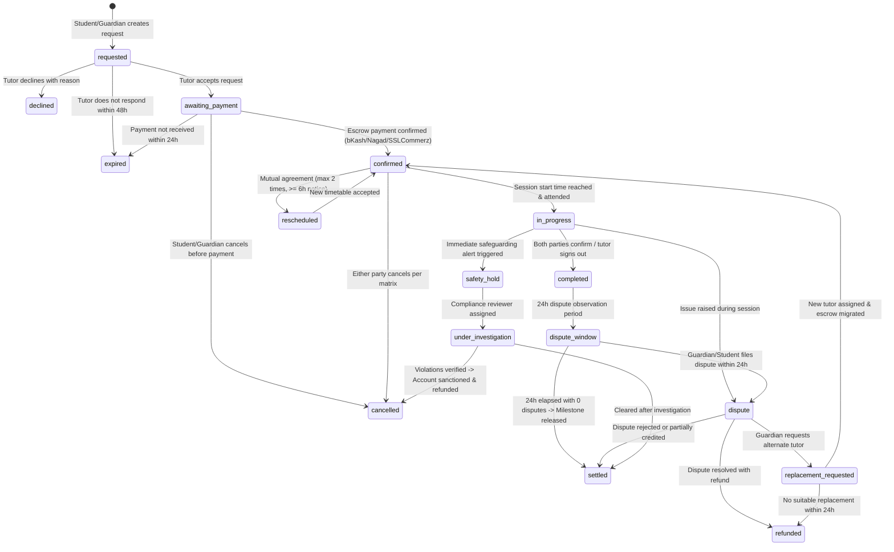

# OgroniEdu — Comprehensive Business Rules & Operational Policies

**Document Reference:** `docs/BUSINESS_RULES.md`  
**Last Updated:** 2026-10-22  
**Status:** Authoritative Operational Specification  
**Enforcement:** Application Layer (Services + Guards) + Database Layer (Constraints + Triggers)

---

## 1. Booking State Machine & Invariants

### 1.1 Complete State Machine

### 1.2 State Transition Invariants
1. **Financial Integrity:** A booking can NEVER enter `confirmed` status without a corresponding `TRANSACTION` record of type `ESCROW_HOLD` where `amount == total_booking_amount`.
2. **Double-Booking Prevention:** A tutor cannot accept a booking that overlaps with an existing `confirmed` or `in_progress` session slot (`SELECT 1 FROM sessions WHERE tutor_id = $1 AND tstzrange(start_time, end_time) && tstzrange($2, $3)`).
3. **Automatic Expiry (TTL):**
   - `requested` -> `expired` after exactly **48 hours** if tutor takes no action.
   - `awaiting_payment` -> `expired` after exactly **24 hours** if payment gateway webhook is not received.
4. **Outbox Event Guarantee:** Every booking transition MUST atomically emit a domain event (`booking.requested`, `booking.confirmed`, `booking.completed`, etc.) via the Transactional Outbox pattern within the same database transaction.

---

## 2. Cancellation & Refund Policy Matrix

| Initiating Party | Timing Before Session | Refund to Guardian / Student | Compensation to Tutor | Platform Fee | Operational Consequence |
|---|---|:---:|:---:|:---:|---|
| **Guardian / Student** | > 24 Hours | **100% Refund** (Original MFS/Card or Platform Credit) | 0% | Retained as platform credit | None; no penalty recorded |
| **Guardian / Student** | 4 – 24 Hours | **80% Refund** | 20% Base Compensation | Waived | Recorded in cancellation stats |
| **Guardian / Student** | < 4 Hours | **0% Refund** | 80% (Escrow released) | 20% Retained | Logged as short-notice cancellation |
| **Guardian / Student** | No-Show (> 15 mins late without notice) | **0% Refund** | 80% (Escrow released) | 20% Retained | Strike 1 recorded on student profile |
| **Tutor** | > 24 Hours | **100% Refund** + Free Reschedule Voucher | 0% | Fully waived | 1 reliability point deducted |
| **Tutor** | < 24 Hours | **100% Refund** + Priority Replacement | 0% | Fully waived | 3 reliability points deducted + Warning |
| **Tutor** | No-Show (> 15 mins late without notice) | **100% Refund** + Instant Tutor Replacement | 0% | Fully waived | Profile hidden + Compliance review |
| **Force Majeure / Outage** | Internet/Power/Platform Outage | **100% Refund** or Free Reschedule | 50% from Platform Reserve | Absorbed | System logged, no fault assigned |

---

## 3. Rescheduling & Timetable Shift Rules

1. **Advance Notice Requirement:** Rescheduling a confirmed session requires a minimum of **6 hours advance notice** prior to the scheduled start time.
2. **Frequency Cap:** A single booking agreement may be rescheduled a maximum of **2 times** across its entire lifecycle.
3. **Mutual Agreement:** A reschedule proposal must be accepted by the recipient party within 12 hours. If declined or expired, the original session time remains binding.
4. **Emergency Rescheduling:** If submitted under 6 hours due to verified medical or urgent circumstances, operations staff can manually override after reviewing submitted evidence.

---

## 4. Tutor Replacement Guarantee Policy

1. **Trial Session Guarantee:** If a guardian/student is dissatisfied with a newly assigned tutor following the first introductory trial session, they may request a replacement within **48 hours** of session completion with no penalty.
2. **SLA for Matching:** The platform operations team commits to presenting up to **2 alternative verified tutors** matching the same subject, class level, curriculum, and budget tier within **24 hours**.
3. **Escrow Continuity:** If the guardian accepts an alternative tutor, the unutilized escrow balance is transferred directly to the new booking with zero transaction fees.
4. **Unconditional Exit:** If no acceptable tutor is provided or accepted within 48 hours of filing, the guardian receives a **100% refund of the unutilized escrow balance** directly to their originating payment source within 3 business days.

---

## 5. Escrow & Double-Entry Financial Rules

### 5.1 Account Chart & Ledger Structure
The platform utilizes strict double-entry ledger bookkeeping where total debits MUST balance total credits at all times (`SUM(debit) == SUM(credit)`).

- `1001` — **Asset: Customer Escrow Cash** (Held at SSLCommerz / bKash merchant accounts)
- `2001` — **Liability: Escrow Deposits Payable** (Held on behalf of students/guardians)
- `2002` — **Liability: Tutor Balances Payable** (Earned tutor earnings pending withdrawal)
- `4001` — **Revenue: Platform Service Commission** (8% net platform take rate)
- `5001` — **Expense: Payment Gateway Processing Fees** (1.5% - 2.5% MFS fees)

### 5.2 Milestone Settlement Sequence
1. **Deposit Phase:** Guardian deposits BDT 5,000 for a 10-session package.
   - `DR 1001 (Customer Escrow Cash) BDT 5,000`
   - `CR 2001 (Escrow Deposits Payable) BDT 5,000`
2. **Session Completion Phase:** 1 session completed (BDT 500 value).
   - 24-hour dispute observation window commences.
   - If no dispute:
     - `DR 2001 (Escrow Deposits Payable) BDT 500`
     - `CR 2002 (Tutor Balances Payable) BDT 460` (92%)
     - `CR 4001 (Platform Commission) BDT 40` (8%)
3. **Tutor Payout Phase:** Tutor requests withdrawal of BDT 460 via bKash.
   - `DR 2002 (Tutor Balances Payable) BDT 460`
   - `CR 1001 (Customer Escrow Cash / Bank) BDT 460`

---

## 6. Safeguarding & Minor Protection Rules

1. **Mandatory Guardian Pairing for Minors:**
   - Any student registered with an age under **18 years** MUST have an active linked guardian before booking any paid tutoring session.
   - Guardians receive automated SMS and email notifications upon every booking creation, reschedule, and session completion.
2. **Automated Tutor Protective Hold:**
   - Filing a safety report tagged with severity `CRITICAL` or `HIGH` automatically places the reported tutor in **Protective Hold** (`is_suspended = true`, `availability = disabled`).
   - All upcoming sessions with the affected tutor are temporarily frozen without financial penalties.
3. **No Private Contact Exchange:**
   - Automated chat moderation filters scan all direct messages for phone numbers, WhatsApp links, and personal social handles.
   - Suspected bypass attempts are flagged for operations audit.
4. **Session Auditability:**
   - Digital whiteboard sessions log participant entry, exit timestamps, whiteboard canvas snapshot states, and chat logs for safeguarding compliance.
   - Whiteboard logs are securely retained for **180 days** for dispute and safeguarding arbitration.

---

## 7. Review & Rating Moderation Policy

1. **Double-Blind Submission:** Both student/guardian and tutor are prompted to submit feedback upon session completion. Reviews are only published publicly once either:
   - Both parties have submitted their ratings, or
   - 7 days have elapsed from session completion.
2. **Verified Purchase Only:** Reviews can only be submitted by users who have completed at least one paid session with the tutor.
3. **Zero Tampering Policy:** Tutors cannot delete, hide, or manipulate negative reviews. Tutors may submit one public, professional response per review.
4. **Dispute Immunity:** If a session is undergoing an active formal dispute or safeguarding investigation, review submission is suspended until final resolution.

---

## 8. Tutor Verification & Credential Tiers

| Tier Level | Name | Verification Requirement | Platform Privileges | Badge Rendered |
|:---:|---|---|---|---|
| **Tier 0** | Registered | Email & Phone OTP verified | Profile draft only; cannot receive bookings | None |
| **Tier 1** | ID Verified | Government NID / Smart Card verified via OCR + manual audit | Can receive direct booking requests | `Verified ID` (Blue Check) |
| **Tier 2** | Academically Verified | University Degree / Student ID / Transcript verified | Eligible for Tuition Job Board & Featured List | `Academic Verified` (Purple Check) |
| **Tier 3** | Top Rated & Vetted | > 50 sessions, > 4.8 rating, clean safeguarding record | Priority algorithmic ranking & guarantee shield | `Elite Verified` (Gold Badge) |

---

## 9. Security & Administrative Invariants

1. **Staff Impersonation Protocol:**
   - Super Admins can generate a 15-minute time-bound impersonation token to diagnose user issues.
   - Every single read and write performed during an impersonation session is logged in `audit_logs` with `is_impersonated = true`, `impersonator_id = admin_uuid`.
   - Impersonators CANNOT execute financial payouts or change user passwords.
2. **Rate Limiting:**
   - Authentication endpoints: 5 attempts per minute per IP.
   - Booking creation: 10 requests per hour per user.
   - Direct messaging: 30 messages per minute.
3. **Database Constraints:**
   - Foreign key cascading deletes are STRICTLY FORBIDDEN on financial, booking, and user audit tables (`ON DELETE RESTRICT`).
