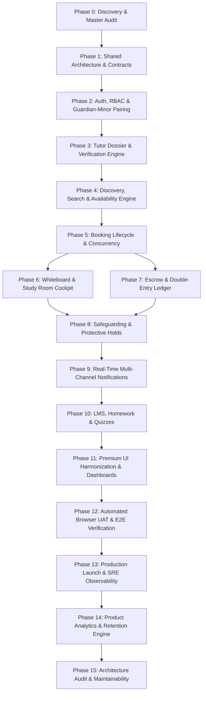

# OgroniEdu — Master Implementation Roadmap (Phases 0–15)

**Document Reference:** `docs/IMPLEMENTATION_ROADMAP.md`  
**Last Updated:** 2026-10-22  
**Status:** Authoritative Sequential Execution Roadmap  
**Execution Model:** Sequential, approval-driven quality engineering phases.

---

## 1. Roadmap Overview & Dependency Architecture

---

## 2. Phase-by-Phase Deliverables & Quality Gates

### Phase 0: Complete Repository Discovery and Product Audit (Current)
- **Goal:** Exhaustive audit answering 12 mandatory questions without altering application code or schema.
- **Key Deliverables:**
  - `docs/PRODUCT_AUDIT.md` (Detailed master audit report)
  - `docs/FEATURE_INVENTORY.md` (20 functional domains across 83 routes and 36 controllers)
  - `docs/USER_ROLE_MATRIX.md` (16-question lifecycle matrix across 9 roles)
  - `docs/ROUTE_AND_NAVIGATION_MAP.md` (All 83 frontend routes and access guards)
  - `docs/BUSINESS_RULES.md` (Comprehensive operational and financial rules)
  - `docs/KNOWN_ISSUES.md` (Prioritized P0–P3 defect backlog and risk register)
  - `docs/USER_JOURNEYS.md` (Narrative user journeys supporting diagrams)
  - `docs/IMPLEMENTATION_ROADMAP.md` (This master roadmap)
  - `docs/PHASE_STATUS.md` (Master phase tracker)
  - `docs/DECISION_LOG.md` (Architectural decision records)
  - `docs/TESTING_STRATEGY.md` (Quality gates and testing matrix)
  - `docs/REGRESSION_CHECKLIST.md` (Release regression verification checklist)
  - 9 Mermaid diagrams in `docs/diagrams/`
- **Quality Gate:** 1,175/1,175 automated tests passing; 0 TypeScript errors; 8/8 smoke test probes green; explicit user `next` command required before code edits.

---

### Phase 1: Shared System Architecture, Domain Models, and Contracts
- **Goal:** Unify DTOs, domain models, and validation schemas across monorepo packages.
- **Key Deliverables:**
  - Shared validation contracts in `packages/contracts`.
  - Type-safe API client schemas.
  - Zero schema drift between backend NestJS DTOs and frontend RTK Query endpoints.
- **Quality Gate:** `pnpm build` passes with zero type assertions (`as any`) in shared contracts.

---

### Phase 2: Authentication, Authorization, RBAC & Guardian-Minor Pairing
- **Goal:** Bulletproof identity management, 2FA, session security, and guardian-minor consent.
- **Key Deliverables:**
  - Phone OTP (+880) and Email login with Argon2id hashing.
  - HTTP-only refresh tokens with cryptographic rotation.
  - Guardian pairing token generation and consent verification.
  - Automated block on minor unlinking during active tuition cycles.
- **Quality Gate:** 100% auth test pass; zero privilege escalation in security unit tests.

---

### Phase 3: Tutor Profile, Multi-Tier Verification & Credential Dossier Engine
- **Goal:** Comprehensive tutor onboarding, verification workflow, and trust badges.
- **Key Deliverables:**
  - Tiered verification: NID (Tier 1), Academic Degrees (Tier 2), Police Background (Tier 3).
  - Admin verification queue with OCR data prefill.
  - Public badge rendering on tutor profile cards.
- **Quality Gate:** Upload virus scan validation; automated notification on review verdict.

---

### Phase 4: Tutor Discovery, High-Performance Search & Availability Engine
- **Goal:** Sub-100ms tutor search, faceted filtering, and weekly schedule management.
- **Key Deliverables:**
  - PostgreSQL `tsvector` full-text search with curriculum, district, and subject facets.
  - Weekly recurring availability grid with exception/blackout date picker.
  - Cache layer for public tutor listings.
- **Quality Gate:** Search query latency < 100ms under 10k mock tutor profiles.

---

### Phase 5: Booking Lifecycle, State Machine & Double-Booking Prevention
- **Goal:** Concurrency-safe booking engine and timetable scheduling.
- **Key Deliverables:**
  - PostgreSQL GiST exclusion lock preventing double-booking of tutor slots.
  - Complete state machine: `requested` -> `awaiting_payment` -> `confirmed` -> `completed` -> `dispute`.
  - Automated 48-hour request expiration and 24-hour payment TTL.
- **Quality Gate:** Concurrency stress test passes without double-booked overlapping slots.

---

### Phase 6: Interactive Classrooms, Digital Whiteboard & Study Room Cockpit
- **Goal:** Real-time collaborative teaching tools.
- **Key Deliverables:**
  - Socket.IO digital whiteboard with canvas stroke sync, shape tools, and PDF import.
  - Session check-in/check-out timestamp logging.
  - Virtual study room resource sharing and calendar.
- **Quality Gate:** Whiteboard canvas sync latency < 80ms over local network.

---

### Phase 7: Payments, Escrow Architecture & Double-Entry Financial Ledger
- **Goal:** Guaranteed escrow protection, platform commission, and automated payouts.
- **Key Deliverables:**
  - SSLCommerz and bKash payment gateway integration with IPN signature validation.
  - Double-entry ledger (`debits == credits`) recording escrow holds and milestone releases.
  - Bi-weekly tutor payout batch processing.
- **Quality Gate:** Financial balance query returns 0 discrepancy; idempotent webhook handling.

---

### Phase 8: Trust, Safety, Safeguarding & Emergency Intervention
- **Goal:** Child safety protection, chat contact masking, and rapid incident triage.
- **Key Deliverables:**
  - Automated protective hold placing reported tutors in temporary suspension.
  - Contact information filter masking phone numbers and WhatsApp links in chat.
  - Safeguarding incident dashboard for operations compliance staff.
- **Quality Gate:** High-severity safety report freezes tutor availability in < 1 second.

---

### Phase 9: Real-Time Multi-Channel Notification & Messaging Engine
- **Goal:** Omnichannel alerts across WebSockets, SMS, and Email.
- **Key Deliverables:**
  - BullMQ Redis queue for notification dispatch.
  - External SMS aggregator adapter (SSL Wireless / Greenweb).
  - Transactional email dispatch for password recovery and booking confirmations.
- **Quality Gate:** Fallback to in-app notification when external telco gateway fails.

---

### Phase 10: Learning Management System (LMS), Assignments & Quizzes
- **Goal:** Homework submission, automated quizzes, and student grade tracking.
- **Key Deliverables:**
  - Assignment upload with PDF/image viewer and tutor grading rubric.
  - Multiple-choice quiz engine with timer and instant grade calculation.
  - Academic progress reports generated for guardian visibility.
- **Quality Gate:** Student assignment submission and tutor grade notification loop verified.

---

### Phase 11: Enterprise Dashboards, Dynamic Charting & Premium UI Harmonization
- **Goal:** Premium user experience, system color palette harmonization, and fluid layouts.
- **Key Deliverables:**
  - Dynamic Recharts integration for student, guardian, tutor, and admin cockpits.
  - System gradient buttons and Shadcn UI dialog consistency.
  - Full-width fluid responsive container layouts for high-resolution screens.
- **Quality Gate:** Zero dark-mode / contrast regressions; responsive on mobile, tablet, and desktop.

---

### Phase 12: End-to-End User Acceptance Testing (UAT) & Automated Browser Testing
- **Goal:** Headful browser automated testing across all 5 core user journeys.
- **Key Deliverables:**
  - Automated Chrome DevTools browser journeys (Student, Guardian, Tutor, Admin).
  - Zero console errors, zero 4xx/5xx API failures during test navigation.
  - Comprehensive UAT verification report with screenshots.
- **Quality Gate:** 100% of critical paths pass end-to-end browser execution.

---

### Phase 13: Production Launch, Live Monitoring & Post-Launch Stabilization
- **Goal:** Production infrastructure setup, SSL, CDN, health checks, and alerting.
- **Key Deliverables:**
  - Production container build and deployment configuration.
  - Health check endpoints (`/api/health`, `/api/health/ready`, `/api/health/live`).
  - Sentry error monitoring and Prometheus/Grafana metrics.
- **Quality Gate:** Zero downtime deployment checklist verified; runbooks documented.

---

### Phase 14: Product Analytics, User Retention & Growth Optimization
- **Goal:** Privacy-conscious, evidence-based event analytics and funnel analysis.
- **Key Deliverables:**
  - First-party product analytics events table (`product_analytics_events`).
  - Booking conversion funnel, student retention cohorts, and tutor response times.
  - Admin analytics dashboard powered exclusively by real PostgreSQL data.
- **Quality Gate:** Zero fake statistics; analytics queries complete in < 250ms.

---

### Phase 15: Architecture Audit, Technical Debt Reduction & Long-Term Maintainability
- **Goal:** Continuous code quality, modularity, security posture, and clean architecture.
- **Key Deliverables:**
  - Monorepo package boundary cleanup and dependency pruning.
  - Removal of dead code, legacy styles, and deprecated endpoints.
  - Updated developer documentation and CI/CD quality gate enforcement.
- **Quality Gate:** 100% lint, typecheck, and unit test pass; zero high/critical vulnerabilities.
