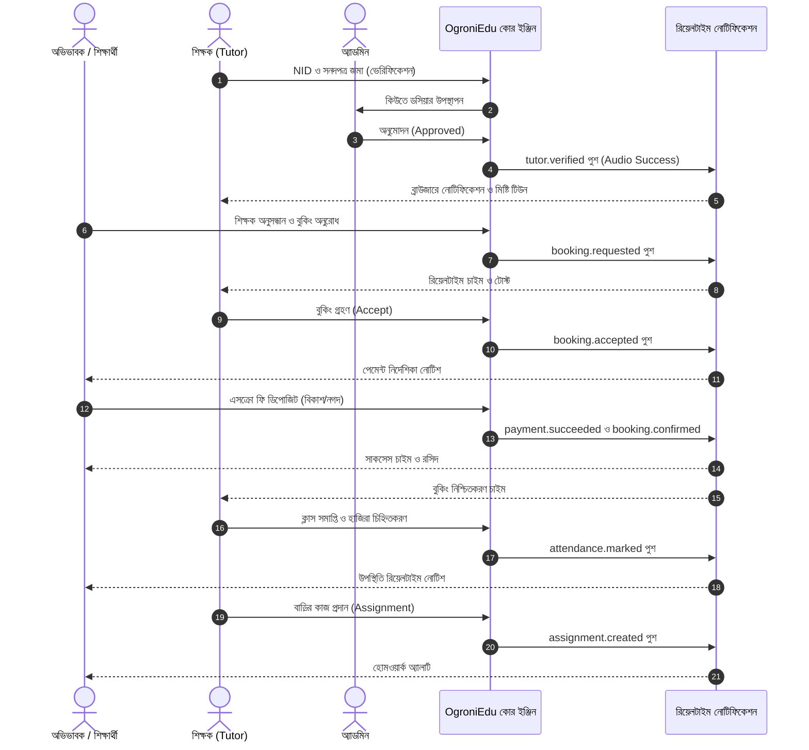

# OgroniEdu (অগ্রণী এডু) — প্ল্যাটফর্ম ফিচার তালিকা, ইউজার ফ্লো ও আর্কিটেকচার রোডম্যাপ

**নথি সংস্করণ:** 2.0.0 (Production Architecture & Feature Completion Standard)  
**অবস্থা:** সার্বিক প্ল্যাটফর্ম স্পেসিফিকেশন ও ইঞ্জিনিয়ারিং গাইডলাইন  
**প্রকল্প:** OgroniEdu — বিশ্বস্ত শিক্ষক ও শিক্ষার্থী প্ল্যাটফর্ম

---

## ১. প্ল্যাটফর্মের ভূমিকা ও মূল ব্যবহারকারী (Roles & Personas Matrix)

OgroniEdu একটি হাই-ট্রাস্ট, নিরাপদ এবং ডাবল-এন্ট্রি এসক্রো অ্যাকাউন্টিং ভিত্তিক শিক্ষামূলক মার্কেটপ্লেস। প্ল্যাটফর্মে ৯টি সুনির্দিষ্ট ভূমিকা (Roles) অনুমোদিত:

```
                                  ┌──────────────────────────────┐
                                  │      সুপার অ্যাডমিন (Super)   │
                                  └──────────────┬───────────────┘
                                                 │
                   ┌─────────────────────────────┼─────────────────────────────┐
                   ▼                             ▼                             ▼
       ┌───────────────────────┐    ┌────────────────────────┐    ┌────────────────────────┐
       │     অ্যাডমিন (Admin)    │    │ কমপ্লায়েন্স রিভিউয়ার  │    │      সাপোর্ট এজেন্ট     │
       └───────────────────────┘    └────────────────────────┘    └────────────────────────┘
                   │
    ┌──────────────┴──────────────┐
    ▼                             ▼
┌────────────────────────┐   ┌────────────────────────┐
│  প্রাতিষ্ঠানিক মালিক     │   │   প্রাতিষ্ঠানিক কর্মী   │
└────────────────────────┘   └────────────────────────┘
    │
    ├─────────────────────────────┬─────────────────────────────┐
    ▼                             ▼                             ▼
┌────────────────────────┐   ┌────────────────────────┐   ┌────────────────────────┐
│   শিক্ষক (Tutor)       │   │  অভিভাবক (Guardian)    │   │  শিক্ষার্থী (Student)  │
└────────────────────────┘   └────────────────────────┘   └────────────────────────┘
```

1. **শিক্ষার্থী (`student`)**:
   - যাচাইকৃত শিক্ষক অনুসন্ধান ও রিভিউ পর্যবেক্ষণ।
   - বুকিং অনুরোধ প্রেরণ এবং অভিভাবকদের সাথে সিঙ্ক করা।
   - লাইভ ক্লাস সেশন, ক্যালেন্ডার শিডিউল এবং অনলাইন মিটিংস।
   - বাড়ির কাজ (হোমওয়ার্ক) গ্রহণ, সমাধান আপলোড এবং গ্রেড ও শিক্ষকের ফিডব্যাক পর্যবেক্ষণ।
   - শিক্ষক বদল বা অসঙ্গতি হলে রিপ্লেসমেন্ট দাবি করা।

2. **অভিভাবক (`guardian`)**:
   - একাধিক সন্তানের জন্য আলাদা শিক্ষার্থী প্রোফাইল পরিচালনা (Multi-child oversight)।
   - বিকাশ, নগদ ও কার্ডের মাধ্যমে সুরক্ষিত এসক্রো পেমেন্ট ডিপোজিট।
   - সন্তানের ক্লাস উপস্থিতি, সেশন সমাপ্তি ও শিক্ষকের আচরণ নজরদারি।
   - ক্লাস যাচাইয়ের পর শিক্ষকের জন্য ফান্ড ছাড়করণ অনুমোদন।
   - যেকোনো অসদাচরণ বা অনুপস্থিতিতে ৪৮ ঘণ্টার শিক্ষক রিপ্লেসমেন্ট বা ১০০% রিফান্ড গ্যারান্টি দাবি।

3. **শিক্ষক (`tutor`)**:
   - ৩-স্তরের NID, শিক্ষাগত সনদ এবং প্রাতিষ্ঠানিক তথ্য জমা দিয়ে ভেরিফিকেশন আবেদন।
   - টিউশন বিষয়, এলাকা, পড়ানোর মাধ্যম (অনলাইন/অফলাইন) এবং ফি কনফিগারেশন।
   - বুকিং অনুরোধ গ্রহণ/বাতিলকরণ।
   - ক্লাসের সময়সূচি নির্ধারণ, সেশন পরিচালনা ও উপস্থিতি মার্কিং।
   - অ্যাসাইনমেন্ট তৈরি, শিক্ষার্থীদের জমা দেওয়া কাজ মূল্যায়ন এবং গ্রেডিং।
   - সমাপ্ত ক্লাসের অর্জিত পারিশ্রমিক উত্তোলন (Payout) ও স্টেটমেন্ট ট্র্যাকিং।

4. **অ্যাডমিনিস্ট্রেটর (`admin`)**:
   - শিক্ষক ভেরিফিকেশন কিউ (NID, সার্টিফিকেট ও ব্যাকগ্রাউন্ড) ডসিয়ার নিরীক্ষা ও অনুমোদন।
   - চলমান সকল বুকিং তদারকি ও প্রশাসনিক হস্তক্ষেপ (বাতিলকরণ ও এসক্রো রিভার্সাল)।
   - কাস্টমার অভিযোগ ও বিরোধ ট্রায়াজ নিষ্পত্তি।
   - অডিট ট্রেইল ও সিস্টেম ইভেন্ট পর্যবেক্ষণ।

5. **সুপার অ্যাডমিন (`super_admin`)**:
   - সার্বিক প্ল্যাটফর্ম কনফিগারেশন ও ক্যানারি ফিচার ফ্ল্যাগ (Emergency Maintenance, Match Mode)।
   - ব্যবহারকারীদের প্ল্যাটফর্ম রোল পরিবর্তন (সকল ৯টি রোলের অনুমোদন)।
   - জরুরি প্রোটোকলে ১৫-মিনিটের টাইম-বাউন্ড ইমপার্সনেশন সেশন (অপরিবর্তনীয় অডিট লগ সহ)।
   - ডাবল-এন্ট্রি ফাইন্যান্সিয়াল লেজার রিকনসিলিয়েশন ও সিস্টেম ব্যালেন্স অডিট।

6. **সাপোর্ট এজেন্ট (`support_agent`)**:
   - অভিভাবক ও শিক্ষকদের অভিযোগ ও সহায়তা টিকিট সমাধান।

7. **কমপ্লায়েন্স রিভিউয়ার (`compliance_reviewer`)**:
   - শিক্ষকদের পেশাগত সততা, ডকুমেন্টের সত্যতা এবং শিশু সুরক্ষা নিয়মাবলী নিশ্চিতকরণ।

8. **প্রাতিষ্ঠানিক মালিক ও কর্মী (`organization_owner`, `organization_staff`)**:
   - কোচিং সেন্টার ও শিক্ষাপ্রতিষ্ঠানের গ্রুপ ব্যাচ ও শিক্ষক টিম ব্যবস্থাপনা।

---

## ২. সামগ্রিক প্ল্যাটফর্ম ফিচার ও ইউজার ফ্লো (Feature Inventory & Flows)



### মডিউল ১: সেন্ট্রালাইজড রিয়েলটাইম নোটিফিকেশন ও অডিও অ্যালার্ট (Module 1 — ✅ সম্পন্ন)

- **উদ্দেশ্য**: প্রতিটি রোলের সকল গুরুত্বপূর্ণ কার্যক্রমে তাৎক্ষণিক নোটিফিকেশন ও মিষ্টি অডিও টোন বাজানো।
- **বাস্তবায়িত সুবিধাসমূহ**:
  - Web Audio API সিন্থেসাইজার (`notification-sound.ts`): হারমোনিক ৮৮০Hz + ১৩১৮Hz ডাবল বেল চাইম, ৩-পালস জরুরি অ্যালার্ট এবং ৪-নোট সাকসেস কর্ড।
  - নোটিফিকেশন সেন্টার ড্রয়ারে ভলিউম কন্ট্রোল ও "টেস্ট সাউন্ড" বাটন।
  - ক্যাটাগরি ফিল্টার: `সব`, `অপঠিত`, `বুকিং`, `শিক্ষা`, `পেমেন্ট`, `নিরাপত্তা`।
  - ডার্ক অবসিডিয়ান গ্লাস টোস্টে ৬ সেকেন্ডের কাউন্টডাউন প্রগ্রেস বার।
  - ২০টি সুনির্দিষ্ট সেন্ট্রালাইজড ইভেন্ট রেজিস্ট্রি।

### মডিউল ২: অথেন্টিকেশন, সেশন ও আরব্যাক সিকিউরিটি (Authentication & ABAC)

- **কাজের প্রবাহ**: ওটিপি/পাসওয়ার্ড ভিত্তিক দ্বি-স্তরীয় লগইন, JWT সাইনিং ও সেশন রিফ্রেশ, সেশন চলাকালীন স্বয়ংক্রিয় রোল ভ্যালিডেশন।
- **পরবর্তী উন্নয়ন**:
  - SMS গেটওয়ে ডেলিভারি ব্যর্থ হলে স্বয়ংক্রিয় হোয়াটসঅ্যাপ ওটিপি বিকল্প।
  - ডিভাইস ফিঙ্গারপ্রিন্টিং ও অস্বাভাবিক লোকেশন থেকে লগইনে অতিরিক্ত ভেরিফিকেশন।

### মডিউল ৩: শিক্ষক অনবোর্ডিং ও ৩-স্তর ভেরিফিকেশন (Tutor Verification)

- **কাজের প্রবাহ**: শিক্ষক NID নম্বর, শিক্ষাগত সনদ ও প্রাতিষ্ঠানিক তথ্য আপলোড করেন। অ্যাডমিন কিউতে ডসিয়ার রিভিউ করে অনুমোদন, অতিরিক্ত তথ্য চাওয়া অথবা বাতিল করেন।
- **পরবর্তী উন্নয়ন**:
  - জাতীয় পরিচয়পত্রের সাথে স্বয়ংক্রিয় OCR টেক্সট ম্যাচিং।
  - সনদপত্রের মেয়াদ শেষ হওয়ার আগে স্বয়ংক্রিয় রিমাইন্ডার ও নোটিফিকেশন।

### মডিউল ৪: শিক্ষক অনুসন্ধান ও রিপ্লেসমেন্ট গ্যারান্টি (Discovery & Matching)

- **কাজের প্রবাহ**: বিষয়, ক্লাস, এলাকা ও ফি অনুসারে ফিল্টারিং। শিক্ষক অনুপযুক্ত হলে ৪৮ ঘণ্টার মধ্যে নতুন বিকল্প শিক্ষক বা ১০০% ফি ফেরত গ্যারান্টি।
- **পরবর্তী উন্নয়ন**:
  - জিও-লোকেশন ভিত্তিক রেডিয়াস সার্চ (কাছাকাছি দূরত্বের শিক্ষক অগ্রাধিকার)।
  - এক ক্লিকে শিক্ষক রিপ্লেসমেন্ট কেস ফাইল মডাল।

### মডিউল ৫: টিউশন বুকিং ও বহু-সন্তান ব্যবস্থাপনা (Bookings & Guardianship)

- **কাজের প্রবাহ**: অভিভাবক একই অ্যাকাউন্ট থেকে একাধিক সন্তানের জন্য আলাদা শিক্ষক ও সময় বুক করতে পারেন। শিক্ষক বুকিং গ্রহণ করলে পেমেন্ট লিঙ্ক তৈরি হয়।
- **পরবর্তী উন্নয়ন**:
  - ক্যালেন্ডারে রিকারিং সাপ্তাহিক ক্লাস স্লট সিলেকশন।
  - অভিভাবক ও শিক্ষার্থীর ক্যালেন্ডার সিঙ্ক (Google / Apple Calendar iCal)।

### মডিউল ৬: এসক্রো পেমেন্ট ও ডাবল-এন্ট্রি লেজার (Escrow & Accounting)

- **কাজের প্রবাহ**: বিকাশ/নগদ/কার্ডের মাধ্যমে অভিভাবকের ফি এসক্রো অ্যাকাউন্টে জমা হয়। ক্লাস সম্পন্ন ও অভিভাবকের যাচাই শেষে শিক্ষককে পেমেন্ট ডিসবার্স করা হয়।
- **পরবর্তী উন্নয়ন**:
  - তাৎক্ষণিক বিকাশ টোকেনাইজড পেমেন্ট উইজেট।
  - স্বয়ংক্রিয় মাসিক ইনভয়েস ডাউনলোড (PDF ফরম্যাট)।

### মডিউল ৭: লার্নিং ম্যানেজমেন্ট ও অগ্রগতি ট্র্যাকিং (LMS)

- **কাজের প্রবাহ**: শিক্ষক সেশন শেষে হাজিরা চিহ্নিত করেন, বাড়ির কাজ দেন এবং গ্রেড প্রদান করেন। অভিভাবক শিক্ষার্থীর অগ্রগতি রিপোর্ট দেখতে পান।
- **পরবর্তী উন্নয়ন**:
  - সরাসরি ইন-ব্রাউজার হোয়াইটবোর্ড ও লাইভ অডিও-ভিডিও লিংক সংযুক্তি।
  - বাড়ির কাজের ছবিতে অ্যানোটেশন ও ফিডব্যাক টুল।

### মডিউল ৮: নিরাপত্তা ও শিশু সুরক্ষা (Child Safety & Trust)

- **কাজের প্রবাহ**: যেকোনো অসঙ্গতি, অসদাচরণ বা অনৈতিক বিষয়ে রিপোর্ট করা যায়। হাই-সিভিয়ারিটি রিপোর্ট সরাসরি অ্যাডমিনের জরুরি ট্রায়াজে চলে যায়।
- **পরবর্তী উন্নয়ন**:
  - চ্যাট মেসেজে স্বয়ংক্রিয় ফোন নম্বর ও বাহ্যিক পেমেন্ট লিংক রিডাকশন ফিল্টার (ইতিমধ্যে ব্যাকএন্ডে যুক্ত, ফ্রন্টএন্ড ওয়ার্নিং আরও উন্নত করা)।
  - একক বোতামে ইমার্জেন্সি এসওএস হেল্পলাইন নম্বর প্রদর্শন।

---

## ৩. সেন্ট্রালাইজড নোটিফিকেশন ইভেন্ট তালিকা (Notification Registry)

| নোটিফিকেশন ইভেন্ট (`eventType`) | ক্যাটাগরি  | প্রাপক রোল (`allowedRoles`)                 | অগ্রাধিকার | অডিও সুর          | কার্যপ্রণালী ও নেভিগেশন                                          |
| :------------------------------ | :--------- | :------------------------------------------ | :--------- | :---------------- | :--------------------------------------------------------------- |
| `booking.requested`             | `booking`  | `tutor`                                     | High       | চাইম (Chime)      | নতুন টিউশন অনুরোধ আসলে শিক্ষক পাবেন -> `/tutor/bookings/[id]`    |
| `booking.accepted`              | `booking`  | `guardian`, `student`                       | High       | চাইম (Chime)      | শিক্ষক বুকিং গ্রহণ করলে ফি পরিশোধের জন্য -> `/bookings/[id]/pay` |
| `booking.confirmed`             | `booking`  | `guardian`, `student`, `tutor`              | High       | সাকসেস (Success)  | ফি জমা হওয়ার পর বুকিং নিশ্চিত হলে -> `/bookings/[id]`            |
| `booking.cancelled`             | `booking`  | `guardian`, `student`, `tutor`              | Urgent     | অ্যালার্ট (Alert) | বুকিং বাতিল হলে তাৎক্ষণিক জরুরি বার্তা                           |
| `session.reminder`              | `booking`  | `guardian`, `student`, `tutor`              | Normal     | চাইম (Chime)      | ক্লাস শুরুর ৩০ মিনিট আগে সতর্কবার্তা -> `/sessions/[id]`         |
| `attendance.marked`             | `learning` | `guardian`, `student`                       | Normal     | চাইম (Chime)      | ক্লাসে উপস্থিতি/অনুপস্থিতি নোটিশ                                 |
| `assignment.created`            | `learning` | `student`, `guardian`                       | Normal     | চাইম (Chime)      | নতুন বাড়ির কাজ দেওয়া হলে -> `/assignments/[id]`                  |
| `assignment.submitted`          | `learning` | `tutor`                                     | Normal     | চাইম (Chime)      | শিক্ষার্থী কাজ জমা দিলে শিক্ষকের কাছে                            |
| `assignment.graded`             | `learning` | `student`, `guardian`                       | Normal     | সাকসেস (Success)  | বাড়ির কাজ মূল্যায়ন ও গ্রেড নোটিশ                                 |
| `payment.succeeded`             | `payment`  | `guardian`, `student`                       | High       | সাকসেস (Success)  | এসক্রো ফি সফলভাবে গৃহীত হলে রসিদ                                 |
| `payment.failed`                | `payment`  | `guardian`, `student`                       | Urgent     | অ্যালার্ট (Alert) | পেমেন্ট ফেইল করলে পুনরায় চেষ্টার নোটিশ                           |
| `refund.processed`              | `payment`  | `guardian`, `student`                       | High       | সাকসেস (Success)  | রিফান্ড সম্পন্ন হলে নোটিশ                                        |
| `tutor.verified`                | `trust`    | `tutor`                                     | High       | সাকসেস (Success)  | শিক্ষক প্রোফাইল ও সনদ অনুমোদিত হলে                               |
| `tutor.needs_information`       | `trust`    | `tutor`                                     | Urgent     | অ্যালার্ট (Alert) | সনদে অসঙ্গতি থাকলে অতিরিক্ত তথ্য চাওয়ার নোটিশ                    |
| `tutor.rejected`                | `trust`    | `tutor`                                     | Urgent     | অ্যালার্ট (Alert) | আবেদন বাতিল হলে কারণ ও পুনঃআবেদনের তথ্য                          |
| `safety.alert`                  | `trust`    | `admin`, `super_admin`, `guardian`          | Urgent     | অ্যালার্ট (Alert) | শিশু সুরক্ষা সংক্রান্ত অভিযোগ আসলে জরুরি অ্যালার্ট               |
| `tutor.replacement`             | `booking`  | `guardian`, `student`, `tutor`              | High       | চাইম (Chime)      | বিকল্প শিক্ষক খোঁজা ও রিপ্লেসমেন্ট আপডেট                         |
| `dispute.opened`                | `trust`    | `admin`, `super_admin`, `guardian`, `tutor` | High       | অ্যালার্ট (Alert) | বিরোধ বা অভিযোগ দায়ের হলে                                        |
| `chat.message`                  | `booking`  | `guardian`, `student`, `tutor`              | Normal     | চাইম (Chime)      | বুকিং চ্যাটে নতুন বার্তা আসলে                                    |
| `system.announcement`           | `system`   | সকল রোল                                     | Normal     | চাইম (Chime)      | প্ল্যাটফর্মের সাধারণ নোটিশ                                       |

---

## ৪. পরবর্তী ফিচার বাস্তবায়নের ধারাবাহিক কাজের পদ্ধতি (Step-by-Step Completion Rule)

প্রতিটি পরবর্তী মডিউলের জন্য নিম্নলিখিত ৭টি ধাপ কঠোরভাবে অনুসরণ করা হবে:

1. **কন্ট্রাক্ট ও DTO ডিজাইন**: `@ogroniedu/contracts`-এ কঠোর Zod/class-validator টাইপিং (জিরো `any`)।
2. **ব্যাকএন্ড সার্ভিস ও এন্টাইটি লজিক**: NestJS মডিউলে ডাবল-এন্ট্রি ও অডিট ট্রেইল সহ ব্যবসায়িক লজিক বাস্তবায়ন।
3. **ইউজার ইন্টারফেস ও ডেডিকেটেড পেজ**: প্রতিটি ফিচারের জন্য আলাদা, দৃষ্টিনন্দন ডার্ক-মোড ও রেসপন্সিভ পেজ।
4. **সেন্ট্রালাইজড নোটিফিকেশন লিঙ্কিং**: প্রতিটি কার্যক্রমে সংশ্লিষ্ট রোলের কাছে স্বয়ংক্রিয় নোটিফিকেশন ও অডিও অ্যালার্ট ট্র্যাকিং।
5. **দ্বিভাষিক লোকালাইজেশন**: বাংলা ও ইংরেজি উভয়েই ১০০% নির্ভুল অনুবাদের চাবি যুক্ত করা।
6. **টেস্ট স্যুট কভারেজ**: ইউনিট, ইন্টিগ্রেশন এবং নেগেটিভ টেস্ট নিশ্চিত করা।
7. **ব্রাউজার সাব-এজেন্ট ভেরিফিকেশন**: ব্রাউজারে স্বচক্ষে ক্লিক ও ইন্টারঅ্যাকশন পরীক্ষা করে স্ক্রিনশট সংগ্রহ।
