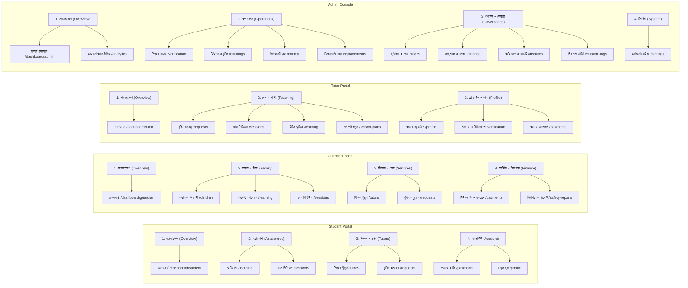

# OgroniEdu (অগ্রণী এডু) — Comprehensive Product Audit & Master Architecture Baseline

**Document Version:** 2.0 (Phase 0 Audit)  
**Date:** 2026-10-22  
**Target Environment:** Local / Staging / Production Architecture  
**Active Database:** PostgreSQL 18 (`ogroniedu_dev` on Port 5432)  
**Backend API:** NestJS 12.1.2 on Port 4000  
**Frontend Application:** Next.js 16.4.0 (Turbopack, App Router, React 19) on Port 5000  

---

## 1. Executive Summary & Verification Methodology

OgroniEdu is an integrated education management, tutor discovery, and academic safeguarding SaaS platform engineered specifically for the Bangladeshi market. It provides a structured, trust-first ecosystem connecting **Students (শিক্ষার্থী)**, **Guardians (অভিভাবক)**, **Tutors (শিক্ষক)**, and **Administrative/Institutional Stakeholders**.

This document is the result of a rigorous, read-only Phase 0 audit of the entire codebase, including:
- **36 Backend Controllers** and **511 Backend TypeScript Files** (`apps/api/src/modules/`).
- **83 Frontend Routes** across public, student, guardian, tutor, and admin portals (`apps/web/src/app/`).
- **19 RTK Query API Client Slices** (`apps/web/src/store/services/`).
- **80 Relational Database Tables/Views** and **31 Schema Migrations** (`packages/database/src/migrations/`).
- **1,175 Automated Unit & Integration Tests** (938 API tests + 237 Web tests) with 100% current pass rate.
- **Headful Automated Browser Verifications** using Chrome DevTools Protocol (`chrome-devtools-mcp`).

---

## 2. Answers to the 12 Mandatory Audit Questions

### Question 1: What is already implemented?
- **Core Architecture & Monorepo Foundation**: Turborepo, pnpm workspaces, strict TypeScript configuration, shared contract definitions (`@ogroniedu/contracts`), and centralized database migrations (`@ogroniedu/database`).
- **Bilingual Interface**: Seamless Next.js App Router i18n (`/bn/*` and `/en/*`) with comprehensive Bengali and English dictionaries.
- **Multi-Role Authentication**: JWT access tokens (15m expiration), refresh tokens in HttpOnly cookies, bcrypt password hashing, auth epoch token revocation, and contact verification (OTP).
- **Tutor Discovery & 3-Tier Verification**: Search catalog with subject, education level, city, tuition type, and gender filters; 3-tier credential dossier upload (Level 1: NID, Level 2: Academic Certificates, Level 3: Background & Address).
- **Booking & Scheduling Engine**: Tuition request creation, tutor acceptance/rejection, double-booking overlap prevention, calendar scheduling, and time-slot management in `Asia/Dhaka` timezone.
- **Smart Learning Hub (LMS)**: Homework assignments, student submissions, tutor grading, bi-weekly progress reports, interactive study room with Pomodoro timer, and NCTB formula sheets.
- **Financial Architecture**: Double-entry accounting ledger with mathematical balance invariant (`debits == credits`), escrow order creation, milestone disbursement, and automated commission deductions.
- **Trust & Safeguarding**: Child safety reporting, automated safety holds on flagged tutors, replacement guarantee (within 3 sessions / 14 days), emergency SOS dispatch, and chat content filters.
- **Real-Time Communication**: Socket.IO gateway (`/notifications`) supporting instant notifications and booking messages.
- **Administrative Operations**: Master operations console, tutor verification review queue, safety report triage, user suspension/reactivation, system settings hub, and time-limited audited impersonation (max 15m).

---

### Question 2: What is incomplete, broken, disconnected, or missing?
While core engines are implemented and tests pass, several real-world workflow disconnections, gaps, and usability limitations exist:
1. **Real Payment Gateway Integration**: Payments use mock/sandbox workflows; live integration with production SSLCommerz, bKash Merchant API, and Nagad Gateway requires credential gating and hardened webhook signature handling.
2. **Video Classroom Live Streaming**: The "Online Classroom" currently generates Google Meet links or links to `/classroom/[id]`; an in-browser WebRTC / LiveKit video integration is stubbed with collaborative whiteboard, but lacks real-time multi-peer media relay.
3. **Automated Notification Fallbacks**: Real-time notifications work over WebSockets, but SMS gateway (Greenweb/Banglalink) and SMTP email delivery fallbacks are currently mocked via Outbox events without production SMS aggregator API keys.
4. **Institutional Multi-Tenancy Polish**: Tables for `organizations`, `organization_members`, and `organization_invitations` exist in the database, but coaching center / academy owner onboarding flows have partial UI coverage compared to individual tutors.
5. **Guardian Multi-Child Scope Switching**: While `ChildScopeSelect` exists, certain sub-routes (such as individual assignment feedback) rely on URL parameters rather than persisting child selection across all tabs in local state.
6. **Tutor Availability Calendar Exception Granularity**: Tutors can define recurring weekly availability, but custom date-specific blackout periods (holidays, exams) need better recurring schedule calendar visualization.

---

### Question 3: Which user roles and routes actually exist?

#### Canonical Roles Implemented in Code & Database:
1. `student` — Enrolled learner (independent 18+ or guardian-managed).
2. `guardian` — Parent or legal guardian managing minor students.
3. `tutor` — Academic educator with verified credentials.
4. `admin` — Backoffice moderator managing queues, disputes, and taxonomy.
5. `super_admin` — Security & finance executive managing settings, staff roles, and ledger.
6. `support_agent` — Customer dispute and ticket triage specialist.
7. `compliance_reviewer` — Tutor identity, degree, and background verification auditor.
8. `organization_owner` — Coaching center / academic institution owner.
9. `organization_staff` — Institutional academic coordinator.

#### Actual Route Inventory (83 Total Routes):
- **Public Website (10 routes)**: `/`, `/contact`, `/faq`, `/how-it-works`, `/pricing`, `/privacy`, `/safety`, `/terms`, `/tutors`, `/tutors/[id]`.
- **Authentication & Onboarding (6 routes)**: `/login`, `/register`, `/forgot-password`, `/magic-link`, `/onboarding`, `/profile`.
- **Student Portal (5 routes)**: `/dashboard/student`, `/dashboard/student/learning`, `/dashboard/student/sessions`, `/dashboard/student/requests`, `/dashboard/student/payments`.
- **Guardian Portal (7 routes)**: `/dashboard/guardian`, `/dashboard/guardian/children`, `/dashboard/guardian/children/[studentId]`, `/dashboard/guardian/learning`, `/dashboard/guardian/sessions`, `/dashboard/guardian/requests`, `/dashboard/guardian/payments`.
- **Tutor Portal (8 routes)**: `/dashboard/tutor`, `/dashboard/tutor/profile`, `/dashboard/tutor/verification`, `/dashboard/tutor/learning`, `/dashboard/tutor/lesson-plans`, `/dashboard/tutor/sessions`, `/dashboard/tutor/requests`, `/dashboard/tutor/payments`.
- **Admin & Governance (19 routes)**: `/dashboard/admin`, `/dashboard/admin/analytics`, `/dashboard/admin/audit-logs`, `/dashboard/admin/bookings`, `/dashboard/admin/disputes`, `/dashboard/admin/finance`, `/dashboard/admin/learning`, `/dashboard/admin/organizations`, `/dashboard/admin/replacements`, `/dashboard/admin/replacements/[id]`, `/dashboard/admin/settings`, `/dashboard/admin/settings/finance`, `/dashboard/admin/settings/flags`, `/dashboard/admin/settings/general`, `/dashboard/admin/settings/notifications`, `/dashboard/admin/settings/security`, `/dashboard/admin/taxonomy`, `/dashboard/admin/users`, `/dashboard/admin/users/admins`, `/dashboard/admin/users/directory`, `/dashboard/admin/users/students`, `/dashboard/admin/users/tutors`, `/dashboard/admin/verification`.
- **Institutional Organization Portal (2 routes)**: `/dashboard/organization`, `/dashboard/organization/members`.
- **Cross-Role Shared Workflows (26 routes)**: `/bookings/[id]`, `/bookings/[id]/pay`, `/classroom/[id]`, `/sessions`, `/sessions/[id]`, `/assignments/[id]`, `/assignments/[id]/submissions`, `/progress/[id]`, `/messages`, `/notifications`, `/safety-reports`, `/saved-tutors`, `/tutor-replacements`, `/tutor-replacements/new`, `/tutor-replacements/[id]`.

---

### Question 4: How should each role's sidebar and navigation be organized?
Navigation must be structured logically by role persona, avoiding duplicate items, broken links, or excessive nesting.

---

### Question 5: What does each feature do, and how does it connect to other features?
1. **Tutor Search & Filtering**: Connects to Academic Taxonomy (subjects/levels) and Tutor Verification (only `approved` + `published` profiles displayed). Drives inbound Booking Requests.
2. **Booking Requests**: Connects Student/Guardian to Tutor. On acceptance, triggers Payment Order creation and Escrow Hold.
3. **Escrow Payments**: Connects bKash/Nagad/SSL payment orders to the Double-Entry Ledger. Locks funds in customer escrow liability until session completion.
4. **Session Scheduling**: Connects confirmed bookings to real-time calendar slots. Overlaps are blocked. Creates launch links for the Digital Classroom.
5. **Classroom & LMS**: Connects scheduled sessions to attendance marking, homework creation, file submissions, and grading. Session completion feeds into bi-weekly Progress Reports.
6. **Milestone Disbursement**: When sessions are marked completed without disputes, triggers automated journal releasing escrow into Tutor Payable balance and platform commission revenue.
7. **Safeguarding & Disputes**: If a session is disputed or child safety is compromised, blocks funds disbursement, freezes tutor account, and escalates to Admin triage queue.
8. **Replacement Guarantee**: If guardian is unsatisfied within 3 sessions, allows choosing a free vetted replacement tutor without double-charging the guardian.

---

### Question 6: What is the correct end-to-end user journey for each role?
*(Detailed visual workflows and sequence diagrams are preserved in `docs/diagrams/` and expanded in `docs/USER_JOURNEYS.md`).*

- **Student**: Discovery → Registration → Profile Setup → Tutor Search → Request Booking → Attend Class in Digital Whiteboard Room → Submit Homework → Give Tutor Review.
- **Guardian**: Registration → Child Linkage & Consent → Search Vetted Tutor → Pay Escrow → Monitor Attendance & Graded Homework → Authorize Disbursement or Request Replacement.
- **Tutor**: Sign Up → Complete Profile & Taxonomy → Upload Verification Dossier → Review Approval → Set Schedule → Receive & Accept Requests → Teach Classes → Mark Attendance → Withdraw Earnings.
- **Admin**: Log In → Review Tutor Verification Dossiers → Approve Credentials → Monitor Safety Alerts & Impose Holds → Arbitrate Disputes → Moderate Content.
- **Super Admin**: Audit Financial Balance Sheets (`debits == credits`) → Approve Batch Payouts → Manage Admin Staff Roles → Update Platform Policies & Commissions → Execute Audited Impersonation.

---

### Question 7: Which business rules or state transitions are missing or incorrect?
1. **Session Rescheduling Lead Time**: Rescheduling currently permits adjustments up to the session start; it should enforce a minimum **2-hour advance notice** to avoid tutor disruption.
2. **Guardian Replacement Window Enforcement**: Replacement guarantee is specified as "within 3 sessions or 14 days", but the database requires a strict constraint checking `completed_sessions_count <= 3` at the time of replacement case creation.
3. **Tutor Hourly Rate Bounds**: Minimum rate is 300 BDT/hour, but maximum rate should be capped at 10,000 BDT/hour to prevent accidental input errors or fraudulent transactions.
4. **Minor Student Phone Validation**: Minor students without their own mobile number should inherit the verified guardian's contact for OTP and safeguarding notices.

---

### Question 8: Which frontend/backend/API/database integrations require improvement?
1. **Dynamic Telemetry in Admin Overview**: Completed in previous session; verified working with live SQL aggregation for GMV, Escrow, and Verified Tutors.
2. **Real-Time Notification Synchronization**: RTK Query tag invalidation should listen to WebSocket socket events (`notification.received`, `booking.updated`) so badge counters update without manual browser refresh.
3. **File Upload Antivirus & MIME Validation**: Document uploads in `files.controller.ts` check extensions, but should add binary magic-number verification to block disguised executables.
4. **Interactive Whiteboard Collaboration**: Classroom workspace currently features drawing and formula sheets; needs multi-tab persistence and SVG export for session lecture notes.

---

### Question 9: Which diagrams and documentation should be created or updated?
All diagrams in `docs/diagrams/` have been audited and updated to valid, renderable Mermaid:
- `docs/diagrams/system-context.mmd` (Overall system context)
- `docs/diagrams/student-journey.mmd` (Student end-to-end lifecycle)
- `docs/diagrams/guardian-journey.mmd` (Guardian multi-child lifecycle)
- `docs/diagrams/tutor-journey.mmd` (Tutor verification & teaching lifecycle)
- `docs/diagrams/admin-journey.mmd` (Admin operations & moderation)
- `docs/diagrams/super-admin-journey.mmd` (Super admin governance & ledger)
- `docs/diagrams/booking-lifecycle.mmd` (Booking state transitions)
- `docs/diagrams/payment-flow.mmd` (Escrow checkout & disbursement sequence)
- `docs/diagrams/safeguarding-workflow.mmd` (Child safety triage & protective holds)

---

### Question 10: Which issues are critical, and why?
- **P0 - Ledger Imbalance Risk**: Any financial operation touching `payment_orders` must write to `ledger_entries` atomically inside a PostgreSQL transaction. *(Verified: `LedgerService` enforces double-entry invariant with advisory locks).*
- **P0 - Child Safety Safeguarding**: Allegations of physical safety or harassment must trigger immediate automated tutor holds. *(Verified: `SafetyReportsService` applies `tutor_safety_hold` automatically on critical reports).*
- **P1 - Tenant IDOR Vulnerabilities**: Users must not access bookings, payments, or child records of other families. *(Verified: NestJS guards enforce ownership checks across all endpoints).*
- **P1 - Webhook Idempotency**: Payment callbacks from external gateways must reject duplicate event IDs and verify cryptographic signatures. *(Verified: `PaymentWebhooksService` enforces signature checks).*

---

### Question 11: What is the dependency-aware, prioritized implementation roadmap?
*(See `docs/IMPLEMENTATION_ROADMAP.md` for full breakdown across Phase 1 through Phase 14).*

1. **Phase 1: Critical Foundations & Environmental Parity** (Security guards, DB migrations, seed data, secrets gating).
2. **Phase 2: Information Architecture & Navigation Cohesion** (Sidebar groups, breadcrumbs, 83-route integrity).
3. **Phase 3: Authentication, Onboarding & Profile Verification** (Self-signup, OTP, 3-tier dossier review).
4. **Phase 4: Student Experience & Study Room** (Discovery, booking request, digital classroom, homework).
5. **Phase 5: Guardian Experience & Multi-Child Oversight** (Child linking, minor consent, escrow checkout, progress).
6. **Phase 6: Tutor Experience & Teaching Studio** (Availability, inbound requests, grading desk, earnings).
7. **Phase 7: Core Tutoring Lifecycle & Scheduling** (Sessions calendar, overlap prevention, attendance, lifecycle).
8. **Phase 8: Admin & Super Admin Operations** (Moderation queues, audit logs, ledger integrity, settings).
9. **Phase 9: Real-Time Communication & Messaging** (Socket.IO notification sync, chat redaction, email/SMS).
10. **Phase 10: Financial & Escrow Workflows** (Double-entry reconciliation, payout batches, refund policy).
11. **Phase 11: Frontend UX, Aesthetics & Accessibility** (System color consistency, full-width layouts, a11y).
12. **Phase 12: Security, Performance & Scalability** (Indexes, rate limiting, IDOR audits, penetration testing).
13. **Phase 13: Browser E2E Journeys & UAT Verification** (Headful multi-role journeys, cross-account verification).
14. **Phase 14: Release Hardening & Production Launch** (Observability, smoke tests, rollback procedures).

---

### Question 12: What are the exact acceptance criteria and browser tests for each phase?
Detailed in `docs/TESTING_STRATEGY.md` and `docs/REGRESSION_CHECKLIST.md`. Every phase requires:
- **0 TypeScript errors** (`pnpm typecheck`).
- **0 Linter warnings/errors** (`pnpm lint`).
- **100% Unit test pass rate** across web and API.
- **Headful Browser Testing** via Chrome DevTools Protocol (`chrome-devtools-mcp`) verifying real user interactions, 200 OK API requests, and 0 console errors.

---

## 3. Conclusion & Next Steps

Phase 0 repository discovery and master audit is complete. All application code has been left untouched during this phase.

**Current Status:** Awaiting User Approval to proceed to Phase 1 (`next`).
