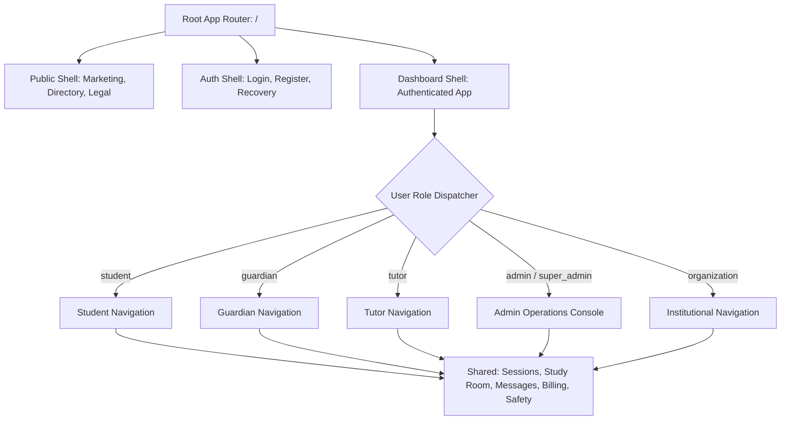

# OgroniEdu — Route & Navigation Architecture Map

**Last Updated:** 2026-10-22  
**Scope:** Complete frontend routing inventory, role-based access controls, navigation hierarchies, and client-server data bindings.  
**Platform Base URL:** `http://localhost:5000` (Web) | `http://localhost:4000/api/v1` (Backend API)

---

## 1. Executive Route Summary

The frontend application (`apps/web`, Next.js 16.4.0 App Router) exposes **83 registered route endpoints** partitioned into 8 functional tiers:

| Tier | Category | Route Count | Primary Shell / Layout | Primary Role Access |
|---|---|:---:|---|---|
| **Tier 1** | Public & Marketing | 10 | `(public)/layout.tsx` (Navbar + Footer) | Anonymous / All Users |
| **Tier 2** | Authentication & Onboarding | 6 | `(auth)/layout.tsx` (Split Hero Shell) | Anonymous / Unverified |
| **Tier 3** | Student Learning Cockpit | 5 | `dashboard/layout.tsx` (Student Sidebar) | `student` |
| **Tier 4** | Guardian Supervisory Portal | 7 | `dashboard/layout.tsx` (Guardian Sidebar) | `guardian` |
| **Tier 5** | Tutor Professional Studio | 8 | `dashboard/layout.tsx` (Tutor Sidebar) | `tutor` |
| **Tier 6** | Shared Cross-Role Portals | 26 | `dashboard/layout.tsx` (Contextual Sidebar) | All Authenticated Roles |
| **Tier 7** | Administration & Operations | 19 | `dashboard/layout.tsx` (Admin Sidebar) | `admin`, `super_admin`, Staff |
| **Tier 8** | Institutional & Enterprise | 2 | `dashboard/layout.tsx` (Org Sidebar) | `organization_owner`, Staff |
| **Total** | **All Application Routes** | **83** | — | — |

---

## 2. Global Navigation Architecture

---

## 3. Tier 1: Public & Marketing Routes (10 Routes)

These routes do not require authentication and are optimized for SEO, fast loading, responsive rendering, and conversion to registered users.

| Route Path | Page Title / Purpose | Navigation Item | Data Dependencies (API / RTK Query) | Responsive Layout Behavior |
|---|---|---|---|---|
| `/` | Platform Homepage & Hero | Top Navbar: Home | Static Hero + Dynamic Featured Tutors (`useGetPublicTutorsQuery`) | Mobile Hamburger, Hero quick search |
| `/tutors` | Tutor Directory & Search Engine | Top Navbar: Find Tutors | `useGetPublicTutorsQuery`, Filter State (Subjects, City, Curricula, Rate) | Collapsible filter drawer on mobile |
| `/tutors/[id]` | Tutor Public Profile & Booking | In-Directory CTA | `useGetPublicTutorByIdQuery`, `useGetTutorReviewsQuery` | Floating bottom booking bar on mobile |
| `/tuition-jobs` | Open Tuition Jobs Directory | Top Navbar: Tuition Jobs | `useGetPublicTuitionJobsQuery` | Infinite scroll or paginated cards |
| `/tuition-jobs/[id]` | Tuition Job Details | Job Board Item | `useGetPublicTuitionJobByIdQuery` | Sticky CTA to apply |
| `/about` | About OgroniEdu Mission | Footer: Company | Static Content | Responsive typography stack |
| `/contact` | Contact Support & Inquiries | Footer: Support | `useSubmitContactInquiryMutation` | 2-column form on desktop, single column on mobile |
| `/privacy` | Privacy & Safeguarding Policy | Footer: Legal | Static Legal Markdown | Readable 68ch max-width prose |
| `/terms` | Terms of Service & Escrow Rules | Footer: Legal | Static Legal Markdown | Readable 68ch max-width prose |
| `/faq` | Frequently Asked Questions | Footer: Support | Static Accordion | Expandable Shadcn accordion items |

---

## 4. Tier 2: Authentication & Onboarding Routes (6 Routes)

Protected against authenticated users (redirects to `/dashboard` if already logged in).

| Route Path | Form / Workflow | Route Guard | Backend API Endpoints | Security Controls |
|---|---|---|---|---|
| `/login` | Credentials & OTP Login | `GuestGuard` | `POST /auth/login`, `POST /auth/login-otp` | Rate limited (5/min), IP tracking |
| `/register` | Multi-Role Registration | `GuestGuard` | `POST /auth/register`, `POST /auth/send-verification-otp` | Role selection required, Terms checkbox |
| `/forgot-password` | Password Reset Request | `GuestGuard` | `POST /auth/forgot-password` | Opaque response (anti-enumeration) |
| `/reset-password` | Token-Based Password Reset | `GuestGuard` | `POST /auth/reset-password` | Single-use 15m crypto token |
| `/verify-email` | Email OTP / Token Verification | `GuestGuard` | `POST /auth/verify-email` | 6-digit expiring token |
| `/onboarding` | Profile Completion Wizard | `AuthGuard` | `PATCH /users/profile`, `POST /tutors/onboard` | Role-specific dynamic stepper |

---

## 5. Tier 3: Student Portal Routes (5 Dedicated Routes)

Dedicated student workspace for personal learning, homework submission, quizzes, and guardian relationship status.

| Route Path | Navigation Menu | Required Role | Primary RTK Query / API Bindings | Key Actions & Components |
|---|---|---|---|---|
| `/dashboard/student` | Sidebar: Overview | `student` | `useGetStudentCockpitQuery` | Quick stats, next session countdown, recent assignments |
| `/dashboard/student/learning` | Sidebar: My Courses | `student` | `useGetStudentEnrollmentsQuery` | Progress bars, curriculum tree, lesson launcher |
| `/dashboard/student/assignments` | Sidebar: Assignments | `student` | `useGetStudentAssignmentsQuery`, `useSubmitAssignmentMutation` | PDF upload, grading rubric, feedback viewer |
| `/dashboard/student/quizzes` | Sidebar: Quizzes | `student` | `useGetStudentQuizzesQuery`, `useSubmitQuizMutation` | Timed quiz engine, automated score cards |
| `/dashboard/student/guardian-link` | Sidebar: Guardian Link | `student` | `useGetStudentGuardianLinkQuery`, `useAcceptGuardianLinkMutation` | Pairing code verification, guardian consent status |

---

## 6. Tier 4: Guardian Supervisory Portal (7 Dedicated Routes)

Provides full academic and financial oversight over enrolled minors without interfering with tutor-student interactive spaces.

| Route Path | Navigation Menu | Required Role | Primary RTK Query / API Bindings | Key Actions & Components |
|---|---|---|---|---|
| `/dashboard/guardian` | Sidebar: Overview | `guardian` | `useGetGuardianCockpitQuery` | Child summary cards, billing summary, pending approvals |
| `/dashboard/guardian/children` | Sidebar: My Children | `guardian` | `useGetLinkedChildrenQuery` | Add child modal, individual attendance & report links |
| `/dashboard/guardian/link-student` | Button: Link New Child | `guardian` | `useInitiateChildLinkMutation` | Generate 6-digit link OTP, verify relationship |
| `/dashboard/guardian/academic-reports`| Sidebar: Academic Progress | `guardian` | `useGetChildAcademicReportsQuery` | Attendance charts, tutor notes, monthly report cards |
| `/dashboard/guardian/billing` | Sidebar: Tuition Billing | `guardian` | `useGetGuardianInvoicesQuery`, `usePayInvoiceMutation` | Escrow payments (bKash/Nagad/SSLCommerz), receipts |
| `/dashboard/guardian/approvals` | Sidebar: Approvals | `guardian` | `useGetPendingApprovalsQuery`, `useApproveBookingMutation` | Approve new booking requests, minor consent |
| `/dashboard/guardian/replacement-requests` | Sidebar: Replacement Claims | `guardian` | `useGetReplacementRequestsQuery`, `useCreateReplacementMutation` | Tutor replacement request wizard, refund claims |

---

## 7. Tier 5: Tutor Professional Studio (8 Dedicated Routes)

Tools for professional educators to manage availability, credentials, curriculum delivery, and financial earnings.

| Route Path | Navigation Menu | Required Role | Primary RTK Query / API Bindings | Key Actions & Components |
|---|---|---|---|---|
| `/dashboard/tutor` | Sidebar: Overview | `tutor` | `useGetTutorCockpitQuery` | Total earnings, pending bookings, today's schedule |
| `/dashboard/tutor/availability` | Sidebar: Availability | `tutor` | `useGetTutorAvailabilityQuery`, `useUpdateAvailabilityMutation` | Weekly recurring grid, timezone selector, blackout dates |
| `/dashboard/tutor/credentials` | Sidebar: Verifications | `tutor` | `useGetTutorDossierQuery`, `useUploadCredentialMutation` | NID, University Degree, Criminal Record, Status Badge |
| `/dashboard/tutor/earnings` | Sidebar: Earnings & Payout | `tutor` | `useGetTutorEarningsQuery`, `useRequestPayoutMutation` | Available balance, escrow locked, withdrawal requests |
| `/dashboard/tutor/assignments` | Sidebar: Homework Hub | `tutor` | `useGetTutorAssignmentsQuery`, `useGradeAssignmentMutation` | Create assignment, upload files, grade submissions |
| `/dashboard/tutor/quizzes` | Sidebar: Quizzes | `tutor` | `useGetTutorQuizzesQuery`, `useCreateQuizMutation` | Multiple-choice builder, automated grading settings |
| `/dashboard/tutor/lesson-notes` | Sidebar: Lesson Records | `tutor` | `useGetLessonNotesQuery`, `useSaveLessonNoteMutation` | Session logs, homework attachments, parent updates |
| `/dashboard/tutor/job-applications` | Sidebar: Job Applications | `tutor` | `useGetMyJobApplicationsQuery`, `useApplyJobMutation` | Proposals submitted, status tracker, chat launcher |

---

## 8. Tier 6: Shared Cross-Role Portals (26 Routes)

Available across student, guardian, tutor, and staff roles, with dynamic UI rendering adapted to the active role's security context.

| Route Path | Feature Domain | Applicable Roles | Key Data Bindings & Capabilities |
|---|---|---|---|
| `/dashboard` | Role Redirection Hub | All Authenticated | Evaluates `user.role` and redirects to `/dashboard/{role}` |
| `/dashboard/profile` | Personal Profile | All Authenticated | `useGetProfileQuery`, `useUpdateProfileMutation` |
| `/dashboard/security` | Credentials & Security | All Authenticated | Password change, 2FA setup, active sessions termination |
| `/dashboard/sessions` | Tutoring Sessions | `student`, `guardian`, `tutor` | Filter by status: `upcoming`, `completed`, `cancelled` |
| `/dashboard/sessions/[id]` | Session Detail Room | `student`, `guardian`, `tutor` | Meeting links, status actions, attendance logs |
| `/dashboard/sessions/[id]/whiteboard` | Live Collaborative Board | `student`, `tutor` | Canvas sync, PDF rendering, pen/text/shape tools |
| `/dashboard/study-room` | Digital Study Cockpit | `student`, `tutor`, `guardian` | Shared files, upcoming calendar, live audio room |
| `/dashboard/classes` | Class Schedule Matrix | `student`, `guardian`, `tutor` | Monthly/weekly schedule calendar |
| `/dashboard/schedule` | Timetable & Conflicts | `student`, `tutor` | Slot booking, rescheduling requests |
| `/dashboard/tuition-posts` | Tuition Postings | `guardian`, `student`, `tutor` | Post listing, status filtering |
| `/dashboard/tuition-posts/create` | Post Tuition Requirement | `guardian`, `student` | Multi-step requirement wizard with budget & curriculum |
| `/dashboard/tuition-posts/[id]` | Tuition Post Candidates | `guardian`, `student`, `tutor` | Candidate proposals, tutor profile inspection, offer CTAs |
| `/dashboard/courses` | Course Marketplace / LMS | All Authenticated | Enrolled courses, course catalog |
| `/dashboard/courses/[id]` | Course Learning Engine | All Authenticated | Video lessons, module navigation, completion tracking |
| `/dashboard/resources` | Shared Resource Repository | `student`, `tutor` | Download study guides, past papers, notes |
| `/dashboard/messages` | Direct Messaging Engine | `student`, `guardian`, `tutor`, Staff | Real-time chat, file attachments, conversation threads |
| `/dashboard/notifications` | Notifications Center | All Authenticated | Real-time alerts, mark as read, category filters |
| `/dashboard/payments` | Transactions & Invoices | `guardian`, `tutor` | Escrow ledger, transaction logs, downloadable PDF invoices |
| `/dashboard/billing` | Payment Methods & Billing | `guardian`, `tutor` | Saved cards/MFS, payout account settings |
| `/dashboard/feedback` | Reviews & Ratings | `student`, `guardian`, `tutor` | Post-session rating, double-blind review system |
| `/dashboard/disputes` | Dispute Claims | `guardian`, `tutor` | Active disputes list, filing date, resolution status |
| `/dashboard/disputes/[id]` | Dispute Resolution Chamber | `guardian`, `tutor`, `admin` | Evidence timeline, admin chat, resolution decree |
| `/dashboard/safety-reports` | Safeguarding Reporting | All Authenticated | Incidents reported, emergency contact directory |
| `/dashboard/safety-reports/[id]` | Safeguarding Case Detail | Reporting User, Staff | Case investigation progress, protective actions |
| `/dashboard/support` | Helpdesk & Knowledge Base | All Authenticated | Ticket submission, FAQ search, live support chat |
| `/dashboard/settings` | User Preferences | All Authenticated | Theme toggles (System/Light/Dark), Language, Email alerts |

---

## 9. Tier 7: Administration & Operations Console (19 Routes)

Exclusively accessible to users holding `admin`, `super_admin`, or specialized operations roles (`compliance_reviewer`, `support_agent`).

| Route Path | Administrative Domain | Required Role | Operations Capability |
|---|---|---|---|
| `/dashboard/admin` | Executive Overview | `admin`, `super_admin` | Platform health, revenue graphs, active sessions, dispute alerts |
| `/dashboard/admin/users` | User Registry | `admin`, `super_admin` | Ban/suspend accounts, role promotion, email verification overrides |
| `/dashboard/admin/verifications` | Tutor Dossier Queue | `admin`, `compliance_reviewer`| Inspect NID, degrees, approve/reject tutor badges with reasons |
| `/dashboard/admin/bookings` | Booking Operations | `admin`, `super_admin` | Global booking search, manual cancel, force-refund |
| `/dashboard/admin/financials` | Double-Entry Ledger | `super_admin` | Balance verification (`debits == credits`), commission fee tiers |
| `/dashboard/admin/payouts` | Tutor Payout Dispatch | `admin`, `super_admin` | Batch payout approval, bKash/bank transfer disbursement proofs |
| `/dashboard/admin/disputes` | Dispute Arbitration | `admin`, `super_admin` | Evidence inspection, escrow split verdicts, refund triggers |
| `/dashboard/admin/safety-reports` | Safeguarding Operations | `compliance_reviewer`, `admin`| Triage urgent reports, tutor protective holds, log case notes |
| `/dashboard/admin/tuition-posts` | Tuition Moderation | `admin`, `compliance_reviewer`| Moderate tuition jobs, reject spam or inappropriate postings |
| `/dashboard/admin/courses` | Course Management | `admin`, `super_admin` | Review submitted courses, publish/archive courses |
| `/dashboard/admin/subjects` | Taxonomy Management | `admin`, `super_admin` | Manage subjects, curriculum tiers (SSC/HSC/English Medium) |
| `/dashboard/admin/institutions` | B2B Institutional Roster | `super_admin` | Institutional client creation, contract settings |
| `/dashboard/admin/audit-logs` | Security Audit Trail | `super_admin` | Immutable log viewer with IP, user agent, actor ID, and action |
| `/dashboard/admin/analytics` | Product Analytics Suite | `admin`, `super_admin` | Retention cohorts, booking funnel drop-offs, churn rates |
| `/dashboard/admin/feature-flags` | Feature Flags Engine | `super_admin` | Enable/disable features globally or by user cohort |
| `/dashboard/admin/impersonation` | Audited Impersonation | `super_admin` | 15-minute audited impersonation token generator |
| `/dashboard/admin/system` | System Infrastructure | `super_admin` | Redis cache flush, queue latency check, DB connection pool health |
| `/dashboard/admin/settings` | Platform Constants | `super_admin` | Platform commission rate, cancellation windows, timeout intervals |
| `/dashboard/admin/support` | Support Ticket Desk | `support_agent`, `admin` | Triage user tickets, send official replies, escalate tickets |

---

## 10. Tier 8: Institutional & Enterprise Routes (2 Routes)

| Route Path | Navigation Menu | Required Role | Primary Capabilities |
|---|---|---|---|
| `/dashboard/organization` | Org Cockpit | `organization_owner`, `organization_staff` | Institution summary, active branches, seat allocations |
| `/dashboard/organization/members` | Member Directory | `organization_owner`, `organization_staff` | Add branch teachers, enroll bulk student cohorts, assign seats |

---

## 11. Navigation Components & Layout Mapping

### 11.1 Shell Hierarchy
1. **Public Marketing Shell** (`apps/web/src/app/(public)/layout.tsx`):
   - Sticky Top Navbar (`apps/web/src/components/layout/Navbar.tsx`) with dynamic session awareness.
   - Comprehensive Footer (`apps/web/src/components/layout/Footer.tsx`) with legal, trust, and directory links.
2. **Authentication Shell** (`apps/web/src/app/(auth)/layout.tsx`):
   - Two-column split layout: Left side with brand story, testimonials, and trust badges; Right side with focused form card.
3. **Application Dashboard Shell** (`apps/web/src/app/dashboard/layout.tsx`):
   - Left Sidebar Navigation (`apps/web/src/components/dashboard/Sidebar.tsx`) with role-filtered links.
   - Top Header Bar (`apps/web/src/components/dashboard/Header.tsx`) with breadcrumb trail, role switcher (if multi-role), global search, notification bell with unread badge, and user avatar dropdown menu.
   - Full-width content canvas with responsive horizontal padding.

### 11.2 Route Access Guard Implementation Matrix

| Guard Type | File Location | Enforcement Mechanism | Failure Redirect |
|---|---|---|---|
| `GuestGuard` | `apps/web/src/components/auth/GuestGuard.tsx` | Checks JWT / Session token in Redux auth state | `/dashboard` |
| `AuthGuard` | `apps/web/src/components/auth/AuthGuard.tsx` | Verifies valid JWT token; triggers refresh if expired | `/login?redirect={target}` |
| `RoleGuard` | `apps/web/src/components/auth/RoleGuard.tsx` | Verifies `user.role` is in `allowedRoles` array | `/dashboard` (or 403 Forbidden screen) |
| `AdminGuard`| `apps/web/src/components/auth/AdminGuard.tsx` | Strictly verifies `admin` or `super_admin` | `/dashboard` |
| `MinorGuard`| Embedded in Guardian/Student routing | Requires linked guardian verification for bookings if student age < 18 | Modal prompt to link guardian |
