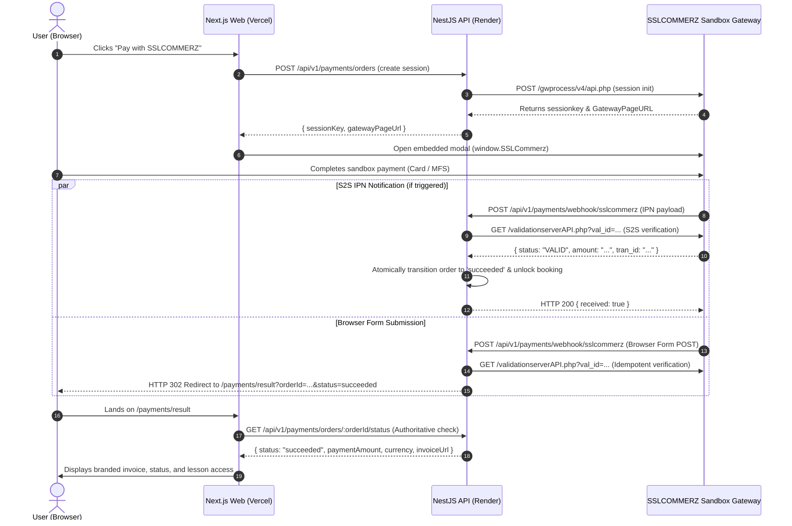

# OgroniEdu — SSLCOMMERZ Sandbox Setup and Deployment Guide

This document defines the configuration, verification steps, and operational procedures for running SSLCOMMERZ Embedded Easy Checkout in **Sandbox-only mode** for OgroniEdu.

The deployment topology consists of:
- **Frontend**: Next.js deployed on **Vercel** (`https://<project-name>.vercel.app`, e.g. `https://ogroniedu-web.vercel.app`).
- **Backend API**: NestJS deployed on **Render** (`https://<service-name>.onrender.com`, e.g. `https://ogroniedu-api.onrender.com`).
- **Payment Mode**: **Explicit Sandbox Only** (no Live merchant account or Live processing).

---

## 1. Sandbox Credentials and Environment Variables

> [!IMPORTANT]
> OgroniEdu operates strictly in **Sandbox mode**. All merchant credentials are sensitive and must remain exclusively on the server side in backend environment variables. Never expose `SSLCOMMERZ_STORE_PASSWD` to the frontend, browser bundles, git repositories, or client-side logs.

### Required Backend Environment Variables

In your Render backend dashboard or local `.env`:

```env
# SSLCOMMERZ Gateway Configuration (Sandbox Only)
SSLCOMMERZ_STORE_ID=your_sandbox_store_id
SSLCOMMERZ_STORE_PASSWD=your_sandbox_store_passwd
SSLCOMMERZ_IS_LIVE=false
SSLCOMMERZ_SESSION_URL=https://sandbox.sslcommerz.com/gwprocess/v4/api.php
SSLCOMMERZ_VALIDATION_URL=https://sandbox.sslcommerz.com/validator/api/validationserverAPI.php
```

### Safety Guarantees & Startup Validation

The NestJS backend (`SslcommerzSandboxAdapter`) enforces fail-closed initialization via `validateSandboxConfiguration()`:
1. **Accidental Live Mode Prevention**: If `SSLCOMMERZ_IS_LIVE` is set to `true`, backend startup throws a fatal `Error` preventing application launch.
2. **Endpoint Verification**: If `SSLCOMMERZ_SESSION_URL` or `SSLCOMMERZ_VALIDATION_URL` points to live servers (`securepay.sslcommerz.com`), startup throws a fatal `Error`.
3. **Missing Credential Guard**: Missing `SSLCOMMERZ_STORE_ID` or `SSLCOMMERZ_STORE_PASSWD` halts startup immediately.
4. **Credential Masking**: Startup logs only print a masked prefix (`storeId.slice(0, 4)***`) and never log passwords or secrets.
5. **No Automatic Fallback**: There is no dynamic switching between Live and Sandbox.

---

## 2. Vercel Frontend Configuration

The frontend is deployed to Vercel and requires only public client environment variables. No payment gateway secrets are installed on Vercel.

### Vercel Environment Variables (`.env.production` / Vercel Dashboard)

| Variable | Description | Example Value |
| :--- | :--- | :--- |
| `NODE_ENV` | Runtime environment | `production` |
| `NEXT_PUBLIC_APP_URL` | Public frontend URL on Vercel | `https://ogroniedu-web.vercel.app` |
| `NEXT_PUBLIC_API_URL` | Public Render backend API URL | `https://ogroniedu-api.onrender.com` |

### Script Loading Integrity

- The client checkout component (`EmbeddedEasyCheckout`) strictly loads `https://sandbox.sslcommerz.com/embed.min.js`.
- It loads asynchronously and attaches to `window.SSLCommerz`.
- If an ad-blocker or content blocker restricts script loading, the UI displays an in-app fallback enabling users to pay directly via an official SSLCOMMERZ popup/tab.

---

## 3. Render Backend Configuration

The backend is deployed as a Web Service on Render (`render.yaml` service `ogroniedu-api`).

### Render Environment Variables

```env
NODE_ENV=production
PORT=10000

# Public Render backend URL (used for dynamic callback resolution)
RENDER_EXTERNAL_URL=https://ogroniedu-api.onrender.com

# Frontend origin and CORS allowlist
FRONTEND_URL=https://ogroniedu-web.vercel.app
CORS_ORIGINS=https://ogroniedu-web.vercel.app

# SSLCOMMERZ Sandbox Configuration
SSLCOMMERZ_STORE_ID=your_sandbox_store_id
SSLCOMMERZ_STORE_PASSWD=your_sandbox_store_passwd
SSLCOMMERZ_IS_LIVE=false
SSLCOMMERZ_SESSION_URL=https://sandbox.sslcommerz.com/gwprocess/v4/api.php
SSLCOMMERZ_VALIDATION_URL=https://sandbox.sslcommerz.com/validator/api/validationserverAPI.php
```

### Dynamic Origin & Callback Resolution

1. **CORS Allowlist**: The backend dynamically permits calls from `FRONTEND_URL` and all `https://*.vercel.app` preview branches.
2. **Callback Base URL**: The adapter resolves callbacks using `RENDER_EXTERNAL_URL` (or `API_BASE_URL` locally). It validates the presence of an HTTPS scheme and strips trailing slashes to guarantee well-formed URLs.
3. **Browser Post-Payment Redirection**: When the customer finishes paying, the gateway sends a browser POST to Render. The backend responds with an HTTP 302/303 redirect to `${FRONTEND_URL}/${locale}/payments/result?orderId=...&status=...&bookingId=...`.

---

## 4. Sandbox API Endpoints

All payment lifecycle calls interact with official SSLCOMMERZ Sandbox endpoints:

| Action | Official Sandbox Endpoint | Protocol & Method |
| :--- | :--- | :--- |
| **Session Initiation** | `https://sandbox.sslcommerz.com/gwprocess/v4/api.php` | HTTPS `POST` (`application/x-www-form-urlencoded`) |
| **Order Validation (S2S)** | `https://sandbox.sslcommerz.com/validator/api/validationserverAPI.php` | HTTPS `GET` with `val_id`, `store_id`, `store_passwd`, `format=json` |
| **Embedded Client SDK** | `https://sandbox.sslcommerz.com/embed.min.js` | HTTPS Client Script |
| **Gateway Hosted Checkout** | `https://sandbox.sslcommerz.com/EasyCheckOut/<sessionkey>` | HTTPS Browser Page / Modal iframe |

---

## 5. Success, Failure, Cancellation, and IPN Configuration

The integration uses a unified, secure callback architecture.

### Unified Backend Webhook Endpoint

- **Path**: `POST /api/v1/payments/webhook/sslcommerz`
- **Public URL**: `https://<your-render-api>.onrender.com/api/v1/payments/webhook/sslcommerz`

### Dynamic Session Registration

When creating a payment order, OgroniEdu supplies the following parameters to SSLCOMMERZ:
- `success_url`: `https://<your-render-api>.onrender.com/api/v1/payments/webhook/sslcommerz`
- `fail_url`: `https://<your-render-api>.onrender.com/api/v1/payments/webhook/sslcommerz`
- `cancel_url`: `https://<your-render-api>.onrender.com/api/v1/payments/webhook/sslcommerz`
- `ipn_url`: `https://<your-render-api>.onrender.com/api/v1/payments/webhook/sslcommerz`

### Callback & IPN Execution Flow



---

## 6. Payment Validation Requirements

OgroniEdu follows zero-trust payment verification: **a payment is never marked successful simply because a browser returned or a query parameter contains `status=success`**.

### Authoritative S2S Order Validation

Upon receiving any payment callback or IPN containing a `val_id`:
1. The backend makes an authoritative server-to-server call to:
   ```text
   GET https://sandbox.sslcommerz.com/validator/api/validationserverAPI.php?val_id=<val_id>&store_id=<store_id>&store_passwd=<store_passwd>&format=json
   ```
2. **Verification Rules**:
   - **Status Check**: The validation response `status` must be `VALID` or `VALIDATED`.
   - **Transaction Match**: `tran_id` in the gateway response must match the database `PaymentOrder.id`.
   - **Currency Match**: `currency` must match the expected currency (`BDT`).
   - **Amount Integrity**: The paid `amount` returned by the gateway must match the expected payable amount on the order (tolerance `< 0.01 BDT`).
   - **Risk Assessment**: If `risk_level === '1'`, the transaction is flagged for inspection.

### Idempotency & Concurrency Guards

- **Webhook Deduplication**: Every webhook/IPN event is recorded in `WebhookEventEntity` with unique key `(provider, providerEventId)`. Duplicate deliveries return `HTTP 200 { duplicate: true }` without re-processing.
- **Pessimistic Locking**: `payment_orders` rows are locked with TypeORM `pessimistic_write` during transition to guarantee single execution even under concurrent browser return and IPN triggers.
- **Terminal State Immutability**: Once an order reaches `succeeded`, subsequent callbacks cannot regress its state.

---

## 7. Sandbox Payment Test Cases

Use the official SSLCOMMERZ Sandbox test instruments. **Never use real debit/credit cards or real MFS accounts in sandbox.**

### Official Test Cards

| Card Type | Card Number | Expiration Date | CVV / CVC | OTP | Expected Result |
| :--- | :--- | :--- | :--- | :--- | :--- |
| **Visa (Success)** | `4111111111111111` | Any future date (e.g. `12/28`) | `123` | Any 6 digits (`123456`) | Succeeded |
| **Mastercard (Success)** | `5105105105105100` | Any future date (e.g. `12/28`) | `123` | Any 6 digits (`123456`) | Succeeded |
| **Amex (Success)** | `371449635398431` | Any future date (e.g. `12/28`) | `1234` | Any 6 digits (`123456`) | Succeeded |
| **Declined / Failed Card** | `4000000000000002` | Any future date | `123` | N/A | Failed |

### Mobile Financial Services (bKash / Nagad / Rocket)

1. Select **bKash** / **Nagad** / **Rocket** in the sandbox checkout modal.
2. Enter any 11-digit mobile number (e.g., `01700000000`).
3. Enter mock OTP: `123456`.
4. Enter mock PIN: `12345`.
5. Gateway returns `VALID` status.

### 13 Mandatory Verification Test Scenarios

| # | Test Scenario | Trigger | Expected Outcome |
| :- | :--- | :--- | :--- |
| 1 | **Successful Card Payment** | Use test Visa card `4111...` | Order transitions to `succeeded`; booking confirmed; invoice rendered. |
| 2 | **Successful MFS Payment** | Select bKash with mock PIN `12345` | Order transitions to `succeeded`; balance credited to escrow. |
| 3 | **Failed Payment** | Use declined test card or reject auth | Order marked `failed`; descriptive safe error shown; retry button enabled. |
| 4 | **Cancelled Payment** | Click "Cancel" in gateway modal | Order marked `cancelled`; booking remains open; no charges recorded. |
| 5 | **Pending / Review Payment** | Bank marks status `PENDING` | Order remains `pending`; polling hook continues checking with backoff. |
| 6 | **Invalid Transaction Reference** | Callback with non-existent `tran_id` | Backend rejects callback with 400/404; logs security alert; no state changes. |
| 7 | **Amount Mismatch** | Validated amount differs from order | Verification fails; order marked `failed`; escrow not released; audit logged. |
| 8 | **Invalid Provider Response** | Gateway returns malformed JSON | Verification fails closed; order remains in pending/failed; no double credit. |
| 9 | **Duplicate IPN Delivery** | Gateway resends same IPN payload | Deduplicated via `WebhookEventEntity`; returns `200 { duplicate: true }`. |
| 10 | **Browser Return Before IPN** | Browser redirects first | Browser triggers S2S validation; order succeeds; subsequent IPN is no-op. |
| 11 | **IPN Before Browser Return** | IPN arrives before user browser redirects | IPN validates and marks order `succeeded`; browser redirects to confirmed state. |
| 12 | **Temporary Gateway Failure** | Gateway returns 502 or timeout during validation | Order remains `pending`; polling hook retries; user given retry option. |
| 13 | **Access Control Guard** | User B attempts to view User A's order status | Backend returns 403 Forbidden; status only visible to payer, tutor, or admin. |

---

## 8. Troubleshooting

### 1. CORS Errors (`No 'Access-Control-Allow-Origin' header`)
- **Cause**: Vercel preview branch URL is missing from backend CORS allowlist.
- **Fix**: The NestJS server in `apps/api/src/main.ts` automatically authorizes `https://*.vercel.app` if `FRONTEND_URL` or `CORS_ORIGINS` includes `vercel.app`. Verify that `CORS_ORIGINS` in Render includes your Vercel deployment URL.

### 2. Mixed Content Warnings
- **Cause**: Backend URL configured with `http://` instead of `https://`.
- **Fix**: Render provides SSL by default. Ensure `NEXT_PUBLIC_API_URL` and `RENDER_EXTERNAL_URL` both start with `https://`.

### 3. Ad-Blocker Blocking `embed.min.js`
- **Cause**: Brave Shields or uBlock Origin flags `sandbox.sslcommerz.com/embed.min.js`.
- **Fix**: The OgroniEdu checkout component detects script loading failures within 3.5 seconds and displays the fallback banner: `"Direct Gateway Payment"`. Users can click this button to open the checkout session directly in a secure popup tab.

### 4. Render Cold Start Delay (Free Tier)
- **Cause**: On Render free tiers, web services spin down after 15 minutes of inactivity, causing the initial session creation to take 20–50 seconds.
- **Fix**: For testing, wake up the service by visiting `https://ogroniedu-api.onrender.com/health` before initiating checkout, or run on a Starter/Standard paid instance.

---

## 9. Security Requirements

1. **Zero Client-Side Credentials**: Merchant Store ID and Store Password are strictly maintained in server-side environment variables.
2. **No Raw Card Data Handling**: Cardholder data (PAN, CVV, PIN) is entered directly into SSLCOMMERZ-hosted iframes or gateway pages. OgroniEdu servers never receive, process, or store card data, fulfilling PCI-DSS SAQ-A compliance.
3. **Pessimistic Concurrency**: Database locks prevent race conditions when handling simultaneous browser redirects and IPN notifications.
4. **Tenant & Record-Level Authorization**: The endpoint `GET /api/v1/payments/orders/:orderId/status` validates that the requesting user is the designated payer, linked guardian, student, assigned tutor, or an administrator.
5. **No Production Exposure**: The sandbox adapter actively blocks live transactions, preventing accidental real money movement.

---

## 10. Future Live Merchant Onboarding Checklist

*(This phase is deferred until an official Live SSLCOMMERZ Merchant Account is approved and contracted).*

When transitioning to production with a real merchant contract:

- [ ] **Commercial Agreement**: Complete corporate verification, trade license submission, and merchant onboarding with SSLCOMMERZ Operations.
- [ ] **Receive Live Credentials**: Obtain production `Store ID` and `Store Password` via the official SSLCOMMERZ Merchant Portal.
- [ ] **Custom Domain Verification (Optional)**: If custom domains are acquired (e.g. `ogroniedu.com` and `api.ogroniedu.com`), register them in SSLCOMMERZ Merchant Settings under allowed origins.
- [ ] **Configure Live Environment Variables on Render**:
  ```env
  SSLCOMMERZ_STORE_ID=<official_live_store_id>
  SSLCOMMERZ_STORE_PASSWD=<official_live_store_password>
  SSLCOMMERZ_IS_LIVE=true
  SSLCOMMERZ_SESSION_URL=https://securepay.sslcommerz.com/gwprocess/v4/api.php
  SSLCOMMERZ_VALIDATION_URL=https://securepay.sslcommerz.com/validator/api/validationserverAPI.php
  ```
- [ ] **Configure Live Script on Frontend**: Update embedded checkout script loader to `https://seamless-epay.sslcommerz.com/embed.min.js`.
- [ ] **Configure Live IPN**: In the SSLCOMMERZ Live Merchant Panel, set the IPN URL to:
  `https://<your-production-api-domain>/api/v1/payments/webhook/sslcommerz`.
- [ ] **Execute Live Smoke Test**: Conduct a nominal BDT 10 transaction using a real card and verify authoritative validation, booking confirmation, invoice generation, and immediate refund via the merchant portal.
