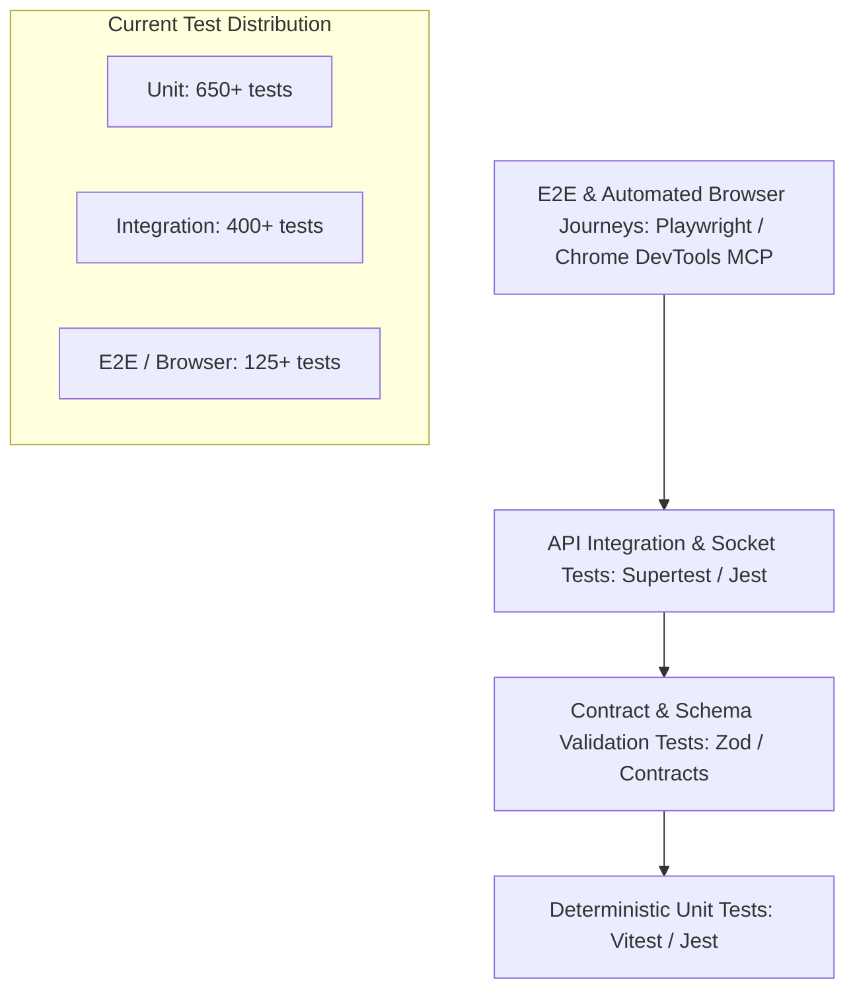

# OgroniEdu — Testing Strategy & Quality Assurance Architecture

**Document Reference:** `docs/TESTING_STRATEGY.md`  
**Last Updated:** 2026-10-22  
**Test Frameworks:** Vitest / Jest (Unit & Integration), Supertest (API Integration), Playwright / Chrome DevTools (E2E & Automated Browser Testing)  
**Current Test Suite Baseline:** **1,175 Automated Tests Passing (100% Pass Rate)**

- `apps/api`: **938 Tests Passing**
- `apps/web`: **237 Tests Passing**
- TypeScript Diagnostics: **0 Errors**
- Lint Diagnostics: **0 Errors**
- Smoke Test Probes: **8/8 Passing**

---

## 1. Testing Pyramid & Quality Gates

---

## 2. Test Execution Commands & Environments

| Test Target                  | CLI Command                                  | Scope / Description                                                                                | Average Execution Time |
| ---------------------------- | -------------------------------------------- | -------------------------------------------------------------------------------------------------- | :--------------------: |
| **Full Monorepo Unit/Integ** | `pnpm test`                                  | Runs all Jest/Vitest test suites across `@ogroniedu/api`, `@ogroniedu/web`, `@ogroniedu/contracts` |          ~45s          |
| **API Backend Suites**       | `pnpm --filter @ogroniedu/api test`          | 938 unit, service, controller, and database tests                                                  |          ~32s          |
| **Web Frontend Suites**      | `pnpm --filter @ogroniedu/web test`          | 237 component, hook, Redux slice, and utility tests                                                |          ~14s          |
| **Monorepo Typecheck**       | `pnpm typecheck`                             | Strict TypeScript compiler check across all workspaces                                             |          ~12s          |
| **Code Linting**             | `pnpm lint`                                  | ESLint rules enforcement (0 warnings / 0 errors)                                                   |          ~8s           |
| **Smoke Test Probes**        | `node scripts/smoke-test.mjs --target local` | 8 critical runtime probes against ports 4000 & 5000                                                |          ~3s           |
| **E2E Browser Journeys**     | `pnpm --filter @ogroniedu/web test:e2e`      | Playwright multi-role browser journeys                                                             |          ~90s          |

---

## 3. Test Categories & Verification Standards

### 3.1 Unit Testing (Deterministic, Isolated)

- **Execution Target:** Vitest / Jest in-memory.
- **Scope:**
  - Business rule calculators (cancellation refund percentages, platform fee tiers, reliability score deductions).
  - Validation schemas (Zod DTOs for booking requests, credentials, profile updates).
  - Utility functions (date formatting, currency formatting in BDT, phone number sanitization for `+880`).
- **Standard:** Fast execution (< 5ms per test), 0 external network/database dependencies.

### 3.2 API Integration & Persistence Testing

- **Execution Target:** Supertest against local PostgreSQL 18 (`ogroniedu_dev` test schema).
- **Scope:**
  - NestJS controllers and service layers.
  - Transaction rollbacks: Verifying that failure in payment webhook atomically aborts booking confirmation.
  - Concurrency & Double-Booking: Proving PostgreSQL GiST exclusion lock rejects overlapping sessions for the same tutor.
  - Outbox Events: Verifying that `outbox` records are inserted atomically with domain entities.

### 3.3 WebSocket & Real-Time Isolation Testing

- **Execution Target:** Socket.IO client mock suites.
- **Scope:**
  - Authenticated handshake with JWT bearer token.
  - Room isolation: Proving Socket A (User 1) never receives events dispatched to Socket B (User 2).
  - Whiteboard synchronization: Verifying broadcast of canvas draw strokes, clear commands, and undo/redo stacks.

### 3.4 Headful Browser Automation & DevTools Protocol

- **Execution Target:** Automated headful Chrome DevTools testing protocol (per system instructions).
- **Scope:**
  - Live page rendering on `http://localhost:5000`.
  - Console message monitoring (`list_console_messages`): Asserting zero unhandled JavaScript exceptions.
  - Network request monitoring (`list_network_requests`): Asserting API calls to backend port `4000` succeed with HTTP 200/201.
  - Visual regression confirmation (`take_screenshot`).

---

## 4. Mandatory Quality Gates & Invariants

1. **Zero Flakiness Invariant:** Any test that fails intermittently must be quarantined, debugged, and fixed before advancing to subsequent phases.
2. **Negative Security Testing:** Every single authenticated route and API endpoint MUST have automated tests confirming:
   - Request without token -> `401 Unauthorized`.
   - Request with insufficient role (e.g., student accessing admin payouts) -> `403 Forbidden`.
   - Request accessing another user's private data -> `403 Forbidden` / `404 Not Found`.
3. **Idempotency Guarantees:** Financial and booking endpoints must include automated tests asserting that repeating identical requests with the same `Idempotency-Key` does not duplicate charges or records.
4. **No Code Without Verification:** In accordance with the sequential quality engineering workflow, all newly implemented features must be paired with comprehensive unit and integration tests.
