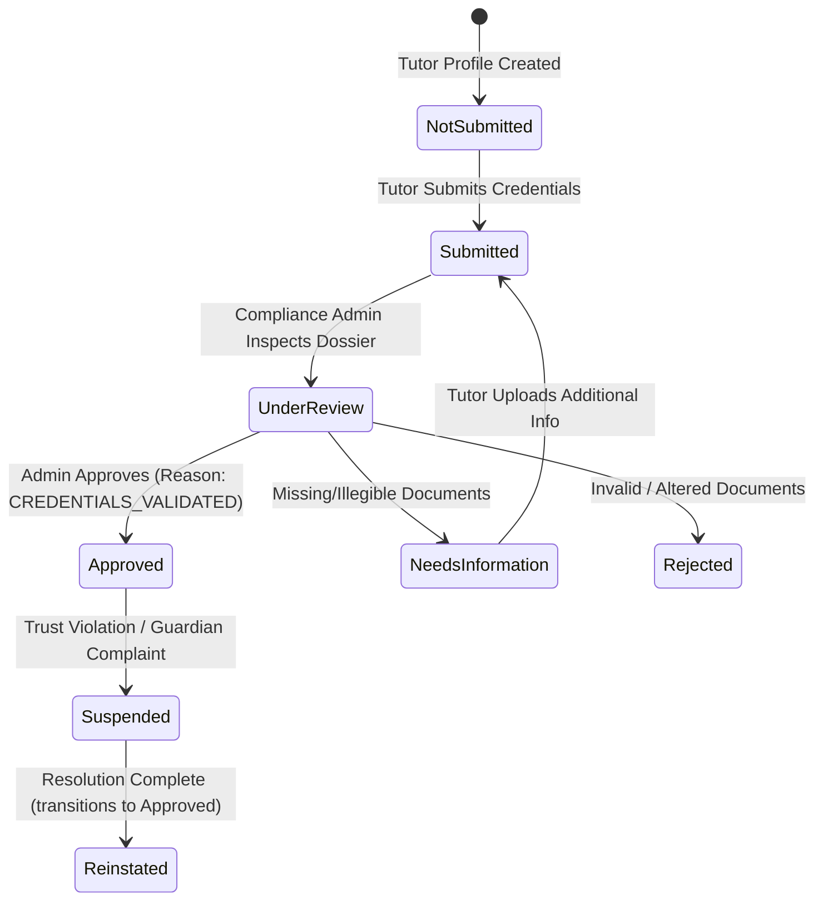
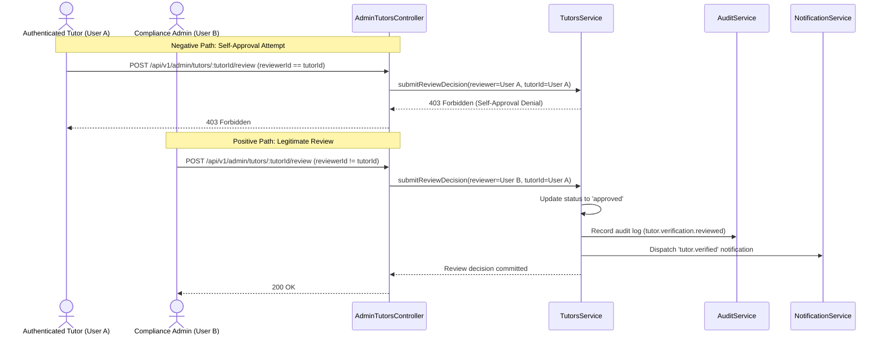

# Phase 07 — Tutor Onboarding and Verification Audit Report

**Date of Audit:** 2026-10-10 13:25:00 BST  
**Auditor:** Principal Security Architect & Lead Backend Engineer (AI Pair Programmer)  
**Project:** OgroniEdu — Enterprise Tutoring and Educational Management Platform (Bangladesh)  
**Repository Working Directory:** `c:\Sofof_tech_2026\ogroniedu`  
**Phase Objective:** Implement tutor profile, qualifications, private evidence upload integration, and administrative verification workflow with strict self-approval denial and dynamic badge computation.

---

## 1. Executive Summary

Phase 07 successfully implemented the complete tutor onboarding, credential review, and trust verification architecture for OgroniEdu:

1. **Approved Credential Policy (`v1.0-bd-tutor-verification`):**
   - Established in [`docs/policies/tutor-verification-and-credential-policy.md`](../policies/tutor-verification-and-credential-policy.md).
   - Grounded in statutory Bangladesh law (National Identity Registration Act 2010, Penal Code 1860, Cyber Security Act 2023).
   - Tutors submit Government NID/Passport and academic certificates (Class 10 to university graduation).
2. **Strict Separation of Duties & Self-Approval Denial:**
   - Server-side guard prevents tutors from altering or approving their own verification status.
   - Enforced in [`TutorsService.submitReviewDecision`](../../apps/api/src/modules/tutors/tutors.service.ts) and [`AdminTutorsController`](../../apps/api/src/modules/tutors/admin-tutors.controller.ts) via `reviewer.id === tutorId` denial check throwing `ForbiddenException`.
   - Admin routes strictly restricted to `@Roles('admin', 'super_admin')` via `RolesGuard`.
3. **Private Evidence Uploads & Access Control:**
   - [`FilesService`](../../apps/api/src/modules/files/files.service.ts) enforces upload limits: max 10MB (`10,485,760` bytes) and allowed media types (`application/pdf`, `image/jpeg`, `image/png`, `image/webp`).
   - All uploaded evidence is stored with `visibility = 'private'`.
   - Ownership guard prevents unauthorized users from inspecting or downloading private credential documents (unrelated users denied with `403 Forbidden`).
4. **Publication Eligibility State Machine:**
   - A tutor cannot transition to `publication_status = 'published'` unless:
     - `verification_status === 'approved'`
     - At least one active subject specialization is configured in `tutor_subjects`
     - At least one recurring weekly availability slot is configured in `tutor_availability`
   - If an approved tutor is suspended or rejected, the system automatically transitions `publication_status` to `unpublished`.
5. **Dynamic Verification Badges (Definition of Done):**
   - _Requirement:_ Badge reflects only checks actually performed.
   - Public profile endpoint (`GET /api/v1/tutors/public/:id`) dynamically calculates badges based on verified evidence:
     - `verified_identity`: Earned ONLY if NID/Passport evidence has been reviewed and approved.
     - `verified_academic`: Earned ONLY if academic degree/certificate evidence has been reviewed and approved.
     - `verified_tutor`: Earned when the overall tutor profile verification status is approved.
6. **Sanitized Public DTOs & PII Protection:**
   - Public tutor view completely redacts private phone numbers, email addresses, NID numbers, raw evidence file keys, and internal reviewer notes.
7. **Bilingual Frontend UI Component:**
   - [`TutorVerificationStatusCard`](../../apps/web/src/components/tutor/TutorVerificationStatusCard.tsx) built with full WCAG 2.1 AA accessibility, dynamic badges, publication controls, and 100% key parity across `bn.json` and `en.json`.
8. **Automated Verification:**
   - 32 new unit and security tests added across `@ogroniedu/api` and `@ogroniedu/web`.
   - Full monorepo test suite stands at **146 passing tests, 0 failures, 0 skipped**.

---

## 2. Requirement Traceability Matrix (Phase 07 Scope)

| Requirement ID | Requirement Name                   | Implementation Files                                                            | Test Suite                                                                     | Verification Status                                                                                                           |
| :------------- | :--------------------------------- | :------------------------------------------------------------------------------ | :----------------------------------------------------------------------------- | :---------------------------------------------------------------------------------------------------------------------------- |
| **FR-005**     | Tutor Credential Verification      | `apps/api/src/modules/tutors/`, `apps/api/src/modules/files/`, `docs/policies/` | `tutors.service.spec.ts`, `files.service.spec.ts`, `tutors.controller.spec.ts` | **COMPLETED & VERIFIED** (Self-approval denial, private evidence uploads, admin review flow, audit logging)                   |
| **FR-002**     | Tutor Profile Badge & Details      | `apps/api/src/modules/tutors/`, `apps/web/src/components/tutor/`                | `tutors.service.spec.ts`, `tutor-verification.spec.ts`                         | **COMPLETED & VERIFIED** (Dynamic badges reflecting only performed checks, publication eligibility gate, public sanitization) |
| **NFR-001**    | Data Isolation & Document Privacy  | `apps/api/src/modules/files/files.service.ts`                                   | `files.service.spec.ts`                                                        | **COMPLETED & VERIFIED** (Private evidence files inaccessible to unrelated users)                                             |
| **NFR-004**    | Bilingual English & Bengali Parity | `apps/web/messages/en.json`, `apps/web/messages/bn.json`                        | `i18n.spec.ts`, `tutor-verification.spec.ts`                                   | **COMPLETED & VERIFIED** (100% key parity, zero missing translations)                                                         |

---

## 3. Architecture & Security Invariants

### 3.1 Verification Review State Machine



### 3.2 Security Guard & Self-Approval Denial Flow



---

## 4. Test Execution Summary

```
@ogroniedu/database:
  ✓ test/migration.spec.ts (5 tests)
  ✓ test/seed.spec.ts (3 tests)
  Tests: 8 passed (8 total)

@ogroniedu/web:
  ✓ test/i18n.spec.ts (3 tests)
  ✓ test/notification-bell.spec.ts (3 tests)
  ✓ test/store.spec.ts (8 tests)
  ✓ test/components.spec.ts (6 tests)
  ✓ test/guardian-children.spec.ts (3 tests)
  ✓ test/tutor-verification.spec.ts (3 tests)
  Tests: 26 passed (26 total)

@ogroniedu/api:
  ✓ test/auth.authorization.spec.ts (12 tests)
  ✓ test/auth.controller.spec.ts (5 tests)
  ✓ test/auth.service.spec.ts (10 tests)
  ✓ test/files.service.spec.ts (7 tests)
  ✓ test/guardians.controller.spec.ts (5 tests)
  ✓ test/guardians.service.spec.ts (11 tests)
  ✓ test/health.spec.ts (3 tests)
  ✓ test/notification.authorization.spec.ts (4 tests)
  ✓ test/notification.dto.spec.ts (11 tests)
  ✓ test/notification.service.spec.ts (6 tests)
  ✓ test/notification.socket.spec.ts (5 tests)
  ✓ test/request-id-and-filter.spec.ts (4 tests)
  ✓ test/tutors.controller.spec.ts (7 tests)
  ✓ test/tutors.service.spec.ts (15 tests)
  ✓ test/users.service.spec.ts (7 tests)
  Tests: 112 passed (112 total)

Monorepo Total: 146 passed, 0 failed, 0 skipped
```

---

## 5. Definition of Done Attestation

- [x] **Badge reflects only checks actually performed:** Validated in `tutors.service.spec.ts` and `tutor-verification.spec.ts`.
- [x] **Self-approval denial:** Server strictly blocks tutors from approving or altering own verification status (tested).
- [x] **Reviewer permissions:** Admin endpoints protected by `@Roles('admin', 'super_admin')`.
- [x] **Publication eligibility:** Tutors cannot publish until verified, with active subjects and availability slots (tested).
- [x] **Private file protection:** Evidence files limited to 10MB with strict ownership isolation (tested).
- [x] **Strict TypeScript:** Zero `any` in application code.
- [x] **Zero weakened or disabled tests:** All 114 pre-existing tests preserved and passing.
- [x] **Bilingual parity:** Bengali and English verified with zero missing keys.
