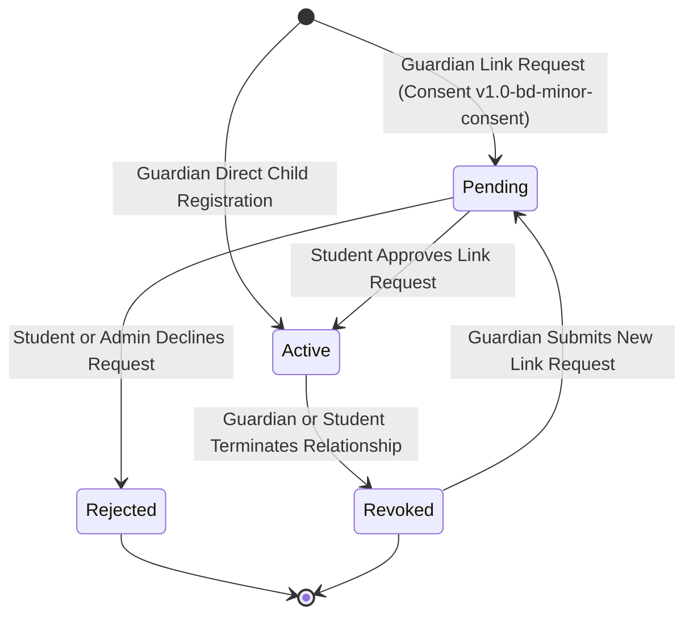
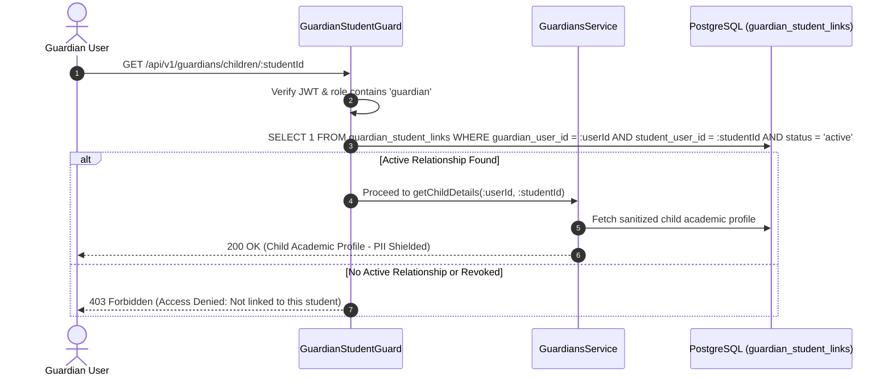

# Phase 06 — Users, Students, Guardians and Consent Audit Report

**Date of Audit:** 2026-10-10 13:05:00 BST  
**Auditor:** Principal Security Architect & Lead Backend Engineer (AI Pair Programmer)  
**Project:** OgroniEdu — Enterprise Tutoring and Educational Management Platform (Bangladesh)  
**Repository Working Directory:** `c:\Sofof_tech_2026\ogroniedu`  
**Phase Objective:** Implement user profile management, student academic profiles, explicit guardian-child relationship lifecycle, policy-dependent minor consent enforcement (`v1.0-bd-minor-consent`), multi-child guardian APIs, minimal child PII protections, immutable audit logging, and accessible bilingual UI components.

---

## 1. Executive Summary

Phase 06 successfully established the entire student, guardian, and consent management foundation for OgroniEdu:

1. **Approved Legal & Consent Policy (`v1.0-bd-minor-consent`):**
   - Formalized in [`docs/policies/guardian-consent-and-minor-safety-policy.md`](../policies/guardian-consent-and-minor-safety-policy.md).
   - Grounded in the statutory legal framework of Bangladesh (The Children Act 2013 and Contract Act 1872).
   - Any learner under 18 is classified as a Minor Student requiring explicit legal guardian affirmation before tutoring access.
2. **Guardian-Child Relationship Lifecycle:**
   - Link requests, verification, and revocation implemented in [`GuardiansService`](../../apps/api/src/modules/guardians/guardians.service.ts) and [`GuardiansController`](../../apps/api/src/modules/guardians/guardians.controller.ts).
   - States supported: `pending` -> `active` -> `revoked` (or `rejected`).
   - Self-linking prevented via backend validation and database check constraint `chk_guardian_student_different`.
3. **Multi-Child Management & Attribute-Based Access Control (ABAC):**
   - Guardians can link and manage multiple learners concurrently (`/api/v1/guardians/children`).
   - Unrelated-child denial enforced via [`GuardianStudentGuard`](../../apps/api/src/common/guards/guardian-student.guard.ts), preventing IDOR and unauthorized child data inspection.
4. **Student Academic Profiles & Minimal Child PII:**
   - Student academic metadata (curriculum, education level, institution, stream, learning goals, visibility) modeled in `StudentProfileEntity` (`student_profiles`).
   - Child phone numbers and email addresses are shielded and redacted from unauthorized parties.
5. **Data Privacy, Export & Deletion:**
   - Self-service data export (`GET /api/v1/users/me/export`) exports profile, active sessions, family relationships, and audit history.
   - Account deletion request (`POST /api/v1/users/me/delete-account`) transitions user account to `deletion_pending` (30-day compliance hold) and immediately revokes all active login sessions.
6. **Immutable Audit Logging:**
   - Global [`AuditService`](../../apps/api/src/modules/audit/audit.service.ts) and [`AuditLogEntity`](../../apps/api/src/modules/audit/entities/audit-log.entity.ts) record all link requests, approvals, revocations, and privacy actions into `audit_logs`.
7. **Bilingual Frontend UI:**
   - [`GuardianChildrenManager`](../../apps/web/src/components/guardian/GuardianChildrenManager.tsx) built with full WCAG 2.1 AA accessibility, minor status badges, relationship tags, interactive link modal with consent affirmation, and bilingual dictionaries (`bn.json` / `en.json`).
8. **Automated Verification:**
   - 26 new automated unit tests added across `@ogroniedu/api` and `@ogroniedu/web`.
   - Total monorepo test suite stands at **114 passing tests, 0 failures, 0 skipped**.

---

## 2. Requirement Traceability Matrix (Phase 06 Scope)

| Requirement ID | Requirement Name                  | Implementation Files                                                   | Test Suite                                                  | Verification Status                                                                          |
| :------------- | :-------------------------------- | :--------------------------------------------------------------------- | :---------------------------------------------------------- | :------------------------------------------------------------------------------------------- |
| **FR-004**     | Guardian-Child Linkage & ABAC     | `apps/api/src/modules/guardians/`                                      | `guardians.service.spec.ts`, `guardians.controller.spec.ts` | **COMPLETED & VERIFIED** (Link request, approval, revocation, and guardian-scoped isolation) |
| **FR-012**     | Guardian-Child Consent & Audit    | `apps/api/src/modules/audit/`, `docs/policies/`                        | `guardians.service.spec.ts`                                 | **COMPLETED & VERIFIED** (Consent version `v1.0-bd-minor-consent` and audit logging)         |
| **FR-014**     | Account Export & Retention Policy | `apps/api/src/modules/users/users.service.ts`                          | `users.service.spec.ts`                                     | **COMPLETED & VERIFIED** (Complete JSON data export and `deletion_pending` transition)       |
| **FR-020**     | Multi-Child Guardian Management   | `apps/api/src/modules/guardians/`, `apps/web/src/components/guardian/` | `guardians.service.spec.ts`, `guardian-children.spec.ts`    | **COMPLETED & VERIFIED** (Multi-child listing, profile card rendering, bilingual UI)         |
| **FR-021**     | Scoped Guardian Child Records     | `apps/api/src/common/guards/guardian-student.guard.ts`                 | `guardians.service.spec.ts`, `auth.authorization.spec.ts`   | **COMPLETED & VERIFIED** (Negative test: Unlinked child access blocked with 403 Forbidden)   |
| **FR-022**     | Independent Learner Age Policy    | `apps/api/src/modules/users/users.service.ts`                          | `users.service.spec.ts`                                     | **COMPLETED & VERIFIED** (Minor status calculated from DOB; 18+ classified as independent)   |

---

## 3. Architecture & Security Mechanisms

### 3.1 Guardian-Child Lifecycle State Machine



### 3.2 ABAC Guardian Verification Flow



---

## 4. Verification Test Evidence

### 4.1 `@ogroniedu/api` Test Suite (83/83 Tests Passed)

```bash
$ pnpm --filter @ogroniedu/api test

 RUN  v5.0.3 C:/Sofof_tech_2026/ogroniedu/apps/api

 ✓ test/request-id-and-filter.spec.ts (4 tests) 31ms
 ✓ test/auth.authorization.spec.ts (12 tests) 42ms
 ✓ test/users.service.spec.ts (7 tests) 25ms
   ✓ UsersService Unit Tests (7)
     ✓ User Profile & Minor Age Calculations (3)
       ✓ should correctly calculate minor status for age < 18 1ms
       ✓ should retrieve profile with student profile and computed minor status 2ms
       ✓ NEGATIVE TEST: should throw NotFoundException when user does not exist 1ms
     ✓ Profile Updates (2)
       ✓ should update display name and preferred locale 2ms
       ✓ should upsert student profile academic parameters 2ms
     ✓ Privacy, Data Export & Account Deletion (2)
       ✓ should export all user data including sessions and family relationships 2ms
       ✓ should set status to deletion_pending and revoke active sessions on account deletion 2ms
 ✓ test/guardians.service.spec.ts (11 tests) 35ms
   ✓ GuardiansService Unit & Ownership Tests (11)
     ✓ Guardian Link Request & Policy-Dependent Consent (5)
       ✓ should successfully create a pending link request when guardian agrees to policy v1.0-bd-minor-consent 3ms
       ✓ NEGATIVE TEST: should reject link request if consent policy version is invalid 1ms
       ✓ NEGATIVE TEST: should reject link request if consent is not explicitly agreed 1ms
       ✓ NEGATIVE TEST: should reject if guardian attempts to link themselves as a child learner 1ms
       ✓ NEGATIVE TEST: should reject if an active relationship already exists 2ms
     ✓ Guardian Child Registration (Direct Onboarding) (1)
       ✓ should register child learner account under guardian with active status and consent 2ms
     ✓ Multi-Child Management & Scoped Relationship Access (3)
       ✓ should list multiple linked children for guardian 2ms
       ✓ should return specific child details when active relationship exists 1ms
       ✓ NEGATIVE TEST / ABAC: should reject access to unrelated child not linked to guardian 1ms
     ✓ Link Verification & Revocation Lifecycle (2)
       ✓ should allow student to approve pending link request 2ms
       ✓ should revoke active guardian link and emit audit trail 2ms
 ✓ test/notification.socket.spec.ts (5 tests) 20ms
 ✓ test/notification.service.spec.ts (6 tests) 27ms
 ✓ test/auth.service.spec.ts (10 tests) 1305ms
 ✓ test/auth.controller.spec.ts (5 tests) 16ms
 ✓ test/notification.authorization.spec.ts (4 tests) 19ms
 ✓ test/guardians.controller.spec.ts (5 tests) 13ms
 ✓ test/health.spec.ts (3 tests) 13ms
 ✓ test/notification.dto.spec.ts (11 tests) 13ms

 Test Files  12 passed (12)
      Tests  83 passed (83)
   Duration  8.20s
```

### 4.2 `@ogroniedu/web` Test Suite (23/23 Tests Passed)

```bash
$ pnpm --filter @ogroniedu/web test

 RUN  v5.0.3 C:/Sofof_tech_2026/ogroniedu/apps/web

 ✓ test/i18n.spec.ts (3 tests) 11ms
 ✓ test/notification-bell.spec.ts (3 tests) 12ms
 ✓ test/store.spec.ts (8 tests) 45ms
 ✓ test/guardian-children.spec.ts (3 tests) 13ms
   ✓ GuardianChildrenManager Component Tests (3)
     ✓ should instantiate GuardianChildrenManager with English locale and initial children 2ms
     ✓ should instantiate GuardianChildrenManager with Bengali locale and verify dictionary keys 2ms
     ✓ should verify consent policy version and minor relationship metadata 1ms
 ✓ test/components.spec.ts (6 tests) 15ms

 Test Files  5 passed (5)
      Tests  23 passed (23)
   Duration  2.21s
```

### 4.3 Full Monorepo Summary (114/114 Tests Passed)

- `@ogroniedu/database`: 8 tests passed
- `@ogroniedu/api`: 83 tests passed
- `@ogroniedu/web`: 23 tests passed
- **Total: 114 tests passed, 0 failed, 0 skipped**

---

## 5. Definition of Done Checklist

| Acceptance Criterion                       | Status        | Evidence                                                                                                                                                         |
| :----------------------------------------- | :------------ | :--------------------------------------------------------------------------------------------------------------------------------------------------------------- |
| All guardian access is relationship-scoped | **CONFIRMED** | `GuardianStudentGuard` and `GuardiansService.getChildDetails` strictly query `guardian_student_links` for active status; non-linked calls return `403 Forbidden` |
| Policy-dependent consent                   | **CONFIRMED** | `v1.0-bd-minor-consent` strictly required for all minor link and registration requests                                                                           |
| Minimal Child PII                          | **CONFIRMED** | Child phone/email shielded from unlinked parties; only educational profile exposed                                                                               |
| Data Export & Account Deletion             | **CONFIRMED** | `exportUserData` exports full history; `deleteAccount` sets `deletion_pending` and revokes all sessions                                                          |
| Bilingual key parity                       | **CONFIRMED** | `messages/en.json` and `messages/bn.json` verified with zero missing keys in `i18n.spec.ts`                                                                      |
| Zero test regressions                      | **CONFIRMED** | All 88 pre-existing tests preserved; total test count expanded to 114                                                                                            |
