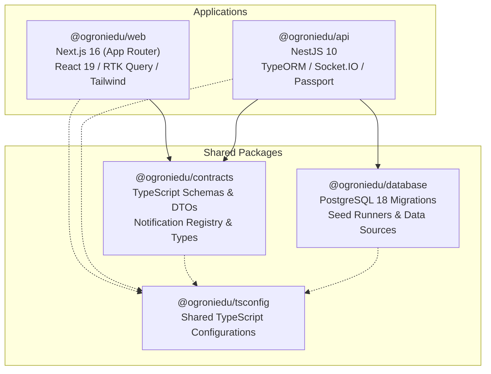
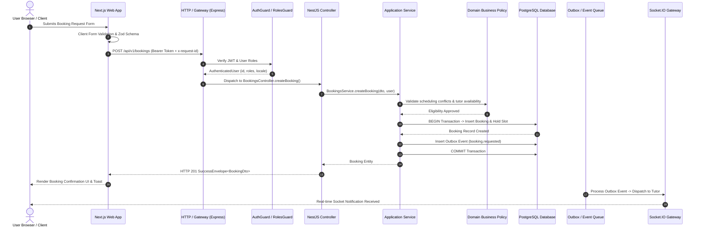

# Current Architecture Inventory — OgroniEdu (অগ্রণী এডু)

## 1. System Overview

OgroniEdu is an enterprise-grade, multi-tenant tutoring SaaS platform built specifically for the Bangladesh education ecosystem. It coordinates live instruction, scheduling, escrow payments (bKash, Nagad, SSLCOMMERZ), verified tutor onboarding, learning management (LMS), and child safeguarding across four primary user personas: Students, Guardians, Tutors, and System Administrators.

The system is deployed as a unified Turborepo monorepo running on Node.js 20+ with strict TypeScript, utilizing PostgreSQL 18 with 30 applied database migrations.

---

## 2. Monorepo Structure & Package Hierarchy



### Monorepo Packages Summary

| Package | Path | Responsibility | Technologies |
| :--- | :--- | :--- | :--- |
| **`@ogroniedu/web`** | `apps/web` | Frontend Web application & PWA | Next.js 16, React 19, Redux Toolkit, Tailwind CSS, Radix UI / shadcn |
| **`@ogroniedu/api`** | `apps/api` | REST & WebSocket Backend Services | NestJS 10, TypeORM, Socket.IO, Express, Passport JWT, bcrypt |
| **`@ogroniedu/contracts`** | `packages/contracts` | Canonical DTOs, API envelopes, and notification registries | TypeScript, ts-standard |
| **`@ogroniedu/database`** | `packages/database` | Raw SQL schema migrations, seeds, and BCDR drill runners | PostgreSQL 18, `pg`, TypeORM |
| **`@ogroniedu/tsconfig`** | `packages/tsconfig` | Shared compiler options and path mappings | TypeScript JSON configs |

---

## 3. Backend Architecture (`@ogroniedu/api`)

The backend is structured into 20 modular domains located in `apps/api/src/modules/`:

```
apps/api/src/modules/
├── admin/            # Administrative governance, reconciliation, user suspension, impersonation
├── analytics/        # First-party privacy-conscious event tracking, funnel analytics, retention
├── audit/            # Append-only audit logging and administrative action trails
├── auth/             # Passport JWT auth, phone OTP, magic link, lockout policies, password reset
├── bookings/         # Booking lifecycle, GiST-backed scheduling, session conflict prevention
├── feedback/         # Beta UAT feedback ingestion, triaging, and issue classification
├── files/            # Signed URLs, evidence attachments, document access gating
├── guardians/        # Guardian-student linkages, consent enforcement, emergency contacts
├── health/           # Kubernetes / container liveness and readiness probes
├── learning/         # LMS assignments, submissions, grading, lesson plans, materials, attendance
├── notifications/    # Multi-channel notification dispatch (SMS, Email, Push, WebSocket), outbox worker
├── onboarding/       # Multi-step role-specific onboarding wizards and profile completion
├── organizations/    # Multi-tenant coaching centers, role assignments, IDOR-protected tenant isolation
├── payments/         # Escrow orders, bKash & SSLCOMMERZ adapters, double-entry ledger journals, payouts
├── public/           # Public platform statistics, landing page metrics
├── support/          # Zendesk-style support tickets, SLA tracking, internal agent notes
├── taxonomy/         # Curriculum grades, subjects, categories, track levels
├── trust/            # Tutor verification dossier, child safety reports, disputes, tutor replacement guarantee
├── tutors/           # Tutor search, profile management, subjects, availability, rates
└── users/            # User profile management, locale preferences, account deletion & GDPR exports
```

---

## 4. Frontend Architecture (`@ogroniedu/web`)

The web application is structured using Next.js 16 App Router with internationalized route groups (`[locale]`):

```
apps/web/src/
├── app/[locale]/
│   ├── (admin)/       # Admin operations, finance, taxonomy, governance dashboards
│   ├── (dashboard)/   # Authenticated role dashboards (Student, Guardian, Tutor)
│   ├── (public)/      # Landing page, tutor search catalog, pricing, contact, FAQ
│   └── (auth)/        # Login, registration, phone OTP verification, magic link callback
├── components/        # Reusable UI widgets (shadcn primitives, modals, notifications, guardians)
├── features/          # Domain-aligned feature modules (tutors, payments, classroom, admin, etc.)
├── hooks/             # Custom React hooks (useAuth, useLocalization, useSocket, etc.)
├── lib/               # Internationalization dictionaries (en/bn), API contracts, theme utilities
└── store/             # Redux Toolkit store, baseApi with reauth, and 19 RTK Query API slices
```

---

## 5. Key Request Lifecycle Trace



---

## 6. Persistence & Transaction Architecture

- **PostgreSQL 18**: The single source of truth for all operational, financial, and analytical data.
- **Strict GiST Exclusion Constraints**: `ex_tutor_session_overlap` enforces physical slot concurrency protection at the database engine level, eliminating race conditions.
- **Double-Entry Financial Ledger**: `ledger_journals` and `ledger_entries` ensure every debit is balanced by an exact matching credit in integer poisha/cents (1 BDT = 100 poisha). No floating-point math.
- **Tenant Isolation**: Row-level organization checks and composite indexes (`organization_id`) ensure strict cross-tenant data isolation.

---

## 7. Known Architectural Inconsistencies & Hotspots

1. **Circular Import Dependencies**:
   - `NotificationService` <-> `NotificationGateway` bi-directional coupling via `forwardRef`.
   - `GuardianChildrenManager.tsx` <-> `use-guardian-children.ts` type-level circular import.
   - `store.ts` <-> `base-api.ts` state interface circular reference.
   - TypeORM entity circular imports between parent and child entities.
2. **Component Monoliths**:
   - `admin-taxonomy-page.tsx` (1,460 lines) combines 4 independent administrative tables, 4 creation modals, delete confirmations, and tab state in a single file.
   - `GuardianChildrenManager.tsx` (999 lines) combines table rendering, linking forms, safety settings, and replacement guarantee claims.
3. **Service Complexity Hotspots**:
   - `tutor-replacement.service.ts` (1,053 lines) mixes pure eligibility scoring, financial calculations, and TypeORM query execution.
   - `auth.service.ts` (1,087 lines) mixes credential hashing, OTP generation, lockout timers, and audit dispatching.
