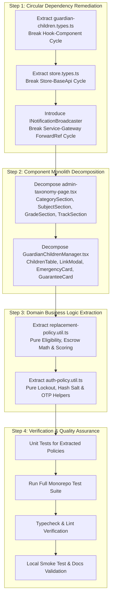

# Architecture Refactoring & Maintainability Implementation Plan — OgroniEdu

## 1. Overview & Objectives

This implementation plan defines the step-by-step technical refactoring program for Phase 15. The objective is to resolve high-impact structural risks, break circular dependencies, decompose component monoliths, and extract testable domain policies without altering any API contract, breaking existing business logic, or causing test regressions.

---

## 2. Refactoring Phases & Work Breakdown

---

## 3. Detailed Work Breakdown

### Stage 1: Circular Dependency Remediation (P1)

1. **Frontend Guardian Children Types**:
   - Create `apps/web/src/components/guardian/guardian-children.types.ts`.
   - Move `ChildItem`, `GuardianChildrenCallbacks`, `GuardianRelationship`, `LinkChildModalProps`, and related interfaces into `guardian-children.types.ts`.
   - Update `use-guardian-children.ts` and `GuardianChildrenManager.tsx` to import from the new types file.
   - Verify circular dependency between hook and component is eliminated.
2. **Frontend Redux Store Types**:
   - Create `apps/web/src/store/store.types.ts`.
   - Define `RootState` and `AppDispatch` types in `store.types.ts`.
   - Update `base-api.ts` and `store.ts` to import types cleanly without cycles.
3. **Backend Notification Broadcaster Inversion**:
   - Create `apps/api/src/modules/notifications/interfaces/notification-broadcaster.interface.ts`.
   - Define `INotificationBroadcaster` and DI token `NOTIFICATION_BROADCASTER`.
   - Have `NotificationGateway` implement `INotificationBroadcaster`.
   - Update `NotificationService` to inject `@Optional() @Inject('NOTIFICATION_BROADCASTER') private readonly broadcaster?: INotificationBroadcaster`.
   - Remove bidirectional `forwardRef()` imports.

### Stage 2: Frontend Monolith Decomposition (P2)

1. **Admin Taxonomy Page Decomposition**:
   - Create folder `apps/web/src/features/admin/components/taxonomy/`.
   - Extract:
     - `CategoryManagementSection.tsx`
     - `SubjectManagementSection.tsx`
     - `GradeManagementSection.tsx`
     - `TrackManagementSection.tsx`
     - `TaxonomyEntityModal.tsx`
   - Refactor `admin-taxonomy-page.tsx` into an orchestrator importing these cohesive sections.
2. **Guardian Children Manager Decomposition**:
   - In `apps/web/src/components/guardian/`:
     - Extract `GuardianChildrenTable.tsx`
     - Extract `LinkChildModal.tsx`
     - Extract `GuardianEmergencySettingsCard.tsx`
     - Extract `GuardianReplacementGuaranteeCard.tsx`
   - Refactor `GuardianChildrenManager.tsx` to compose these subcomponents.

### Stage 3: Domain Logic Extraction (P2)

1. **Tutor Replacement Policy Extraction**:
   - Create `apps/api/src/modules/trust/utils/replacement-policy.util.ts`.
   - Move pure calculations:
     - `isReplacementGuaranteeEligible(booking, dispute, hoursSinceSession)`
     - `calculateEscrowTransferAmounts(disputedAmountPoisha, replacementAmountPoisha)`
     - `scoreReplacementCandidate(candidateTutor, originalTutor, subjectId)`
   - Refactor `TutorReplacementService` to delegate pure calculations to the utility.
   - Author unit tests in `apps/api/test/replacement-policy.util.spec.ts`.
2. **Auth Policy Extraction**:
   - Create `apps/api/src/modules/auth/utils/auth-policy.util.ts`.
   - Extract pure helpers: `evaluateLockoutStatus(...)`, `generateSecureOtp(...)`.
   - Author unit tests in `apps/api/test/auth-policy.util.spec.ts`.

### Stage 4: Verification & Final Quality Gates

1. Run new policy unit tests.
2. Run full monorepo test suite (`pnpm test`).
3. Run `node scripts/audit-circular-deps.mjs` to measure cycle reduction.
4. Run `pnpm typecheck` (0 errors).
5. Run `pnpm lint` (0 warnings, 0 errors).
6. Run `node scripts/validate-documentation.js` across all canonical docs.
7. Run `node scripts/smoke-test.mjs --target local`.
8. Complete the documentation suite with actual verification evidence.
