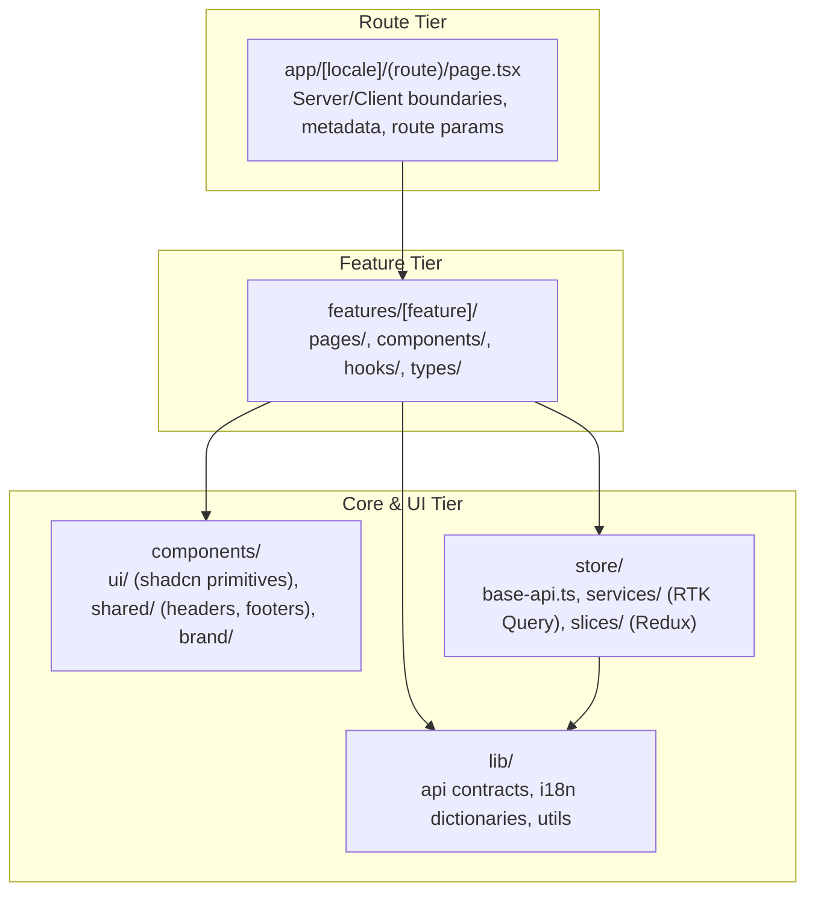

# Module Boundaries & Interface Standards — OgroniEdu (অগ্রণী এডু)

## 1. Principles of Module Isolation

To ensure maintainability as the platform scales, strict boundary definitions are established across all tiers of the OgroniEdu monorepo.

---

## 2. Backend Module Boundary Matrix (`@ogroniedu/api`)

Each backend module in `apps/api/src/modules/` adheres to a strict internal structure:

```
[module-name]/
├── [module-name].module.ts        # Module registration and DI exports
├── [module-name].controller.ts    # REST endpoints, route decorators, guards
├── [module-name].service.ts       # Orchestration, transactions, and business flows
├── dto/                           # Request DTOs, class-validator decorators, queries
│   ├── [action].dto.ts
│   └── index.ts
├── entities/                      # TypeORM relational persistence entities
│   └── [entity].entity.ts
├── interfaces/                    # Internal module abstractions and contracts
├── utils/ or policies/            # Pure, deterministic domain business calculations
└── services/                      # Focused domain sub-services (if module is large)
```

### Module Boundary Cross-Import Rules

| From Module | Allowed Module Imports | Disallowed Module Imports | Justification |
| :--- | :--- | :--- | :--- |
| **`auth`** | `users`, `audit`, `notifications` | `bookings`, `payments`, `learning` | Authentication must remain a foundational layer; high-level business domains depend on auth, never the reverse. |
| **`bookings`** | `tutors`, `users`, `notifications`, `payments` | `admin`, `feedback` | Booking engine should not know about administrative back-office tools or beta feedback. |
| **`payments`** | `audit`, `notifications` | `classroom`, `onboarding` | Financial ledger and payment orders must be isolated from educational content and onboarding wizards. |
| **`trust`** | `tutors`, `bookings`, `files`, `notifications` | `analytics` | Trust & safety operations are critical governance workflows with strict access controls. |
| **`notifications`** | `contracts` | `bookings`, `learning` | Notification delivery is a generic platform capability; it dispatches payloads given to it without depending on specific business flows. |

---

## 3. Frontend Module Boundary Matrix (`@ogroniedu/web`)

The frontend separates code into four primary tiers:



### Frontend Boundary Rules

1. **Pages Are Thin Orchestrators**: Next.js route `page.tsx` files must not contain complex JSX table layouts, raw API fetch requests, or inline state machines. They import and render feature components.
2. **Feature Encapsulation**: A feature component (e.g. `apps/web/src/features/tutor-discovery/`) should not import internal sub-components from another feature (e.g. `apps/web/src/features/classroom/`). Shared widgets must reside in `apps/web/src/components/`.
3. **Store Isolation**: API service definitions in `apps/web/src/store/services/` define API endpoints using RTK Query `injectEndpoints` and tags. Components consume auto-generated hooks (`useGet...Query`, `use...Mutation`) rather than making direct HTTP requests.

---

## 4. Shared Package Boundaries (`@ogroniedu/contracts` & `@ogroniedu/database`)

1. **`@ogroniedu/contracts`**:
   - MUST ONLY contain pure TypeScript types, interfaces, enums, constants, and pure template interpolation utilities.
   - MUST NEVER import `@nestjs/*`, `typeorm`, `react`, or browser DOM APIs.
   - MUST be safe for import in both server (Node.js) and browser (Next.js client bundles).
2. **`@ogroniedu/database`**:
   - Contains pure SQL migrations and migration execution scripts.
   - Database migrations are append-only.
   - NEVER import frontend web modules or API controllers into `@ogroniedu/database`.
