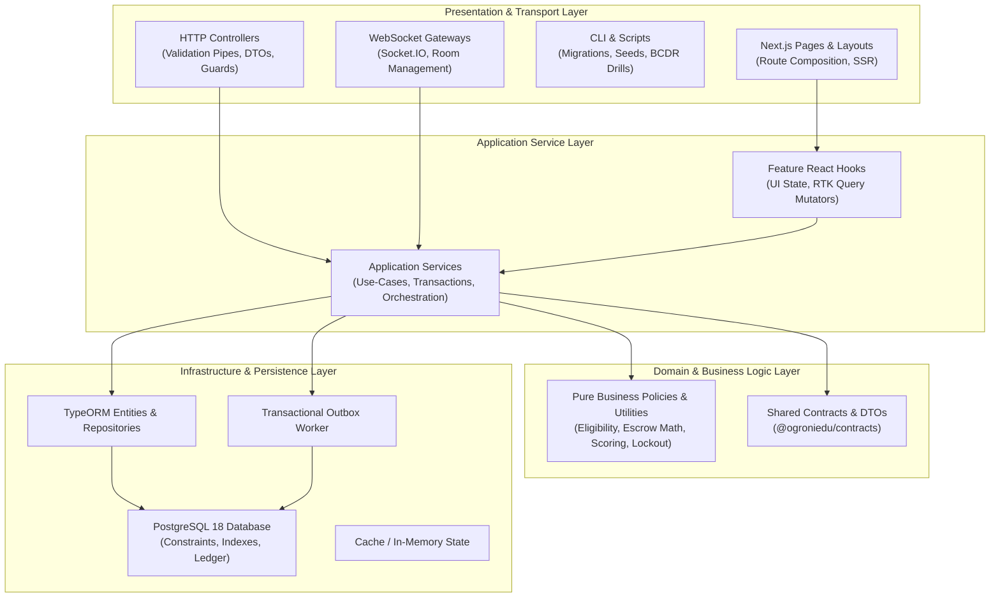
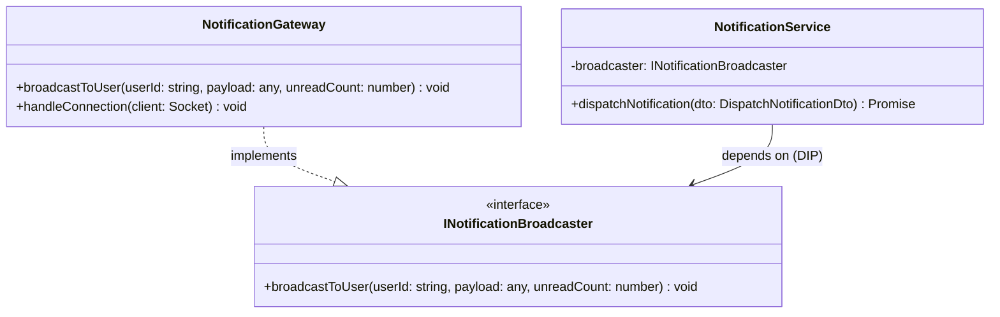

# Target Architecture & Design Principles — OgroniEdu (অগ্রণী এডু)

## 1. Architectural Vision

The target architecture establishes a clean, decoupled, layered system design that respects existing boundaries while enforcing:

1. **Unidirectional Dependency Flow**: Presentation/Controllers -> Application Services -> Domain Business Rules/Policies -> Infrastructure/Persistence.
2. **Zero Circular Dependencies**: Modules and components must have clear parent-child or client-service relationships without circular `forwardRef()` or bi-directional type cycles.
3. **Decoupled Transports**: WebSockets, HTTP Controllers, and Outbox Workers are presentation/transport concerns. Application services must never have hard dependencies on transport mechanisms.
4. **Focused Presentation Components**: UI pages compose cohesive domain widgets; giant monoliths (>1,000 lines) are decomposed into feature-specific components.
5. **Pure Domain Logic Isolation**: Financial math, scoring formulas, state transition validations, and eligibility rules are encapsulated in pure, deterministic functions easily verified without mock databases.

---

## 2. Target Layered Architecture

---

## 3. Boundary & Inversion Contracts

### 3.1 Notification Broadcaster Inversion

In the target architecture, `NotificationService` (Application Service) no longer injects `NotificationGateway` (Transport). Instead:

- `NotificationService` publishes via `INotificationBroadcaster` (an abstract interface token).
- `NotificationGateway` implements `INotificationBroadcaster`.
- In test environments where WebSockets are not spun up, a no-op broadcaster or mock is injected without complex bidirectional mock stubs.

### 3.2 Frontend Component Composition

Instead of pages with 1,500 lines managing multi-entity tables and modal states:

- Pages manage only route parameters, breadcrumbs, and active tab state.
- Each tab or functional entity is encapsulated into an independent section component (`*Section.tsx`).
- Forms and modal dialogs are separate, single-purpose components (`*Modal.tsx`).
- Shared state and API synchronization are mediated cleanly through RTK Query hooks.

---

## 4. Architectural Quality Rules

1. **Rule of Clean Dependency Direction**: Dependencies must point toward stability. Higher-level domain policies must never import concrete infrastructure or transport classes.
2. **Rule of Pure Business Logic**: Financial calculations, commission rates, and eligibility checks must reside in pure functions with zero external I/O side-effects.
3. **Rule of Atomic Transactions**: Any operation affecting multiple ledger entries, bookings, or user balances must execute inside an explicit `queryRunner` or TypeORM transaction with proper rollback.
4. **Rule of Zero-Leakage Contracts**: Database ORM entities must never be returned directly in API responses without being transformed into an explicit DTO conforming to `@ogroniedu/contracts`.
