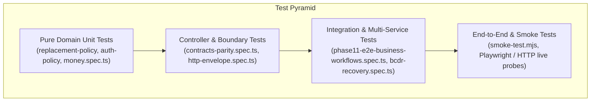

# Testability & Refactoring Safety Strategy — OgroniEdu (অগ্রণী এডু)

## 1. Safety-First Refactoring Protocol

To eliminate the risk of introducing behavioral regressions into production workflows (financial transactions, scheduling, safeguarding holds, and authentication), refactoring follows a strict safety protocol:
1. **Never Refactor Without Existing Tests**: Identify existing test suites that exercise the target module.
2. **Add Targeted Boundary & Pure Policy Tests First**: If the module contains pure business logic intertwined with database queries, author unit tests asserting the exact input/output behavior of the business rules before extracting them.
3. **Refactor In Small, Atomic Steps**: Perform one structural transformation at a time.
4. **Re-Run Unit & Integration Suites**: Verify that the exact same inputs yield identical results and that zero tests fail.
5. **Run Monorepo Typecheck & Lint**: Confirm TypeScript compilation and Oxlint pass without any errors.

---

## 2. Testing Pyramid & Test Architecture

---

## 3. High-Risk Modules & Regression Protection Plan

| Refactoring Target | Primary Risk | Protecting Test Suites | Strategy |
| :--- | :--- | :--- | :--- |
| **Notification Gateway Broadcaster Decoupling** | Real-time WebSocket delivery dropped or notifications unread count broken. | `test/notification.service.spec.ts` `test/notification.socket.spec.ts` `test/notification.authorization.spec.ts` | Invert dependency via `INotificationBroadcaster`; mock broadcaster in unit tests; verify socket deliveries in gateway specs. |
| **Guardian Children Manager Component Decomposition** | Guardian unable to view children, link new child, or toggle safety emergency contacts. | `test/guardian-children.spec.ts` `test/guardian-access.spec.ts` | Extract types into `guardian-children.types.ts`; preserve identical callbacks and prop shapes. |
| **Admin Taxonomy Page Decomposition** | Admin unable to create/edit subjects, categories, or curriculum grades. | `test/taxonomy.controller.spec.ts` `apps/web/test/components.spec.ts` | Decompose into distinct tab sections; ensure form validation and RTK Query mutations remain identical. |
| **Tutor Replacement Policy Extraction** | Incorrect escrow amounts or invalid replacement eligibility determinations. | `test/tutor-replacement.service.spec.ts` (24 tests) `test/replacement-policy.util.spec.ts` (new) | Extract pure math into `replacement-policy.util.ts`; verify integer arithmetic across all edge cases (full refund, partial refund, zero balance). |
| **Auth Policy Helper Extraction** | Brute-force lockout bypassed or login rate limiting fails. | `test/auth.service.spec.ts` `test/auth-guard-account-status.spec.ts` `test/auth-policy.util.spec.ts` (new) | Isolate pure lockout check function; assert lockout trigger times and account reset conditions. |
