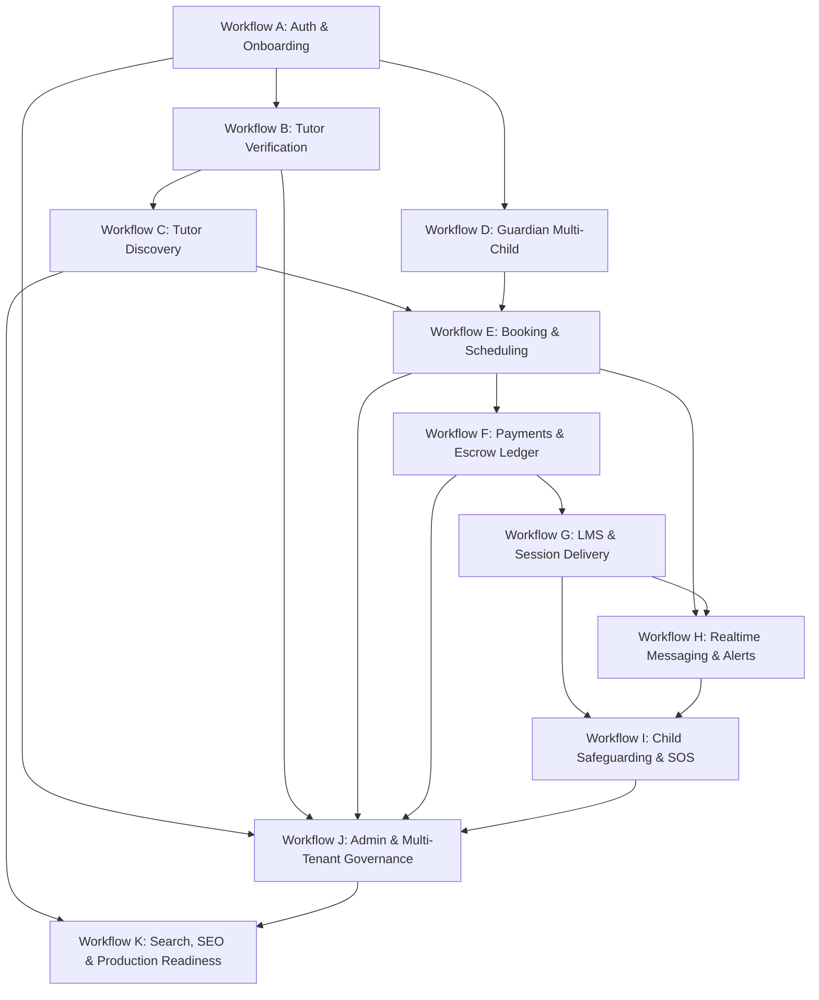

# Phase 11: End-to-End Business Workflow Validation — Business Workflow Catalog

## 1. Catalog Overview

This document defines the canonical specifications, state machines, actor responsibilities, preconditions, side effects, and validation criteria for all 11 critical business workflows (Workflows A through K) of the OgroniEdu platform.

---

## 2. Workflow Specifications

### Workflow A: Authentication, Onboarding, Role Provisioning & Session Lifecycle

- **Actors:** All 9 roles (`student`, `guardian`, `tutor`, `support_agent`, `compliance_reviewer`, `admin`, `super_admin`, `organization_owner`, `organization_staff`).
- **Description:** Complete identity lifecycle from initial registration, magic link / password authentication, role selection, profile onboarding, JWT session issuance, refresh rotation, and logout.
- **State Flow:**
  `Unregistered` $\to$ `Registered` $\to$ `Role Selected` $\to$ `Profile Onboarded` $\to$ `Active Session` $\to$ `Refreshed Session` $\to$ `Revoked / Logged Out`
- **Security Invariants:**
  - Refresh tokens are hashed and stored in database; rotation prevents token replay attacks.
  - Rate limiting enforced on login (5 attempts per minute per IP + account).
  - Passwords hashed with argon2/bcrypt; minimum length and complexity strictly enforced.

---

### Workflow B: Tutor Profile, Document Verification & 3-Level Badge Lifecycle

- **Actors:** `tutor`, `compliance_reviewer`, `admin`, `super_admin`.
- **Description:** Tutor builds subject offerings, educational background, hourly rates, and submits verification evidence across 3 distinct tiers:
  1. _Level 1 (Identity):_ National ID (NID) / Passport scan with biometric selfie.
  2. _Level 2 (Academic):_ Degree certificates, university transcripts, institutional credentials.
  3. _Level 3 (Background):_ Police clearance certificate / institutional recommendation.
- **State Flow:**
  `Draft` $\to$ `Submitted` $\to$ `Under Review` $\to$ `Level Approved / Rejected` $\to$ `Fully Verified`
- **Side Effects:**
  - Verified badges update tutor search ranking multiplier.
  - Compliance audit logs record reviewer ID, timestamp, and review rationale.

---

### Workflow C: Tutor Discovery, Geo-Radius Search, Catalog Filtering & Public Profile

- **Actors:** `student`, `guardian`, Anonymous Public Visitor.
- **Description:** Multi-criteria search allowing learners and parents to discover verified tutors by subject, education level (SSC, HSC, O/A Levels, University), curriculum (Bangla Medium, English Medium, English Version, Madrasah), price range, gender, rating, and geospatial radius.
- **Key Features:**
  - Trigram full-text search with Bengali/English term support.
  - Haversine geo-distance calculation with radius filtering.
  - SSR / Incremental Static Regeneration caching with SEO meta tags.
- **Acceptance Criteria:** Search queries respond in $<100\text{ms}$ with zero private data leakage (e.g. tutor phone/NID strictly masked).

---

### Workflow D: Guardian Multi-Child Management & Scoped Access

- **Actors:** `guardian`, `student`.
- **Description:** Multi-child management allowing a parent/guardian to link multiple dependent student accounts, monitor attendance, manage shared payment escrow, and inspect academic progress.
- **Security Invariants:**
  - Guardian can only access linked child profiles with active `guardian_student_links`.
  - Non-guardian users or guardians of other students are blocked with HTTP 403 Forbidden.
  - Emergency contact details and consent flags are enforced on all dependent bookings.

---

### Workflow E: Booking Proposal, Counter-Offer, Acceptance, Scheduling & Concurrency Safety

- **Actors:** `student`, `guardian`, `tutor`.
- **Description:** Lifecycle of a tutoring engagement from initial proposal, price/schedule negotiation, tutor acceptance, calendar slot reservation, and session generation.
- **State Flow:**
  `Draft` $\to$ `Requested` $\to$ `Counter-Offered` $\to$ `Accepted` $\to$ `Funded` $\to$ `Confirmed` $\to$ `In Progress` $\to$ `Completed` (or `Cancelled` / `Expired`)
- **Concurrency Protection:**
  - Pessimistic / optimistic calendar slot locking prevents double-booking of the same tutor time slot.
  - Expired proposals automatically release reserved locks after 48 hours.

---

### Workflow F: Payments, Escrow Ledger Invariant, Refunds, Disputed Holds & Payouts

- **Actors:** `guardian`, `student`, `tutor`, `admin`, Payment Gateways (bKash, SSLCOMMERZ).
- **Description:** Complete financial lifecycle governed by immutable double-entry bookkeeping:
  1. Guardian initiates payment order via bKash / SSLCOMMERZ.
  2. Webhook validates gateway signature and deposits funds into `Platform Escrow Liability`.
  3. Balanced journal entry posted: $\sum \text{Debit} = \sum \text{Credit}$.
  4. Per session completion, funds release from Escrow to Tutor Payable minus Platform Commission.
  5. In dispute/cancellation, automated refund rules reverse escrow to guardian account.
  6. Tutor requests payout disbursement to mobile wallet or bank account.
- **Ledger Invariance Rule:** Direct balance updates on accounts are impossible; balances are derived exclusively from immutable journal entries.

---

### Workflow G: LMS Learning Flow, Attendance Tracking, Milestone Verification & Session Delivery

- **Actors:** `student`, `tutor`, `guardian`.
- **Description:** Online/in-person session delivery, WebRTC classroom connection telemetry, digital whiteboard, attendance check-in/check-out, homework assignments, student submission, and tutor grading.
- **State Flow:**
  `Scheduled` $\to$ `Started` $\to$ `Attendance Recorded` $\to$ `Ended` $\to$ `Milestone Verified` $\to$ `Settled`
- **Key Validations:**
  - Minimum attendance duration threshold ($80\%$ of scheduled minutes) required for auto-milestone release.
  - Guardian receives real-time attendance alert upon student check-in.

---

### Workflow H: Realtime Messaging, Conversation Isolation & Centralized Notifications

- **Actors:** `student`, `guardian`, `tutor`, `support_agent`.
- **Description:** Secure end-to-end communication scoped by booking context:
  - Real-time WebSocket messaging with Socket.IO gateway (`/notifications`).
  - Automated outbox pattern for reliable message delivery and deduplication.
  - Multi-channel delivery: in-app toast, real-time push, persistent bell inbox, email fallback.
- **Security Invariants:**
  - Direct student-tutor messaging only allowed within confirmed booking relationships.
  - Off-platform payment contact exchange (phone/email/WhatsApp) blocked or flagged by automated content moderation filters.

---

### Workflow I: Child Safeguarding, SOS Incidents, Confidential Firewall & Compliance Investigation

- **Actors:** `student`, `guardian`, `tutor`, `compliance_reviewer`, `super_admin`.
- **Description:** Comprehensive safeguarding subsystem protecting vulnerable learners:
  - In-session Emergency SOS button immediately archives session video/telemetry and locks room.
  - Anonymous or attributed incident reporting with encrypted evidence attachments.
  - Strict confidentiality firewall: ordinary `admin` and `support_agent` roles have zero access.
  - Comprehensive investigation audit logs recording all clearance views and enforcement actions (tutor suspension, police referral).

---

### Workflow J: Admin Operations, Multi-Tenant Governance, Platform Settings & Audit Ledger

- **Actors:** `admin`, `super_admin`, `organization_owner`, `organization_staff`.
- **Description:** Platform and institutional agency management:
  - Multi-tenant tutoring agency onboarding with custom commission splits and team roles.
  - System configuration management: dynamic feature flags, maintenance mode, commission rates.
  - Tamper-evident audit ledger tracking all administrative actions with actor metadata, IP, and diff snapshots.

---

### Workflow K: Search, SEO, Security Headers, Accessibility & Production Readiness

- **Actors:** Public Users, Search Engine Crawlers, Security Scanners.
- **Description:** Production operational excellence:
  - Strict Content Security Policy (CSP), HSTS, X-Content-Type-Options, X-Frame-Options.
  - Next.js dynamic metadata, OpenGraph tags, JSON-LD structured data (Course, Person, Organization).
  - WCAG 2.1 AA accessibility compliance across all interactive components.
  - Sub-second server-side rendering and static page delivery.
