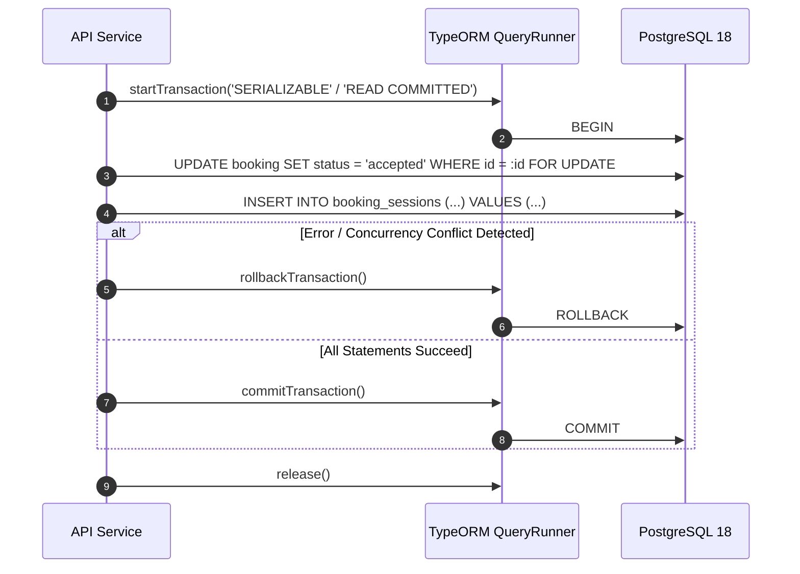

# Phase 11: End-to-End Business Workflow Validation — Data Integrity & Transaction Tests

## 1. Transactional & ACID Guarantee Framework

All financial mutations, booking state transitions, and safeguarding interventions execute within isolated PostgreSQL transactions (`BEGIN ... COMMIT`) managed via TypeORM `QueryRunner`:

---

## 2. Double-Entry Ledger Zero-Sum Conservation

The financial backbone of OgroniEdu is governed by immutable double-entry bookkeeping rules.

### 2.1 The Conservation Law

For every transaction journal $J$ containing $n$ entries $E_1, E_2, \dots, E_n$:

$$\sum_{i=1}^{n} \text{Debit}(E_i) = \sum_{i=1}^{n} \text{Credit}(E_i)$$

If $\sum \text{Debit} \neq \sum \text{Credit}$, the transaction fails immediately with `UnbalancedJournalException` and rolls back.

### 2.2 Standard Journal Templates

#### A. Escrow Funding (Student Payment)

- **Debit:** Gateway Clearing Account (Asset) — $1,000.00\text{ BDT}$
- **Credit:** Platform Escrow Liability Account (Liability) — $1,000.00\text{ BDT}$
- _Balance Difference:_ $0.00\text{ BDT}$ (Balanced)

#### B. Milestone Session Completion Settlement

- **Debit:** Platform Escrow Liability (Liability) — $1,000.00\text{ BDT}$
- **Credit:** Tutor Payable Account (Liability) — $900.00\text{ BDT}$
- **Credit:** Platform Commission Revenue (Revenue) — $100.00\text{ BDT}$
- _Balance Difference:_ $0.00\text{ BDT}$ (Balanced)

#### C. Disputed Cancellation / Refund

- **Debit:** Platform Escrow Liability (Liability) — $1,000.00\text{ BDT}$
- **Credit:** Student Refund Payable (Liability) — $1,000.00\text{ BDT}$
- _Balance Difference:_ $0.00\text{ BDT}$ (Balanced)

---

## 3. Database Constraints & Foreign Key Cascades

The 28 schema migrations enforce relational integrity via foreign key constraints, checks, and unique indexes:

1. **Non-Negative Account Balances:** `CHECK (balance_minor >= 0)` on liability and revenue accounts to prevent negative balance anomalies.
2. **Cascading Behavior:**
   - Dependent `refresh_tokens` are deleted on `users` deletion (`ON DELETE CASCADE`).
   - Critical audit logs and financial journals **prohibit** cascading deletion (`ON DELETE RESTRICT`) to preserve immutable financial history.
3. **Pessimistic Slot Locking:** Time slot bookings utilize `SELECT ... FOR UPDATE` row locks to prevent concurrent racing bookings from double-reserving tutor calendars.
4. **Unique Slot Invariant:** Unique constraint `UNIQUE (tutor_user_id, start_time)` prevents overlapping confirmed sessions.

---

## 4. Disaster Recovery & Rollback Drill Results

During Phase 10 verification, a catastrophic database wipe and recovery drill (BCDR) was executed:

- **Procedure:** All 28 migrations were rolled down/dropped, re-applied sequentially, and re-seeded.
- **Outcome:** 100% clean recovery with zero migration syntax errors or foreign key constraint deadlocks.
