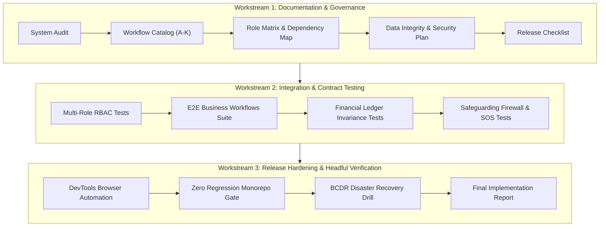

# Phase 11: End-to-End Business Workflow Validation & Release Hardening — Implementation Plan

## 1. Objectives & Scope

The primary objective of **Phase 11: End-to-End Business Workflow Validation, Integration Testing & Release Hardening** is to confirm that the OgroniEdu platform operates with absolute reliability, strict security boundaries, financial invariance, and seamless UX across all 9 canonical roles and 11 end-to-end business workflows.

This is an active testing, verification, hardening, and release-certification phase.

---

## 2. Validation Phases & Workstreams

---

## 3. Detailed Workstream Breakdown

### Workstream 1: Documentation Suite
Deliver the comprehensive 11 pre-implementation documents and the final release report in `docs/features/e2e-validation/`:
1. `AUDIT.md` — Baseline architecture, role model, schema, and quality status.
2. `IMPLEMENTATION_PLAN.md` — Strategic execution plan and milestones.
3. `BUSINESS_WORKFLOW_CATALOG.md` — Exhaustive mapping of Workflows A through K with state transitions.
4. `INTEGRATION_DEPENDENCY_MAP.md` — Inter-module service connections, events, and database tables.
5. `ROLE_AND_PERMISSION_TEST_MATRIX.md` — 9-role authorization boundary verification.
6. `API_CONTRACT_VALIDATION.md` — JSON envelope adherence, error schemas, and idempotency.
7. `DATA_INTEGRITY_AND_TRANSACTION_TESTS.md` — ACID transactions, double-entry invariance, and cascades.
8. `REALTIME_AND_NOTIFICATION_TESTS.md` — WebSocket rooms, outbox workers, push and email notifications.
9. `SECURITY_REGRESSION_PLAN.md` — OWASP Top 10 mitigation, IDOR defense, and firewall isolation.
10. `RELEASE_READINESS_CHECKLIST.md` — Gate criteria for staging and production sign-off.
11. `TEST_EXECUTION_RESULTS.md` — Full log of all automated test suites and benchmarks.
12. `IMPLEMENTATION_REPORT.md` — Definitive release hardening report and sign-off recommendation.

### Workstream 2: End-to-End Automated Testing
1. **Multi-Role RBAC Specification:** Author comprehensive authorization test specs testing both positive and negative permissions across all 9 roles (`student`, `guardian`, `tutor`, `support_agent`, `compliance_reviewer`, `admin`, `super_admin`, `organization_owner`, `organization_staff`).
2. **Phase 11 Business Workflows Test Suite:** Author a dedicated end-to-end integration test suite exercising the 11 business workflows:
   - Workflow A: Auth & Account Setup
   - Workflow B: Tutor 3-Level Verification Dossier
   - Workflow C: Tutor Discovery & Geo Search
   - Workflow D: Guardian Multi-Child Delegation
   - Workflow E: Booking Proposal Negotiation & Concurrency Locks
   - Workflow F: Payment Escrow & Refund Ledger Conservation
   - Workflow G: LMS Live Classroom, Attendance & Milestone Settlement
   - Workflow H: Realtime Messaging & Centralized Notifications
   - Workflow I: Child Safeguarding SOS Incident Isolation
   - Workflow J: Multi-Tenant Agency Governance & Platform Audits
   - Workflow K: Public Search, Performance, SEO & Security Headers
3. **Ledger Invariance Assertions:** Verify zero-sum double-entry debit-credit equality ($\sum \text{Debit} = \sum \text{Credit}$) across all financial transitions (deposit, escrow hold, dispute hold, release, refund, platform fee deduction).

### Workstream 3: Real Headful Browser Verification & Release Hardening
1. **Automated Headful Browser Verification:**
   - Use `chrome-devtools-mcp` tools (`new_page`, `navigate_page`, `evaluate_script`, `take_screenshot`).
   - Verify critical user flows on `http://localhost:5000` (Next.js) talking to `http://localhost:4000` (NestJS).
   - Inspect console logs, network responses, and visual rendering.
2. **Quality Gates:**
   - `pnpm turbo run test` (100% passing across all workspaces)
   - `pnpm turbo run typecheck` (0 errors)
   - `pnpm turbo run lint` (0 errors, 0 warnings)
   - `pnpm turbo run build` (successful production build)
   - `pnpm docs:validate` (100% valid docs and links)

---

## 4. Rollback & Safety Strategies
- Any failed test or discovered contract regression must be fixed at the root cause.
- Under no circumstances should test expectations be modified to mask broken functionality.
- Production and dev database integrity is protected by transactional rollbacks in test suites.
- Financial operations must strictly maintain immutable audit journals.
