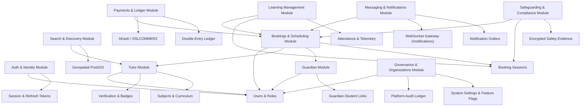
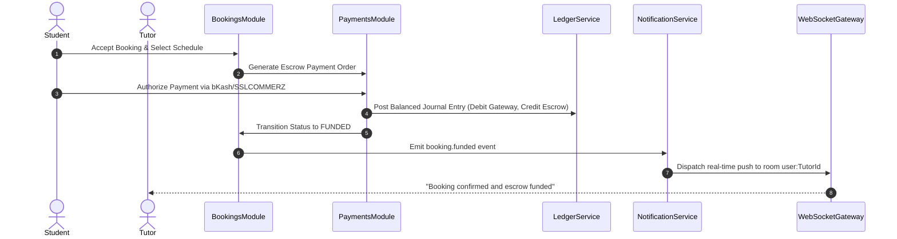

# Phase 11: End-to-End Business Workflow Validation — Integration Dependency Map

## 1. System Module Dependency Graph

The OgroniEdu platform is structured into modular domains that interact through strict TypeScript service contracts, event dispatchers, and transactional database foreign keys.

---

## 2. Shared Database Tables & Relationship Matrix

| Module Domain | Primary Tables Managed | Foreign Tables Referenced | Invariants & Constraints |
| :--- | :--- | :--- | :--- |
| **Identity & Auth** | `users`, `user_roles`, `user_profiles`, `refresh_tokens` | N/A | Unique normalized email/phone; cascading delete of expired refresh tokens. |
| **Tutors** | `tutor_profiles`, `tutor_qualifications`, `tutor_subjects` | `users` | 1-to-1 profile per user with `tutor` role; qualification evidence verification level tracking. |
| **Guardians** | `guardian_student_links`, `guardian_profiles` | `users` | Unique `(guardian_user_id, student_user_id)` pairs; verified parental consent flags. |
| **Bookings** | `bookings`, `booking_sessions`, `booking_proposals` | `users`, `tutor_profiles`, `subjects` | Non-overlapping scheduled time slots per tutor; immutable booking state transitions. |
| **Ledger & Payments** | `ledger_accounts`, `ledger_journals`, `ledger_entries`, `payment_orders`, `payment_transactions`, `escrow_holds` | `bookings`, `users` | Zero-sum journal balance ($\sum \text{Debit} = \sum \text{Credit}$); unique idempotency keys per gateway callback. |
| **Learning (LMS)** | `session_attendance`, `assignments`, `assignment_submissions`, `learning_progress` | `booking_sessions`, `users` | Attendance cannot be logged prior to scheduled start or for non-participating users. |
| **Messaging** | `conversations`, `conversation_members`, `booking_messages`, `message_attachments` | `bookings`, `users` | Conversation access strictly scoped to participants; content safety scan on attachments. |
| **Safeguarding** | `safety_reports`, `safety_evidence`, `safety_investigation_notes` | `booking_sessions`, `users` | Row-level security / service isolation; ordinary admins and accused users strictly barred. |
| **Organizations** | `organizations`, `organization_members`, `organization_invitations` | `users` | Multi-tenant scoping; invitation tokens expire after 7 days; unique active member links. |
| **Governance** | `system_settings`, `feature_flags`, `audit_logs` | `users` | Audit logs are append-only; system setting modifications require `super_admin` clearance. |

---

## 3. Cross-Module Event Bus & Notification Routing

Events emitted across domains trigger decoupled side effects through the centralized notification service and outbox worker:

---

## 4. External Gateway Integration Boundaries

### 4.1 Payment Gateways
- **bKash Tokenized Checkout:** Server-to-server signature verification, payment execution, query payment status, and automated refund API with zero balance leakage.
- **SSLCOMMERZ Hosted Session:** IPN (Instant Payment Notification) validation with validation ID, session status verification, and MD5/SHA256 signature checks.

### 4.2 WebRTC & Media Signaling
- In-browser WebSockets connect to `/notifications` with JWT authentication.
- Ephemeral tokens generated for interactive classroom sessions.

### 4.3 Object Storage (S3 / MinIO)
- Pre-signed upload URLs with strict MIME type validation (PDF, JPG, PNG) and file size constraints ($<10\text{MB}$).
- Evidence and verification documents stored with randomized encrypted prefixes.
