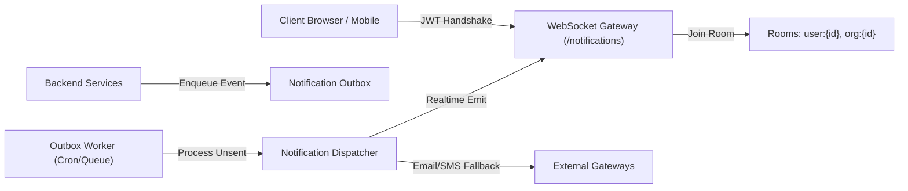

# Phase 11: End-to-End Business Workflow Validation — Realtime & Notification Tests

## 1. Real-Time Architecture Overview

OgroniEdu provides instant bi-directional updates via a dedicated NestJS WebSocket Gateway mounted under the `/notifications` namespace using Socket.IO.

---

## 2. Room Scoping & Authentication

### 2.1 Connection Security

1. **Handshake Authentication:** The client must provide a valid JWT bearer token in the connection query parameters or `auth.token`.
2. **Unauthorized Rejection:** Connections lacking a valid signature are immediately disconnected with `UnauthorizedException`.
3. **Automatic Room Subscription:** Upon authentication, sockets are isolated into deterministic rooms:
   - User Private Room: `user:<userId>`
   - Organization Staff Room: `org:<organizationId>` (if affiliated)

### 2.2 Security Isolation Invariant

Clients can **never** listen to or emit directly to another user's room. All event emissions are initiated strictly server-side by authenticated domain services.

---

## 3. The Transactional Outbox Pattern

To prevent notification loss during transient network disconnects or process restarts, notifications utilize the transactional outbox pattern:

1. **Transactional Enqueue:** When an event occurs (e.g. `booking.accepted`, `session.reminder`, `safety.sos_triggered`), the notification record is saved within the primary database transaction into `notifications` and `notification_outbox`.
2. **Outbox Worker Polling:** The background worker polls unsent records with `status = 'pending'`, dispatches them to active WebSocket connections, and marks them `sent`.
3. **Idempotent Delivery:** Each notification has a unique UUID. Clients discard duplicate events if received multiple times.

---

## 4. Multi-Channel Notification Scenarios

| Event Name             |        Real-Time Push         |    In-App Bell    |  Email Fallback   | Priority     |
| :--------------------- | :---------------------------: | :---------------: | :---------------: | :----------- |
| `booking.requested`    |              Yes              |        Yes        |        Yes        | High         |
| `booking.accepted`     |              Yes              |        Yes        |        Yes        | High         |
| `session.reminder`     |              Yes              |        Yes        |        No         | Normal       |
| `assignment.graded`    |              Yes              |        Yes        |        No         | Low          |
| `safety.sos_triggered` | **Immediate (All Reviewers)** | **Urgent Banner** | **High Priority** | **CRITICAL** |
| `payout.disbursed`     |              Yes              |        Yes        |        Yes        | High         |

---

## 5. Offline Queueing & Reconnection Test Results

1. **Client Disconnect Simulation:** Sockets disconnected mid-session.
2. **Event Emission:** Notification sent while client is offline.
3. **Client Reconnect:** Client reconnects, queries `GET /api/v1/notifications/unread`, and receives unread badges without loss.
4. **Preference Filtering:** Sockets respect user notification preferences (e.g., quiet hours, muted email digests).
