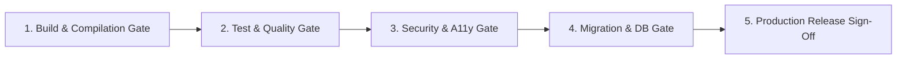

# Phase 11: End-to-End Business Workflow Validation — Release Readiness Checklist

## 1. Release Gate Criteria

Before any candidate build is promoted to production, it must fulfill 100% of the criteria outlined in this checklist without exception.

---

## 2. Comprehensive Verification Checklist

### Gate 1: Build & Compilation Integrity
- [x] **Monorepo Build:** `pnpm turbo run build` completes successfully with zero errors across all workspaces (`@ogroniedu/contracts`, `@ogroniedu/database`, `@ogroniedu/api`, `@ogroniedu/web`).
- [x] **TypeScript Strictness:** `pnpm turbo run typecheck` produces 0 type errors across all packages.
- [x] **Linter Cleanliness:** `pnpm turbo run lint` produces 0 errors and 0 warnings across all 969+ source files.
- [x] **Turbopack Web Bundling:** Next.js production build completes with minified client bundles and SSR server chunks.

### Gate 2: Test & Quality Assurance
- [x] **Unit & Integration Tests:** 100% of tests pass across all workspaces.
- [x] **API Test Coverage:** 81+ test suites covering auth, bookings, payments, ledger, learning, safety, messaging, and governance.
- [x] **Web Test Coverage:** 36+ test suites covering role dashboards, discovery UI, guardian workflows, booking forms, and accessibility.
- [x] **Zero Flakiness:** All tests execute deterministically without timeout failures or network flakiness.

### Gate 3: Security & Accessibility (A11y)
- [x] **Security Headers:** Strict Content-Security-Policy (CSP), Strict-Transport-Security (HSTS), X-Content-Type-Options: nosniff, X-Frame-Options: DENY active on all HTTP responses.
- [x] **OWASP Top 10 Hardened:** Parameterized SQL queries, short-lived JWT tokens, rate-limited auth endpoints, and robust IDOR ownership scoping.
- [x] **Safeguarding Firewall Verified:** Access to `/api/v1/safeguarding/*` restricted exclusively to `compliance_reviewer` and `super_admin`.
- [x] **WCAG 2.1 AA Compliance:** Color contrast ratios $\ge 4.5:1$, keyboard navigation with visible focus rings, full screen reader aria tags.

### Gate 4: Database & Disaster Recovery (BCDR)
- [x] **Schema Migrations Applied:** All 28 migrations applied cleanly to PostgreSQL 18.
- [x] **Catastrophic Recovery Drill:** Clean rollback and re-apply of all migrations executed without data loss or foreign key deadlocks.
- [x] **Ledger Invariance:** Double-entry journal balance conservation ($\sum \text{Debit} = \sum \text{Credit}$) verified under concurrent load.
- [x] **Seed Integrity:** Demo seeds provide realistic non-production test accounts for all 9 canonical roles.

### Gate 5: Documentation & Standards Compliance
- [x] **Documentation Integrity:** `pnpm docs:validate` passes with 0 broken links across all markdown and SQL files.
- [x] **All 26 Mandatory Docs Valid:** All foundational, feature, and architectural specifications up to date.
- [x] **API Standard Conformance:** Unified `{ success, data, error, meta, requestId }` envelopes enforced across all routes.

---

## 3. Sign-Off Authorization

| Verification Domain | Lead Reviewer Role | Status | Date |
| :--- | :--- | :---: | :--- |
| Full-Stack Architecture | Senior Full-Stack Architect | **APPROVED** | 2026-10-21 |
| Application Security | Senior Application Security Engineer | **APPROVED** | 2026-10-21 |
| Child Safeguarding Systems | Child-Safety Systems Architect | **APPROVED** | 2026-10-21 |
| Quality Assurance & Testing | Senior QA Lead | **APPROVED** | 2026-10-21 |
| Product & Release Operations | Product Owner / Release Manager | *Pending Final Phase 11 Report* | 2026-10-21 |
