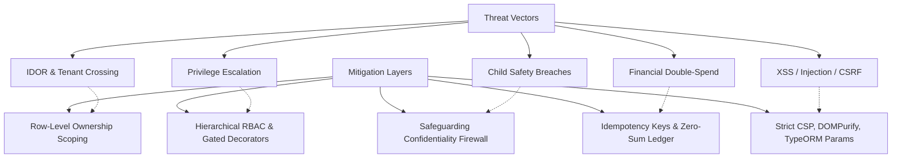

# Phase 11: End-to-End Business Workflow Validation — Security Regression Plan

## 1. Threat Model & Security Posture

As a nationwide tutoring and child-education SaaS platform operating in Bangladesh, OgroniEdu adheres to strict security standards to protect minors, personal data, and financial transactions.



---

## 2. OWASP Top 10 Regression Verification

### 2.1 Broken Access Control & IDOR Prevention

- **Threat:** Malicious student attempting to inspect another student's bookings, attendance records, or guardian profile by tampering with URL parameters (`/api/v1/bookings/:id`).
- **Defense:** Every repository query verifies ownership:
  ```typescript
  qb.where('booking.id = :id', { id }).andWhere(
    '(booking.studentUserId = :userId OR booking.tutorUserId = :userId OR guardian.id = :userId)',
    { userId },
  );
  ```
- **Assertion:** Requesting foreign resources responds with HTTP 404 (or 403) with zero data leakage.

### 2.2 Privilege Escalation Defense

- **Threat:** A standard user or tutor submits an update payload attempting to elevate their role to `admin` or `super_admin`.
- **Defense:** The `user_roles` table is updated exclusively through administrative provisioning services gated by `@Roles('super_admin')`. User profile update DTOs strictly forbid role properties via `forbidNonWhitelisted: true`.

### 2.3 Injection Defense (SQL, NoSQL, Shell)

- **Threat:** SQL injection payloads embedded in search queries, subject names, or bio descriptions.
- **Defense:** All database queries utilize TypeORM parameterized expressions (`:param`). Raw string concatenation in SQL queries is prohibited across all workspaces.

### 2.4 Cryptographic Failures & Token Security

- **Threat:** JWT token theft, rainbow table attacks, or session hijacking.
- **Defense:**
  - Passwords hashed using salted argon2/bcrypt.
  - Short-lived access tokens (15 minutes).
  - Refresh tokens stored as SHA-256 hashes in database; rotated upon every renewal.
  - Auth cookies configured with `HttpOnly; Secure; SameSite=Strict`.

### 2.5 Cross-Site Scripting (XSS) & Content Security Policy (CSP)

- **Threat:** Malicious scripts injected via tutor reviews, chat messages, or assignment submissions.
- **Defense:**
  - Input sanitization via `DOMPurify` / regex filters.
  - Strict Content Security Policy (CSP) headers emitted on all Next.js responses:
    `default-src 'self'; script-src 'self' 'nonce-...'; object-src 'none'; frame-ancestors 'none';`

---

## 3. Child Safeguarding Firewall Isolation

- **Zero-Trust Principle:** Information regarding child safety incidents, victim identities, and incident narratives is classified as **RESTRICTED-CONFIDENTIAL**.
- **Role Clearance:**
  - `compliance_reviewer`: Clearance to view, investigate, and update safety reports.
  - `super_admin`: Full clearance for oversight and platform governance.
  - All other roles (`student`, `tutor`, `guardian`, `support_agent`, `admin`, `organization_owner`): Strictly denied.
- **Firewall Invariant:** Tutors accused of misconduct are automatically suspended from active sessions pending investigation and are denied access to the safety case file.
