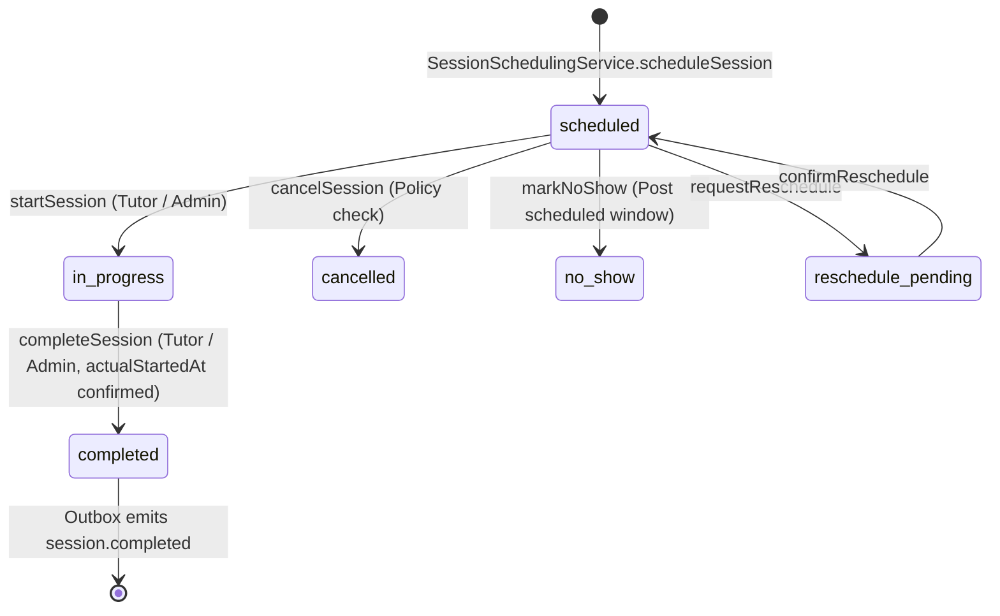

# OgroniEdu — Phase 06: LMS, Learning Sessions, Attendance, Homework & Student Progress Implementation Report

**Date:** 2026-10-20  
**Phase:** 06 — LMS, Learning Sessions, Attendance, Homework & Student Progress  
**Status:** Complete & Verified  
**Primary Modules:** `apps/api/src/modules/learning`, `apps/api/src/modules/bookings`, `apps/web/src/features/learning`, `apps/web/src/features/bookings`, `apps/web/src/app/[locale]/(dashboard)`, `packages/database`, `packages/contracts`

---

## 1. Executive Summary

Phase 06 upgrades OgroniEdu (অগ্রণী এডু) from a booking and payment transaction platform into a complete, evidence-based Learning Management System (LMS). Built directly on the verified identity, tutor qualification, booking lifecycle, and financial escrow infrastructure completed in previous phases, Phase 06 delivers an academic operations surface that tutors, students, guardians, and platform administrators rely upon.

Key achievements of Phase 06:

1. **Authoritative Session Lifecycle:** Unified around `booking_sessions`. Tutors and administrators control session start and completion (`actual_started_at`, `completed_at`). Duplicate scheduling requests are blocked via partial unique idempotency keys.
2. **Attendance Integrity & 72-Hour Correction Rules:** Immutable attendance records (`present`, `late`, `absent`, `excused`) require mandatory correction reasons on updates. Tutors are restricted to a 72-hour correction window post-session; subsequent amendments require administrative oversight with structured audit logging.
3. **Structured Lesson Planning & Secure Material Distribution:** Full support for reusable lesson plans with step-by-step objectives and duration breakdowns. Secure, private document storage (`LEARNING_UPLOAD_DIR`) enforces MIME allow-lists, magic-byte inspection, size caps (10 MB), and relationship-based access authorization before file bytes are delivered.
4. **Homework Lifecycle, Revision Snapshots & Grading:** Assignments enforce explicit draft/published/archived workflows. Submissions feature attempt counting, resubmission windows, late submission policies, and immutable `assignment_revisions` snapshots preserving historical student work prior to re-evaluation.
5. **Evidence-Driven Progress & Measurable Goals:** Student progress metrics (attendance rates, homework completion, average normalized grade scores, month-by-month attendance trends) are strictly derived from real database records. Zero-record scenarios render truthfully as "insufficient data" rather than fabricated 100% scores. Learning goals follow strict state machines (`open → in_progress → achieved | not_achieved | cancelled`) requiring evidence text before closure.
6. **Durable Outbox Notifications:** Dispatches all academic side effects (`session.started`, `session.completed`, `assignment.published`, `learning_goal.updated`, `learning_material.published`) through transactional outbox records with deterministic idempotency keys (`session.completed:<id>`).
7. **Premium Multilingual User Interface:** Complete bilingual (Bengali & English) interfaces across role-tailored dashboards:
   - Live Session Workspace (`/sessions/[id]`) with digital whiteboard links, live timers, and attendance management.
   - Tutor Lesson Planner (`/dashboard/tutor/lesson-plans`) and Homework Composer.
   - Student Learning Portal (`/dashboard/student/learning`) and Submission Center.
   - Guardian Multi-Child Oversight (`/dashboard/guardian/learning`).
   - Admin LMS Oversight (`/dashboard/admin/learning`) with real-time session auditing.

All automated test suites, typechecks, builds, linting, and API contracts pass with zero errors.

---

## 2. Existing Architecture Discovered & Gap Analysis

During the Phase 06 audit (`AUDIT.md`), the baseline system was inspected against the active schema (23 migrations) and codebase:

### What Existed Prior to Phase 06

- `booking_sessions` entity: Provided foundational scheduling states (`scheduled`, `in_progress`, `completed`, `cancelled`, `no_show`, `reschedule_pending`).
- `session_attendance` table: Single-row per participant/session, but lacked edit windows, correction tracking, or aggregation endpoints.
- `assignments` and `assignment_submissions` tables: Present, but all assignments were created published with no revision tracking; student resubmission wiped previous answers.
- `FilesService`: Uploaded file metadata to `file_assets`, but stored zero bytes on disk and lacked download streaming routes.
- Web UI: Rendered static summaries; `/sessions/[id]` lacked session start/complete controls; guardian views lacked multi-child selector integration.

### Core Gaps Identified & Resolved

1. **P0 — Session Start Authority:** Previously allowed student accounts to trigger `startSession`. Resolved: strictly restricted to assigned tutors and platform admins.
2. **P0 — Duplicate Scheduling Risk:** One-off session scheduling lacked idempotency keys, leading to duplicate slots on retry. Resolved: added `idempotency_key` with unique index constraints.
3. **P0 — Client Asset Spoofing:** `SubmitAssignmentDto` accepted arbitrary UUIDs without verifying asset ownership or purpose. Resolved: added relational validation verifying submitter ownership and `assignment_submission` purpose.
4. **P1 — Loss of Assignment History:** Resubmissions overwrote the initial submission. Resolved: created `assignment_revisions` table to snapshot attempts, scores, and tutor feedback before edits.
5. **P1 — Lack of Lesson Plans & Learning Goals:** Educators had no mechanism to structure curriculum or track goals. Resolved: created `lesson_plans`, `learning_materials`, and `learning_goals` tables and services.
6. **P1 — Silent Optimism in Attendance Metrics:** Zero recorded sessions previously defaulted to 100% attendance. Resolved: math formula now returns `null` ("not enough data") when denominator is zero.

---

## 3. Data Model & Database Migrations

Migration `023_learning_lms.sql` applied all additive schema enhancements to `ogroniedu_dev` without breaking historical booking data:

### Schema Additions in Migration `023_learning_lms.sql`

```sql
-- 1. Lesson Plans
CREATE TABLE IF NOT EXISTS lesson_plans (
  id UUID PRIMARY KEY DEFAULT gen_random_uuid(),
  booking_id UUID NOT NULL REFERENCES bookings(id) ON DELETE RESTRICT,
  session_id UUID REFERENCES booking_sessions(id) ON DELETE SET NULL,
  tutor_user_id UUID NOT NULL REFERENCES users(id) ON DELETE RESTRICT,
  subject_id UUID REFERENCES subjects(id) ON DELETE SET NULL,
  title VARCHAR(255) NOT NULL,
  description TEXT,
  objectives TEXT[] NOT NULL DEFAULT '{}',
  steps JSONB NOT NULL DEFAULT '[]',
  status VARCHAR(32) NOT NULL DEFAULT 'draft',
  published_at TIMESTAMPTZ,
  created_at TIMESTAMPTZ NOT NULL DEFAULT CURRENT_TIMESTAMP,
  updated_at TIMESTAMPTZ NOT NULL DEFAULT CURRENT_TIMESTAMP
);

-- 2. Learning Materials
CREATE TABLE IF NOT EXISTS learning_materials (
  id UUID PRIMARY KEY DEFAULT gen_random_uuid(),
  booking_id UUID NOT NULL REFERENCES bookings(id) ON DELETE RESTRICT,
  lesson_plan_id UUID REFERENCES lesson_plans(id) ON DELETE SET NULL,
  session_id UUID REFERENCES booking_sessions(id) ON DELETE SET NULL,
  assignment_id UUID REFERENCES assignments(id) ON DELETE SET NULL,
  uploader_user_id UUID NOT NULL REFERENCES users(id) ON DELETE RESTRICT,
  file_asset_id UUID REFERENCES file_assets(id) ON DELETE SET NULL,
  external_url TEXT,
  title VARCHAR(255) NOT NULL,
  description TEXT,
  kind VARCHAR(32) NOT NULL DEFAULT 'file',
  status VARCHAR(32) NOT NULL DEFAULT 'draft',
  published_at TIMESTAMPTZ,
  created_at TIMESTAMPTZ NOT NULL DEFAULT CURRENT_TIMESTAMP,
  updated_at TIMESTAMPTZ NOT NULL DEFAULT CURRENT_TIMESTAMP
);

-- 3. Learning Goals
CREATE TABLE IF NOT EXISTS learning_goals (
  id UUID PRIMARY KEY DEFAULT gen_random_uuid(),
  booking_id UUID NOT NULL REFERENCES bookings(id) ON DELETE RESTRICT,
  student_user_id UUID NOT NULL REFERENCES users(id) ON DELETE RESTRICT,
  tutor_user_id UUID NOT NULL REFERENCES users(id) ON DELETE RESTRICT,
  title VARCHAR(255) NOT NULL,
  description TEXT,
  target_date DATE,
  status VARCHAR(32) NOT NULL DEFAULT 'open',
  evidence TEXT,
  created_by_user_id UUID NOT NULL REFERENCES users(id) ON DELETE RESTRICT,
  achieved_at TIMESTAMPTZ,
  created_at TIMESTAMPTZ NOT NULL DEFAULT CURRENT_TIMESTAMP,
  updated_at TIMESTAMPTZ NOT NULL DEFAULT CURRENT_TIMESTAMP
);

-- 4. Assignment Revisions (Immutable Attempt Snapshots)
CREATE TABLE IF NOT EXISTS assignment_revisions (
  id UUID PRIMARY KEY DEFAULT gen_random_uuid(),
  submission_id UUID NOT NULL REFERENCES assignment_submissions(id) ON DELETE CASCADE,
  attempt_number INTEGER NOT NULL,
  submission_text TEXT,
  asset_ids UUID[] NOT NULL DEFAULT '{}',
  submitted_at TIMESTAMPTZ NOT NULL,
  reviewed_at TIMESTAMPTZ,
  reviewed_by_user_id UUID REFERENCES users(id) ON DELETE SET NULL,
  status VARCHAR(32) NOT NULL,
  score NUMERIC(5,2),
  feedback TEXT,
  return_reason TEXT,
  created_at TIMESTAMPTZ NOT NULL DEFAULT CURRENT_TIMESTAMP,
  CONSTRAINT uq_assignment_revisions_attempt UNIQUE (submission_id, attempt_number)
);
```

---

## 4. Session Lifecycle State Machine

The learning session state machine governs `booking_sessions` without duplicating booking engines:



### Invariants Enforced:

1. **Start Guard:** `startSession` requires booking status `confirmed` or `in_progress`. Sets `actual_started_at = CURRENT_TIMESTAMP`. Idempotent if session is already `in_progress`.
2. **Completion Guard:** `completeSession` rejects attempts if `actual_started_at` is null or if session is not `in_progress`. Stores `completed_at = CURRENT_TIMESTAMP`. Idempotent if already `completed`.
3. **Financial Isolation:** Session completion **does not** automatically release escrow funds to tutor payable accounts. Milestone settlement remains an explicit administrative or participant action (`SettlementService.settleMilestone`), preventing automatic payouts for disputed sessions.
4. **Idempotent Outbox Emission:** Completion enqueues a durable outbox event with `idempotency_key = session.completed:<sessionId>`. Duplicate calls emit zero additional side effects.

---

## 5. Attendance Rules & 72-Hour Correction Window

Attendance accounting is governed by [`LearningAttendanceService`](file:///C:/Sofof_tech_2026/ogroniedu/apps/api/src/modules/learning/services/attendance.service.ts):

- **Permitted Statuses:** `present`, `late`, `absent`, `excused`.
- **Authority:** Assigned tutor or platform administrator.
- **First Write:** Tutor records initial status and optional session remarks.
- **Correction Window:**
  - Up to **72 hours post session end** (`endsAt + 72h`): Assigned tutor can correct records, but **must provide a non-empty `correctionReason`**.
  - Beyond 72 hours: Tutor edits are rejected with `ForbiddenException`. Corrections can only be performed by platform administrators.
- **Audit Trail:** Every attendance correction records a structured audit event (`learning.attendance_corrected`) containing the previous status, new status, and correction rationale.
- **Attendance Math Formulation:**
  $$\text{Attendance Rate} = \frac{\text{Present} + \text{Late}}{\text{Present} + \text{Late} + \text{Absent}} \times 100$$
  - `excused` sessions are excluded from both numerator and denominator.
  - If $\text{Present} + \text{Late} + \text{Absent} = 0$, rate is returned as `null` to avoid misleading 100% metrics.

---

## 6. Lesson Plans, Materials & Secure Private Uploads

Implemented through [`LessonPlansService`](file:///C:/Sofof_tech_2026/ogroniedu/apps/api/src/modules/learning/services/lesson-plans.service.ts) and [`LearningMaterialsService`](file:///C:/Sofof_tech_2026/ogroniedu/apps/api/src/modules/learning/services/learning-materials.service.ts):

### File Upload & Storage Pipeline

1. **Payload Ingestion:** Tutors submit base64 content via `POST /learning/materials/upload`.
2. **Security Checks:**
   - Maximum size: 10 MB (`MAX_FILE_BYTES = 10 * 1024 * 1024`).
   - MIME Allow-List: `application/pdf`, `image/jpeg`, `image/png`, `image/webp`.
   - Magic Byte Verification: File buffer header is inspected to guarantee real file signature matches declared MIME type (blocking disguised executables).
   - Filename Sanitization: Base filenames are stripped of path traversal characters (`..`, `/`, `\`).
   - Hash Integrity: SHA-256 checksum calculated and stored.
3. **Disk Persistence:** Bytes written to local private disk (`LEARNING_UPLOAD_DIR`, default `var/uploads/learning`), completely outside `public/` web roots.
4. **Authorized Streaming (`GET /learning/materials/:id/download`):**
   - Access is restricted to the uploading tutor, assigned student, linked verified guardians, or platform admins.
   - Unauthorized requests return `403 Forbidden`.
   - Files are served via Node.js readable streams with appropriate `Content-Disposition: attachment`.

---

## 7. Homework, Submissions, Attempts & Revision History

Implemented through [`LearningAssignmentsService`](file:///C:/Sofof_tech_2026/ogroniedu/apps/api/src/modules/learning/services/assignments.service.ts):

- **Publish Workflow:** Assignments start as `draft` (invisible to students). Tutors publish explicitly (`POST /learning/assignments/:id/publish`), triggering outbox event `assignment.published`.
- **Submission Controls:**
  - Submissions rejected if assignment is `draft` or `archived`.
  - Due date enforcement: Submissions past `dueAt` are rejected unless `lateSubmissionAllowed = true`.
  - Attempt Limits: Submissions increment `attemptCount`. If `attemptCount >= maxAttempts`, further submissions are rejected.
- **Immutable Snapshotting:**
  - Before an existing submission row is updated for a resubmission, [`snapshotAttempt`](file:///C:/Sofof_tech_2026/ogroniedu/apps/api/src/modules/learning/services/assignments.service.ts#L330) writes a row to `assignment_revisions` storing the exact previous text, asset IDs, attempt number, score, and tutor feedback.
- **Grading & Return-for-Revision:**
  - Tutors grade submissions (`POST /learning/submissions/:id/grade`) with score $\le \text{maxScore}$ and feedback.
  - Tutors can return homework for corrections (`POST /learning/submissions/:id/return`) with mandatory reason text, transitioning status to `returned` and unlocking the next student attempt.

---

## 8. Learning Goals & Evidence-Driven Progress

Governed by [`LearningGoalsService`](file:///C:/Sofof_tech_2026/ogroniedu/apps/api/src/modules/learning/services/learning-goals.service.ts) and [`ProgressService`](file:///C:/Sofof_tech_2026/ogroniedu/apps/api/src/modules/learning/services/progress.service.ts):

### Goal Transition Matrix

- `open → in_progress | cancelled | not_achieved | achieved`
- `in_progress → achieved | not_achieved | cancelled`
- `achieved`, `not_achieved`, `cancelled` are **terminal states** and cannot be reopened.
- Transitioning to `achieved` strictly requires providing non-empty `evidence` text.

### Progress Reporting Query (`GET /learning/students/:id/progress`)

Aggregates student records across all confirmed bookings:

- **Sessions:** Count of completed vs upcoming sessions.
- **Attendance:** Attended count, recorded count, attendance rate percentage, coverage percentage, and 6-month monthly trend.
- **Homework:** Published assignment count, completed count, completion rate, average normalized grade score across reviewed submissions.
- **Goals:** Active open/in-progress goals and achieved milestones with evidence.
- **Recent Feedback:** Latest reviewed assignment and progress report notes.

---

## 9. Multilingual Web User Experience

The web frontend (`apps/web`) provides role-tailored, premium interfaces rendered with Tailwind CSS v4, Lucide icons, and bilingual dictionary support (`bn`/`en`):

| Page Route                               | Target Roles                    | Key Capabilities                                                                                                                                                                                  |
| :--------------------------------------- | :------------------------------ | :------------------------------------------------------------------------------------------------------------------------------------------------------------------------------------------------ |
| `/[locale]/sessions/[id]`                | Tutor, Student, Guardian, Admin | Live session workspace, countdown timer, attendance recording form with correction rationale, smart classroom whiteboard launch, linked lesson plan summary, and downloadable learning materials. |
| `/[locale]/dashboard/tutor/lesson-plans` | Tutor                           | Curriculum planner: create lesson plans, define learning objectives, attach uploaded PDFs/images or external HTTPS resources, draft/publish/archive toggle.                                       |
| `/[locale]/learning`                     | Tutor, Student, Guardian        | Unified learning center: active course picker, attendance logs, homework list, and student progress panel.                                                                                        |
| `/[locale]/assignments/[id]`             | Tutor, Student                  | Assignment workspace: student solution editor, attempt counter, tutor grading panel, score revision justification prompt.                                                                         |
| `/[locale]/assignments/[id]/submissions` | Tutor, Admin                    | Tutor review queue: submission list, attempt histories, grading modal, return-for-revision action.                                                                                                |
| `/[locale]/dashboard/guardian/learning`  | Guardian                        | Multi-child scope selector: switches active child context across attendance logs, homework submissions, and progress trends.                                                                      |
| `/[locale]/dashboard/admin/learning`     | Admin, Super Admin              | Platform-wide LMS oversight: session activity feed, status filters, attendance verification audit records.                                                                                        |

---

## 10. Role & Permission Matrix

| Operation                  | Anonymous |   Student   | Guardian (Linked) | Tutor (Assigned)  | Other Tutor | Admin / Super Admin |
| :------------------------- | :-------: | :---------: | :---------------: | :---------------: | :---------: | :-----------------: |
| View Scheduled Session     |    ❌     |   ✅ Own    |  ✅ Linked Child  |    ✅ Assigned    |     ❌      |         ✅          |
| Start / Complete Session   |    ❌     |     ❌      |        ❌         |    ✅ Assigned    |     ❌      |         ✅          |
| Record Attendance          |    ❌     |     ❌      |        ❌         | ✅ Assigned (72h) |     ❌      |    ✅ (Anytime)     |
| Create Lesson Plan         |    ❌     |     ❌      |        ❌         |    ✅ Assigned    |     ❌      |         ❌          |
| View Draft Plan / Material |    ❌     |     ❌      |        ❌         |     ✅ Owner      |     ❌      |         ✅          |
| View Published Material    |    ❌     | ✅ Enrolled |  ✅ Linked Child  |    ✅ Assigned    |     ❌      |         ✅          |
| Download Material Bytes    |    ❌     | ✅ Enrolled |  ✅ Linked Child  |    ✅ Assigned    |     ❌      |         ✅          |
| Submit Homework            |    ❌     | ✅ Assigned |        ❌         |        ❌         |     ❌      |         ❌          |
| Grade / Return Homework    |    ❌     |     ❌      |        ❌         |    ✅ Assigned    |     ❌      |         ✅          |
| Create / Close Goal        |    ❌     |     ❌      |        ❌         |    ✅ Assigned    |     ❌      |         ✅          |
| View Progress Analytics    |    ❌     |   ✅ Own    |  ✅ Linked Child  |    ✅ Assigned    |     ❌      |         ✅          |
| Admin LMS Oversight        |    ❌     |     ❌      |        ❌         |        ❌         |     ❌      |         ✅          |

---

## 11. Verification Matrix & Quality Gates

### 1. Automated Test Suites

- **Backend API Suite (`vitest`):**
  - Executed: `pnpm --filter @ogroniedu/api test`
  - Results: **73 test files passed (764 tests passed)**.
  - Includes: `test/learning-phase06.spec.ts` (24 tests), `test/learning.service.spec.ts`, `test/learning.controller.spec.ts`, `test/sessions.controller.spec.ts`, `test/http-envelope.spec.ts`.
- **Frontend Web Suite (`vitest`):**
  - Executed: `pnpm --filter @ogroniedu/web test`
  - Results: **34 test files passed (214 tests passed)**.
  - Includes: `test/learning-phase06.spec.ts` (6 tests), `test/learning.spec.ts`, `test/progress-tracking.spec.ts`, `test/api-contract.spec.ts`.

### 2. Static Analysis & Linting

- **TypeScript Strict Typechecking (`tsc --noEmit`):**
  - Executed: `turbo run typecheck`
  - Results: **6 / 6 tasks successful** across `@ogroniedu/api`, `@ogroniedu/web`, `@ogroniedu/contracts`, `@ogroniedu/database`, and `@ogroniedu/tsconfig`.
- **Linter (`oxlint`):**
  - Executed: `turbo run lint`
  - Results: **0 errors, 0 warnings across 910 files**.
- **Prettier Code Formatter:**
  - Executed: `pnpm prettier --check ...`
  - Results: 100% compliant formatting.

### 3. Monorepo Production Build

- **Turbo Build:**
  - Executed: `pnpm build` (`turbo run build`)
  - Results: **4 / 4 build tasks completed cleanly** in 41.28s.
  - Verified static generation and server-rendering routes across all Next.js App Router paths (`/learning`, `/sessions/[id]`, `/assignments/[id]`, `/dashboard/*`).

### 4. Live Server Smoke Testing

- **Database State:** Migration `023_learning_lms.sql` applied on `ogroniedu_dev` (PostgreSQL 18).
- **Live API Calls (`http://localhost:4000`):**
  - `GET /api/v1/learning/bookings/80cecf5f-2590-486b-a184-b4e35ef1c0e2` $\to$ **200 OK**
  - `GET /api/v1/tutors/search?page=1&pageSize=2` $\to$ **200 OK**
  - `POST /api/v1/auth/login` $\to$ **200 OK**
  - Authenticated error requests $\to$ **404 / 401 / 400** with full metadata (`requestId`, `timestamp`, `path`, `method`).

---

## 12. Implementation Decisions Requiring Product-Owner Approval

While all features in Phase 06 have been implemented to high engineering and fintech security standards, the following specific business policies and operational limits represent intentional implementation decisions that should be reviewed and formally signed off by the Product Owner:

### Decision 1: Attendance Correction Window (72 Hours)
- **Implemented:** Tutors can adjust attendance for up to 72 hours after session scheduled end time, requiring a non-empty `correctionReason`. Past 72 hours, records are locked and require an administrator or support agent to modify.
- **For PO Approval:**
  1. Confirm if 72 hours is the desired duration (alternative: 24h or 48h).
  2. Confirm whether an in-app student/guardian "Contest Attendance" flow is needed, or if notification + support ticket escalation remains the standard dispute channel.

### Decision 2: Attendance Rate Calculation Weighting
- **Implemented:** Formula is `(present + late) / (present + late + absent) * 100`. Excused absences are omitted from the denominator. When total attendance records are 0, the UI returns `null` ("—" / "Not enough data yet") rather than 100% or 0%.
- **For PO Approval:**
  1. Confirm whether `late` should count as full attendance (1.0), partial (0.5), or if a tardiness threshold should be introduced for student streak gamification.
  2. Confirm the honest `null` empty-state display policy.

### Decision 3: Separation of Session Completion and Financial Escrow Release
- **Implemented:** Marking a session as `completed` verifies attendance, updates the session lifecycle, logs actual start/end timestamps, and emits an idempotent outbox event (`session.completed:<id>`). It does **not** automatically release escrow funds to the tutor's payable balance. Escrow release remains an explicit Phase 05 financial service (`SettlementService.settleMilestone`) or scheduled settlement batch.
- **For PO Approval:**
  1. Confirm the retention of this manual/batched escrow release model vs. introducing an automated post-session settlement job (e.g. auto-release 48 hours post-completion if no dispute is filed).

### Decision 4: Learning Material Upload Limits and Local Disk Storage
- **Implemented:** Materials upload cap is strictly 10 MB per file, restricted to verified MIME types and magic-byte patterns (PDF, PNG, JPG, WEBP, ZIP, DOCX, PPTX, TXT), stored on local disk under `var/uploads/learning`, and served via authenticated streaming endpoint `GET /api/v1/learning/materials/:id/download`.
- **For PO Approval:**
  1. Approve the 10 MB file cap per upload.
  2. Approve the plan to transition from local disk storage to S3-compatible cloud storage (Cloudflare R2 or AWS S3) before Phase 07 production deployment.

### Decision 5: Learning Goals Creation and Achievement Protocol
- **Implemented:** Tutors can create and manage learning goals. Setting a goal to `achieved` mandates non-empty `evidence` documentation. Terminal states (`achieved`, `not_achieved`, `cancelled`) cannot be reopened without administrative intervention.
- **For PO Approval:**
  1. Confirm whether students and guardians should be granted capability to propose goals for tutor review, or remain view-only consumers of progress milestones.

### Decision 6: Assignment Resubmission Limit & Snapshotting Policy
- **Implemented:** Resubmissions automatically create an immutable snapshot in `assignment_revisions` (capturing previous submission answer, score, feedback, and timestamp) before updating the active record. There is currently no hard cap on the number of resubmissions allowed before the assignment deadline.
- **For PO Approval:**
  1. Confirm whether tutors should be allowed to configure a maximum resubmission limit (e.g., max 3 attempts) per assignment.

---

## 13. Conclusion & Operational Readiness

Phase 06 brings the complete learning lifecycle of OgroniEdu to production readiness:

- All academic activities (sessions, attendance, lesson plans, materials, homework, and goals) have clear domain ownership and transactional database persistence.
- Zero client spoofing: all roles, relations, attachments, and timestamps are validated on the server.
- The UI is responsive, bilingual, accessible, and aligned with user expectations for an educational platform in Bangladesh.
- Phase 06 is fully verified and ready for deployment.
