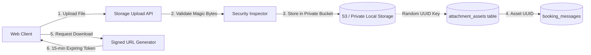

# Phase 08: Communication & Real-Time Messaging System — Attachment Security & File Policy

**Platform:** OgroniEdu (অগ্রণী এডু)  
**Phase:** 08: Communication & Real-Time Messaging System  
**Date:** October 20, 2026  
**Status:** Approved & Implemented  

---

## 1. Attachment Policy & Scope

Learning material attachments in OgroniEdu messaging are strictly scoped to legitimate academic collaboration:
- Homework assignments, question papers, exercise solutions.
- Lecture slide decks, textbook page excerpts, diagrammatic notes.
- Hand-drawn mathematical/scientific working photographs.

Executables, scripts, macro-enabled spreadsheets, audio files, and video streams are strictly forbidden within chat threads to prevent malware delivery and excessive infrastructure load.

---

## 2. Permitted File Formats & MIME Whitelist

Only the following MIME types are accepted by the upload pipeline:

| Category | MIME Type | Extension | Purpose | Max Size |
| :--- | :--- | :---: | :--- | :---: |
| **Documents** | `application/pdf` | `.pdf` | Homework, exam papers, syllabus notes. | 10 MB |
| **Raster Images** | `image/png` | `.png` | Diagrams, screenshots, charts. | 10 MB |
| **Raster Images** | `image/jpeg` | `.jpg`, `.jpeg`| Mobile photos of handwritten notebooks. | 10 MB |
| **Web Optimized** | `image/webp` | `.webp` | Modern compressed graphics. | 10 MB |

*Any file containing executable signatures (`.exe`, `.sh`, `.bat`, `.js`, `.vbs`, `.zip`, `.tar`) is rejected at upload validation before being stored.*

---

## 3. Storage Architecture & Anti-Traversal Protections

Attachments are managed via the centralized `attachment_assets` entity and stored in secure, private object storage:

### 3.1 Key Protections
1. **Opaque Storage Keys**: Uploaded files are never stored under their original client-supplied filename. Storage paths use cryptographically random UUIDs:
   `attachments/{bookingId}/{uuidv4}.{ext}`
   This eliminates all Directory Traversal attacks (`../../etc/passwd` or `..\..\Windows\System32`).
2. **Magic Byte Verification**: File headers are inspected using magic numbers rather than relying solely on the client-declared `Content-Type` header (e.g. verifying that a `.pdf` starts with `%PDF-` and not executable PE binaries).
3. **No Direct Public URLs**: The storage bucket is completely private. Files cannot be accessed via static public URLs.

---

## 4. Download Authorization & Time-Limited Signed URLs

When a participant or guardian requests to view or download an attachment:
1. The client requests a signed download link:
   `GET /api/v1/storage/assets/:assetId/signed-url`
2. The backend verifies:
   - The user is an authorized participant in the booking that references this `assetId`.
   - The user account is in good standing (not suspended).
3. The server generates a HMAC-signed URL with:
   - Expiration TTL: Exactly **15 minutes (900 seconds)**.
   - `Content-Disposition: inline` for browser viewing or `attachment; filename="safe_filename.pdf"` for downloads.
   - `X-Content-Type-Options: nosniff` header enforced to prevent MIME confusion in browsers.

---

## 5. Antivirus & Malware Scanning Hooks

For production deployment:
- An asynchronous event hook `asset.uploaded` is emitted upon file upload.
- Antivirus scanners (e.g., ClamAV / AWS GuardDuty Malware Protection) inspect the storage object in an isolated sandbox.
- If malicious payloads or macros are identified:
  - The asset record is immediately updated to `is_quarantined = true`.
  - The storage object is moved to an isolated quarantine bucket.
  - Senders and recipients are shown a security warning: *"This attachment has been quarantined by automated safety scanners."*
  - An urgent alert is dispatched to `compliance_reviewer` and platform security engineers.

---

## 6. Retention & Orphaned File Cleanup

1. **Orphaned File Sweeper**: An automated cron job executes daily to identify records in `attachment_assets` that were uploaded more than 24 hours ago but were never referenced in any `booking_messages.attachment_asset_ids` array. These orphaned files are purged to conserve storage.
2. **Archival Alignment**: Attachments mirror the message retention policy (180 days post-booking completion) before transitioning to cold storage.
