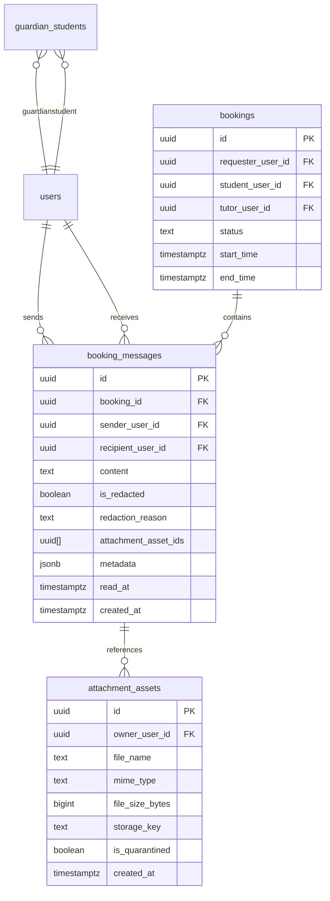

# Phase 08: Communication & Real-Time Messaging System — Data Model & Schema

**Platform:** OgroniEdu (অগ্রণী এডু)  
**Phase:** 08: Communication & Real-Time Messaging System  
**Date:** October 20, 2026  
**Status:** Approved & Implemented

---

## 1. Relational Entity-Relationship Diagram



---

## 2. Table Definition: `booking_messages`

| Column                 | Data Type     | Nullable | Default             | Description                                                                              |
| :--------------------- | :------------ | :------- | :------------------ | :--------------------------------------------------------------------------------------- |
| `id`                   | `UUID`        | No       | `gen_random_uuid()` | Primary Key (v4 UUID).                                                                   |
| `booking_id`           | `UUID`        | No       | -                   | Foreign Key to `bookings(id)` ON DELETE CASCADE.                                         |
| `sender_user_id`       | `UUID`        | No       | -                   | Foreign Key to `users(id)` ON DELETE RESTRICT.                                           |
| `recipient_user_id`    | `UUID`        | No       | -                   | Foreign Key to `users(id)` ON DELETE RESTRICT.                                           |
| `content`              | `TEXT`        | No       | -                   | Message body. Sanitized/redacted if violating content safety.                            |
| `is_redacted`          | `BOOLEAN`     | No       | `false`             | True if automated filters modified the message text.                                     |
| `redaction_reason`     | `TEXT`        | Yes      | `NULL`              | Machine code indicating violation (e.g. `PHONE_NUMBER_SHARING`, `PAYMENT_SOLICITATION`). |
| `attachment_asset_ids` | `UUID[]`      | No       | `'{}'::uuid[]`      | Array of references to `attachment_assets(id)`.                                          |
| `metadata`             | `JSONB`       | No       | `'{}'::jsonb`       | Extensible metadata (system notice tags, client temporary IDs, edit logs).               |
| `read_at`              | `TIMESTAMPTZ` | Yes      | `NULL`              | Timestamp when recipient viewed the message.                                             |
| `created_at`           | `TIMESTAMPTZ` | No       | `now()`             | Timestamp of creation.                                                                   |

---

## 3. Database Migration `026_realtime_messaging_and_attachments.sql`

```sql
-- Migration: 026_realtime_messaging_and_attachments.sql
-- Module: Communications & Real-Time Messaging

ALTER TABLE booking_messages
  ADD COLUMN IF NOT EXISTS attachment_asset_ids UUID[] DEFAULT '{}'::uuid[],
  ADD COLUMN IF NOT EXISTS metadata JSONB DEFAULT '{}'::jsonb;

-- Composite index for cursor-based pagination (oldest / newest history browsing)
CREATE INDEX IF NOT EXISTS idx_booking_messages_cursor
  ON booking_messages (booking_id, created_at DESC, id DESC);

-- Composite index for sender-recipient analytics and relationship indexing
CREATE INDEX IF NOT EXISTS idx_booking_messages_sender_recipient
  ON booking_messages (sender_user_id, recipient_user_id);

-- Unread index (pre-existing, confirmed active)
CREATE INDEX IF NOT EXISTS idx_booking_messages_unread
  ON booking_messages (recipient_user_id, read_at)
  WHERE read_at IS NULL;
```

---

## 4. Performance & Indexing Justification

1. **`idx_booking_messages_cursor (booking_id, created_at DESC, id DESC)`**:
   - Enables ultra-fast $O(\log N)$ cursor pagination for both initial thread loading (`LIMIT 50`) and scrolling back through historical transcripts without expensive table scans or offset degradation.
2. **`idx_booking_messages_unread (recipient_user_id, read_at) WHERE read_at IS NULL`**:
   - Partial index covering only unread messages. Minimizes index size and allows instantaneous aggregation for `ConversationsInboxView` unread badges and notification drawer counters.
3. **`idx_booking_messages_sender_recipient (sender_user_id, recipient_user_id)`**:
   - Accelerates fraud investigation, anti-collusion queries, and guardian oversight audit extraction across multiple bookings between specific individuals.

---

## 5. TypeORM Entity Definition (`BookingMessageEntity`)

```typescript
@Entity({ name: 'booking_messages' })
export class BookingMessageEntity {
  @PrimaryGeneratedColumn('uuid')
  id!: string;

  @Column({ type: 'uuid', name: 'booking_id' })
  bookingId!: string;

  @Column({ type: 'uuid', name: 'sender_user_id' })
  senderUserId!: string;

  @Column({ type: 'uuid', name: 'recipient_user_id' })
  recipientUserId!: string;

  @Column({ type: 'text' })
  content!: string;

  @Column({ type: 'boolean', name: 'is_redacted', default: false })
  isRedacted!: boolean;

  @Column({ type: 'text', name: 'redaction_reason', nullable: true })
  redactionReason?: string | null;

  @Column({
    type: 'uuid',
    array: true,
    name: 'attachment_asset_ids',
    default: '{}',
  })
  attachmentAssetIds!: string[];

  @Column({ type: 'jsonb', default: {} })
  metadata!: Record<string, unknown>;

  @Column({ type: 'timestamptz', name: 'read_at', nullable: true })
  readAt?: Date | null;

  @CreateDateColumn({ type: 'timestamptz', name: 'created_at' })
  createdAt!: Date;
}
```

---

## 6. Retention & Archival Policy

- **Active Retention**: Messages are retained online in hot storage for the lifetime of the active booking and 180 days post-completion.
- **Cold Archival**: After 180 days post-completion, messages may be moved to compressed cold tables (`booking_messages_archive`) for legal compliance and safeguarding records.
- **Child Protection Safeguard**: Messages associated with open safeguarding disputes or complaints are placed on legal hold and are exempt from standard expiration or deletion routines.
