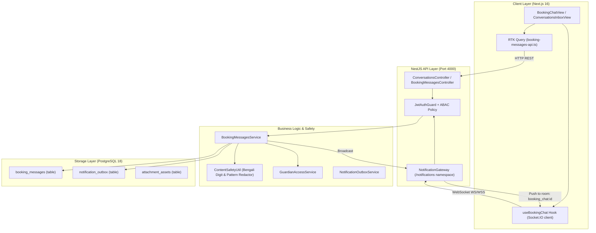
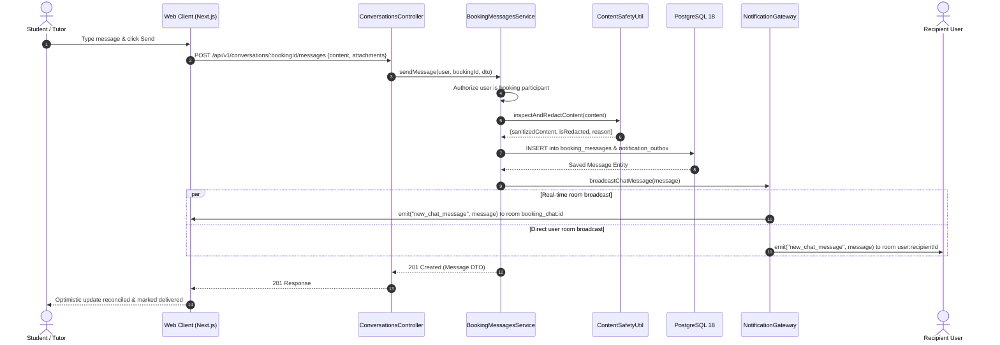
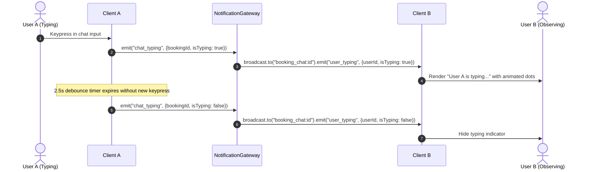
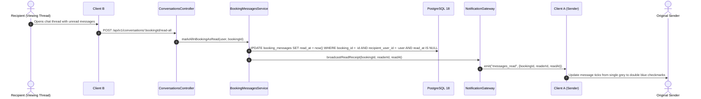

# Phase 08: Communication & Real-Time Messaging System — Implementation Plan

**Platform:** OgroniEdu (অগ্রণী এডু)  
**Phase:** 08: Communication & Real-Time Messaging System  
**Date:** October 20, 2026  
**Status:** Approved & Implemented  

---

## 1. System Architecture Overview

The OgroniEdu Real-Time Messaging System integrates database persistence, server-side content moderation, asynchronous outbox notifications, and bi-directional WebSockets via Socket.IO.



---

## 2. Work Breakdown Structure (WBS)

### 2.1 Database & Migrations
- [x] Create migration `026_realtime_messaging_and_attachments.sql`:
  - Add `attachment_asset_ids UUID[] DEFAULT '{}'` to `booking_messages`.
  - Add `metadata JSONB DEFAULT '{}'` to `booking_messages`.
  - Add composite index `idx_booking_messages_cursor (booking_id, created_at DESC, id DESC)`.
  - Add index `idx_booking_messages_sender_recipient (sender_user_id, recipient_user_id)`.
- [x] Execute migration against PostgreSQL 18 `ogroniedu_dev` and verify idempotency.
- [x] Rebuild `@ogroniedu/database`.

### 2.2 Shared Contracts (`packages/contracts`)
- [x] Create `packages/contracts/src/messaging.ts`:
  - Zod schemas: `SendBookingMessageSchema`, `BookingMessageRecord`, `ConversationInboxItem`, `ChatTypingPayload`, `ChatReadReceiptPayload`.
  - Export TypeScript interfaces for client/server sharing.
- [x] Re-export in `packages/contracts/src/index.ts` and compile.

### 2.3 Backend API & Services (`apps/api`)
- [x] Create `apps/api/src/modules/notifications/utils/content-safety.util.ts`:
  - Bengali digit converter (`০-৯` -> `0-9`).
  - Whitespace-insensitive mobile number detector (`013-019` series).
  - Off-platform cash and wallet solicitations (`bKash`, `Nagad`, `Rocket`, `Cash`).
  - Social bypass links (`wa.me`, `t.me`, `imo`, `facebook.com`).
  - Return redacted text, flags, and specific redaction reasons.
- [x] Update `BookingMessageEntity` with `attachmentAssetIds` and `metadata`.
- [x] Upgrade `BookingMessagesService`:
  - Ingest content safety inspection.
  - Transactional persistence with outbox event `booking.message_sent`.
  - Bulk read operation `markAllInBookingAsRead(user, bookingId)`.
  - Inbox aggregator `getConversationsInbox(user)` with unread count calculation.
- [x] Upgrade `NotificationGateway`:
  - Listen for `@SubscribeMessage('join_booking_chat')` with server-side ABAC authorization check.
  - Listen for `@SubscribeMessage('leave_booking_chat')`.
  - Listen for `@SubscribeMessage('chat_typing')` and broadcast `user_typing`.
  - Broadcast `new_chat_message` to room `booking_chat:${bookingId}` and room `user:${recipientUserId}`.
  - Broadcast `messages_read` to room `booking_chat:${bookingId}`.
- [x] Create `ConversationsController` (`/api/v1/conversations`).

### 2.4 Frontend Web Application (`apps/web`)
- [x] Update `apps/web/src/store/services/booking-messages-api.ts`:
  - Add `getConversationsInbox` query.
  - Add `markAllBookingMessagesAsRead` mutation.
  - Add attachment and metadata fields.
- [x] Upgrade `useBookingChat` hook (`apps/web/src/features/messaging/hooks/use-booking-chat.ts`):
  - Connect to Socket.IO `/notifications` namespace with auth token.
  - Auto-join and leave `booking_chat:${bookingId}` room.
  - Handle real-time push: `new_chat_message`, `user_typing`, `messages_read`.
  - Expose debounced `emitTyping(isTyping: boolean)`.
- [x] Modernize `BookingChatView` component:
  - Visual typing status ("Dr. Nusrat is typing...").
  - Guardian oversight badge when viewing minor's thread.
  - Attachment file picker with preview chips and remove buttons.
  - Attachment rendering for PDF, PNG, and JPEG.
- [x] Create `ConversationsInboxView` (`apps/web/src/features/messaging/components/ConversationsInboxView.tsx`):
  - Split-pane inbox with search, partner avatar, last message preview, and unread badge.
- [x] Create page route `apps/web/src/app/[locale]/(dashboard)/messages/page.tsx`.

---

## 3. Sequence Diagrams

### 3.1 Message Submission & Real-Time Delivery



### 3.2 Typing Indicator Flow



### 3.3 Read Receipt Synchronization



---

## 4. Migration & Rollback Strategy

### 4.1 Safe Migration Plan
1. `026_realtime_messaging_and_attachments.sql` uses `ADD COLUMN IF NOT EXISTS` for zero-downtime deployment.
2. Default values (`'{}'::uuid[]` and `'{}'::jsonb`) ensure existing rows require no backfilling or null checking.
3. Indexes are created with `CREATE INDEX IF NOT EXISTS` to avoid locks during deployment.

### 4.2 Rollback Procedure
If issues occur with attachments or metadata:
```sql
DROP INDEX IF EXISTS idx_booking_messages_cursor;
DROP INDEX IF EXISTS idx_booking_messages_sender_recipient;
ALTER TABLE booking_messages DROP COLUMN IF EXISTS attachment_asset_ids;
ALTER TABLE booking_messages DROP COLUMN IF EXISTS metadata;
DELETE FROM schema_migrations WHERE version = '026_realtime_messaging_and_attachments';
```

---

## 5. Backward Compatibility Assurances

1. **Legacy Endpoints Maintained**: The existing endpoints `GET /api/v1/learning/bookings/:id/messages` and `POST /api/v1/learning/bookings/:id/messages` remain fully functional and route to the same core logic.
2. **Namespace Preservation**: Socket.IO connects to the existing `/notifications` namespace without forcing clients to maintain dual socket connections.
3. **Optional Gateway Dependencies**: `BookingRepository` and `GuardianAccessService` are injected as optional in `NotificationGateway` constructors, ensuring existing unit test harnesses remain 100% green without refactoring.
