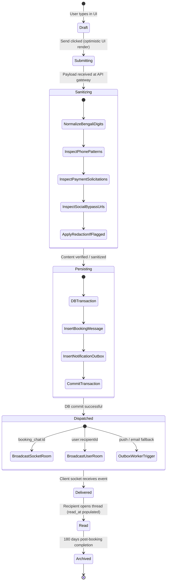

# Phase 08: Communication & Real-Time Messaging System — Message Lifecycle

**Platform:** OgroniEdu (অগ্রণী এডু)  
**Phase:** 08: Communication & Real-Time Messaging System  
**Date:** October 20, 2026  
**Status:** Approved & Implemented

---

## 1. Lifecycle State Machine Diagram



---

## 2. Phase-by-Phase Technical Walkthrough

### Phase 1: Client Submission & Optimistic UI

1. The user types content and selects optional verified attachment IDs.
2. When the user hits Send:
   - The web client immediately creates a temporary local message with a client UUID, `createdAt: new Date().toISOString()`, and status `'sending'`.
   - The message bubble appears immediately in `BookingChatView` to provide zero-latency tactile feedback.
   - The Send button is temporarily disabled to prevent duplicate submissions.
3. The client dispatches `POST /api/v1/conversations/:bookingId/messages`.

### Phase 2: Server-Side Ingestion, Normalization & Sanitization

1. **Authentication & Authorization**:
   - `JwtAuthGuard` authenticates the caller.
   - `BookingMessagesService` verifies caller is a valid participant or authorized guardian.
2. **Content Safety Engine (`content-safety.util.ts`)**:
   - **Bengali Digit Normalization**: Converts all Bengali digits (`০-৯`) to standard ASCII (`0-9`).
   - **Phone Obfuscation Neutralization**: Strips spaces, dots, dashes, and invisible zero-width characters to detect hidden 11-digit Bangladeshi mobile numbers (`013`, `014`, `015`, `016`, `017`, `018`, `019`).
   - **Payment Circumvention Inspection**: Matches keywords for off-platform payment methods (`bkash`, `nagad`, `rocket`, `upay`, `cash on delivery`, `direct pay`).
   - **Social Handle / URL Neutralization**: Detects external redirection attempts (`wa.me`, `t.me`, `imo`, `facebook.com`).
3. **Redaction Transformation**:
   - If violations are detected:
     - Violation segments are replaced with clean security tokens: `[REDACTED CONTACT NUMBER]` or `[REDACTED PAYMENT SOLICITATION]`.
     - `is_redacted` is set to `true`.
     - `redaction_reason` records machine tags (`PHONE_NUMBER_SHARING`, `PAYMENT_SOLICITATION`).
     - A structured security audit log is emitted to alert platform safety supervisors.

### Phase 3: Transactional Persistence & Outbox Registration

1. In a single PostgreSQL transaction:
   - Insert row into `booking_messages` with sanitized content, `attachment_asset_ids`, and `metadata`.
   - Insert row into `notification_outbox` with event type `booking.message_sent`, payload containing message metadata, and `idempotency_key = booking_message:${message.id}`.
2. Transaction commits.

### Phase 4: Dual-Route Real-Time Broadcast

Immediately following database commit, `NotificationGateway` triggers two simultaneous WebSocket broadcasts:

1. **Thread Room Broadcast (`booking_chat:${bookingId}`)**:
   - Dispatches `new_chat_message` to all connected users actively viewing the thread.
   - Allows open chat windows on both sides to display the new message instantly.
2. **Recipient Personal Room Broadcast (`user:${recipientUserId}`)**:
   - Dispatches `new_chat_message` to the recipient's personal socket room.
   - Triggers desktop toast notifications and increments the unread badge on the top navigation bar even if the user is currently on a different page.

### Phase 5: Asynchronous Delivery Fallback

1. An outbox background worker polls `notification_outbox`.
2. If the recipient does not acknowledge the real-time socket message within 120 seconds and has not viewed the thread, the outbox worker triggers an offline push notification or SMS alert based on user preferences.

### Phase 6: Read Receipt Synchronization

1. When the recipient views the message in an active viewport:
   - The client emits either HTTP `POST /api/v1/conversations/:bookingId/read-all` or socket event `mark_thread_read`.
   - PostgreSQL executes:
     ```sql
     UPDATE booking_messages
     SET read_at = now()
     WHERE booking_id = :bookingId
       AND recipient_user_id = :userId
       AND read_at IS NULL;
     ```
   - The server emits `messages_read` to `booking_chat:${bookingId}`.
   - The sender's UI updates the message delivery tick from single grey (delivered) to double blue (read).
