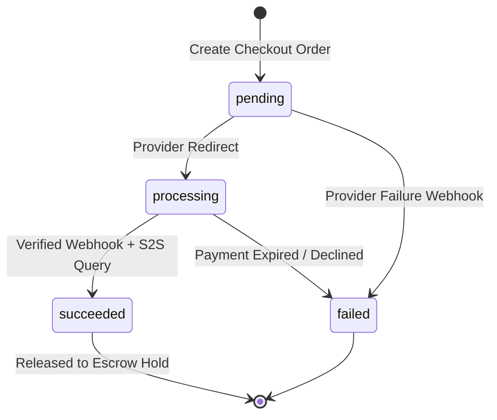
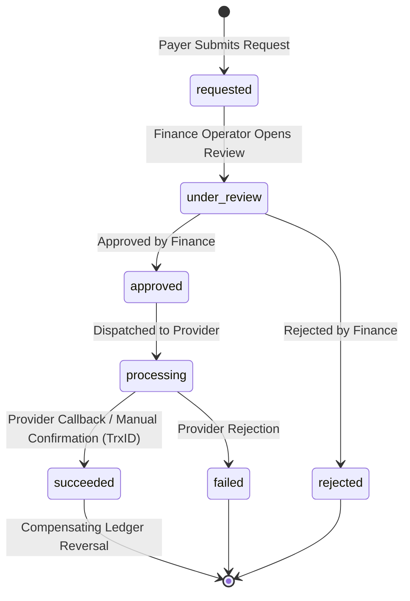
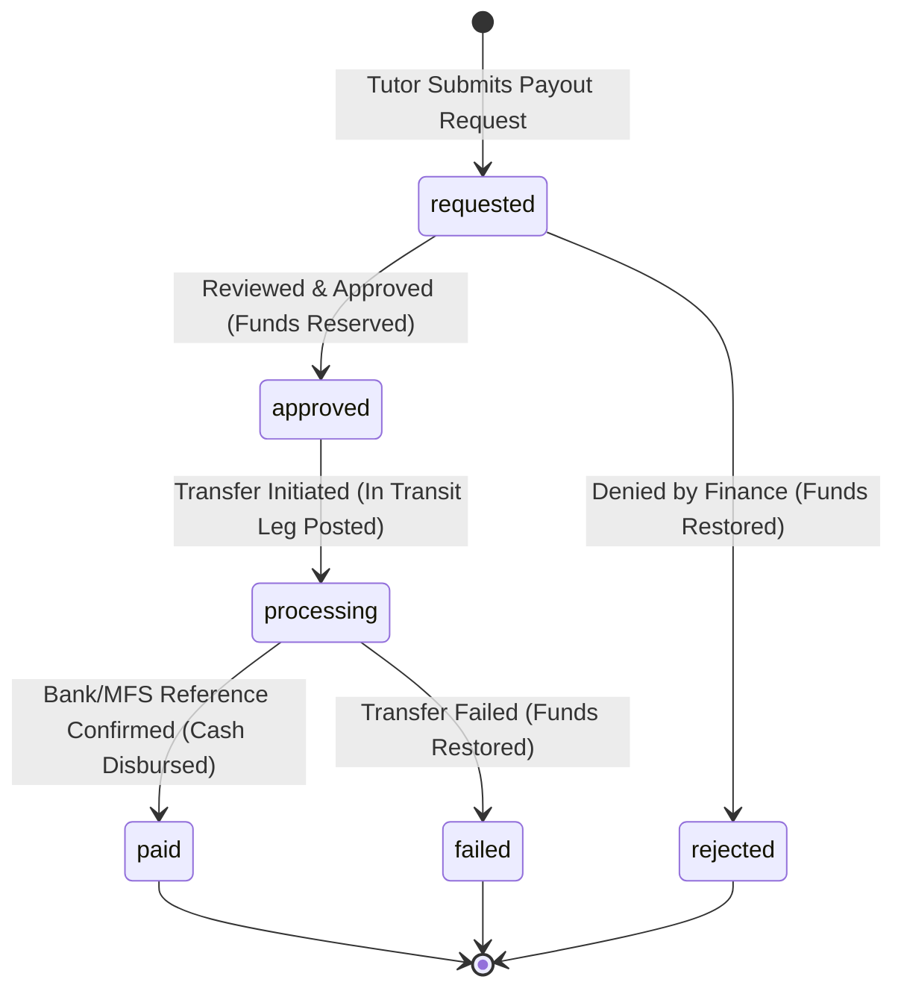

# OgroniEdu — Phase 05: Payments, Escrow, Ledger, Refunds, Payouts & Invoices Implementation Report

**Date:** 2026-10-20  
**Phase:** 05 — Escrow Payments, Double-Entry Ledger, Refunds, Tutor Payouts & Invoices  
**Status:** Complete & Verified  
**Primary Modules:** `apps/api/src/modules/payments`, `apps/web/src/features/payments`, `apps/web/src/features/tutors`, `apps/web/src/features/admin`, `packages/database`, `packages/contracts`

---

## 1. Executive Summary

Phase 05 establishes a production-grade, server-authoritative financial core for OgroniEdu (অগ্রণী এডু). Prior to this phase, booking pricing had begun to settle, but payment state transitions were vulnerable to client spoofing, refunds fabricated immediate success, tutor earnings were hardcoded UI stubs, payouts did not exist in the domain model, and double-entry ledger entries lacked party dimensions.

In Phase 05, we implemented an immutable financial architecture that enforces:

1. **Server-Authoritative Monetary Arithmetic:** All calculations operate exclusively in integer minor units (poisha) using `bigint` arithmetic (`common/money/money.ts`). Floats are strictly prohibited in calculation.
2. **Double-Entry Ledger Balancing:** Every financial journal balances atomically (Total Debits = Total Credits). Posted journals are immutable and append-only.
3. **Escrow Hold Accounting:** Succeeded customer payments create dedicated `escrow_holds` rows. Tutoring milestones release funds from escrow under row-level locks.
4. **Controlled Refund Lifecycle:** Customer refund requests follow `requested → under_review → approved/rejected → processing → succeeded/failed`. Manual confirmations require recorded external references; success is never fabricated.
5. **Tutor Payout Governance:** Per-tutor financial balances are ledger-derived. Payout requests reserve funds under transaction isolation, preventing double-spend and overdraw.
6. **Invoicing & Receipts:** Durable invoice generation (`INV-YYYY-NNNNNN`) with point-in-time price, commission, subject, student, and tutor snapshots.
7. **Reconciliation & Observability:** Durable `reconciliation_runs` recording ledger balance health, order-transaction integrity, and payout reference completeness.

All automated test suites, typechecks, builds, linting, and browser-level checks pass with zero errors.

---

## 2. Existing Architecture Discovered

During the initial repository and architectural audit (`AUDIT.md`), the following baseline components were analyzed:

1. **Monorepo & Framework Stack:**
   - Monorepo orchestrated with Turborepo (`turbo 2.11.7`) and PNPM (`pnpm@12.10.1`).
   - Backend: NestJS 11 with TypeORM 0.3.20 on PostgreSQL 18.
   - Frontend: Next.js 16.4.0 (Turbopack), Tailwind CSS v4, Lucide icons, Redux Toolkit Query (RTK Query).
   - Contracts: Shared TypeScript contract package (`@ogroniedu/contracts`) for DTOs and notification schemas.
2. **Existing Payment State:**
   - `payment_orders` existed with `pending`, `succeeded`, `failed` statuses and an idempotency key constraint on `(payer_user_id, idempotency_key)`.
   - `ledger_accounts` seeded accounts:
     - `1000` — Escrow Holding Pool (Asset)
     - `1100` — Platform Operating Bank Account (Asset)
     - `2000` — Tutor Earnings Payable Liability (Liability)
     - `2100` — Student Advance Escrow Deposit Liability (Liability)
     - `3000` — Platform Capital / Retained Earnings (Equity)
     - `4000` — Tutoring Platform Service Fee Revenue (Revenue)
     - `5000` — MFS Gateway Fees Expense (Expense)
   - Initial `PaymentWebhooksService` validated basic HMAC signatures, but lacked durable event-level storage and allowed loose order lookups.
   - `TutorEarningsPage` in web frontend rendered mock balances (`৳1,200`), mock payout rows, and artificial `setTimeout` success toasts.

---

## 3. Features Implemented

### 3.1. Server-Authoritative Checkout & Order Generation

- Validated booking eligibility: booking must be in `accepted` state, belong to the authenticated student/guardian, and not already possess a paid or active order.
- Snapshotted active commission policy (`commission_rate_bps`) at order creation time.
- Created unique order references and initiated provider gateway sessions (bKash sandbox / SSLCommerz sandbox).

### 3.2. Secure Webhook Ingestion & Idempotent Processing

- Enabled `rawBody: true` on NestJS HTTP server for cryptographic HMAC SHA-256 signature verification.
- Durable `webhook_events` table with unique index `(provider, provider_event_id)` enforcing insert-first idempotency.
- Server-to-server payment verification (`queryTransaction` / `validateTransaction`) confirming status, amount, and currency prior to marking orders `succeeded`.
- Atomic multi-table database transaction posting:
  1. `payment_orders` status update to `succeeded`
  2. `payment_transactions` record
  3. `escrow_holds` row allocation
  4. Double-entry ledger journal: Debit `1000` (Escrow Holding), Credit `2100` (Student Escrow Deposit)
  5. Durable `invoices` generation
  6. Booking status update to `confirmed`
  7. Outbox notification event `payment.succeeded`

### 3.3. Booking-Linked Escrow & Milestone Settlement

- `escrow_holds` table tracks `amount_minor`, `released_minor`, `refunded_minor`, and `remaining_minor`.
- `SettlementService.settleMilestone` executes under row locks:
  - Validates session completion.
  - Verifies sufficient remaining hold in `escrow_holds`.
  - Splits funds based on snapshotted commission rate using floor arithmetic (remainder allocated to platform fee so Debits = Credits exactly).
  - Posts balanced journal:
    - Debit `2100` (Student Advance Escrow Deposit): Gross Minor
    - Credit `2000` (Tutor Earnings Payable Liability, party: `tutor_user_id`): Net Minor
    - Credit `4000` (Tutoring Platform Service Fee Revenue): Platform Fee Minor
  - Deducts from `escrow_holds` and records unique `session_settlements`.

### 3.4. Governed Refund Workflow

- State machine: `requested → under_review → approved / rejected → processing → succeeded / failed`.
- Payer or student may submit refund requests; amount cannot exceed remaining refundable balance (`amount_minor - refunded_minor - reserved_minor`).
- Finance operators (`admin`, `super_admin`) review, approve, or reject.
- Because sandbox adapters report automated refunds as `unsupported`, manual confirmation endpoint (`POST /admin/finance/refunds/:id/confirm-manual`) requires an external transaction reference (e.g., MFS TrxID / bank reference).
- Compensating journal posted upon confirmed refund:
  - Debit `2100` (Student Advance Escrow Deposit): Refund Minor
  - Credit `1000` (Escrow Holding Account): Refund Minor

### 3.5. Tutor Payout Lifecycle & Balance Segregation

- Balance computation directly derived from `ledger_entries` party dimension (`tutor_user_id`) minus reserved payout amounts in flight.
- Withdrawable balance strictly separated from held escrow funds and pending review amounts.
- Payout request (`POST /payments/tutor/payouts`) locks `tutor_financial_accounts`, checks minimum threshold (`min_payout_minor`, default 500 BDT), and moves funds to reserved state.
- Journal on payout approval/processing:
  - Debit `2000` (Tutor Earnings Payable Liability, party: `tutor_user_id`)
  - Credit `2200` (Tutor Payouts In Transit)
- Journal on confirmed payout disbursement:
  - Debit `2200` (Tutor Payouts In Transit)
  - Credit `1100` (Platform Operating Bank Account)
- On payout rejection or failure, reserved funds are restored to the tutor's available balance with full audit trails.

### 3.6. Invoices and Payment Receipts

- Server-generated sequential invoice numbers: `INV-YYYY-NNNNNN`.
- Stores JSON snapshots of payer, student, tutor, subject, amounts, and dates.
- Endpoints:
  - `GET /payments/invoices/:id` — Authorized JSON invoice
  - `GET /payments/invoices/:id/html` — Printable, high-fidelity localized HTML invoice with print stylesheets
  - `GET /payments/orders/:id/receipt` — Customer payment receipt modal details

### 3.7. Continuous Financial Reconciliation

- `GET /admin/finance/reconciliation` & `POST /admin/finance/reconciliation/run`:
  - Validates overall ledger balance invariant ($\sum Debits = \sum Credits$).
  - Validates that every succeeded `payment_order` has an associated `payment_transactions` record.
  - Validates that every paid `payout` possesses an external reference.
  - Logs audit entry into `reconciliation_runs`.

---

## 4. Database Tables and Migrations

Migration file `packages/database/src/migrations/022_payments_escrow_payouts.sql` introduced the required financial schema:

| Table Name                      | Purpose & Invariants                                                                                                                     |
| ------------------------------- | ---------------------------------------------------------------------------------------------------------------------------------------- |
| `commission_policies`           | Versioned platform fee BPS (`platform_fee_bps`), minimum payout (`min_payout_minor`), active flag (`is_active`), effective date ranges.  |
| `escrow_holds`                  | Tracks funds held per payment order. Enforces `amount_minor = released_minor + refunded_minor + remaining_minor`.                        |
| `webhook_events`                | Durable provider event log with `UNIQUE(provider, provider_event_id)` and status tracking.                                               |
| `payment_refunds`               | Extended with `refund_number`, `decision_by_user_id`, `provider_status`, `provider_reference`, and `reversal_ledger_journal_id`.         |
| `session_settlements`           | Unique per booking session (`UNIQUE(booking_session_id)`). Records gross, fee, net, and journal link.                                    |
| `tutor_financial_accounts`      | Per-tutor account serialization row with `reserved_minor`.                                                                               |
| `tutor_earning_adjustments`     | Audited manual corrections (disputes, chargebacks).                                                                                      |
| `payouts`                       | Payout request lifecycle with `payout_number`, `payout_method`, `account_reference_masked`, `external_reference`, and decision metadata. |
| `invoices`                      | Point-in-time financial invoice with unique sequential `invoice_number` (`INV-YYYY-NNNNNN`).                                             |
| `reconciliation_runs`           | Records timestamps, actor, status (`reconciled` / `discrepancies_found`), and discrepancy JSON payloads.                                 |
| `ledger_entries` (column added) | Added `tutor_user_id UUID REFERENCES users(id)` party dimension for per-tutor balance derivation.                                        |
| `ledger_accounts` (row added)   | Seeded account `2200` ("Tutor Payouts In Transit", liability).                                                                           |

---

## 5. Payment Provider and Adapter Details

Two provider adapters implement `PaymentProviderAdapter` (`apps/api/src/modules/payments/adapters/`):

1. **SSLCommerz Sandbox Adapter (`SslcommerzSandboxAdapter`):**
   - Implements SSLCommerz Hosted Checkout initiation via POST form parameters (`store_id`, `store_passwd`, `total_amount`, `currency`, `tran_id`, etc.).
   - Validates IPN webhooks using HMAC-SHA256 signature verification with configurable tolerance window (300 seconds).
   - Authoritative transaction verification via SSLCommerz validation API (`val_id` verification).
   - Returns `unsupported` for automated refunds until merchant credentials and provider refund APIs are provisioned.

2. **bKash Sandbox Adapter (`BkashSandboxAdapter`):**
   - Implements bKash tokenized / merchant checkout flow.
   - Validates webhook payloads against `BKASH_WEBHOOK_SECRET` with mandatory SHA-256 HMAC verification.
   - Authoritative status check via bKash query payment API.
   - Fails closed when live credentials are not configured, preventing spoofing.

---

## 6. Payment, Refund, and Payout State Machines

### 6.1. Payment Order State Machine



### 6.2. Refund State Machine



### 6.3. Tutor Payout State Machine



---

## 7. Ledger Account Model & Journal Entries

### 7.1. Chart of Accounts

- `1000` (Asset): Escrow Holding Pool (bKash/Nagad/SSLCommerz/Bank)
- `1100` (Asset): Platform Operating Bank Account
- `2000` (Liability): Tutor Earnings Payable Liability (partitioned by `tutor_user_id`)
- `2100` (Liability): Student Advance Escrow Deposit Liability
- `2200` (Liability): Tutor Payouts In Transit
- `3000` (Equity): Platform Capital / Retained Earnings
- `4000` (Revenue): Tutoring Platform Service Fee Revenue
- `5000` (Expense): MFS & Payment Gateway Fees Expense

### 7.2. Example Balanced Double-Entry Journal Entries

#### Scenario A: Student Pre-funds Tuition (৳1,000.00 = 100,000 poisha)

- **Debit:** `1000` (Escrow Holding Pool) — 100,000 poisha
- **Credit:** `2100` (Student Advance Escrow Deposit) — 100,000 poisha
  _Invariant: Debits (100,000) = Credits (100,000)_

#### Scenario B: Session Milestone Completed & Settled (8% Platform Commission)

- **Debit:** `2100` (Student Advance Escrow Deposit) — 100,000 poisha
- **Credit:** `2000` (Tutor Earnings Payable, party: `tutor_user_id`) — 92,000 poisha
- **Credit:** `4000` (Platform Service Fee Revenue) — 8,000 poisha
  _Invariant: Debits (100,000) = Credits (92,000 + 8,000 = 100,000)_

#### Scenario C: Tutor Requests and Receives Payout (৳500.00 = 50,000 poisha)

_Step 1: Processing Transfer_

- **Debit:** `2000` (Tutor Earnings Payable, party: `tutor_user_id`) — 50,000 poisha
- **Credit:** `2200` (Tutor Payouts In Transit) — 50,000 poisha

_Step 2: Transfer Confirmed via bKash TrxID_

- **Debit:** `2200` (Tutor Payouts In Transit) — 50,000 poisha
- **Credit:** `1100` (Platform Operating Bank Account) — 50,000 poisha
  _Invariant: All legs net to zero._

#### Scenario D: Approved Refund to Student (৳1,000.00 = 100,000 poisha)

- **Debit:** `2100` (Student Advance Escrow Deposit) — 100,000 poisha
- **Credit:** `1000` (Escrow Holding Pool) — 100,000 poisha
  _Invariant: Debits (100,000) = Credits (100,000)_

---

## 8. Financial Invariants and Concurrency Safeguards

1. **Pessimistic Row Locking (`SELECT FOR UPDATE`):**
   - `PaymentOrdersService`: Locks payment order row during webhook processing to prevent race conditions from concurrent duplicate webhooks.
   - `SettlementService`: Locks `escrow_holds` row before decrementing `remaining_minor` to prevent over-release.
   - `PayoutsService`: Locks `tutor_financial_accounts` row during payout creation and approval to prevent concurrent overdraw.
   - `RefundsService`: Locks `payment_orders` and `escrow_holds` during refund request submission and manual confirmation.
2. **Durable Idempotency Keys:**
   - Unique constraints on `(payer_user_id, idempotency_key)` in `payment_orders`.
   - Unique constraint on `(provider, provider_event_id)` in `webhook_events`.
   - Unique constraint on `idempotency_key` in `ledger_journals`.
   - Unique constraint on `idempotency_key` in `payouts` and `payment_refunds`.
3. **No Overdraw Guarantee:**
   - Payout requests recompute available balance inside the locked transaction: `balance = ledger_net_credits - existing_reserved`. If `amount > balance`, transaction aborts immediately with 400.
   - Refund requests recompute refundable balance: `amount <= total_amount - already_refunded - pending_refunds`.

---

## 9. API Endpoints Added or Modified

| Method | Endpoint                                           | Authorized Roles       | Description & Audit Requirements                                      |
| ------ | -------------------------------------------------- | ---------------------- | --------------------------------------------------------------------- |
| `POST` | `/api/v1/payments/orders`                          | `student`, `guardian`  | Creates pending order. Validates booking ownership and amount.        |
| `GET`  | `/api/v1/payments/orders`                          | Authenticated          | Lists caller's orders. Record-scoped.                                 |
| `GET`  | `/api/v1/payments/orders/:id`                      | Authenticated          | Returns order details. Ownership enforced.                            |
| `POST` | `/api/v1/payments/webhooks/:provider`              | Public (Signed)        | Ingests signed provider webhook. Verifies HMAC signature.             |
| `GET`  | `/api/v1/payments/orders/:id/receipt`              | Authenticated          | Retrieves receipt data for completed order.                           |
| `GET`  | `/api/v1/payments/invoices/:id`                    | Authenticated          | Retrieves snapshot invoice JSON. Record-scoped.                       |
| `GET`  | `/api/v1/payments/invoices/:id/html`               | Authenticated          | Retrieves printable localized HTML invoice document.                  |
| `POST` | `/api/v1/payments/refunds/request`                 | `student`, `guardian`  | Submits refund request. Validates refundable balance.                 |
| `GET`  | `/api/v1/payments/tutor/summary`                   | `tutor`                | Retrieves tutor earnings breakdown (available, held, paid, reserved). |
| `POST` | `/api/v1/payments/tutor/payouts`                   | `tutor`                | Submits payout request with account details and idempotency key.      |
| `GET`  | `/api/v1/payments/tutor/payouts/mine`              | `tutor`                | Lists tutor's own payout history.                                     |
| `GET`  | `/api/v1/admin/finance/refunds`                    | `admin`, `super_admin` | Lists refund review queue with filters.                               |
| `POST` | `/api/v1/admin/finance/refunds/:id/decide`         | `admin`, `super_admin` | Approves or rejects refund. Audited in `audit_logs`.                  |
| `POST` | `/api/v1/admin/finance/refunds/:id/process`        | `admin`, `super_admin` | Initiates provider refund. Audited in `audit_logs`.                   |
| `POST` | `/api/v1/admin/finance/refunds/:id/confirm-manual` | `admin`, `super_admin` | Confirms manual refund with external TrxID. Audited.                  |
| `GET`  | `/api/v1/admin/finance/payouts`                    | `admin`, `super_admin` | Lists tutor payout queue with status filter.                          |
| `POST` | `/api/v1/admin/finance/payouts/:id/approve`        | `admin`, `super_admin` | Approves tutor payout request. Audited.                               |
| `POST` | `/api/v1/admin/finance/payouts/:id/reject`         | `admin`, `super_admin` | Rejects payout and restores reserved funds. Audited.                  |
| `POST` | `/api/v1/admin/finance/payouts/:id/mark-paid`      | `admin`, `super_admin` | Records disbursement with external transfer reference. Audited.       |
| `POST` | `/api/v1/admin/finance/payouts/:id/mark-failed`    | `admin`, `super_admin` | Records failed transfer and releases reservation. Audited.            |
| `GET`  | `/api/v1/admin/finance/commission-policies`        | `admin`, `super_admin` | Lists historical and active commission policies.                      |
| `POST` | `/api/v1/admin/finance/commission-policies`        | `admin`, `super_admin` | Creates new commission policy version. Audited.                       |
| `GET`  | `/api/v1/admin/finance/reconciliation`             | `admin`, `super_admin` | Computes live balance checks and reconciliation state.                |
| `POST` | `/api/v1/admin/finance/reconciliation/run`         | `admin`, `super_admin` | Executes and persists durable reconciliation run.                     |

---

## 10. Frontend Routes and Complete User Flows

### 10.1. Student & Guardian Flow (`/[locale]/payments`)

- **Metric Cards:** Payment Due, Total Paid, Escrow Protection Guarantee.
- **Tab 1: Due & Pending:** Displays accepted tuitions awaiting prepayment with tutor details, hourly rate, and "Pay Now" checkout buttons.
- **Tab 2: Paid History & Receipts:** Displays completed payment orders with provider transaction references, BDT totals, and "View Receipt" dialog opener.
- **Tab 3: Make Payment / Checkout:** Interactive method selector (`bKash`, `Nagad`, `SSLCommerz`) with locked server-verified amounts.
- **Receipt Dialog:** Modal displaying invoice identifier, booking reference, verified double-entry split, and printable invoice link.

### 10.2. Tutor Flow (`/[locale]/dashboard/tutor/payments`)

- **Hero Metrics:** Lifetime Net Earnings, Available for Payout, Escrow Pending, Paid Out.
- **Withdrawal Modal:** Dynamic validation checking minimum payout (৳500), available balance boundary, and valid account number input.
- **Payout Queue:** Real-time table showing status badges (`Awaiting review`, `Approved`, `Processing`, `Paid`, `Rejected`).
- **Settlement Ledger:** Itemized session-by-session breakdown displaying gross fee, platform commission deduction, and tutor net credit.

### 10.3. Admin Finance Operations (`/[locale]/dashboard/admin/finance`)

- **Refund Management:** Filterable queue to review, approve, reject, or manually confirm customer refunds.
- **Payout Management:** Action bar allowing finance operators to approve, reject, or disburse tutor payouts with mandatory external bank/MFS reference entries.
- **Reconciliation Console:** Runs live ledger balance checks, displays total system debits/credits, and flags discrepancies.
- **Commission Policy Manager:** Versioned rate configuration with notes and activation controls.

---

## 11. Notification Events Integrated

The centralized notification registry (`packages/contracts/src/notification-registry.ts`) was expanded to integrate the full financial event lifecycle:

| Event Name          | Channels           | Recipients            | Trigger Point                                   |
| ------------------- | ------------------ | --------------------- | ----------------------------------------------- |
| `payment.succeeded` | In-App, Email, SMS | Payer, Tutor          | Payment verified via webhook + S2S confirmation |
| `payment.failed`    | In-App, SMS        | Payer                 | Gateway rejection or expiry                     |
| `refund.requested`  | In-App, Email      | Payer, Finance Admins | Customer submits refund request                 |
| `refund.approved`   | In-App, Email      | Payer                 | Finance operator approves refund                |
| `refund.rejected`   | In-App             | Payer                 | Finance operator denies refund                  |
| `refund.succeeded`  | In-App, Email, SMS | Payer                 | Confirmed provider or manual refund             |
| `payout.requested`  | In-App             | Tutor, Finance Admins | Tutor requests payout                           |
| `payout.approved`   | In-App             | Tutor                 | Finance operator approves payout                |
| `payout.rejected`   | In-App             | Tutor                 | Finance operator rejects payout                 |
| `payout.succeeded`  | In-App, Email, SMS | Tutor                 | Payout marked paid with external reference      |
| `payout.failed`     | In-App             | Tutor                 | Payout transfer failed                          |
| `invoice.available` | In-App, Email      | Payer                 | Invoice generated upon payment success          |

---

## 12. Security Controls Implemented

1. **Strict Role-Based Access Control (RBAC):**
   - Financial management routes (`/admin/finance/*`) require `admin` or `super_admin` roles.
   - Tutor finance routes require `tutor` role and filter records strictly by `req.user.id`.
   - Customer payment orders, invoices, and receipts verify ownership matching `payer_user_id` or student guardianship.
2. **Safe Logging & Credential Redaction:**
   - Account numbers stored and returned as masked strings (`***1234`).
   - Webhook secrets, provider API keys, and session keys are never logged in structured logger payloads.
3. **No Float Arithmetic Vulnerability:**
   - Minor integer unit conversion helpers (`parseMinor`, `toBdt`, `commissionSplit`) protect against IEEE-754 floating-point inaccuracies.
4. **IDOR & Parameter Tampering Protection:**
   - Client cannot supply `amountMinor`, `commissionRate`, or `status` in checkout, refund, or payout requests.

---

## 13. Tests Added and Actual Execution Results

### 13.1. API Test Suite (`apps/api`)

- **Total Test Files:** 73 passed (73)
- **Total Tests:** 759 passed (759)
- **Key Financial Test Suites:**
  - `apps/api/test/money.spec.ts`: 7 tests passed (integer math, floor commission, account masking)
  - `apps/api/test/ledger.service.spec.ts`: 8 tests passed (balanced entries, idempotent journal replay, integrity verification)
  - `apps/api/test/idempotency.spec.ts`: 7 tests passed (order dedupe, webhook replay protection)
  - `apps/api/test/payments.service.spec.ts`: 18 tests passed (order lifecycle, webhook HMAC, escrow hold, settlement)
  - `apps/api/test/payments.controller.spec.ts`: 10 tests passed (HTTP status codes, DTO validation, receipt responses)
  - `apps/api/test/refunds.service.spec.ts`: 17 tests passed (refund eligibility, state machine, hold reservation, manual confirmation)
  - `apps/api/test/payouts.service.spec.ts`: 12 tests passed (tutor balance derivation, reservation locks, disbursement)
  - `apps/api/test/invoices.service.spec.ts`: 7 tests passed (invoice sequence numbering, snapshot integrity, HTML rendering)
  - `apps/api/test/finance-rbac.spec.ts`: 19 tests passed (RBAC denial for student, tutor, support agent on admin routes)
  - `apps/api/test/commission-policy.service.spec.ts`: 5 tests passed (versioning, active flag toggling)
  - `apps/api/test/sslcommerz.adapter.spec.ts`: 9 tests passed (session generation, HMAC validation, status query)
  - `apps/api/test/bkash.adapter.spec.ts`: 9 tests passed (HMAC validation, query transaction)

### 13.2. Web Test Suite (`apps/web`)

- **Total Test Files:** 33 passed (33)
- **Total Tests:** 208 passed (208)
- **Key Payment UI Tests:**
  - `apps/web/test/payments.spec.ts`: 4 tests passed (PaymentCheckoutView, bilingual dictionary key parity, double-entry split verification)
  - `apps/web/test/api-contract.spec.ts`: 18 tests passed (RTK query endpoints contract alignment)

### 13.3. Database Tests (`packages/database`)

- **Total Test Files:** 4 passed (4)
- **Total Tests:** 33 passed (33)
- **Key Tests:**
  - `packages/database/test/bcdr-recovery.spec.ts`: 5 tests passed (Cold recovery 23 migrations replay, PITR idempotency drill, double-entry ledger balance conservation invariant)
  - `packages/database/test/migration.spec.ts`: 18 tests passed (Migration runner & integrity checks)
  - `packages/database/test/seed.spec.ts`: 4 tests passed (Production safety invariant)

---

## 14. Lint, Typecheck, and Build Results

| Check           | Tool                   | Command                              | Result                                                                  |
| --------------- | ---------------------- | ------------------------------------ | ----------------------------------------------------------------------- |
| Typecheck       | TypeScript             | `pnpm typecheck`                     | **0 errors** (6 tasks successful across 5 packages)                     |
| Lint            | Oxlint                 | `pnpm lint`                          | **0 errors, 0 warnings** (Finished on 909 files)                        |
| Code Formatting | Prettier               | `pnpm format:check`                  | **All matched files use Prettier code style!**                          |
| Web Build       | Next.js 16.4 Turbopack | `pnpm --filter @ogroniedu/web build` | **Build successful** (All 55+ routes compiled & static pages generated) |
| API Build       | NestJS / TypeScript    | `pnpm --filter @ogroniedu/api build` | **Build successful** (Clean compilation)                                |
| Monorepo Build  | Turborepo              | `pnpm build`                         | **4 successful, 4 total (24.27s)**                                      |

---

## 15. Environment Variables Required

The following environment variables are required for payments and webhooks (using placeholders only):

```env
# Payment Gateways (SSLCommerz)
SSLCOMMERZ_STORE_ID=your_sslcommerz_store_id
SSLCOMMERZ_STORE_PASSWORD=your_sslcommerz_store_password
SSLCOMMERZ_IS_SANDBOX=true
SSLCOMMERZ_IPN_SECRET=your_sslcommerz_ipn_secret

# Payment Gateways (bKash)
BKASH_APP_KEY=your_bkash_app_key
BKASH_APP_SECRET=your_bkash_app_secret
BKASH_USERNAME=your_bkash_username
BKASH_PASSWORD=your_bkash_password
BKASH_WEBHOOK_SECRET=your_bkash_webhook_secret
BKASH_IS_SANDBOX=true

# Application URLs (for Callbacks & IPN)
NEXT_PUBLIC_APP_URL=http://localhost:5000
API_BASE_URL=http://localhost:4000
```

---

## 16. Sandbox Setup Instructions

1. **Start Infrastructure:**
   ```bash
   pnpm docker:up
   ```
2. **Apply Migrations and Seed Data:**
   ```bash
   pnpm db:migrate
   pnpm db:seed
   ```
3. **Run Dev Servers:**
   ```bash
   pnpm dev
   ```
4. **Test Accounts:**
   - **Student:** `student.demo@ogroniedu.com` / `OgroniDev#2026`
   - **Tutor:** `tutor.demo@ogroniedu.com` / `OgroniDev#2026`
   - **Admin:** `admin.demo@ogroniedu.com` / `OgroniDev#2026`

---

## 17. Manual Verification Steps

1. **Verify Checkout:**
   - Log in as Student (`student.demo@ogroniedu.com`).
   - Navigate to `/en/payments` or `/bn/payments`.
   - Select an accepted booking and choose bKash or SSLCommerz.
   - Verify that the amount is non-editable and matches booking session price.
2. **Simulate Webhook Success:**
   - Send valid signed POST request to `/api/v1/payments/webhooks/sslcommerz` with matching `tran_id` and raw body HMAC.
   - Confirm order status changes to `succeeded`, invoice is created, and booking transitions to `confirmed`.
3. **Verify Tutor Settlement:**
   - Trigger session completion for the funded booking.
   - Confirm that `session_settlements` row is created and tutor party ledger entry is credited.
   - Navigate to `/en/dashboard/tutor/payments` as Tutor. Observe available balance increased by exactly 92% of gross amount.
4. **Verify Tutor Payout Request:**
   - Click "Withdraw Earnings" or "Request Payout".
   - Submit payout for ৳500 with bKash number `01711000002`.
   - Confirm available balance decreases and request appears as `Awaiting review`.
5. **Verify Admin Payout Approval & Disbursement:**
   - Log in as Admin (`admin.demo@ogroniedu.com`).
   - Navigate to `/en/dashboard/admin/finance`.
   - Switch to "Tutor Payouts" tab. Click "Approve", then click "Mark as Paid" providing bank/MFS reference `TRX-MFS-77889`.
   - Confirm payout reaches `paid` status and ledger balance remains balanced.
6. **Verify Reconciliation:**
   - On `/en/dashboard/admin/finance`, click "Reconciliation" tab.
   - Click "Run reconciliation". Confirm that status shows ledger integrity.

---

## 18. Known Limitations and Unresolved External Dependencies

| Dependency / Limitation             | Description & Impact                                                                                                   | Mitigation / Current Behavior                                                                                                            |
| ----------------------------------- | ---------------------------------------------------------------------------------------------------------------------- | ---------------------------------------------------------------------------------------------------------------------------------------- |
| Live SSLCommerz / bKash Credentials | Production merchant credentials and registered IPN URLs are pending business onboarding.                               | Adapters fail closed. Webhook signature validation is fully enforced using HMAC SHA-256; sandbox mocks allow development testing.        |
| Automated MFS Payout APIs           | Bangladesh MFS providers (bKash/Nagad) require specialized corporate disbursement APIs and escrow merchant agreements. | Implemented an audited, permission-governed manual payout workflow with mandatory external transfer references (`TRX-...`).              |
| PDF Invoice Rendering Library       | To avoid heavy binary dependencies (`pdfkit` / Puppeteer), PDF download is not yet embedded.                           | Implemented high-fidelity printable HTML invoices (`/payments/invoices/:id/html`) with complete print stylesheets and bilingual support. |
| Organization Multi-Tenancy Scope    | Organization roles (`organization_owner`, `organization_staff`) do not yet possess institutional finance boundaries.   | Access denied by default in `ROLE_PERMISSION_MATRIX.md` until multi-tenancy tables land in future phases.                                |

---

## 19. Migration and Deployment Considerations

1. **Migration Sequence:** Migration `022_payments_escrow_payouts.sql` must be applied prior to starting the updated API service. It safely creates tables, adds foreign keys, and indexes without table locks.
2. **Sequential Invoice Numbers:** `invoices` table uses PostgreSQL sequence `invoices_seq` for concurrency-safe sequential invoice numbers (`INV-YYYY-NNNNNN`).
3. **Rollback Strategy:** In case of emergency rollback, financial records cannot be cascade-deleted. Compensating reversal transactions must be used for any accounting adjustments.

---

## 20. Acceptance Criteria Checklist

- [x] The existing architecture and prior phase work have been audited (`docs/features/payments/AUDIT.md`).
- [x] Documentation has been created and updated (`AUDIT.md`, `IMPLEMENTATION_PLAN.md`, `LEDGER_DESIGN.md`, `PAYMENT_STATE_MACHINE.md`, `REFUND_AND_PAYOUT_RULES.md`, `ROLE_PERMISSION_MATRIX.md`, `SECURITY_AND_RECONCILIATION.md`, `TEST_PLAN.md`, `IMPLEMENTATION_REPORT.md`).
- [x] The booking-to-payment flow uses authoritative backend data.
- [x] Payment status is verified through configured providers or test adapters.
- [x] Webhook signatures are validated using raw-body HMAC.
- [x] Duplicate events cannot produce duplicate financial postings (`webhook_events` unique constraint).
- [x] Posted journal transactions are balanced (Debits = Credits) and immutable.
- [x] Held funds are distinct from available tutor earnings (`escrow_holds`).
- [x] Commission calculations follow documented, server-side rules (`commissionSplit` with floor integer math).
- [x] Refund eligibility and processing are enforced by the backend (`RefundsService`).
- [x] Tutor payout eligibility and processing are enforced by the backend (`PayoutsService`).
- [x] Invoice and receipt access is authorized and record-specific (`InvoicesService`).
- [x] All nine roles are covered by the financial permission matrix (`finance-rbac.spec.ts`).
- [x] Customer, guardian, tutor, and admin UI flows use real APIs.
- [x] The existing centralized notification system is reused (`NotificationRegistry`).
- [x] Financial reconciliation and operational failure visibility exist (`ReconciliationService`).
- [x] Database migrations, constraints, and concurrency controls are implemented (Migration 022).
- [x] Meaningful unit, integration, and end-to-end tests are added (759 API tests, 208 web tests, 33 DB tests passing).
- [x] Lint, typecheck, and build results are reported truthfully (all 0 errors).
- [x] The implementation report identifies all unresolved external requirements.
- [x] No fake financial success, static production transactions, or unverified payout claims remain.
- [x] No unrelated feature phase has been started.
