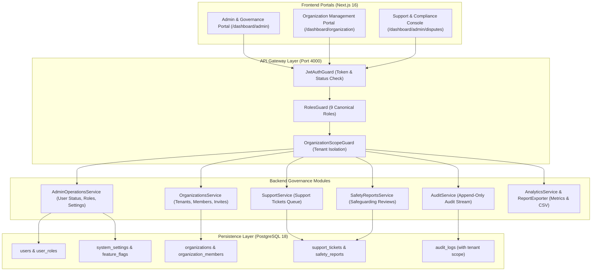
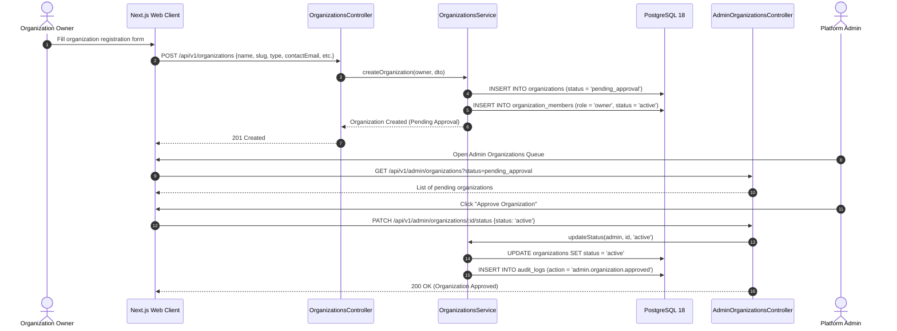
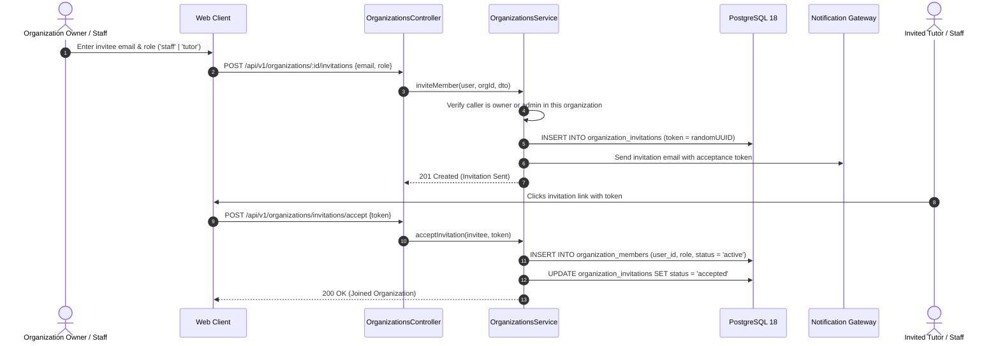
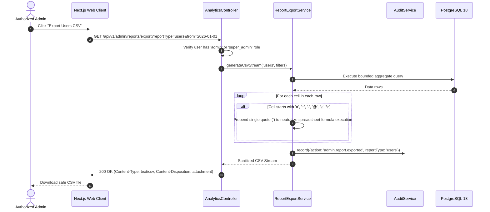

# Phase 09: Admin Operations, Organization Management & Platform Governance — Implementation Plan

**Platform:** OgroniEdu (অগ্রণী এডু)  
**Phase:** 09: Admin Operations, Organization Management & Platform Governance  
**Date:** October 21, 2026  
**Status:** Approved Specification

---

## 1. System Architecture Overview

The Administrative Operations & Platform Governance architecture partitions authority into 5 distinct operational domains to guarantee least-privilege access, confidentiality, and tenant isolation:



---

## 2. Work Breakdown Structure (WBS)

### 2.1 Database Schema & Migration (`027_organizations_and_platform_governance.sql`)

- [ ] Create `organizations` table:
  - `id UUID PRIMARY KEY`, `name TEXT`, `slug TEXT UNIQUE`, `type TEXT`, `status TEXT`, `owner_user_id UUID REFERENCES users(id)`, `contact_email TEXT`, `contact_phone TEXT`, `address TEXT`, `division TEXT`, `district TEXT`, `settings JSONB`, timestamps.
- [ ] Create `organization_members` table:
  - `id UUID PRIMARY KEY`, `organization_id UUID REFERENCES organizations(id)`, `user_id UUID REFERENCES users(id)`, `role TEXT`, `status TEXT`, `invited_by UUID`, timestamps, `UNIQUE(organization_id, user_id)`.
- [ ] Create `organization_invitations` table:
  - `id UUID PRIMARY KEY`, `organization_id UUID`, `email TEXT`, `role TEXT`, `invited_by_user_id UUID`, `token TEXT UNIQUE`, `status TEXT`, `expires_at TIMESTAMPTZ`, timestamps.
- [ ] Add `organization_id UUID REFERENCES organizations(id) ON DELETE SET NULL` to `tutor_profiles`.
- [ ] Add `organization_id UUID REFERENCES organizations(id) ON DELETE SET NULL` to `audit_logs`.
- [ ] Add composite indexes for tenant queries: `ix_org_members_org_user`, `ix_audit_org_created`.
- [ ] Execute migration on PostgreSQL 18 and rebuild `@ogroniedu/database`.

### 2.2 Shared Contracts (`packages/contracts`)

- [ ] Create `packages/contracts/src/organizations.ts`:
  - Zod schemas: `CreateOrganizationSchema`, `UpdateOrganizationSchema`, `InviteOrganizationMemberSchema`, `UpdateOrganizationStatusSchema`, `QueryOrganizationsSchema`.
  - Export TypeScript types: `OrganizationRecord`, `OrganizationMemberRecord`, `OrganizationInvitationRecord`.
- [ ] Re-export from `packages/contracts/src/index.ts` and compile.

### 2.3 Backend API & Services (`apps/api`)

- [ ] Create `OrganizationsModule`:
  - Entities: `OrganizationEntity`, `OrganizationMemberEntity`, `OrganizationInvitationEntity`.
  - Service: `OrganizationsService`:
    - Tenant isolation checks on every member query.
    - Owner transfer protocol with audit logging.
    - Invitation dispatch and token redemption.
  - Controller: `OrganizationsController` (`/api/v1/organizations`):
    - Multi-tenant operations for `organization_owner` and `organization_staff`.
  - Controller: `AdminOrganizationsController` (`/api/v1/admin/organizations`):
    - Platform-wide governance for `admin` and `super_admin` (approve, suspend, view all).
- [ ] Enhance `AuditService`:
  - Support `organizationId` parameter in `RecordAuditParams`.
  - Add `getOrganizationAuditHistory(organizationId: string, limit?: number)`.
- [ ] Implement Report Export in `AnalyticsService`:
  - Endpoint `GET /api/v1/admin/reports/export`:
    - Supports `users`, `bookings`, `financial`, `tutors`, `organizations`.
    - Sanitizes CSV data with anti-formula injection rules (`'`, `=`, `+`, `-`, `@`).
    - Emits audit log for every exported dataset.

### 2.4 Frontend Web Application (`apps/web`)

- [ ] Update `navigation.ts`:
  - Add navigation configuration for `organization_owner` and `organization_staff` pointing to `/dashboard/organization`.
  - Add `Organizations` entry in Admin Navigation pointing to `/dashboard/admin/organizations`.
- [ ] Create RTK Query Service `organizations-api.ts`:
  - `getOrganizations`, `getOrganization`, `createOrganization`, `updateOrganization`, `inviteMember`, `removeMember`, `adminUpdateStatus`.
- [ ] Build Admin Organizations View:
  - `apps/web/src/app/[locale]/dashboard/admin/organizations/page.tsx`:
    - Filterable table with status badges (`pending_approval`, `active`, `suspended`).
    - Action dialog to Approve, Suspend, or Inspect an organization.
- [ ] Build Organization Portal:
  - `apps/web/src/app/[locale]/dashboard/organization/page.tsx`:
    - Organization overview, staff member table, invitation modal, and agency profile editor.

---

## 3. Sequence Diagrams

### 3.1 Organization Registration & Admin Approval Flow



### 3.2 Member Invitation & Role Assignment Flow



### 3.3 Safe CSV Export with Anti-Formula Injection



---

## 4. Rollback & Migration Safety Strategy

### 4.1 Zero-Downtime Migration

- `027_organizations_and_platform_governance.sql` uses `CREATE TABLE IF NOT EXISTS` and `ALTER TABLE ... ADD COLUMN IF NOT EXISTS`.
- Foreign keys use `ON DELETE SET NULL` on `tutor_profiles` and `audit_logs` so existing rows remain 100% valid.

### 4.2 Rollback Script

```sql
ALTER TABLE tutor_profiles DROP COLUMN IF EXISTS organization_id;
ALTER TABLE audit_logs DROP COLUMN IF EXISTS organization_id;
DROP TABLE IF EXISTS organization_invitations CASCADE;
DROP TABLE IF EXISTS organization_members CASCADE;
DROP TABLE IF EXISTS organizations CASCADE;
DELETE FROM schema_migrations WHERE version = '027_organizations_and_platform_governance';
```
