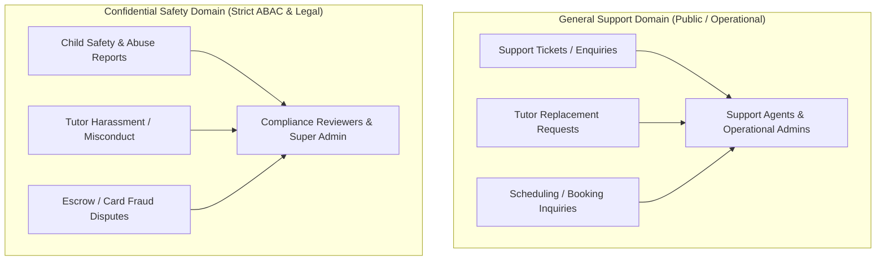
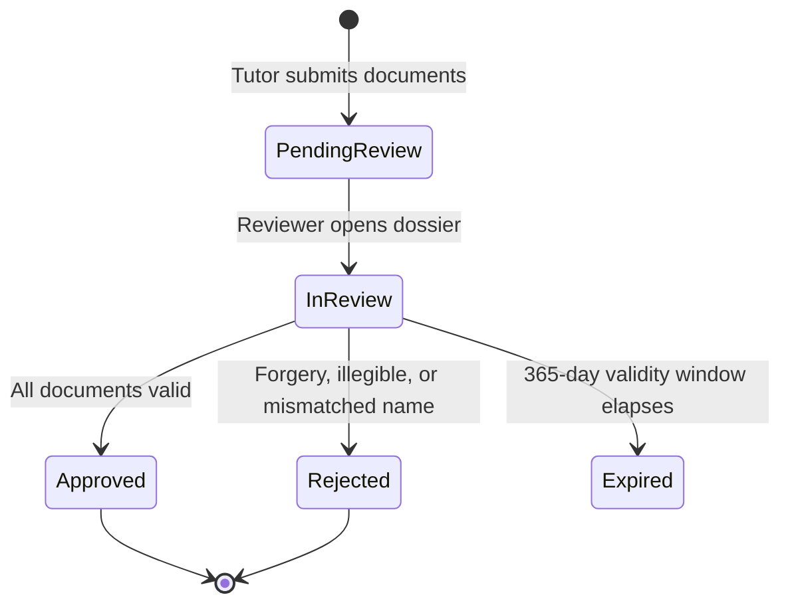

# Phase 09: Admin Operations, Organization Management & Platform Governance — Moderation & Operational Workflows

**Platform:** OgroniEdu (অগ্রণী एडু)  
**Phase:** 09: Admin Operations, Organization Management & Platform Governance  
**Date:** October 21, 2026  
**Status:** Approved Specification  

---

## 1. Moderation Architecture & Case Segregation

Operational governance requires strict segregation between **ordinary customer support** and **confidential safeguarding investigations**. Merging these workflows violates Bangladesh's The Children Act 2013 (*শিশু আইন ২০১৩*) and exposes minor victims to privacy leaks.

---

## 2. Core Operational Workflows

### 2.1 Tutor Verification Review Workflow
Tutors submit identity and academic credentials across 3 tiers: `identity` (NID), `educational` (Certificates/Transcripts), and `institutional` (Employment/Letters).

- **Authorized Reviewers**: `admin`, `super_admin`, `compliance_reviewer`.
- **Requirements**:
  - Rejection requires an explicit code (`INVALID_DOCUMENT`, `NAME_MISMATCH`, `POOR_QUALITY`) and user-facing explanation in Bengali & English.
  - Approval updates `tutor_profiles.verification_status` and triggers `tutor.verified` notification outbox event.

---

### 2.2 Support Ticket Triage Workflow
Governs general inquiries, account assistance, and platform questions.

- **Status Transitions**: `submitted` -> `in_review` -> `resolved` | `spam`.
- **Authorized Roles**: `support_agent`, `admin`, `super_admin`.
- **Assignment**: Tickets can be assigned to specific agents (`assigned_to_user_id`).
- **Resolution**: Requires `resolution_notes` and emits notification to ticket requester.

---

### 2.3 Safeguarding & Child Protection Case Workflow
Governs sensitive reports of harassment, inappropriate contact, grooming, or abuse.

- **Status Transitions**: `submitted` -> `under_investigation` -> `escalated` -> `action_taken` -> `resolved`.
- **Authorized Roles**: `compliance_reviewer`, `super_admin`.
- **Firewall Rule**: Ordinary administrators and support agents receive `403 Forbidden` if attempting to fetch child safety case details or attachment assets.
- **Protective Hold**: Reviewers can place an immediate protective hold (`SafetyActionEntity`) freezing a tutor's active bookings and public search visibility pending formal police or legal inquiry.

---

### 2.4 Booking Dispute & Escrow Arbitration Workflow
When a guardian or student disputes a session (e.g. tutor was a no-show, premature disconnect, or quality breach):

- **Status Transitions**: `opened` -> `under_review` -> `resolved_refund` | `resolved_release` | `dismissed`.
- **Authorized Roles**: `support_agent` (reviews evidence), `admin` (arbitrates), `super_admin` (final release).
- **Financial Rule**: Refunds are executed via `RefundsService` and payouts via `PayoutsService`. **Administrators never manually alter ledger balances directly.**

---

### 2.5 Content Moderation (Reviews & Messages)
- **Reviews**: Automated safety scans flag abusive language. Administrators review flagged reviews and can approve, reject, or request edit.
- **Messages**: Real-time regex engine normalizes Bengali numerals (`০-৯`) and redacts off-platform contact (`[REDACTED CONTACT NUMBER]`) and bKash solicitations (`[REDACTED PAYMENT SOLICITATION]`). Flagged instances trigger an audit entry for supervisor review.
