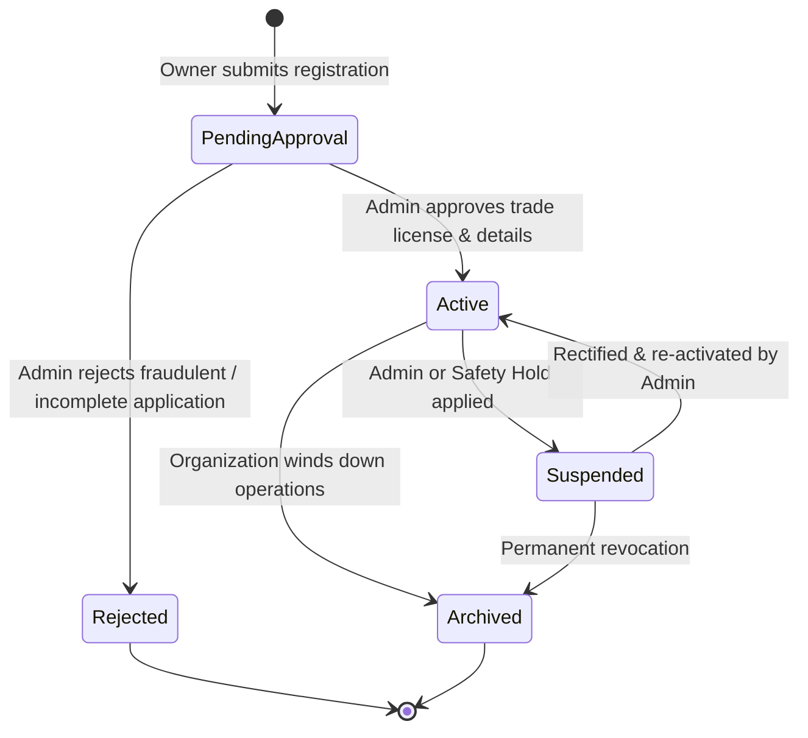
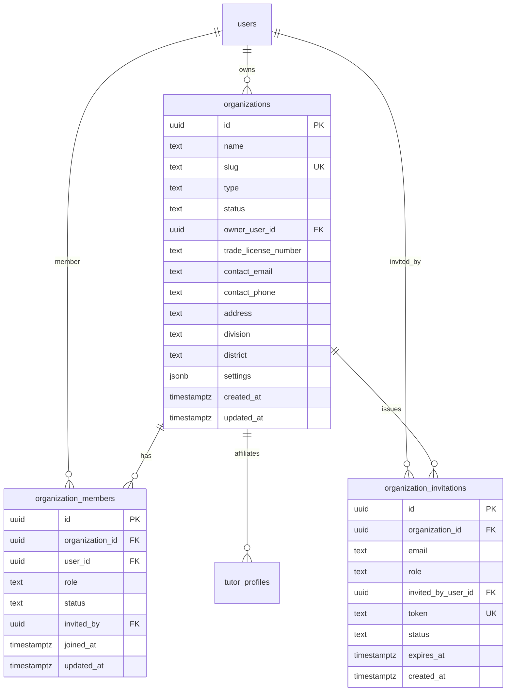

# Phase 09: Admin Operations, Organization Management & Platform Governance — Organization & Tenant Model

**Platform:** OgroniEdu (অগ্রণী এডু)  
**Phase:** 09: Admin Operations, Organization Management & Platform Governance  
**Date:** October 21, 2026  
**Status:** Approved Specification

---

## 1. Domain Overview & Purpose

In Bangladesh, a substantial proportion of secondary and higher-secondary tutoring is delivered through structured coaching centers, academic institutions, and tutoring agencies (e.g. UCC, Saifur's, Retinā, Mentors', local neighborhood coaching academies).

The Organization model enables:

1. Coaching centers and agencies to operate as verified business entities on OgroniEdu.
2. Organization Owners (`organization_owner`) and Staff (`organization_staff`) to manage institutional tutors under their umbrella.
3. Multi-tenant scoping ensuring an organization's rosters, internal metrics, and tuition bookings are isolated from competitor organizations.
4. Platform administrators (`admin`, `super_admin`) to govern organization accreditation, verify trade licenses, and suspend bad actors.

---

## 2. Organization Lifecycle State Machine



### 2.1 State Definitions & Capabilities

| State                  | Allowed Operations                                                                            | Restricted Operations                                                                   |
| :--------------------- | :-------------------------------------------------------------------------------------------- | :-------------------------------------------------------------------------------------- |
| **`pending_approval`** | Owner can view status, update contact metadata, upload verification documents.                | Cannot invite tutors, cannot take institutional bookings, hidden from public directory. |
| **`active`**           | Full institutional capability: invite tutors, manage staff, accept bookings, view analytics.  | None. Must maintain active trade license.                                               |
| **`suspended`**        | Read-only access for existing records. All active bookings flagged for administrative review. | Cannot post new bookings, cannot invite members, search visibility suppressed.          |
| **`archived`**         | Historical audit records preserved for 7 years (tax/accounting compliance).                   | Entire organization permanently decommissioned.                                         |

---

## 3. Entity Definitions & Schema Architecture



---

## 4. Membership & Role Hierarchy

Within an organization, members hold one of four organizational roles:

| Org Role    | Description                                          | Permissions                                                                                                                                            |
| :---------- | :--------------------------------------------------- | :----------------------------------------------------------------------------------------------------------------------------------------------------- |
| **`owner`** | Primary business proprietor or legal representative. | Full authority: update settings, invite/remove staff and tutors, transfer ownership, view billing. Exactly one active owner required per organization. |
| **`admin`** | Executive branch manager or operations director.     | Manage tutors, invite staff, manage class schedules, view organization analytics. Cannot transfer ownership.                                           |
| **`staff`** | Academic coordinator or student counselor.           | View member directory, coordinate tutor schedules. Cannot alter billing or organization settings.                                                      |
| **`tutor`** | Affiliated educator teaching under the organization. | Delivers sessions, views assigned institutional bookings.                                                                                              |

---

## 5. Tenant Isolation & IDOR Defense

Cross-tenant data exposure (Insecure Direct Object Reference) is prevented at the database and service layers:

1. **Server-Side Membership Verification**:
   ```typescript
   async verifyMembership(userId: string, orgId: string, allowedRoles?: string[]): Promise<OrganizationMemberEntity> {
     const member = await this.memberRepo.findOne({
       where: { organizationId: orgId, userId, status: 'active' },
     });
     if (!member) {
       throw new ForbiddenException('Access denied: You are not an active member of this organization');
     }
     if (allowedRoles && !allowedRoles.includes(member.role)) {
       throw new ForbiddenException(`Access denied: Requires one of [${allowedRoles.join(', ')}]`);
     }
     return member;
   }
   ```
2. **Never Trust Client-Submitted `organizationId`**:
   - APIs operating on member or booking resources derive the tenant context from the verified token or confirm ownership server-side.
3. **Audit Log Isolation**:
   - `audit_logs` records include `organization_id` so organization owners can inspect internal member changes without seeing other organizations' logs.

---

## 6. Ownership Transfer Protocol

To safeguard organizations from hostile takeovers or orphaned accounts:

1. Only the current verified `owner` can initiate an ownership transfer.
2. The recipient must be an existing active member of the organization.
3. The transfer requires an explicit confirmation payload and reason.
4. Upon successful transfer:
   - The recipient's role in `organization_members` becomes `owner`.
   - The former owner's role is demoted to `admin`.
   - `organizations.owner_user_id` is updated.
   - An immutable audit log (`admin.organization.ownership_transferred`) is written.
