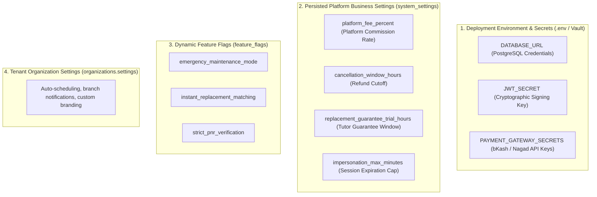

# Phase 09: Admin Operations, Organization Management & Platform Governance — Platform Settings & Configuration

**Platform:** OgroniEdu (অগ্রণী ایڈু)  
**Phase:** 09: Admin Operations, Organization Management & Platform Governance  
**Date:** October 21, 2026  
**Status:** Approved Specification

---

## 1. Configuration Taxonomy

OgroniEdu rigorously partitions platform configuration across four architectural layers:



> [!WARNING]
> Secrets, encryption keys, and payment gateway passwords must **NEVER** be stored in `system_settings` or exposed via administrative REST endpoints.

---

## 2. Persisted System Settings Schema & Validation

All persisted business settings reside in table `system_settings`. Modifications require `super_admin` role and strict schema validation:

| Setting Key                             | Default Value     | Data Type | Validation Rules                    | Description & Business Impact                                                |
| :-------------------------------------- | :---------------- | :-------: | :---------------------------------- | :--------------------------------------------------------------------------- |
| **`platform_fee_percent`**              | `{"percent": 8}`  |  `JSONB`  | Integer `percent` between 0 and 50. | Commission deducted by the platform upon milestone completion.               |
| **`cancellation_window_hours`**         | `{"hours": 24}`   |  `JSONB`  | Integer `hours` between 1 and 168.  | Hours before scheduled session start allowing 100% guardian refund.          |
| **`replacement_guarantee_trial_hours`** | `{"hours": 48}`   |  `JSONB`  | Integer `hours` between 12 and 168. | Window post-trial session during which guardian can invoke free replacement. |
| **`impersonation_max_minutes`**         | `{"minutes": 15}` |  `JSONB`  | Integer `minutes` between 5 and 60. | Strict hard-cap ceiling for super-admin emergency support sessions.          |

---

## 3. Dynamic Feature Flags Schema

Managed via table `feature_flags`:

```json
{
  "key": "emergency_maintenance_mode",
  "enabled": false,
  "rules": {
    "allowRoles": ["admin", "super_admin"]
  },
  "description": "Restricts student and tutor logins during emergency database migrations."
}
```

- **Toggling**: Updating a feature flag executes via `PUT /api/v1/admin/feature-flags/:key`.
- **Runtime Consumption**: Services inspect `feature_flags` to evaluate live circuit breakers without application restarts.

---

## 4. Administrative Change Control Protocol

1. **Authorization**:
   - `admin`: Granted read-only permission (`GET /api/v1/admin/settings`).
   - `super_admin`: Granted read and update permission (`PUT /api/v1/admin/settings/:key`).
2. **Transactional Audit Logging**:
   - Every setting change creates an audit entry in `audit_logs` with `action: 'admin.system_setting.updated'`, capturing the previous and new values.
3. **Cache Eviction**:
   - When a setting is updated, in-memory caches are invalidated immediately so all cluster nodes execute with current parameters.
