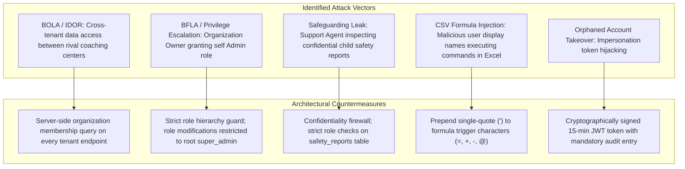

# Phase 09: Admin Operations, Organization Management & Platform Governance — Security & Privacy Architecture

**Platform:** OgroniEdu (অগ্রণী ایڈু)  
**Phase:** 09: Admin Operations, Organization Management & Platform Governance  
**Date:** October 21, 2026  
**Status:** Approved Specification

---

## 1. Threat Model & Security Posture

Administrative consoles represent the highest-value attack surface in SaaS architectures. A compromise of an administrator or organization account risks platform-wide data leakage, financial theft, or child privacy exposure.

---

## 2. Insecure Direct Object Reference (IDOR) & Tenant Isolation

1. **Multi-Tenancy Scoping**:
   - Every route under `/api/v1/organizations/:id/...` resolves the calling user's membership in `:id`.
   - If `organization_members.status != 'active'`, request is rejected with `403 Forbidden`.
   - Listing endpoints enforce `WHERE organization_id = :userOrgId` in SQL queries, completely eliminating the possibility of cross-tenant record leakage.
2. **Preventing Tenant ID Falsification**:
   - The backend never trusts client-supplied tenant headers (`X-Organization-Id`) or body fields without database validation against the authenticated JWT user.

---

## 3. Broken Function Level Authorization (BFLA) & Anti-Escalation

1. **Role Modification Gating**:
   - Only `super_admin` can call `PUT /api/v1/admin/users/:id/roles`.
   - A regular `admin` cannot grant `super_admin` or promote any user to platform staff.
   - Self-promotion is strictly rejected: a user cannot update their own roles.
2. **Organization Owner Constraints**:
   - `organization_owner` has zero platform administrative privileges.
   - An organization owner can only assign organizational roles (`admin`, `staff`, `tutor`) within their own organization.

---

## 4. Safeguarding & Child Protection Privacy

Under Bangladesh's **The Children Act 2013 (_শিশু আইন ২০১৩_)**:

- Minor victim identities, home addresses, phone numbers, and evidence attachments are classified as **Confidential Legal Records**.
- Support agents, operational admins, tutors, and organization managers receive immediate `403 Forbidden` if attempting to query child safety reports.
- Access is restricted strictly to designated `compliance_reviewer` officers and executive `super_admin`.
- Every access to a safeguarding file generates a cryptographically traceable audit record.

---

## 5. CSV Injection / Formula Execution Defense

When an administrator exports a CSV report:

- Any user could maliciously register with a name such as `=cmd|'/C calc'!A0` or `@SUM(1+1)`.
- The export serializer inspects every string value. If the initial character is in `[=+\-@\t\r]`, a single quote (`'`) is prepended, instructing spreadsheet interpreters to treat the value strictly as plain text.

---

## 6. Emergency Impersonation Security Protocol

To prevent abuse of user impersonation:

1. **Root-Only**: Restricted exclusively to `super_admin`.
2. **Time-Capped**: Hard ceiling of **15 minutes**. Cannot be refreshed or renewed.
3. **Mandatory Ticket Justification**: Requires an active support ticket ID and explicit reason.
4. **Audit Immutability**: Logs `admin.impersonation.started` with actor, target, timestamp, and client IP.
5. **No Nesting**: Impersonating a user who is themselves a super_admin is blocked.
