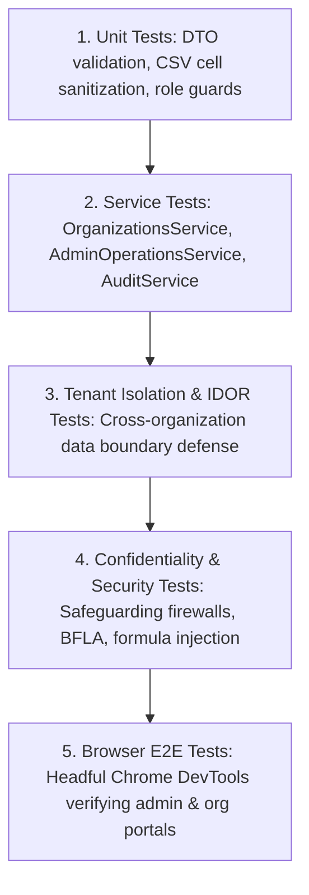

# Phase 09: Admin Operations, Organization Management & Platform Governance — Test Plan

**Platform:** OgroniEdu (অগ্রণী ایڈু)  
**Phase:** 09: Admin Operations, Organization Management & Platform Governance  
**Date:** October 21, 2026  
**Status:** Approved Specification

---

## 1. Test Strategy Overview

Quality assurance for Phase 09 verifies security boundaries, tenant isolation, role-based authorization, and administrative operational reliability across five testing tiers:

---

## 2. Test Suites & Target Coverage

| Test File                                              | Target Module                  | Scope & Objectives                                                                                      | Target Count |
| :----------------------------------------------------- | :----------------------------- | :------------------------------------------------------------------------------------------------------ | :----------: |
| `apps/api/test/organizations.service.spec.ts`          | `OrganizationsService`         | Create organization, approve, suspend, invite member, accept token, tenant scoping, ownership transfer. |      15      |
| `apps/api/test/organizations.controller.spec.ts`       | `OrganizationsController`      | Endpoint status codes, body validation, tenant verification.                                            |      6       |
| `apps/api/test/admin-organizations.controller.spec.ts` | `AdminOrganizationsController` | Platform admin list, approve, suspend organizations.                                                    |      6       |
| `apps/api/test/admin-operations.controller.spec.ts`    | `AdminOperationsController`    | User suspension, reactivation, role assignment, settings, impersonation.                                |      10      |
| `apps/api/test/report-export.spec.ts`                  | `ReportExportService`          | CSV generation, date-range filters, anti-formula injection escaping.                                    |      8       |
| `apps/api/test/platform-governance-rbac.spec.ts`       | RBAC & ABAC                    | 9-role authorization boundary checks across administrative endpoints.                                   |      18      |
| `apps/api/test/tenant-isolation-idor.spec.ts`          | Multi-Tenant Scoping           | Org A owner attempting to read/update Org B records (IDOR defense).                                     |      6       |
| `apps/web/test/organizations.spec.ts`                  | Web Components & API           | Redux RTK Query, member list rendering, invitation modal, admin table.                                  |      12      |

---

## 3. Security Penetration & Abuse Test Cases

| #     | Attack / Abuse Vector                    | Injected Payload / Action                                                          | Expected System Behavior                                                      |
| :---- | :--------------------------------------- | :--------------------------------------------------------------------------------- | :---------------------------------------------------------------------------- |
| **1** | **Cross-Tenant IDOR Attempt**            | Org A owner requests `GET /api/v1/organizations/{orgB-id}/members`                 | Rejected with `403 Forbidden` (`NOT_AN_ACTIVE_MEMBER`).                       |
| **2** | **Self-Escalation to Admin**             | Org Owner submits `PUT /api/v1/admin/users/{self-id}/roles` with `['super_admin']` | Rejected with `403 Forbidden` (Role requires `super_admin`).                  |
| **3** | **Unauthorized Safeguarding Inspection** | Support Agent queries `GET /api/v1/safety-reports/{child-safety-case-id}`          | Rejected with `403 Forbidden` (Strictly restricted to `compliance_reviewer`). |
| **4** | **CSV Formula Injection Attack**         | User name is `=cmd                                                                 | '/C calc'!A0`or`@SUM(1+1)`                                                    | Sanitized to `'=cmd | '/C calc'!A0`. Single quote prepended; inert text in Excel. |
| **5** | **Self-Suspension Attempt**              | Admin submits `POST /api/v1/admin/users/{own-id}/suspend`                          | Rejected with `400 Bad Request` (`CANNOT_SUSPEND_OWN_ACCOUNT`).               |
| **6** | **Unauthenticated Impersonation**        | Non-super-admin attempts `POST /api/v1/admin/impersonation/start`                  | Rejected with `403 Forbidden`.                                                |
| **7** | **Expired Invitation Redemption**        | User submits expired or revoked invitation token                                   | Rejected with `400 Bad Request` (`INVITATION_EXPIRED_OR_REVOKED`).            |

---

## 4. End-to-End Browser Verification Protocol

Headful automated browser testing via Chrome DevTools MCP on `http://localhost:5000`:

1. **Admin Portal Check**:
   - Login as `super_admin@ogroniedu.com`.
   - Navigate to `/en/dashboard/admin`.
   - Verify master console cards: pending verifications, active bookings, ledger integrity badge.
2. **Organizations Governance View**:
   - Navigate to `/en/dashboard/admin/organizations`.
   - Verify table lists organizations with status pills (`pending_approval`, `active`).
   - Click "Approve Organization" and verify immediate UI status change to `active`.
3. **User Management & Audited Suspension**:
   - Navigate to `/en/dashboard/admin/users`.
   - Search for user, click Suspend, input mandatory reason.
   - Verify user status pill changes to `suspended` and an audit entry is created.
4. **Organization Owner Portal**:
   - Login as `org_owner@retinabd.org`.
   - Navigate to `/en/dashboard/organization`.
   - Verify organization name, member roster, and invitation modal.
