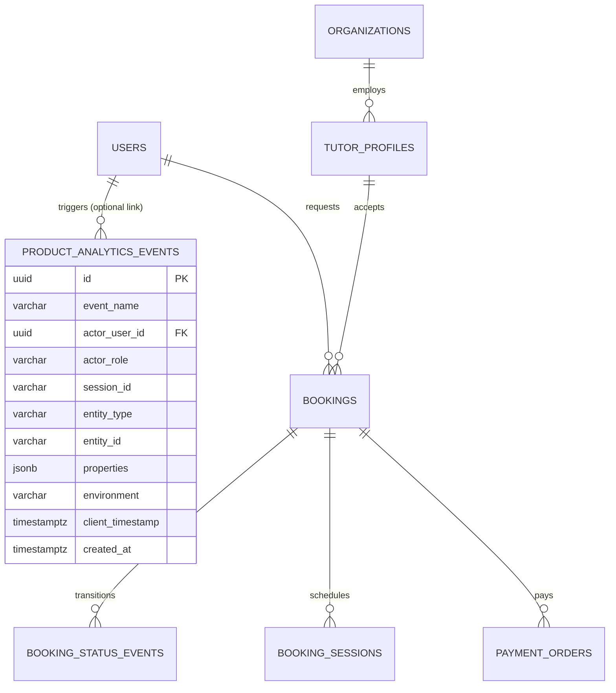

# OgroniEdu — Analytics Data Model Specification

## 1. Relational Architecture & Tables

The analytics data architecture balances operational transactional speed with fast historical querying.



---

## 2. DDL Schema Definition (Migration 030)

```sql
CREATE TABLE IF NOT EXISTS product_analytics_events (
    id UUID PRIMARY KEY DEFAULT gen_random_uuid(),
    event_name VARCHAR(64) NOT NULL,
    actor_user_id UUID REFERENCES users(id) ON DELETE SET NULL,
    actor_role VARCHAR(32) NOT NULL DEFAULT 'anonymous',
    session_id VARCHAR(64),
    entity_type VARCHAR(64),
    entity_id VARCHAR(64),
    properties JSONB NOT NULL DEFAULT '{}'::jsonb,
    environment VARCHAR(16) NOT NULL DEFAULT 'production',
    client_timestamp TIMESTAMPTZ,
    created_at TIMESTAMPTZ NOT NULL DEFAULT CURRENT_TIMESTAMP,
    CONSTRAINT chk_event_name_valid CHECK (
        event_name IN (
            'registration_started',
            'registration_completed',
            'onboarding_step_completed',
            'onboarding_completed',
            'tutor_search_performed',
            'tutor_profile_viewed',
            'booking_started',
            'booking_request_submitted',
            'booking_confirmed',
            'booking_cancelled',
            'session_attended',
            'session_completed',
            'homework_submitted',
            'homework_reviewed',
            'feedback_submitted'
        )
    )
);
```

---

## 3. High-Throughput Compound Indexes

To prevent table scans during date-range and funnel querying, the following compound indexes are provisioned:

| Index Name | Indexed Columns | Query Use-Case |
| :--- | :--- | :--- |
| `ix_analytics_events_name_time` | `(event_name, created_at DESC)` | Funnel stage count aggregation over date windows |
| `ix_analytics_events_actor` | `(actor_user_id, created_at DESC)` | User journey and cohort retention aggregation |
| `ix_analytics_events_entity` | `(entity_type, entity_id)` | Tutor profile views and specific booking inquiries |
| `ix_analytics_events_session` | `(session_id, created_at DESC)` | Session attribution and client deduplication |
| `ix_analytics_events_created_at` | `(created_at DESC)` | General chronological stream queries |

---

## 4. Analytical Views

### 4.1 Daily Product Funnel View (`v_daily_product_funnel`)
Pre-aggregates daily counts across all funnel stages directly in PostgreSQL for real-time reporting dashboards:

```sql
CREATE OR REPLACE VIEW v_daily_product_funnel AS
SELECT 
    DATE_TRUNC('day', e.created_at)::date as metric_date,
    COUNT(e.id) FILTER (WHERE e.event_name = 'tutor_search_performed')::int as search_count,
    COUNT(e.id) FILTER (WHERE e.event_name = 'tutor_profile_viewed')::int as profile_views_count,
    COUNT(e.id) FILTER (WHERE e.event_name = 'booking_started')::int as bookings_started_count,
    COUNT(e.id) FILTER (WHERE e.event_name = 'booking_request_submitted')::int as booking_requests_count,
    COUNT(e.id) FILTER (WHERE e.event_name = 'booking_confirmed')::int as bookings_confirmed_count,
    COUNT(e.id) FILTER (WHERE e.event_name = 'session_completed')::int as sessions_completed_count
FROM product_analytics_events e
GROUP BY DATE_TRUNC('day', e.created_at)::date;
```

---

## 5. Data Retention & Archival Policies

- **Raw Events Retention:** Retained in `product_analytics_events` for **90 days**.
- **Aggregated Summaries:** Retained in daily and weekly views permanently.
- **Automated Partitioning / Purge:** Events older than 90 days are archived to compressed cold storage or pruned via scheduled cleanup jobs, preserving system performance.
- **Account Erasure Invariant:** When a user deletes their account (`users` record deleted), `actor_user_id` is set to `NULL` via `ON DELETE SET NULL`, breaking linkability to the person while retaining anonymized counts for historical business reporting.
