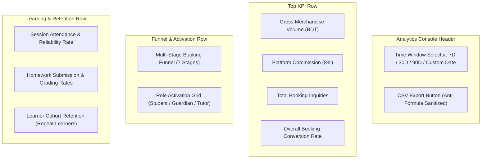

# OgroniEdu — Dashboard & Reporting UI Specification

## 1. Design Standard & Visual Token Hierarchy

In accordance with the system design standard, all analytics views adhere strictly to:

- **Theme Standard:** Light theme exclusively (`bg-slate-50` background, pure white `#FFFFFF` cards, slate text `#0F172A`).
- **Surface Elevation:** Clean white cards with `border border-slate-200 shadow-xs rounded-2xl`.
- **Primary Brand Gradient:** Royal Sapphire Blue (`from-blue-600 via-indigo-600 to-blue-600` for primary metric highlights and export buttons).
- **Component Primitives:** Customized shadcn UI primitives (`Card`, `Button`, `Select`, `Dialog`).

---

## 2. Admin Analytics Console Layout

---

## 3. UI State Handling Standards

### 3.1 Loading State

- Displays standard accessible `LoadingSpinner` with subtle skeleton cards matching the exact dimensions of KPI cards.
- Screen readers receive `aria-busy="true"` announcements.

### 3.2 Empty State (Zero Data / Fresh Installation)

- **Principle:** Never display fake production numbers or hardcoded placeholder charts.
- When `totalRequests == 0` or `searchCount == 0`:
  - Conversion rates render as `0.0%` (never `NaN` or crashing division).
  - Displays friendly empty state:
    > "কোনো অ্যানালিটিক্স ডেটা পাওয়া যায়নি (No analytics data recorded for this time window). Metrics will populate automatically as users book sessions."

### 3.3 Error & Retry State

- In the event of network disruption or query failure, a card displays:
  - Error description translated into the active locale (`bn` or `en`).
  - "পুনরায় চেষ্টা করুন" (Retry) button triggering query re-fetch without reloading the page.

---

## 4. Administrative CSV Report Exporter

The exporter in `AnalyticsService.exportReport()` provides formula-safe CSV downloads across 5 categories: `users`, `bookings`, `financial`, `tutors`, and `organizations`.

### Anti-Formula Injection Sanitization

To prevent CSV Injection (CWE-1236) when spreadsheet software (Excel, LibreOffice) opens exported files:

- Any cell value starting with `=`, `+`, `-`, or `@` is prepended with a single quote (`'`).
- Prevents remote code execution via formula evaluation.
- Commas, quotes, and newlines are safely escaped using RFC 4180 rules.
