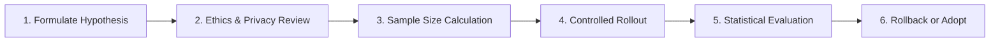

# OgroniEdu — Product Experimentation Policy & Guidelines

## 1. Governance Principles & Strict Prohibitions

OgroniEdu prioritizes learner safety, pedagogical integrity, and financial transparency over growth hacking.

### Strict Non-Negotiable Prohibitions:
1. **Zero Experiments on Safety & Safeguarding:** Never A/B test or experiment on child protection workflows, emergency SOS reporting, guardian links, or safeguarding triage queues.
2. **Zero Experiments on Financial Accounting:** Never experiment on pricing calculation logic, escrow balances, ledger entries, or refund processing rules.
3. **Zero Experiments on Authentication & RBAC:** Never experiment on password hashing, OTP verification rates, or authorization permission checks.
4. **No Unapproved Live User Testing:** No experiment may be activated on real users without explicit written authorization from the Product Owner.

---

## 2. Permissible Experimentation Domains

When authorized, controlled experiments may be evaluated exclusively within:
- **Tutor Search & Ranking UI:** Testing alternative sorting criteria (e.g. rating vs. response time vs. price).
- **Onboarding Copy & Guidance:** Testing localized copy improvements to increase onboarding completion rates.
- **Empty States & Recommendations:** Testing helpful subject suggestions when a user's search returns zero results.
- **Session Reminder Timing:** Testing in-app reminder lead times (e.g. 15 minutes vs. 30 minutes before a lesson).

---

## 3. Experimentation Lifecycle & Protocol

### 3.1 Step 1: Formulate Hypothesis
Every experiment requires a documented hypothesis template:
- *Observation:* What UX friction or drop-off was detected in funnel analytics?
- *Hypothesis:* If we change X, metric Y will improve by Z% without hurting guardrail metric G.
- *Primary Metric:* (e.g. Search-to-profile conversion rate).
- *Guardrail Metric:* (e.g. Search latency < 200ms, zero-result rate does not increase).

### 3.2 Step 2: Sample Size & Statistical Validity
- Small traffic volumes cannot produce statistically significant A/B test conclusions.
- When daily sample size is under 500 actions, prefer **qualitative user feedback** and **usability interviews** over underpowered A/B tests.
- Claiming "statistical significance" without adequate power (> 80%) and confidence level (p < 0.05) is strictly prohibited.

### 3.3 Step 3: Guardrails & Automatic Stopping Triggers
An experiment must be halted immediately and rolled back if:
1. HTTP 5xx error rate spikes by > 0.2%.
2. Conversion rate on the variant drops by > 15% compared to control.
3. User feedback tickets report confusion or UI breakage.
