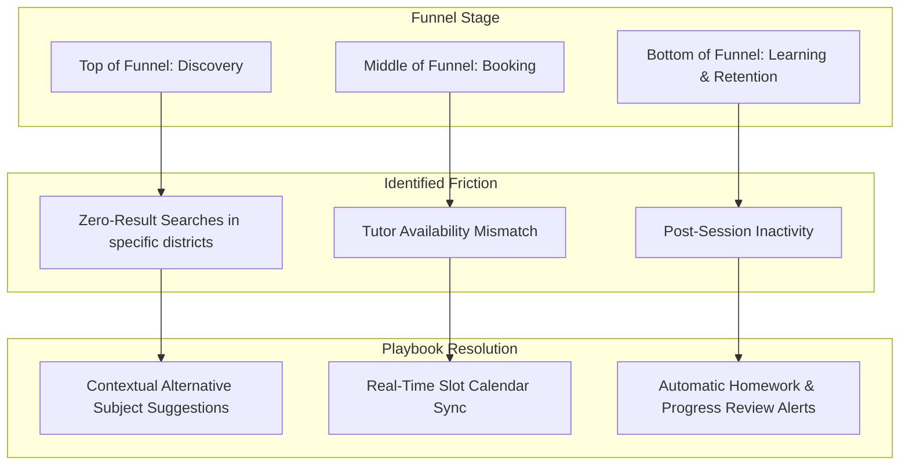

# OgroniEdu — Growth & User Retention Playbook

## 1. Growth Strategy: Quality & Trust Over Aggressive Acquisition

In the educational tutoring market of Bangladesh, sustainable retention is driven by **trust, academic outcomes, and tutor punctuality**, rather than spammy growth loops or pressuring push notifications.

---

## 2. Evidence-Backed Friction Diagnosis & Playbook Actions

### 2.1 Playbook Action 1: Zero-Result Search Remediation

- **Problem:** When prospective students search for specialized subjects (e.g. Higher Secondary ICT or English Medium Physics) in non-metropolitan areas, the search may return 0 tutors.
- **Evidence:** `zeroResultRate` metric in `v_daily_product_funnel`.
- **Action:**
  1. Display friendly zero-results card with one-click toggles to broaden search to "Online / Remote" tutors.
  2. Display related curriculum subjects (e.g. general Math or Science).
  3. Offer a "Request a Tutor" notification intake without requiring account registration.
- **Guardrail:** Never show fake or unverified tutors to fill space.

### 2.2 Playbook Action 2: Tutor Profile Verification Guidance

- **Problem:** Tutors register but abandon before completing their academic qualification dossier.
- **Evidence:** `tutor.verificationRate` in `getActivationAnalytics()`.
- **Action:**
  1. Provide step-by-step document guidance on the verification screen showing acceptable Bangladeshi certificates (SSC/HSC certificates, University Student ID, or National ID).
  2. Send in-app verification status reminders via notifications.
- **Guardrail:** Never lower verification standards to boost tutor supply.

### 2.3 Playbook Action 3: Multi-Child Guardian Overview

- **Problem:** Guardians managing multiple children struggle to track different lesson schedules.
- **Evidence:** Guardian retention drops if session times conflict.
- **Action:**
  1. Unify multi-child session calendars in the Guardian Dashboard (`/dashboard/guardian/sessions`).
  2. In-app and SMS reminders sent to the guardian 30 minutes before any child's scheduled session.
- **Guardrail:** Guardian notifications must respect user notification preference toggles.

### 2.4 Playbook Action 4: Homework & Academic Feedback Loop

- **Problem:** Students take sessions but drop off without continuing because lesson progress is not tangible.
- **Evidence:** `homework.submissionRate` in `getLearningEngagementAnalytics()`.
- **Action:**
  1. Tutors assign a lightweight follow-up exercise after each completed session.
  2. Student submits assignment through the LMS tab; tutor provides review and score.
  3. Progress report sent to guardian highlighting subject mastery improvements.
- **Result:** Builds measurable pedagogical commitment, increasing repeat booking rates.

---

## 3. Communication Ethics Standards

- **Zero Unsolicited Marketing:** Never send promotional SMS messages without opt-in consent.
- **Respect User Preferences:** All notification reminders honor user channels configured in `notification_preferences`.
- **No Manipulative Pressure:** Never use artificial countdown timers (e.g. "Only 2 minutes left to book this tutor!") or false scarcity tactics.
