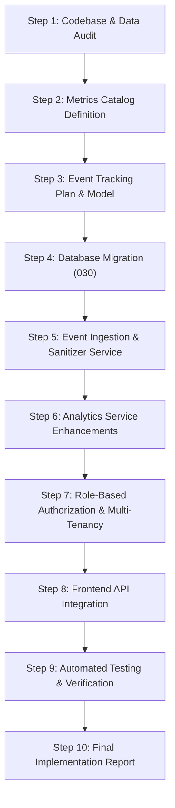

# OgroniEdu — Phase 14: Implementation Plan

## 1. Overview & Phased Roadmap

This plan outlines the architecture, database schema, service logic, API endpoints, privacy controls, and verification steps required to establish OgroniEdu's product analytics and retention system.

---

## 2. Work Breakdown Structure

### Step 1: Codebase & Data Source Audit
- Review existing data models across authentication, bookings, sessions, assignments, payments, reviews, and organizations.
- Identify derived metrics versus events requiring persistent telemetry.
- Document audit findings in `AUDIT.md`.

### Step 2: Product Metrics Catalog
- Formalize Acquisition, Activation, Discovery, Booking Funnel, Learning Engagement, Retention, and Revenue metrics.
- Establish exact formulas and safe division rules to prevent zero-denominator errors.
- Document catalog in `PRODUCT_METRICS_CATALOG.md`.

### Step 3: Event Tracking Plan & Analytics Data Model
- Define an allowlist of 15 stable product analytics events (`registration_started`, `tutor_search_performed`, `booking_confirmed`, etc.).
- Separate client-permitted interaction events from server-authoritative lifecycle events.
- Document schemas in `EVENT_TRACKING_PLAN.md` and `ANALYTICS_DATA_MODEL.md`.

### Step 4: Database Migration (Migration 030)
- Create `packages/database/src/migrations/030_product_analytics_events.sql`.
- Add compound indexes:
  - `(event_name, created_at DESC)`
  - `(actor_user_id, created_at DESC)`
  - `(entity_type, entity_id)`
  - `(session_id, created_at DESC)`
- Create view `v_daily_product_funnel`.
- Apply migration across local and cloud database instances.

### Step 5: Event Ingestion & Privacy Sanitizer
- Implement `TrackEventDto` with `CLIENT_PERMITTED_EVENTS` validation.
- Implement `sanitizeAnalyticsProperties()` utility stripping sensitive keys (`password`, `otp`, `token`, `card`, `phone`, `email`).
- Implement `EventTrackingService` with failure isolation (analytics failure never aborts business transactions).

### Step 6: Analytics Service Enhancements
- Implement `AnalyticsService.getFunnelAnalytics()` with 7-stage conversion and zero-result search tracking.
- Implement `AnalyticsService.getActivationAnalytics()` with Student, Guardian, and Tutor activation rates.
- Implement `AnalyticsService.getLearningEngagementAnalytics()` with session attendance and assignment submission/review rates.
- Implement `AnalyticsService.getOrganizationAnalytics()` with tenant isolation.

### Step 7: Controller & Authorization Security
- Update `AnalyticsController`:
  - `POST /api/v1/analytics/events` (`@Public()`)
  - `GET /api/v1/analytics/funnel` (`@Roles(...ADMIN_ROLES)`)
  - `GET /api/v1/analytics/activation` (`@Roles(...ADMIN_ROLES)`)
  - `GET /api/v1/analytics/learning` (`@Roles(...ADMIN_ROLES)`)
  - `GET /api/v1/analytics/organizations/:id` (Scoped to organization members or Admins)

### Step 8: Frontend API Integration
- Update `analytics-api.ts` with RTK Query hooks for the new endpoints.
- Ensure light-theme UI compliance and zero NaN display on empty data states.

### Step 9: Testing & Verification
- Author comprehensive unit tests in `apps/api/test/product-analytics-growth.spec.ts`.
- Verify input validation, event sanitization, zero denominators, and IDOR prevention.
- Run monorepo typecheck, lint, and test suites.

### Step 10: Release Documentation
- Author all remaining Phase 14 documentation files and synthesize final results in `IMPLEMENTATION_REPORT.md`.
