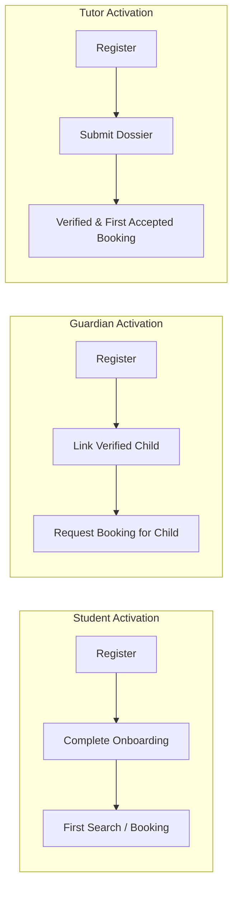
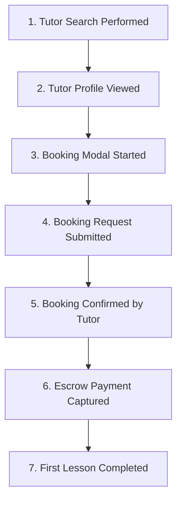

# OgroniEdu — Product Metrics Catalog

## 1. Overview & Measurement Standard

This catalog establishes the canonical definitions, formulas, underlying data sources, and interpretation guidelines for all product metrics in OgroniEdu.

Every metric is derived from real persisted records or first-party analytics events. All percentage calculations implement safe division (`(denominator || 1)` or explicit guard) to prevent `NaN` or division-by-zero crashes.

---

## 2. Acquisition Metrics

| Metric Name | Formula / Definition | Data Source | Interpretation & Target |
| :--- | :--- | :--- | :--- |
| **Registration Starts** | `COUNT(e.id) WHERE e.event_name = 'registration_started'` | `product_analytics_events` | Measures top-of-funnel visitor intent to create an account. |
| **Completed Registrations** | `COUNT(u.id) WHERE u.created_at BETWEEN start AND end` | `users` | Total users successfully created across Student, Guardian, and Tutor roles. |
| **Onboarding Completion Rate**| `(COUNT(u.id WHERE u.is_onboarded = true) / COUNT(u.id)) * 100` | `users` | Target: > 80%. Measures ease of initial onboarding wizard. |

---

## 3. Role-Specific Activation Metrics

Activation reflects the milestone where a newly registered user experiences the core value proposition of the platform.

### 3.1 Student Activation
- **Definition:** Registered student who has submitted at least one booking request or attended at least one learning session.
- **Formula:** `(COUNT(DISTINCT active_student_ids) / COUNT(registered_students)) * 100`
- **Data Source:** `users`, `bookings`, `booking_sessions`

### 3.2 Guardian Activation
- **Definition:** Registered guardian who has linked at least one verified child and submitted an eligible booking request for that child.
- **Formula:** `(COUNT(DISTINCT active_guardian_ids) / COUNT(registered_guardians)) * 100`
- **Data Source:** `users`, `guardian_student_links`, `bookings`

### 3.3 Tutor Activation
- **Definition:** Registered tutor whose profile is published, academic dossier is verified, and has accepted at least one booking inquiry.
- **Formula:** `(COUNT(DISTINCT active_tutor_ids) / COUNT(registered_tutors)) * 100`
- **Verification Rate:** `(COUNT(verified_tutors) / COUNT(registered_tutors)) * 100`
- **Data Source:** `users`, `tutor_profiles`, `bookings`

---

## 4. Tutor Discovery & Search Metrics

| Metric Name | Formula / Definition | Data Source | Interpretation & Target |
| :--- | :--- | :--- | :--- |
| **Total Searches** | `COUNT(e.id) WHERE event_name = 'tutor_search_performed'` | `product_analytics_events` | Volume of tutor search queries executed by prospective learners. |
| **Zero-Result Searches** | `COUNT(e.id) WHERE event_name = 'tutor_search_performed' AND properties->>'result_count' = '0'` | `product_analytics_events` | Identifies unmet supply in specific subjects, curricula, or districts. Target: < 10%. |
| **Zero-Result Rate** | `(zero_result_searches / total_searches) * 100` | `product_analytics_events` | High zero-result rates indicate tutor recruitment priorities. |
| **Search-to-Profile Rate** | `(profile_views / total_searches) * 100` | `product_analytics_events` | Measures relevance of search ranking and catalog filter quality. Target: > 35%. |

---

## 5. Multi-Stage Booking Funnel

The booking funnel evaluates progression across 7 distinct steps:

| Stage # | Stage Name | Data Source | Conversion Formula |
| :--- | :--- | :--- | :--- |
| **1** | **Tutor Search** | `product_analytics_events` (`tutor_search_performed`) | Baseline (100%) |
| **2** | **Profile View** | `product_analytics_events` (`tutor_profile_viewed`) | `(Profile Views / Searches) * 100` |
| **3** | **Booking Started** | `product_analytics_events` (`booking_started`) | `(Bookings Started / Profile Views) * 100` |
| **4** | **Request Submitted**| `bookings` (`total_requests`) | `(Requests Submitted / Bookings Started) * 100` |
| **5** | **Booking Confirmed**| `bookings` (`status IN ('confirmed', 'in_progress', 'completed')`) | `(Confirmed / Requests Submitted) * 100` |
| **6** | **Payment Captured** | `payment_orders` (`status = 'succeeded'`) | `(Paid Orders / Confirmed Bookings) * 100` |
| **7** | **Lesson Completed** | `booking_sessions` (`status = 'completed'`) | `(Completed Sessions / Paid Orders) * 100` |

---

## 6. Learning Engagement Metrics

| Metric Name | Formula / Definition | Data Source | Purpose |
| :--- | :--- | :--- | :--- |
| **Attendance Rate** | `(completed_sessions / (completed_sessions + no_show_sessions)) * 100` | `booking_sessions` | Measures lesson commitment; target: > 92%. |
| **Session Cancellation Rate**| `(cancelled_sessions / total_sessions) * 100` | `booking_sessions` | Measures lesson disruption; target: < 5%. |
| **Homework Submission Rate** | `(total_submissions / total_assignments) * 100` | `assignments`, `assignment_submissions` | Evaluates learner follow-through on homework. |
| **Homework Grading Rate** | `(reviewed_submissions / total_submissions) * 100` | `assignment_submissions` | Measures tutor timeliness in reviewing homework. |
| **Average Assignment Score** | `AVG(score)` | `assignment_submissions` | Academic achievement benchmark. |

---

## 7. Retention & Cohort Metrics

| Metric Name | Formula / Definition | Data Source | Purpose |
| :--- | :--- | :--- | :--- |
| **Learner Retention Rate** | `(repeat_learners_count / total_unique_learners) * 100` | `bookings` | Proportion of students who book >= 2 distinct tutors or courses. |
| **Loyal Learner Count** | `COUNT(student_user_id) WHERE booking_count >= 3` | `bookings` | Highly engaged power users for platform word-of-mouth. |
| **Tutor Repeat Booking Rate**| `(repeat_bookings_for_tutor / total_tutor_bookings) * 100` | `bookings` | Demonstrates tutor satisfaction and pedagogical effectiveness. |

---

## 8. Financial Health & Ledger Metrics

| Metric Name | Formula / Definition | Data Source |
| :--- | :--- | :--- |
| **Gross Merchandise Volume (GMV)** | `SUM(amount_minor) / 100 WHERE status = 'succeeded'` | `payment_orders` |
| **Net Processed Volume** | `GMV - Total Refunds` | `payment_orders`, `payment_refunds` |
| **Platform Commission Revenue** | `8% of completed session milestones (GMV * 0.08)` | Double-entry ledger (`ledger_entries`) |
| **Refund Rate** | `(Total Refunds / GMV) * 100` | `payment_refunds`, `payment_orders` |
| **Ledger Reconciliation Balance**| `Total Debits == Total Credits (Discrepancy == 0)` | `LedgerService.runReconciliation()` |
