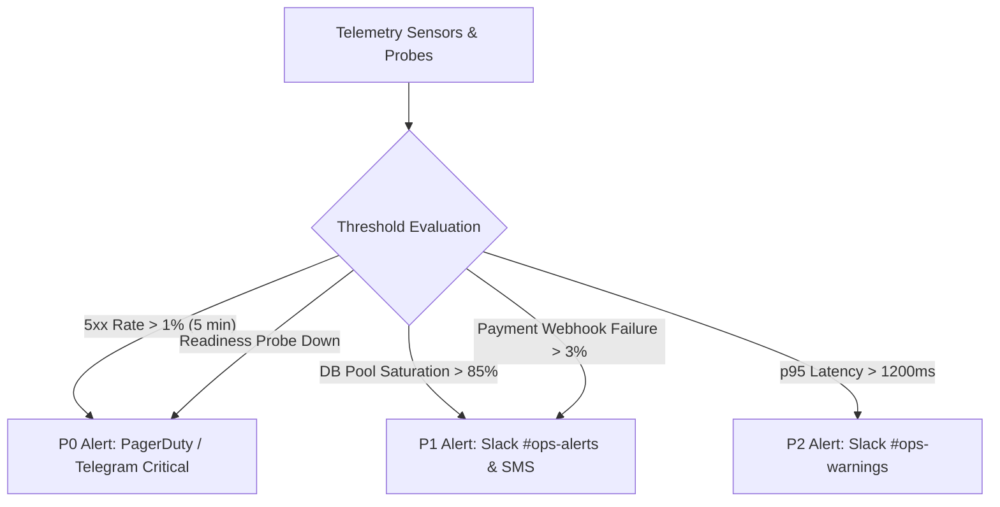

# OgroniEdu — Alerting & Incident Response Framework

## 1. Incident Classification & Severity Matrix

| Severity Level            | Definition                                                                                                                                             | Impact Scope        | Initial Response SLA | Escalation Target                |
| :------------------------ | :----------------------------------------------------------------------------------------------------------------------------------------------------- | :------------------ | :------------------- | :------------------------------- |
| **P0 — Blocker / Outage** | Complete platform unavailability, database failure, data corruption, or payment gateway breakdown preventing all transactions.                         | Platform-wide       | < 15 minutes         | Lead Architect, DevOps Lead, CTO |
| **P1 — Critical**         | Major feature impaired (e.g. tutor search failing, guardian booking confirmation disabled, emergency SOS alerting delayed). Workaround does not exist. | High (>20% users)   | < 30 minutes         | Backend Lead, Product Engineer   |
| **P2 — Major**            | Partial service degradation (e.g. latency spikes on analytics, minor delays in real-time typing indicators, localized report export timeouts).         | Medium (<20% users) | < 2 hours            | Feature Lead, On-Call Engineer   |
| **P3 — Minor**            | Cosmetic UI defect, non-blocking copy mismatch, localized localization typo, or non-critical admin metric display error.                               | Low / Isolated      | Next business day    | Assigned Developer               |

---

## 2. Automated Alert Rules & Thresholds

### Specific Alert Conditions:

1. **API Unhealthy Alert:** Triggered if `/health/readiness` fails for 2 consecutive 30-second windows across >30% of containers.
2. **Elevated 5xx Error Rate:** Triggered if HTTP 500/502/503 errors exceed 1.0% of total inbound requests in a 5-minute sliding window.
3. **Database Saturation:** Triggered if active database connections exceed 85% of pool capacity for >3 minutes.
4. **Payment Gateway Disruption:** Triggered if SSLCOMMERZ or bKash webhook IPN failure rate exceeds 5% in a 10-minute window.
5. **Safeguarding Emergency Trigger:** Triggered immediately upon any invocation of `/api/v1/safeguarding/sos-emergency` to alert on-duty safeguarding officers via SMS and high-priority push notifications.

---

## 3. Incident Response Lifecycle

### Stage 1: Triage & Acknowledgment

- On-call engineer acknowledges alert within SLA window.
- Create incident channel (e.g. `#inc-20261021-db-latency`) and incident log.
- Designate Incident Commander (IC).

### Stage 2: Containment & Mitigation

- Prioritize platform stability over diagnostic debugging.
- Execute rollback runbook (`DEPLOYMENT_RUNBOOK.md`) if incident correlates with a recent release.
- Enable Cloudflare "Under Attack" mode or rate limiting if DDoS is suspected.
- Isolate affected microservices or scale container replicas if load is the bottleneck.

### Stage 3: Root Cause Analysis & Remediation

- Analyze structured logs using correlation `requestId`.
- Inspect PostgreSQL slow query log and active lock table (`pg_stat_activity`).
- Implement and test targeted fix in staging environment before deploying to production.

### Stage 4: Post-Mortem & Blameless Review

- Author Post-Mortem Report within 48 hours of P0/P1 incident resolution.
- Document timeline, root cause, user impact, what went well, and what could be improved.
- Add regression tests to prevent recurrence.
