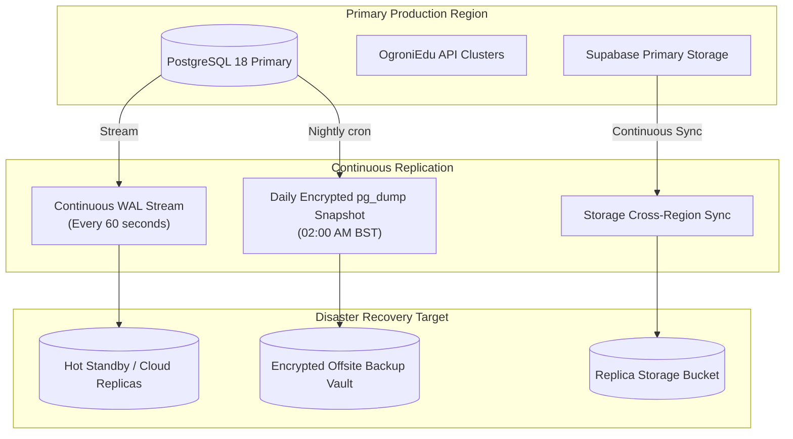
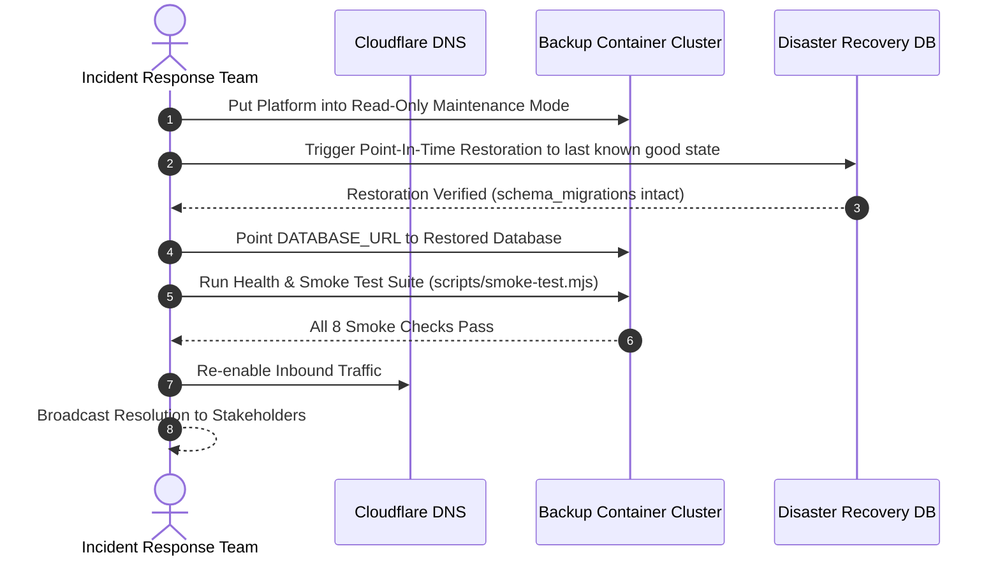

# OgroniEdu — Backup & Business Continuity / Disaster Recovery (BCDR)

## 1. Business Continuity Targets

| Metric | Target SLA | Strategy |
| :--- | :--- | :--- |
| **Recovery Point Objective (RPO)** | **< 5 minutes** | Continuous PostgreSQL Write-Ahead Log (WAL) archiving & multi-region replication. |
| **Recovery Time Objective (RTO)** | **< 30 minutes** | Automated container redeployment via Docker / Kubernetes + point-in-time database restoration. |
| **Availability Target** | **99.9% uptime** | Redundant container instances behind load balancer, zero-downtime rolling releases. |

---

## 2. Backup Strategy Architecture



---

## 3. Automated Backup Configuration

### 3.1 PostgreSQL Continuous Archiving & Snapshots
1. **Continuous WAL Archiving:** Enables point-in-time recovery (PITR) to any second within the retention window (7 days).
2. **Nightly Logical Dump:** Executed daily at 02:00 BST (20:00 UTC) via an isolated cron container using `pg_dump`:
   ```bash
   pg_dump "$DATABASE_URL" \
     --format=custom \
     --compress=9 \
     --no-owner \
     --no-privileges \
     --file="/backups/ogroniedu_$(date +%Y%m%d_%H%M%S).dump"
   ```
3. **Backup Retention Schedule:**
   - Hourly WAL segments: Retained for 7 days.
   - Daily snapshots: Retained for 30 days.
   - Monthly snapshots: Retained for 365 days (for compliance and financial auditing).

### 3.2 Object Storage Replication
- Verification dossiers, certificates, and safeguarding incident evidence stored in Supabase Storage are asynchronously replicated to an encrypted secondary bucket in a geographically separate data center.

---

## 4. Disaster Recovery Execution Plan

### Scenario: Primary Database Catastrophic Outage / Corruption



### Restoration Verification Drill Schedule
- **Quarterly Disaster Recovery Simulation:** The engineering team conducts a live restoration drill on an isolated staging database every 90 days.
- **Integrity Assertion:** A restoration drill is considered successful only if:
  1. The database restores within 20 minutes.
  2. All 29 migration entries in `schema_migrations` are verified.
  3. All 8 post-deploy smoke tests pass against the restored data.
