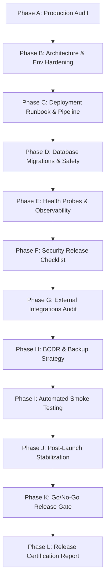

# OgroniEdu — Phase 13: Production Launch & Live Monitoring Implementation Plan

## 1. Objectives & Scope

The primary objective of Phase 13 is to audit the entire OgroniEdu platform, address operational gaps, implement hardened production probes, verify database schema integrity across cloud environments, formalize release runbooks, and provide an evidence-based Go/No-Go certification for public launch.

**Strict Production Safety Boundary:** No live production deployments, database writes to production customer data, real payments, or unsolicited communications may occur without explicit written authorization from the platform owner.

---

## 2. Phased Execution Roadmap

---

## 3. Work Breakdown Structure

### Phase A: Production Audit & Monorepo Inspection
- Review monorepo workspaces (`@ogroniedu/api`, `@ogroniedu/web`, `@ogroniedu/database`, `@ogroniedu/shared`).
- Audit package scripts, CI/CD pipelines, and runtime dependencies.
- Compile itemized findings matrix in `AUDIT.md`.

### Phase B: Production Architecture & Environment Configuration
- Document multi-tier production architecture in `PRODUCTION_ARCHITECTURE.md`.
- Formalize all environment variables in `ENVIRONMENT_CONFIGURATION.md`.
- Enforce strict environment validation via `apps/api/src/config/env.validation.ts`.

### Phase C: Deployment Runbook & Release Strategy
- Define blue/green and rolling release protocols in `DEPLOYMENT_RUNBOOK.md`.
- Detail zero-downtime deployment steps for container orchestrators.
- Establish rapid rollback procedures with defined SLA (< 5 minutes).

### Phase D: Database Migration & Recovery
- Audit 29 applied SQL migrations in `packages/database/src/migrations/`.
- Ensure transaction isolation and expand/contract migration compatibility.
- Document migration verification and recovery procedures in `DATABASE_MIGRATION_AND_RECOVERY.md`.

### Phase E: Health Probes & Observability
- Enhance `HealthController` to support both `/health/liveness` and `/health/readiness` (with `/api/health/*` reverse proxy aliases).
- Enforce truthful readiness reporting (503 on dependency failure in production).
- Formalize monitoring metrics, structured logs, and incident alerting in `HEALTH_CHECKS_AND_OBSERVABILITY.md` and `ALERTING_AND_INCIDENT_RESPONSE.md`.

### Phase F: Security Release Checklist
- Verify OWASP Top 10 compliance, input validation, rate limiting, and RBAC guards.
- Verify CSRF protection, secure cookie flags, and zero credential leakage.
- Compile security audit in `SECURITY_RELEASE_CHECKLIST.md`.

### Phase G: External Integrations Safeguards
- Verify SSLCOMMERZ and bKash sandbox configurations (`isSandbox: true`).
- Ensure webhook HMAC verification and idempotent transaction handling.
- Audit Supabase object storage and signed download URL expiration.

### Phase H: Backup and Disaster Recovery (BCDR)
- Define RPO (< 5 minutes) and RTO (< 30 minutes).
- Document WAL archiving, daily database snapshots, and restoration runbooks in `BACKUP_AND_DISASTER_RECOVERY.md`.

### Phase I: Automated Smoke Testing
- Upgrade `scripts/smoke-test.mjs` to execute 8 automated post-deploy verification tests.
- Implement programmatic Vitest smoke test suite in `apps/api/test/production-smoke.spec.ts`.
- Document all checks in `POST_LAUNCH_SMOKE_TESTS.md`.

### Phase J: Post-Launch Stabilization
- Define Day 0 to Day 14 operational surveillance schedule in `POST_LAUNCH_STABILIZATION_PLAN.md`.
- Establish error budget tracking and rapid hotfix deployment workflows.

### Phase K: Go/No-Go Release Gate Matrix
- Author exhaustive release gate evaluation in `GO_NO_GO_CHECKLIST.md`.
- Itemize pass/fail evidence across functional, performance, security, and financial criteria.

### Phase L: Final Implementation Report
- Execute complete monorepo verification suite (`pnpm test`, `pnpm typecheck`, `pnpm lint`, `pnpm docs:validate`).
- Present comprehensive release certification in `IMPLEMENTATION_REPORT.md`.

---

## 4. Quality Gates & Acceptance Criteria

| Quality Gate | Acceptance Threshold | Verified Tool / Command |
| :--- | :--- | :--- |
| **Monorepo Tests** | 100% pass rate (0 failures) | `pnpm test` (128 test files) |
| **Type Safety** | 0 TypeScript errors | `pnpm typecheck` |
| **Linting & Style** | 0 ESLint errors & warnings | `pnpm lint` |
| **Documentation Links** | 100% valid cross-document links | `node scripts/validate-documentation.js` |
| **Smoke Harness** | 8/8 smoke tests passing | `node scripts/smoke-test.mjs --target local` |
| **Production Safety** | Zero unauthorized live deployments | Policy enforcement |
