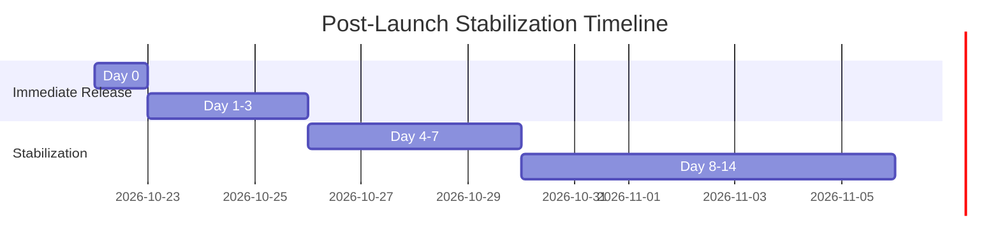

# OgroniEdu — Post-Launch Stabilization Plan

## 1. Post-Launch Operational Horizon (Day 0 – Day 14)

The 14-day post-launch stabilization window ensures immediate triage, rapid mitigation of edge cases, continuous performance tuning, and close monitoring of financial and safeguarding operations following production release.

---

## 2. Daily Stabilization Activities & Cadence

### 2.1 Day 0: Go-Live Execution & War Room

- **War Room Activation:** Lead architect, DevOps engineer, backend lead, and product owner on standby.
- **Continuous Log Streaming:** Monitor live error rates and WebSocket connection pool metrics.
- **Hourly Check-ins:** Review registration rates, OTP delivery success rates, and payment session conversions.
- **Financial Gateway Sanity:** Verify every completed payment session corresponds to an accurate ledger entry and unreleased escrow balance.

### 2.2 Days 1–3: Hypercare & Incident Triage

- **Twice-Daily Bug Scrub (10:00 BST & 18:00 BST):** Review feedback tickets submitted via the Beta/Launch Feedback widget (`/api/v1/feedback`).
- **Safeguarding Audit:** Confirm that 100% of emergency SOS or safeguarding reports are escalated without delay.
- **Database Query Performance:** Inspect PostgreSQL slow query logs for queries taking > 250ms and verify index utilization.

### 2.3 Days 4–7: Performance Tuning & Rapid Hotfix Cadence

- **Hotfix Pipeline SLA:** P0/P1 fixes committed and deployed within 4 hours; non-breaking P2 fixes batched daily.
- **Memory & Resource Leak Audit:** Monitor container memory heap graphs to ensure garbage collection is maintaining heap usage < 250MB.

### 2.4 Days 8–14: Platform Handover & SLA Normalization

- Hand over routine operations to standard maintenance schedules.
- Formalize retrospective on post-launch metrics.
- Transition feedback triage from war room to standard product roadmap queue.

---

## 3. Key Telemetry Metrics & Stabilization Targets

| Metric                        | Target Threshold | Critical Trigger | Responsible Team      |
| :---------------------------- | :--------------- | :--------------- | :-------------------- |
| **API Availability**          | **>= 99.9%**     | < 99.5%          | DevOps / Platform     |
| **HTTP 5xx Error Rate**       | **< 0.1%**       | > 0.5%           | Backend Team          |
| **p95 API Latency**           | **< 400ms**      | > 800ms          | Performance Team      |
| **Payment Success Rate**      | **>= 95%**       | < 90%            | Finance / Integration |
| **OTP Delivery Success**      | **>= 98%**       | < 95%            | Communications Lead   |
| **Realtime Gateway Uptime**   | **>= 99.9%**     | < 99.0%          | Realtime / WebSockets |
| **Safeguarding SOS Response** | **< 15 minutes** | > 30 minutes     | Trust & Safety Team   |

---

## 4. Rapid Hotfix Protocol

When a defect is identified during stabilization:

1. **Reproduce:** Add an automated unit or integration test reproducing the defect in `apps/api/test/` or `apps/web/`.
2. **Implement:** Apply minimal, isolated fix conforming to existing design patterns and TypeScript types.
3. **Validate:** Verify all 128 test files pass (`pnpm test`), type check passes (`pnpm typecheck`), and lint passes (`pnpm lint`).
4. **Deploy:** Deploy through automated CI/CD pipeline using the zero-downtime rolling runbook.
