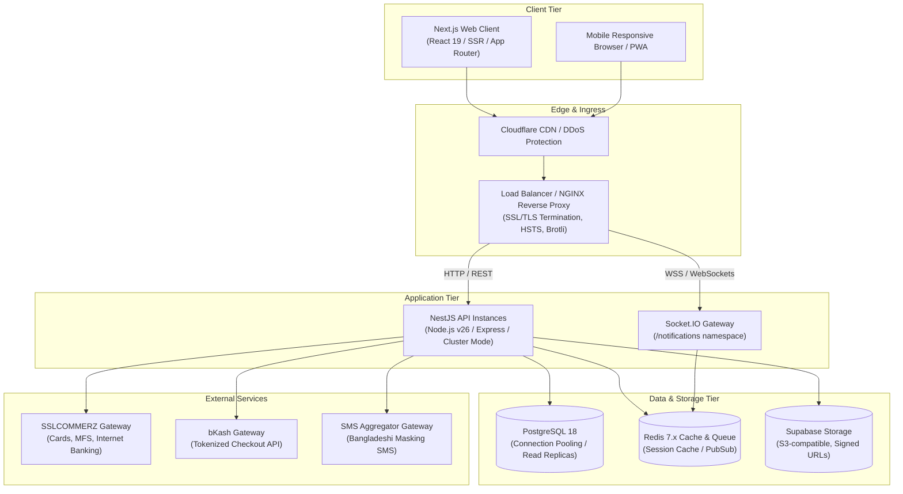
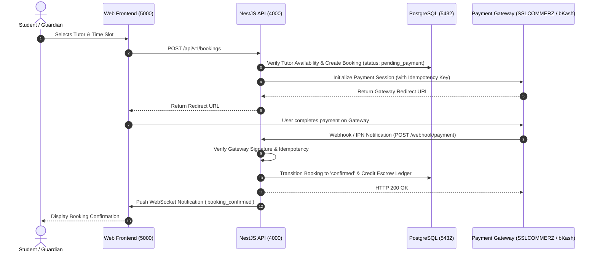
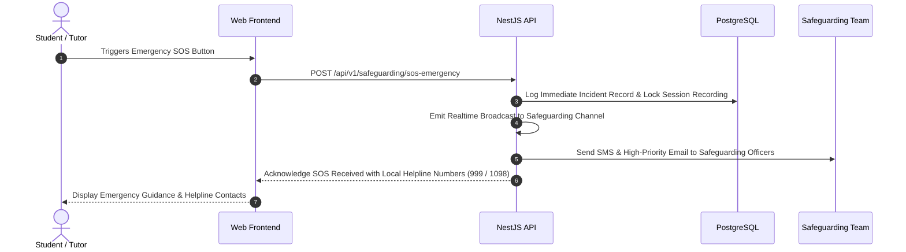

# OgroniEdu — Production Architecture Specification

## 1. System Topology Overview

OgroniEdu is designed as a modular, high-availability tutoring marketplace and learning management SaaS platform tailored for the Bangladesh education ecosystem.

---

## 2. Component Specifications

### 2.1 Frontend Application (`@ogroniedu/web`)
- **Technology:** Next.js 15.5.3, React 19, Tailwind CSS v4, Lucide React icons.
- **Port Allocation:** Port 5000 (Internal Docker container or Node service).
- **Theme Standard:** Strictly Light Theme (Royal Sapphire Blue `#2563EB` to Indigo `#4F46E5` primary gradient, slate backgrounds, pure white `#FFFFFF` cards, high-contrast accessible typography).
- **Rendering Strategy:** Static rendering for marketing/SEO pages (`/`, `/about`, `/tutors`), dynamic Server-Side Rendering (SSR) for personalized dashboards (`/dashboard`, `/sessions`, `/guardian`).
- **Security Headers:** Strict Content Security Policy (CSP), X-Frame-Options: DENY, X-Content-Type-Options: nosniff, Referrer-Policy: strict-origin-when-cross-origin.

### 2.2 Backend Application (`@ogroniedu/api`)
- **Technology:** NestJS 11.0.1, TypeScript 5.8, Express adapter.
- **Port Allocation:** Port 4000.
- **API Standard:** Envelope standard:
  - Success: `{ success: true, data: T, message?: string, meta: { requestId, pagination? } }`
  - Error: `{ success: false, error: { code, message, details? }, meta: { requestId } }`
- **Global Pipes & Interceptors:**
  - `ValidationPipe`: Whitelist, forbidNonWhitelisted, transform enabled.
  - `ResponseMetaInterceptor`: Injects `requestId` and execution metadata.
  - `AllExceptionsFilter`: Sanitizes 5xx errors; logs full server trace while hiding internals from clients.
  - `ThrottlerGuard`: Strict rate limiting (e.g. 100 req/min for general API, 5 req/min for auth OTPs).

### 2.3 Database Tier (`@ogroniedu/database`)
- **Engine:** PostgreSQL 18.
- **Connection Management:** Connection pool size 20–50 connections with SSL (`sslmode=require`).
- **Schema Management:** 29 sequential, idempotent SQL migrations with transactional safety (`schema_migrations` tracking table).
- **Data Integrity:** Foreign keys with `ON DELETE RESTRICT` for financial and booking records, composite indexes for search performance, and check constraints for domain integrity.

### 2.4 Realtime WebSockets Gateway
- **Technology:** Socket.IO v4.
- **Namespace:** `/notifications`.
- **Authentication:** JWT handshake validation before socket establishment.
- **Events Handled:** Real-time in-app notifications, booking chat messages, live typing indicators, session reminders, and safeguarding SOS alerts.

### 2.5 Object Storage
- **Provider:** Supabase Storage (S3-compatible).
- **Access Model:** Private buckets for identity verification dossiers, certificates, and safeguarding incident evidence. Public read-only bucket for tutor profile avatars.
- **Delivery:** Time-limited presigned URLs (15-minute expiration) generated on demand via `FilesService`.

---

## 3. Critical Workflow Request Paths

### 3.1 Student Booking & Escrow Payment

### 3.2 Live Session Safeguarding SOS Escalation

