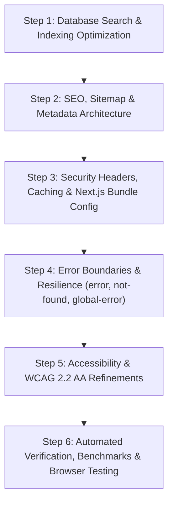

# Phase 10: Search, SEO, Performance, Accessibility & Production Readiness

## Implementation Plan

**Objective:** Upgrade OgroniEdu to enterprise production-readiness by optimizing search latency, implementing complete SEO & JSON-LD metadata, hardening HTTP security headers, establishing resilient error boundaries, and ensuring WCAG 2.2 AA accessibility.

---

## 1. Workstreams & Phases

---

## 2. Detailed Execution Steps

### Step 1: Database Migration `028` (Search & Performance Indexes)

- Enable PostgreSQL extension `pg_trgm`.
- Create GIN trigram indexes on `users(display_name)`, `tutor_profiles(headline, bio)`.
- Create partial btree index on `users(status)` WHERE `deleted_at IS NULL AND status = 'active'`.
- Create composite index on `tutor_qualifications(tutor_user_id, review_status, qualification_type)`.
- Create composite index on `tutor_profiles(publication_status, verification_status, safety_hold_status)`.
- Update `packages/database/test/bcdr-recovery.spec.ts` for migration 028 idempotency.

### Step 2: SEO, Dynamic Sitemap & Server Metadata

- Update `apps/web/src/app/robots.ts` with strict disallow directives for private dashboards, admin portals, messages, and payments.
- Implement dynamic `apps/web/src/app/sitemap.ts` to query public verified tutors and generate canonical URLs with `lastModified`.
- Refactor `[locale]/(public)/tutors/[id]/page.tsx` from purely client to Server Component with `generateMetadata`, generating rich OpenGraph, Twitter card, and `schema.org/Person` JSON-LD.
- Add `generateMetadata` and `schema.org/WebSite` JSON-LD to `[locale]/(public)/page.tsx` and `[locale]/(public)/tutors/page.tsx`.

### Step 3: Security Headers & Next.js Configuration

- Update `apps/web/next.config.js` with:
  - Strict Content-Security-Policy (CSP) headers.
  - `X-Frame-Options: DENY`, `X-Content-Type-Options: nosniff`.
  - `Referrer-Policy: strict-origin-when-cross-origin`.
  - `Permissions-Policy`.
  - Next.js Image `remotePatterns` configuration.
  - `optimizePackageImports: ['lucide-react', 'date-fns', 'clsx', 'tailwind-merge']`.

### Step 4: Error Boundaries & Resilience

- Create `apps/web/src/app/not-found.tsx` and `apps/web/src/app/[locale]/not-found.tsx`.
- Create `apps/web/src/app/[locale]/error.tsx` with error details, retry action, and bilingual copy.
- Create `apps/web/src/app/global-error.tsx` catching root-level hydration or layout crashes.

### Step 5: Accessibility & WCAG 2.2 AA Refinements

- Verify screen reader announcements (`aria-live="polite"`) for search result counts.
- Ensure focus visible indicators on all interactive controls.
- Ensure form validation errors are associated with `aria-describedby` and `aria-invalid`.

### Step 6: Testing & Quality Gates

- Full monorepo build (`pnpm turbo run build`).
- Full test suite execution across monorepo (`pnpm turbo run test`).
- Linter and TypeScript verification (`pnpm turbo run lint`, `pnpm turbo run typecheck`).
- Headful Chrome DevTools automated browser verification on public search, tutor profiles, error boundaries, and security headers.
