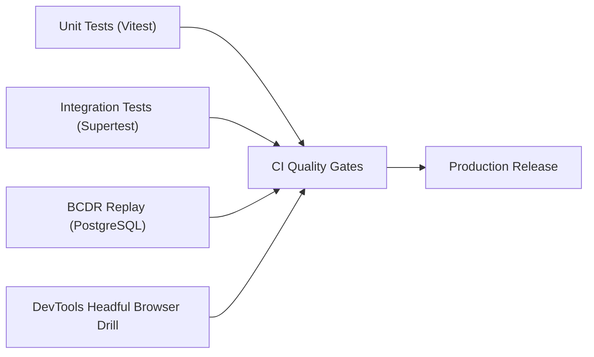

# Phase 10: Search, SEO, Performance, Accessibility & Production Readiness
## Comprehensive Test Plan

This document specifies the test cases, validation scripts, and automated quality gates required to verify Phase 10.

---

## 1. Test Suites & Verification Scope

---

## 2. Specific Test Cases

### 1. Search & Query Performance (`@ogroniedu/api`)
- **Query Validation:** Verify `minPrice <= maxPrice` validation and rejection of invalid sort parameters.
- **Eligibility Exclusions:** Verify suspended, safety-held, unverified, or private profiles are excluded from search results.
- **Trigram Keyword Search:** Verify queries on partial names and Bengali headlines match accurately.
- **Pagination Invariance:** Verify page 1 and page 2 have no overlapping results when sorted by `recommended` or `price_asc`.

### 2. SEO & Metadata Validation (`@ogroniedu/web`)
- **Server Metadata Generation:** Verify `generateMetadata` on `/tutors/[id]` returns title, description, and canonical URL.
- **Robots Disallow Enforcement:** Verify `robots.txt` forbids `/*/dashboard/*`, `/*/admin/*`, `/*/messages`, and `/*/payments`.
- **Dynamic Sitemap:** Verify `sitemap.xml` contains public URLs and excludes private dashboards.
- **Structured JSON-LD:** Verify valid JSON-LD on Home and Tutor details pages.

### 3. Security Headers & Caching
- **Header Emission:** Verify HTTP responses include `Content-Security-Policy`, `X-Frame-Options: DENY`, `X-Content-Type-Options: nosniff`.
- **Private Cache Isolation:** Verify authenticated dashboard requests include `no-store` or `private, no-cache`.

### 4. Accessibility & Error Resilience
- **Error Boundary Execution:** Verify `not-found.tsx` and `error.tsx` render branded fallback with working navigation.
- **WCAG Keyboard Nav:** Verify focus rings and screen-reader announcements on interactive filter elements.

---

## 3. Execution Commands & Pass Criteria

1. `pnpm turbo run test` — 100% pass across all packages.
2. `pnpm turbo run typecheck` — 0 errors.
3. `pnpm turbo run lint` — 0 warnings, 0 errors.
4. `pnpm turbo run build` — Clean production builds for Next.js (Turbopack) and NestJS.
5. `chrome-devtools-mcp` — Real-time headful browser verification of public search, SEO metadata, error boundaries, and security headers.
