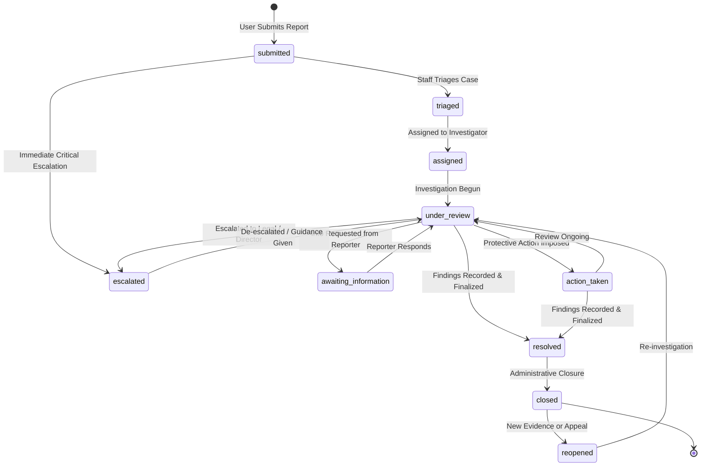

# Case Lifecycle and State Machine

**Document Identifier:** `STATE-SAFEGUARDING-001`  
**Platform:** OgroniEdu (অগ্রণী এডু)

---

## 1. Case State Machine Diagram

---

## 2. Transition Rules and Permissions

| From State | To State | Permitted Roles | Mandatory Requirement |
|:---|:---|:---|:---|
| `*` (Initial) | `submitted` | Any authenticated user | Valid description, category, and target context. |
| `submitted` | `triaged` | `support_agent`, `compliance_reviewer`, `admin`, `super_admin` | Confirms queue routing. |
| `submitted` | `escalated` | Automatic (server) or Staff | Critical severity or imminent danger. |
| `triaged` | `assigned` | `compliance_reviewer`, `admin`, `super_admin` | Assignee user ID; conflict-of-interest check passed. |
| `assigned` | `under_review` | Assigned investigator, `admin`, `super_admin` | Investigation starts. |
| `under_review` | `awaiting_information` | Assigned investigator, `admin`, `super_admin` | Message explaining what evidence/details are required. |
| `awaiting_information` | `under_review` | Reporter (via reply message) or Investigator | Response recorded. |
| `under_review` | `escalated` | Assigned investigator, `admin`, `super_admin` | Documented reason for senior/legal escalation. |
| `under_review` | `action_taken` | `compliance_reviewer`, `admin`, `super_admin` | Record of safety action (e.g. tutor safety hold). |
| `under_review` / `action_taken` | `resolved` | Assigned investigator, `admin`, `super_admin` | Documented resolution notes, outcome type, and formal findings. |
| `resolved` | `closed` | `compliance_reviewer`, `admin`, `super_admin` | Closure summary. |
| `closed` | `reopened` | `compliance_reviewer`, `admin`, `super_admin` | Justification explaining new evidence or appeal grounds. |

---

## 3. Durable Audit Invariant

Every status transition MUST be executed inside a database transaction alongside an entry in `safety_case_events`:
- Case updates CANNOT succeed without committing the corresponding `safety_case_events` record.
- Deleted or altered history is strictly prohibited.
