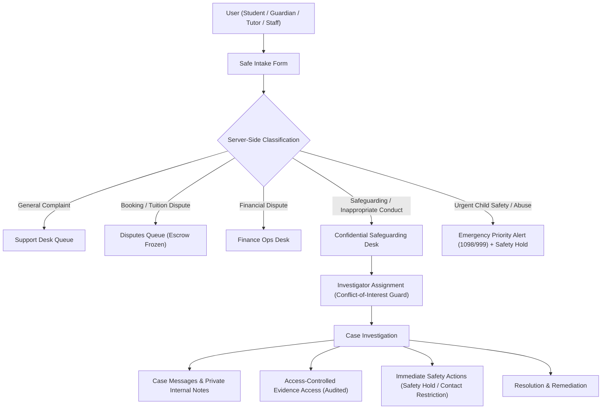

# Phase 07: Safeguarding & Complaint Management — Implementation Plan

**Document Identifier:** `PLAN-SAFEGUARDING-001`  
**Status:** Approved for Implementation  
**Platform:** OgroniEdu (অগ্রণী এডু)

---

## 1. Architectural Blueprint & Work Breakdown Structure

---

## 2. Work Breakdown Structure (WBS)

### Phase 7.1: Database Schema & Migration (Migration 025)
- Extend `safety_reports` with:
  - `assigned_to UUID REFERENCES users(id)`
  - `is_confidential BOOLEAN NOT NULL DEFAULT true`
  - `preferred_contact_method TEXT NOT NULL DEFAULT 'in_app'`
  - `incident_date TIMESTAMPTZ`
  - `conflict_user_ids UUID[] NOT NULL DEFAULT '{}'`
- Create table `safety_case_messages`:
  - `id UUID PRIMARY KEY DEFAULT gen_random_uuid()`
  - `report_id UUID NOT NULL REFERENCES safety_reports(id) ON DELETE CASCADE`
  - `sender_id UUID NOT NULL REFERENCES users(id) ON DELETE RESTRICT`
  - `message TEXT NOT NULL CHECK (length(message) >= 1)`
  - `is_internal_note BOOLEAN NOT NULL DEFAULT false`
  - `attachment_asset_ids UUID[] NOT NULL DEFAULT '{}'`
  - `created_at TIMESTAMPTZ NOT NULL DEFAULT CURRENT_TIMESTAMP`
  - `updated_at TIMESTAMPTZ NOT NULL DEFAULT CURRENT_TIMESTAMP`
- Create table `safety_case_events`:
  - `id UUID PRIMARY KEY DEFAULT gen_random_uuid()`
  - `report_id UUID NOT NULL REFERENCES safety_reports(id) ON DELETE CASCADE`
  - `actor_id UUID NOT NULL REFERENCES users(id) ON DELETE RESTRICT`
  - `event_type TEXT NOT NULL`
  - `from_status TEXT`
  - `to_status TEXT`
  - `reason TEXT`
  - `metadata JSONB NOT NULL DEFAULT '{}'`
  - `created_at TIMESTAMPTZ NOT NULL DEFAULT CURRENT_TIMESTAMP`
- Create table `safety_actions`:
  - `id UUID PRIMARY KEY DEFAULT gen_random_uuid()`
  - `report_id UUID REFERENCES safety_reports(id) ON DELETE SET NULL`
  - `target_user_id UUID NOT NULL REFERENCES users(id) ON DELETE RESTRICT`
  - `action_type TEXT NOT NULL CHECK (action_type IN ('tutor_safety_hold', 'contact_restriction', 'messaging_disabled', 'temporary_suspension', 'flagged_for_review'))`
  - `reason TEXT NOT NULL`
  - `applied_by UUID NOT NULL REFERENCES users(id) ON DELETE RESTRICT`
  - `expires_at TIMESTAMPTZ`
  - `revoked_at TIMESTAMPTZ`
  - `revoked_by UUID REFERENCES users(id) ON DELETE SET NULL`
  - `revocation_reason TEXT`
  - `created_at TIMESTAMPTZ NOT NULL DEFAULT CURRENT_TIMESTAMP`

### Phase 7.2: Backend Domain & Security Engine (`@ogroniedu/api`)
1. **Entities & DTOs:**
   - Map `SafetyCaseMessageEntity`, `SafetyCaseEventEntity`, and `SafetyActionEntity`.
   - Update `SafetyReportEntity` with relations and new columns.
   - DTOs: `CreateSafetyReportDto`, `AssignCaseDto`, `UpdateCaseStatusDto`, `CreateCaseMessageDto`, `ApplySafetyActionDto`, `RevokeSafetyActionDto`, `ResolveCaseDto`.
2. **Services & ABAC Enforcement:**
   - Extend `SafetyReportsService`:
     - Conflict-of-interest check: Rejects assignment or resolution if `actor.id === report.reportedUserId` or actor is in `report.conflictUserIds`.
     - Strict case-level authorization:
       - Accused party (e.g. reported tutor) cannot view confidential report or its evidence (HTTP 404/403).
       - Student cannot view other students' reports.
       - Guardian cannot view reports submitted by their child if marked `is_confidential = true`.
       - Support agent cannot access sensitive safeguarding cases unless explicitly assigned or granted `compliance_reviewer` role.
       - Organization owners cannot view confidential cases solely by virtue of organization tenancy.
     - Evidence download handler: Validates authorization before issuing signed/direct stream, audits access in `safety_case_events`.
     - Message handling: Enforces `isInternalNote = true` can only be read and created by authorized compliance/admin staff.
     - State transitions: Enforces state machine and persists immutable `safety_case_events`.

### Phase 7.3: Centralized Notification Privacy (`@ogroniedu/contracts`)
- Register notification events:
  - `case.submitted`
  - `case.assigned`
  - `case.status_updated`
  - `case.information_requested`
  - `case.escalated`
  - `case.resolved`
  - `safeguarding.urgent_review_required`
- Use generic, non-revealing notification templates that do NOT leak private allegations in email or push previews.

### Phase 7.4: Frontend Experience (`@ogroniedu/web`)
1. **Intake & Reporting:**
   - Accessible student/guardian intake form with category selection, booking/session picker, confidentiality disclosure, and hotline resources.
2. **Case Detail & Secure Messaging:**
   - Case dossier showing timeline, authorized updates, and messaging thread.
3. **Admin & Compliance Safeguarding Hub:**
   - Dedicated safeguarding queue with priority badges, conflict indicators, investigator assignment selector, internal notes tab, safety action triggers, and resolution modal.

### Phase 7.5: Automated Testing & Verification
- Unit & integration tests for classification, state machine, assignment, and conflict-of-interest guards.
- **12 Mandatory Authorization Security Tests**.
- **5 E2E Workflow Tests**:
  - Flow A: General complaint
  - Flow B: Confidential safeguarding report
  - Flow C: Urgent escalation
  - Flow D: Conflict of interest
  - Flow E: Financial dispute
- Monorepo quality gates (`typecheck`, `lint`, `test`, `build`).
- Chrome DevTools MCP visual inspection.
